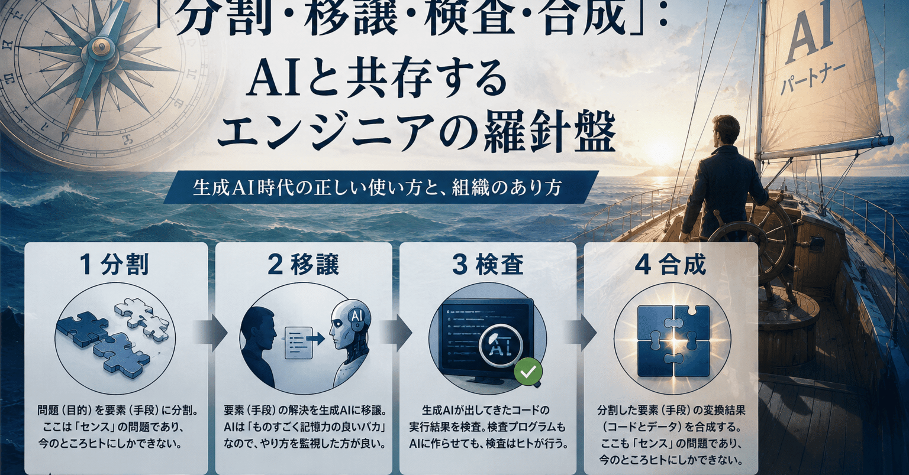

# ​「分割・移譲・検査・合成」：AIと共存するエンジニアの羅針盤

## プログラミングにおける生成AIの正しい使い方

## 分割

問題（目的）を要素（手段）に分割。ここは「センス」の問題であり、**今のところ**はヒトにしかできない。

## 移譲

要素（手段）の解決を生成AIに移譲。これは従来、チームリーダーがメンバーに対してやっていた部分。移譲先がヒトの熟練者なら移譲したらやり方に口を出さないのが正しいが、生成AIは

> ものすごく博識だが気の利かない新人

なので、やり方を監視した方が良い。

## 検査

生成AIが出してきたコードの実行結果を検査。検査プログラムもAIに作らせてもいいが、そのコードはヒトがしっかり解読して検査する。

## 合成

分割した要素（手段）の変換結果（コードとデータ）を合成する。ここも「センス」の問題であり、今のところヒトにしかできない。

---

## 実はこれ、そのまま「正しい組織のあり方」でもある。

#プログラミング  
#マネジメント  
#組織論  
#創作大賞2026  
#オールカテゴリ部門
