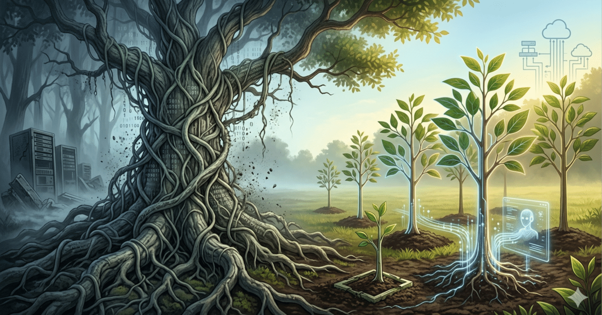

# システム延命の終焉：ストラングラーフィグの罠と生成AI時代の「使い捨て」戦略

システム延命の終焉：ストラングラーフィグの罠と生成AI時代の「使い捨て」戦略

ストラングラーフィグ（絞め殺しのイチジク）パターンという、一見合理的でリスクが低いとされる移行戦略は、現実の現場においては「永遠に終わらない二重管理」という地獄の入り口に過ぎない。このパターンの致命的な欠陥は、宿主となる古い木の構造をなぞって成長せざるを得ない点にある。元のシステムの歪んだデータ構造や不自然なドメイン境界をそのまま引き継げば、誕生するのは最新技術で着飾っただけの「モダン・レガシー」であり、結局は過去の設計判断という呪縛から逃れることはできない。

そもそも、多くの古いシステムは単一の目的ではなく「似て非なる」多数の目的が混在し、癒着している。これらを一つの巨大なイチジクで包み込もうとする調整コストは、組織の忍耐力を容易に超える。真に合理的な解決策は、別の場所に一本ずつ、あるいは複数のチームで並行して「新しい苗」を植え、独立した木を育てることだ。これにより、組織の問題を個人の努力や忍耐で解決するという不毛な構図を避け、設計の純度を最短距離で取り戻すことが可能になる。

特に生成AIが普及した現代において、システムの価値観は「保守」から「置換」へと完全にシフトした。他人が書いた複雑なコードを解読するコストが、AIによって「今の要件で作り直す」コストを上回った今、すべてのシステムは「使い捨て」を前提に設計されるべきである。疎結合な通信さえ担保されていれば、内部構造の寿命を無理に延ばす必要はない。過去の構造をなぞる「延命」を捨て、役目を終えたシステムをいつでも焼き払い、新しい苗を植え替え続けるサイクルこそが、結果として最も安上がりで強靭なシステムを生むのである。
