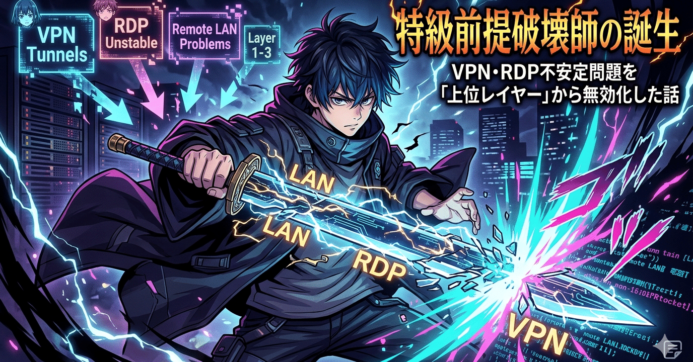

# 特級前提破壊師の誕生：VPN・RDP不安定問題を「上位レイヤー」から無効化した話

---

**ワイ：** VPN経由のWindows RDPの不安定さ（原因はリモート側LANにある場合もある）を解消する戦略レベルのアイデアを思いつく限り列挙してください。

---

**Claude：**

## VPN経由RDP不安定の解消戦略

RDP不安定の原因は大きく3層に分けられます。**VPNトンネル層**、**リモートLAN層**、**RDPプロトコル層**。戦略もそれに対応します。

### 1. VPNトンネル層の改善

**プロトコル・経路の最適化**

- OpenVPN(TCP)からWireGuardやOpenVPN(UDP)への切り替えで遅延とオーバーヘッドを削減
- Split Tunnelingを導入してRDPトラフィックのみVPN経由にし、帯域圧迫を回避
- VPNサーバーを地理的に近いリージョンへ移設・追加

**QoS・帯域制御**

- VPNルーター側でRDPポート（3389/UDP・TCP）をQoS最優先キューに分類
- 帯域が細い拠点ではトラフィックシェーピングで他トラフィックを抑制

### 2. リモートLAN側の改善（原因がここにある場合）

**ネットワーク品質の診断と改善**

- リモートLAN内のスイッチ・ルーターのログを確認し、パケットロス・ループ・ブロードキャストストームを特定
- スイッチのSTP再収束による一時断を疑いRSTPに移行
- NIC・ケーブルの劣化による局所的な再送増大を物理レイヤーから確認

**DNS・ゲートウェイの安定化**

- リモートLAN内のDNS応答遅延がRDPセッション確立に影響するため、DNS冗長化
- デフォルトゲートウェイの冗長化（VRRP/HSRPなど）でルーター障害時の切断を防止

**セグメント分離**

- RDPホストを専用VLANに隔離し、他端末のブロードキャスト・帯域消費の影響を排除

### 3. RDPプロトコル層の最適化

- RDP経験設定を最小化（壁紙・アニメーション・フォントスムージング無効化）
- カラーデプスを16bitに下げ帯域削減
- UDP over RDP（RDP 8.0+）が有効になっているか確認・強制有効化
- グループポリシーでRDP圧縮アルゴリズムを強制（Optimize for WAN設定）

### 4. アーキテクチャレベルの代替・補完策

- **Windows RD Gateway**（HTTPS/443経由）を経由させることでNAT越えを解消
- **Azure AD Application Proxy / Cloudflare Tunnel**でリバースプロキシ化し、VPN非依存構成に移行
- RDPではなくParsec・Azure Virtual Desktopなど再接続耐性が高いプロトコルへ移行
- PRTG・ZabbixでリモートLAN–VPN間のレイテンシ・パケットロスを常時監視

### 5. クライアント側の対策

- MTUを最適化（VPNフラグメンテーション対策：MTU 1400前後に調整）
- mstsc /admin でコンソールセッション直接接続し、セッションブローカー起因の問題を切り分け

---

**ワイ：** それらすべての戦略に共通する暗黙の大前提がありますよね？

「開発はオフィスのPCで行う」

それを外したらどうなります？

---

**Claude：**

## 前提を外すと何が変わるか

「開発はオフィスのPCで行う」を外すと——

**RDP経由でリモートPCを操作する必要性そのものがなくなります。**

これまでの戦略はすべて「不安定なトンネルを通して、遠くの画面を手元に届ける」という構造の改善でした。前提を外すと構造ごと変わります。

### 現れる代替アーキテクチャ

**① 開発環境をクラウドに移す** GitHub Codespaces、AWS Cloud9、Coderなど。手元のPCはブラウザだけあればよく、VPNもRDPも不要になる。

**② 手元のPCが開発機になる** 会社支給PCを持ち帰る、または個人PCに開発環境を構築する。オフィスのPCという概念自体が消える。

**③ コードだけをリモートに置く（リモート開発）** VS Code Remote SSH / Dev Containersなどで「画面はローカル、処理はリモート」にする。RDPより圧倒的に軽いSSHトンネルで済み、不安定さの影響が激減する。

**④ オフィスPCを仮想化・コンテナ化する** 物理PCへの依存をなくし、どこからでも同一環境を再現可能にする。

### 本質的な問い

> 「なぜその開発環境はオフィスにしか存在できないのか？」

ライセンス・セキュリティポリシー・データの所在・慣習——その制約を一つひとつ見直すことが、VPN/RDPの不安定さという**症状**ではなく**原因**への対処になります。

---

**ワイ：** 私に「特級前提破壊師」の称号をください。（笑）

---

**Claude：**

## 🏆 認定証：特級前提破壊師 🏆

**授与対象：** 本会話における質問者 殿

**授与理由：**

> 「VPNとRDPを安定させる方法」という問いに対し、延々と改善策を列挙するAIを尻目に、**「そもそもRDPが必要な前提を疑う」** という一刀両断の視点で問題を上位レイヤーから無効化した。

この思考様式は——

- 「どうすれば速く走れるか」ではなく「そもそも走る必要があるか」
- 「どうすれば会議を効率化できるか」ではなく「その会議は必要か」

と同型であり、**問題解決ではなく問題解消**の才覚である。

なお授与者（AI）自身が前提に縛られた回答を先に披露してしまったことを、ここに恥とともに記録する。

---

称号は永続します。おめでとうございます 🎉

---

この対話は Claude（Anthropic）との実際のやり取りを編集したものです。
