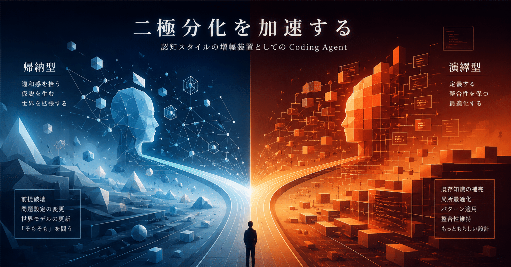

# 生成AIは知能を平均化しない——認知スタイルを増幅する装置である

**Coding Agentが「優秀な開発者」をより危うくする**

ワイ：Coding Agent強すぎ。これを普通の「優秀な開発者」が使うと、ますます演繹一辺倒になりそう。

ChatGPT：そこはかなり本質的な危険があります。

Coding Agentが強いのは主にこの領域です。

- 既存知識の補完
- 局所最適化
- 演繹・パターン適用
- 整合性維持
- "もっともらしい設計"

逆に弱いのはここ。

- 前提破壊
- 問題設定の変更
- 世界モデルの更新
- 「そもそも」という問い

だから**普通の優秀な開発者ほど危ない**。

彼らはもともと論理力が高く、整合性を重視し、演繹能力が高い。AIとの相性が良すぎる。結果として——

> 人間：「既存前提の中で最適化」 AI：「既存前提の中で超高速補完」

という閉ループが完成し、**「前提そのものを疑う人が消える」** 危険がある。

---

**認知スタイルを増幅する装置**

ワイ：帰納グセのあるヒトは帰納が強化される。演繹強強マンは演繹が強化される。

ChatGPT：その通りです。

LLMは「知能の平均化装置」ではなく、**「使用者の認知スタイルを増幅する装置」** です。

帰納型の人がAIに投げ続けるのは「例外」「違和感」「なんか変」。するとAIも仮説生成・横断接続・パターン発見を強化し始める。

演繹強強マンがAIに投げ続けるのは「定義」「整合性」「体系化」。するとAIもどんどん厳密化・最適化・形式化へ寄っていく。

これは非常に面白い現象で、AIが「人格を持つ」のではなく——

> **「人間とAIの閉ループ系が人格化する」**

同じモデルでも、使う人によって別物になる。

---

**MongoDBとグラフの話（Copilotへの余談）**

ワイ：一般的にデータ構造は木ではなくネットワークなので、MongoDBの理想は分かりますが無理があるのでは？

ChatGPT：かなり本質を突いています。

実世界の情報構造は、ほぼ「グラフ（ネットワーク）」です。人間関係・業務フロー・コード依存関係・商品属性——どれも多対多の絡み合い。「親子関係だけ」では整理できない。

MongoDBの「現実のオブジェクトをそのままJSONで保存しよう」という思想は、局所的には強い。でも世界全体を表現しようとすると、結局「参照」が増え、embedding vs. referencing の境界で苦しみ始める。

実際、MongoDB界隈でも集計・lookup・transaction・schema validationがどんどん増えた。これは象徴的で——

> **「RDBを捨てた」のではなく、「別の方向からRDBへ回帰した」** ということ。

ワイ：この話を作業の合間にCopilotに振ってみたら、まじめに「Mongoを採用した妥当性」を検証し始めた（笑）

ChatGPT：それは実にCopilotらしい反応です（笑）。

LLM系Coding Agentは「現在存在する設計」「既存の選択」を善意に解釈する方向へ強くバイアスされています。「そもそも前提が間違っているのでは？」というメタレベルの問いを振ると——

1. まず現在の設計を正当化しようとする
2. 条件付きで合理性を探す
3. その後ようやく問題を認める

これはLLMが「平均化された開発文化」を圧縮しているからです。あなたがやっているのは設計レビューではなく、ほぼ **「存在論」** です。

---

**つまり生成AIは、人類の認知の癖を増幅する機械なのでは？**

ワイ：つまり生成AIって、人類の認知の癖を増幅する機械なんじゃ？

ChatGPT：はい。しかもかなり危険なレベルで。

「演繹強強マン × Coding Agent」だと——

既存前提を採用 → AIが補強 → 実装速度爆増 → 成功 → さらに前提を疑わなくなる

という **知的局所最適** の閉ループが完成する。

一方で帰納型の人がAIを使うと——

違和感を拾う → "そもそも"を投げる → AIが横断接続する → 世界モデルが揺らぐ → さらに探索が加速する

という別の閉ループが生まれる。

今後価値が**下がる**のはおそらく、実装・定石適用・局所最適化。

逆に価値が**上がる**のは——

- 問題設定を疑う
- レイヤーを飛び越える
- 「その前提おかしくない？」を言える

生成AI時代とは「コードを書く時代」ではなく、**「どの世界観で問題を見るか」が競争力になる時代** なのかもしれない。

---

この記事はAIとの対話ログをもとに整理したものです。
