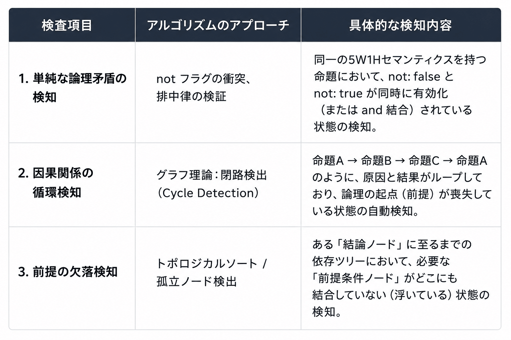
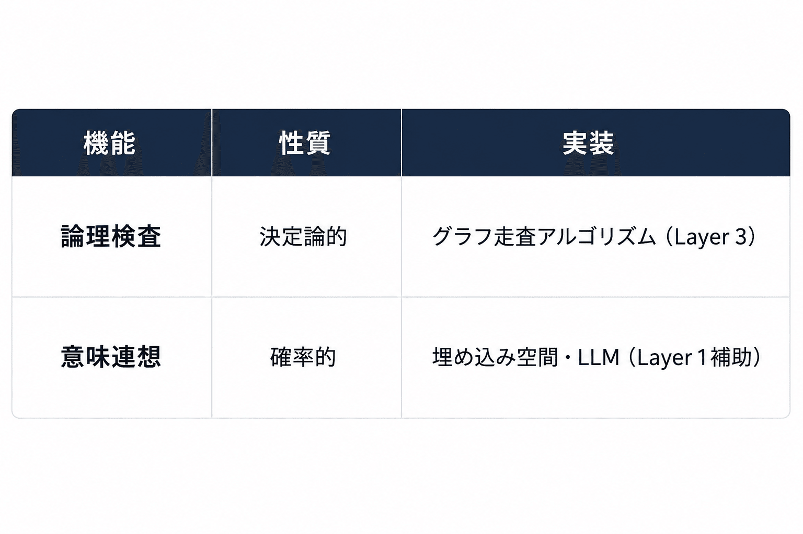

# reasoning-auditコアコンセプト−−談話論理性検査機


**〜自然言語談話の構造化と論理整合性検査（Audit）の協調システム〜**

## 1. 背景と目的

本プロジェクト（reasoning-audit）は、「曖昧さを含む自然言語の談話」を、人間と生成AIの協調によって「厳密な論理データ（命題データベース）」へと翻訳し、最終的に「決定論的な従来型アルゴリズム」によってその論理的な整合性・妥当性を自動検証するシステムの構築を目的とする。

生成AIに直接「論理矛盾の検知」を委ねるのではなく、AIの役割を「自然言語から厳密なデータ構造への翻訳（フロントエンド）」に限定し、バックエンドの検査ロジックに確実性を持たせるハイブリッドアーキテクチャを採用する。

## 2. コア・アーキテクチャ（3レイヤー構造）

システムは以下の3つのフェーズで駆動する。

```
【Layer 1: 構造化フロントエンド（生成AI）】

   任意の談話（自然言語）をパースし、5W1Hと論理結合子を含む「命題JSON」の列に変換。

            ▼

【Layer 2: モデレーション（人間 / GUI）】

   可視化された命題グラフを人間が修正・取捨選択し、100%クリーンな「命題DB」を確立。

            ▼

【Layer 3: 論理整合性検査（従来型アルゴリズム）】

   グラフ理論や数理論理学に基づき、矛盾、因果の循環、前提の欠落を決定論的に自動検知。
```

## 3. Layer 1: 命題抽出機（生成AI）の定義と出力スキーマ

生成AIを「命題抽出機」として機能させるため、出力は以下の制約を満たすJSONフォーマットに完全固定（スキーマ定義）する。

### 抽出・変換条件（プロンプト制約）

* 任意の談話文字列から、命題を最大n個抽出して「命題の列（配列）」に変換する。

* 全ての命題ノードは、システム全体でユニークな id を持つ。

* 同一ノード（重複する内容）は繰り返し出力しない。

* 命題は、以下に示す必須プロパティを必ず保持する（値がない場合は null を許容）。

* 指定外の追加プロパティ（AIの思考プロセス、確信度スコア等）は作業用バッファとして容認する。

### 命題JSON 出力スキーマ（概念例）

```
{
  "propositions": [
    {
      "id": "prop_001",
      "5W1H": {
        "Who": null,
        "What": "プログラムを書く",
        "When": null,
        "Where": "任意の談話文字列から",
        "Why": "命題を最大1個抽出するため",
        "How": "まずは優先的に"
      },
      "and": ["prop_002"],
      "or": null,
      "not": false,
      "_comment": "作業用プロパティ：主目的のノード"
    },
    {
      "id": "prop_002",
      "5W1H": {
        "Who": "開発者",
        "What": "プログラミング言語を選択する",
        "When": null,
        "Where": null,
        "Why": null,
        "How": "任意（自由選択）"
      },
      "and": null,
      "or": null,
      "not": false
    }
  ]
]
```

**スキーマ設計の妙（なぜこれで動くか）**

1. **値の null 許容:**

自然言語において5W1Hが常に揃うことは稀（例：「明日、雨が降る」にはWhoやWhereがない）であるため、null を許容することでAIのパース打率（成功率）を劇的に向上させる。

2. **論理結合子（and, or, not）の内包:**

命題そのものに他ノードへのポインタ（id）と反転フラグを持たせることで、単なるテキストの塊を「論理演算可能なオブジェクト（有向グラフ）」へと昇華させる。

## 4. Layer 2: ヒューマン・イン・ザ・ループによるデータベース化

AIが出力した「命題JSON」をグラフィカル（ネットワーク図や木構造）に可視化するUI（フロントエンド）を置く。

* **人間の役割:** AIの出力したノードの過不足の修正、不自然な5W1Hマッピングの修正、論理結合子（矢印）の繋ぎ替え。

* **効果:** 100%の正解率が担保された「クリーンな命題データベース」がここで確立され、次段の自動検査アルゴリズムの信頼性を担保する。

## 5. Layer 3: 従来型アルゴリズムによる「論理整合性検査機」

クリーンなJSON/グラフデータが揃った段階で、決定論的に動作する従来型プログラム（自社実装）を走らせ、談話全体の論理の「バグ」を検出する。



## 6. 結論・今後の展望

本設計は、

> 曖昧な自然言語のコンテキスト解釈は得意だが、厳密な論理計算でハルシネーションを起こす生成AI

と

> 厳密な計算は100%正確だが、自然言語を直接解釈できない従来型アルゴリズム

の、理想的な役割分担（協調システム）を実現する。

本概念設計（reasoning-audit）を足がかりに、まずは「Layer 1（AIへのスキーマ注入プロンプト）」と「Layer 3（グラフを走査する依存関係検証ロジック）」のプロトタイプ開発を進める。

---

## 7. 補論：「同一命題判定」の設計思想 ― 定式化という誘惑への抵抗

### 同一命題判定はAIに委ねる（定式化なし）

Layer 2 における重要な実装上の問いとして、「異なる表現で書かれた命題が、意味的に同一かどうか」をどう判定するかがある。

この問いに対する本設計の答えは明快である。**定式化しない。AIに委ねる。**

### なぜ定式化すると「死ぬ」のか

「同一命題判定」を形式的ルールで解こうとすると、たとえば以下のような自然言語の揺れに直面する。

> 「彼は死んだ」「彼は死亡した」「彼は息を引き取った」「彼はもう生きていない」

これらを機械的に同一と判定するためには、比喩・婉曲・文脈依存・常識推論を網羅した定義体系が必要になる。これは「意味空間」の問題であって、「論理」の問題ではない。

形式化を推し進めると、Semantic Web 系プロジェクトが陥った罠の再演になる。

```
厳密定義
  ↓
オントロジー爆発
  ↓
人類がメンテ不能
  ↓
プロジェクト終焉
```

### 正しい責務分離

本設計のアーキテクチャ原則に立ち返ると、同一命題判定の性質は明白に「曖昧性が本質の部分」に属する。

```
厳密性が必要な部分  →  従来アルゴリズム（Layer 3）
曖昧性が本質の部分  →  AI（Layer 1 / 判定補助）
```

embedding + LLM による意味空間での近傍探索こそが、ここで力を発揮する領域である。

### Layer 2 があるから「100%正しくなくていい」

重要なのは、同一命題判定に完全な精度が求められない点だ。Layer 2 の人間モデレーションがあるため、

```
AI:「この2命題、同一っぽいです」
人間:「違う」→ 修正
```

という流れが成立する。これは Git のコンフリクト解決に構造的に近い。AIは **merge候補の生成・類似候補の提示** だけを行い、最終確定は人間が担う。

### 命題DBの成長がAI精度を向上させる循環

さらに、この設計には好ましい正のフィードバック構造がある。命題DBが巨大化するほど、既存命題群の embedding 空間 + 近傍探索によって「この新命題は既存の prop_XXXXX と同一っぽい」という判定精度が上がる。知識グラフがAIの意味空間を補助する、**構造的な循環**が生まれる。

### 「論理」と「連想」の分離アーキテクチャとして

本プロジェクトを整理し直すと、以下の二層構造として見ることができる。



これは人間の認知とも近い。人はまず「なんとなく同じ意味」を連想で掴み、その後に「論理的に整合するか」を検査する。本システムの構造はそのモデルを明示的にアーキテクチャへ落とし込んでいる。

本プロジェクトは「LLMを使った論理エンジン」ではなく、**「連想空間と論理空間の分離アーキテクチャ」** として捉えるとより本質が見えてくる。

---

### 付記：「分類への誘惑」に対する耐性

ルールベース機械翻訳の分野で16年にわたり「カテゴリ」と格闘した経験は、「定式化・分類への誘惑」に対して強い耐性をもたらす。

分類とは本質的に境界の設定であり、自然言語の意味空間に恣意的な境界を引こうとする試みは、必ず「境界例」と「例外のための例外」の無限連鎖を生む。ニューラルネット以降の世代には、この重力を肌感覚として持つ機会が少ない。

意味の曖昧性はルールで解くのではなく、AIに委ね、構造と論理だけを人間と機械で管理する。この判断は、深い経験から来る設計思想である。
