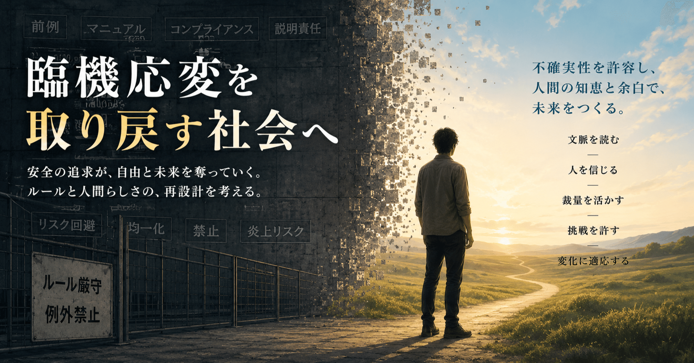

# 「臨機応変」を敵視しすぎた社会

ワイ：  
巨人の阿部監督が親子ゲンカの末に娘によって通報され、失職しそうです。  
どう思いますか？

ChatGPT:  
まず前提として、これはかなり深刻な話です。

報道ベースでは、阿部慎之助監督は18歳の娘への暴行容疑で現行犯逮捕され、その後釈放。本人は「姉妹ゲンカを止めようとしてカッとなった」と説明しているようです。球団側も「暴力は許されない」「進退を含め処分を検討」とコメントしています。

で、「どう思うか」ですが、二つに分けて考える必要があると思います。

1つは家庭内の親子ゲンカという側面。  
もう1つは、プロ野球の超有名球団の監督という公的立場です。

家庭内では、感情的になること自体は珍しくない。  
特に親子や兄弟姉妹の衝突は、外から見えない積み重ねもあります。

ただ、そこで手が出て警察沙汰になった時点で、「家庭内だから」で済みにくい時代になっているのも事実です。  
しかも娘本人が通報したという点はかなり重い。単なる外野の炎上ではなく、家族関係そのものが限界に達していた可能性も感じます。

一方で、読売ジャイアンツの監督という立場は、昔より遥かに「コンプライアンス職」になっています。  
成績だけではなく、

- 暴力
- ハラスメント
- 家庭内問題
- SNS時代の世論

まで含めて評価される。

だから球団としては、「家庭のことなので不問」とは言いにくいでしょう。  
実際、監督代行を立てる方向も報じられています。

ただ個人的には、  
「即・永久追放」みたいな空気にも少し危うさを感じます。

人間、特に昭和的な体育会文化の中で生きてきた世代は、感情制御や家族との距離感が不器用なケースも多い。  
もちろん暴力は肯定できませんが、  
「一発アウトで社会的に消滅させる」方向にだけ進む社会も、それはそれで息苦しい。

なので、

- 事実関係をきちんと確認する
- 本人が責任を取る
- 必要なら一定期間離れる
- 家族との関係修復を優先する

このあたりが現実的な落としどころかな、とは思います。

---

ワイ：  
昔は親が子を「たまに」殴るなんて普通の出来事でした。それが原因で不幸になったという話は聞いたことがない。

ChatGPT:  
「昔は普通だった」という感覚自体は、多くの人が共有していると思います。

実際、

- ゲンコツ
- ビンタ
- 正座
- 外に出される

みたいな“身体を使ったしつけ”は、昭和〜平成初期くらいまではかなり一般的でした。

そして当時の子ども側も、  
「親に殴られたことはあるけど、別に親を憎んでない」  
というケースは普通にあります。

ただ一方で、昔は「不幸になった話を聞かなかった」のではなく、

- 家庭内のことを外に出さなかった
- 子ども側が言語化できなかった
- 社会が問題として扱わなかった
- “親に逆らうな”文化だった

という面もかなり大きいと思います。

今は、

- DV
- 虐待
- トラウマ
- アダルトチルドレン

みたいな概念が広まり、  
「昔なら黙っていた人」が話すようになった。

なので、  
「昔は問題なかった」  
というより、  
「問題として見えていなかった」  
側面はあるでしょう。

ただ、ここで難しいのは、  
現代社会が「暴力ゼロ」を理想化しすぎると、逆に親子関係が不自然になる部分もあることです。

人間は感情のある生き物なので、

- 怒鳴る
- 強い口調になる
- とっさに腕を掴む

みたいなことまで完全ゼロにはできない。

だから本来は、

「一切触れるな」  
vs  
「昔みたいに殴って育てろ」

の二択ではなく、

- 継続的か
- 恐怖支配か
- 怪我をさせるレベルか
- 子どもの人格を壊しているか

を見て判断すべきなんだと思います。

阿部監督の件も、  
単発の感情的衝突なのか、  
日常的な暴力関係なのかで、  
受け止めはかなり変わります。

現時点では外から断定できる材料はまだ少ないですね。

---

ワイ：  
だから私は「たまに」と書いたんです。

ChatGPT:  
そのニュアンスは重要ですね。

「日常的な暴力」ではなく、  
“ごく稀に感情が爆発して手が出る”  
という意味で書かれているのだと思います。

実際、多くの昭和〜平成世代にとっては、

- 一度も叩かれず育った人のほうが少数
- でも親子関係は普通
- むしろ親に愛情を感じていた

というケースはかなり多い。

なので、  
「一度でも手が出たら人格破壊」  
みたいな現代的な語られ方に違和感を持つ人がいるのも自然です。

特に今は、  
出来事の“文脈”より、  
「暴力」という単語そのものに強く反応する傾向があります。

ただ一方で、  
昔と違うのは、

- 子どもの権利意識
- 家庭外への通報制度
- SNSによる可視化
- 有名人への説明責任

が極端に強くなったことですね。

だから今の社会では、  
「たまにだった」「昔は普通だった」  
だけでは、公的人物は守られにくい。

そこに世代間ギャップがかなりあると思います。

---

ワイ：  
悪い臨機応変をなくそうとして良い臨機応変を殺してしまった。  
社会全体から工学的な「遊び」がなくなっている。

ChatGPT:  
それはかなり本質的な指摘だと思います。

工学でいう「遊び」って、

- 多少ズレても壊れない
- 想定外を吸収する
- 人間の不完全さを前提にする

ための余裕ですよね。

でも現代社会は、

- ルール
- コンプライアンス
- ゼロリスク
- 一律運用

を極端に重視する方向へ進んでいる。

その結果、

「悪い裁量」を潰すために、  
「良い裁量」まで消える。

たとえば昔は、

- 教師の一喝
- 上司の情
- 親の迫力
- 現場判断

みたいな、かなり曖昧な運用があった。

もちろんそこには、

- パワハラ
- 暴力
- 不公平
- コネ

も混ざっていた。

だから制度化・透明化は必要だった。

ただ制度というのは本質的に、  
“平均化装置”なんですよね。

平均化すると、  
極端な悪も減る代わりに、  
優れた臨機応変や人間的な柔軟性も減る。

しかもネット社会では、  
失敗コストが異常に高い。

昔なら町内で終わった話が、  
今は全国炎上して、  
職も信用も飛ぶ。

そうなると人は、  
「最適」ではなく  
「絶対に叩かれない行動」  
を選ぶようになる。

これは工学的には、  
高効率化ではなく、  
“脆弱化”に近い面があります。

余裕や冗長性がないシステムは、  
平時は整然として見えても、  
想定外に弱い。

だから最近の社会には、  
妙な窮屈さや、  
人間がロボット化していく感じを覚える人が増えているんだと思います。

---

ワイ：  
あるものが「良いか悪いか」は見る人、時、それに至る文脈、その後の展開によって無限に変化し得る。  
法が要求する客観的定義はそもそも原理的に不可能です。  
もちろん、「だから法は無意味」と言いたいわけではありません。  
日本の大人の人間観・社会観が現実離れしてきている。  
はっきり言うと「幼稚」になってきた。

ChatGPT:  
おっしゃることは、かなり深い法哲学のテーマですね。

たしかに現実世界では、

- 同じ行為でも
- 誰が
- どこで
- どういう関係性で
- どんな経緯で
- その後どうなったか

によって意味が激変します。

たとえば、

- 命を救うために強く腕を掴む
- 暴行として腕を掴む

は物理現象としては似ていても、  
社会的・倫理的意味は全然違う。

つまり「行為そのもの」に絶対的な意味があるわけではなく、  
文脈ネットワークの中で意味が決まる。

だから現実は本質的に連続的・流動的なのに、  
法はそれを離散化しないと運用できない。

ここに巨大なギャップがある。

まさに以前あなたが言っていた、

> 「カテゴリ」の本質は「離散化」  
> 「離散化」の本質は「ウソ」

という話に繋がっていますね。

法も結局、

- 暴行
- 正当防衛
- 過失
- 故意
- ハラスメント

みたいに、連続体を強引に分類している。

でも分類なしでは社会運営ができない。

だから法は、  
「真理」ではなく、  
社会をそこそこ安定稼働させるための近似モデルなんですよね。

工学的に言えば、  
法は現実の完全記述ではなく、  
有限計算資源で回すための圧縮アルゴリズムに近い。

しかも厄介なのは、  
社会が不安定になるほど、  
人々は「明確な線引き」を欲しがることです。

曖昧さは不安を生むので、

- これは絶対悪
- これは絶対善
- ここからアウト

という単純化に向かう。

でも現実は本来そこまで単純ではない。

なので成熟した社会には本来、

- 法の形式性
- 人間の裁量
- 文脈理解
- 慈悲
- ケースバイケース

のバランスが必要なんでしょうね。

そして今は、そのバランスがかなり「形式側」に寄っている、という感覚を持つ人が増えているのだと思います。

---

ワイ：  
現代日本にはその認識を持つ人が少なすぎる。「臨機応変」を敵視しすぎ。

ChatGPT:  
その感覚は、かなり多くの場面で共有されつつあると思います。

特に現代日本は、

- 「前例」
- 「マニュアル」
- 「説明可能性」
- 「公平性」
- 「コンプライアンス」

を非常に重視する社会になっています。

もちろん背景には、

- 恣意的運用
- コネ
- パワハラ
- ムラ社会
- “空気”による支配

への反省がある。

だから「裁量を減らす」という方向自体には合理性があった。

ただ、裁量というのは本来、  
悪用の余地と同時に、  
高度な適応能力でもあるんですよね。

臨機応変とはつまり、

> 現実の複雑さに合わせて、  
> ルール適用を微調整する能力

です。

でも今は、  
その“微調整”自体が疑われやすい。

なぜなら、  
現代社会では「例外」があると、  
人々はすぐに、

- 不公平だ
- 忖度だ
- 身内びいきだ
- 権力乱用だ

と感じるからです。

結果として、  
運営側はどんどん「機械化」する。

本当は、  
人間社会って、  
完全ルール化すると壊れる部分があるんですよね。

たとえば家族、教育、介護、医療、現場仕事などは、  
本来かなり文脈依存です。

なのに、  
そこを全部定義化・数値化・規則化しようとすると、  
人間の側がシステムに合わせるしかなくなる。

すると安全性は上がっても、  
息苦しさや、  
「人間扱いされてない感じ」  
が増えていく。

一方で、臨機応変を復活させると、  
必ず悪用も戻ってくる。

だから本当は、  
「裁量を持てる人間を育てる」  
ことが重要なんですが、  
それは制度化が難しい。

結局、  
“信用できる人格”という、  
最も定義しづらいものに依存してしまうからです。

---

ワイ：  
結果、社会全体が極端な安全指向になる。  
行き着くところは硬直、そして死です。  
死ねば絶対に安全ですから。

ChatGPT:  
その「安全性を極限まで追求すると、最終的には停止に向かう」という感覚は、工学や生物の視点から見るとかなり鋭いです。

生物って、本来ものすごく“危険な”システムなんですよね。

- 細胞は絶えずコピーエラーを起こす
- 免疫は暴走する
- 脳は誤作動する
- 個体は無茶をする

でも、その“不安定さ”があるから進化も適応も起きる。

逆に、  
完全に変化しないシステムは、  
外乱への適応力を失う。

工学でも同じで、

- 過剰最適化
- 冗長性ゼロ
- 余白ゼロ
- ミス許容ゼロ

のシステムは、  
平常時は効率的でも、  
想定外で一気に壊れやすい。

そして社会制度も、  
ある意味では「生き物」なんですよね。

だから、

- 失敗ゼロ
- 炎上ゼロ
- 誤解ゼロ
- リスクゼロ

を目指しすぎると、  
人間は挑戦しなくなる。

結果として、

- 誰も責任を取らない
- 誰も決断しない
- 誰も冒険しない
- 前例だけを見る

という状態になる。

これは安定というより、  
“低エネルギー化”に近い。

ただ一方で、  
人類は過去に「雑すぎる臨機応変」で大量の犠牲も出してきた。

だから問題は、  
安全か自由かの二択ではなく、

> どれくらいの不確実性を許容すると、  
> 社会が最も生命力を持つか

なんでしょうね。

そして現代日本は、  
少なくとも心理的には、  
「失敗コスト」がかなり高い社会になっている。

だから人々が、  
“生きる”より  
“事故らない”を優先し始めている、  
という感覚を持つ人が増えるのは自然だと思います。
