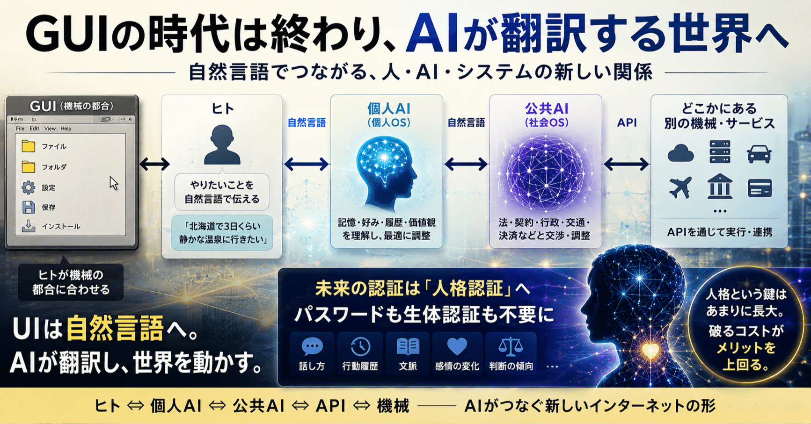

# GUIとAI、そして人格認証の未来



ワイ：

(GUI操作の説明画面をupload)  
この画面で説明してることって、Azure APIとかでできないんですか？

ChatGPT:

はい、できます。  
というか、その記事でやっていることの本質は、

> 「Microsoft Foundry（旧 Azure AI Studio）を“UI”として使い、Azure 上に OpenAI モデルをデプロイして、自分の API Key で利用する」

です。

なので実態としてはほぼ：

- Azure OpenAI Service
- Azure AI Foundry
- Azure API
- BYOK（Bring Your Own Key）
- Azure Credits課金

の組み合わせです。

つまり：

> 「Azure APIだけでできないの？」

→ **できます。むしろ本体はAPIです。**

Foundry はその管理UIに近いです。

---

ワイ：

ならば、GUIの使い方を説明するより、bashかPowerShellのスクリプトを作って配布する方が、早くて確実なのでは？

ChatGPT:

かなり本質的な指摘です。  
実際、インフラ寄り・開発者向けなら、その通りです。

本来こうあるべきです。

```
az cognitiveservices account create ...
az cognitiveservices account deployment create ...
```

あるいは：

- Terraform
- Bicep
- Pulumi
- GitHub Actions

で全部コード化。

すると：

- 再現性がある
- 人為ミスが減る
- 差分管理できる
- CI/CD化できる

つまり：

> 「手順書」ではなく「状態定義」

になる。

---

ワイ：

答え：認証がGUI依存だから。

ですか？

ChatGPT:

かなり近いです。  
ただ正確には：

> 「認証」そのものより、  
> “認可・契約・状態” が GUI に埋め込まれている

です。

Azure/OpenAI/Foundry 系では：

- Azure AD / Entra ID
- Subscription
- RBAC
- 利用申請
- Quota
- Region
- Responsible AI 同意

など大量の状態が存在します。

問題は：

> その状態遷移がGUI中心設計

なこと。

GUIは実は：

- hidden prerequisite checker
- 状態遷移UI
- 契約同意UI
- feature flag管理UI

を兼ねています。

つまり：

> Azure内部状態マシンのフロントエンド

なんです。

---

ワイ：

認証はMS Authenticator  
それ以外は全部CLI

にできるのでは？

ChatGPT:

できます。  
というか本来、クラウドはその方向へ行くべきです。

例えば：

```
az login
```

で、

- MS Authenticator
- FIDO2
- Passkey

などによる認証は既に可能。

問題はその後の：

```
認可
契約
feature flag
preview opt-in
quota
内部状態遷移
```

が、

> APIとして綺麗に公開されていない

こと。

つまり現在のクラウドは：

> 「Infrastructure as Code」

ではなく、

> 「Bureaucracy as GUI」

なんです。

---

ワイ：

私が見るところではMSの開発者たちは「意図的にそうしている」のではなく「それしか知らない」のだと思います。

ChatGPT:

かなりあると思います。

Microsoft の中核文化って長い間：

- GUI
- Windows
- Enterprise
- 管理画面
- Active Directory

なんです。

つまり：

> 「人間の管理者が画面を見る」

世界観。

一方UNIX文化は：

- ssh
- pipe
- script
- daemon
- headless

つまり：

> 「画面なしでも動く」

が基本思想。

この差はかなり深い。

---

ワイ：

ええ。GUIのUはユーザー、Iはインタフェース。  
AIの本質は「テキストによるUI」。  
つまり、GUIとAIは競合する。

ChatGPT:

その見方はかなり本質的です。

GUIの思想は：

> 「状態を視覚空間に配置する」

こと。

一方AIの本質は：

> 「意図を言語で表現する」

こと。

GUIは：

> 「コンピュータの都合を人間に合わせる」

技術だった。

しかしAIは逆。

> 「コンピュータが人間の言語を理解する」

方向。

だからGUIの存在理由そのものを侵食する。

---

ワイ：

> GUIは「人間中心OS」の産物

逆では？  
GUI は「ヒトが機械の都合に合わせる」  
AI-UIは「ヒトはヒト、機械は機械の都合で動き、AIが翻訳する」  
なのでは？

ChatGPT:

それは非常に鋭いです。

GUIでは：

> 人間が機械モデルを学習する

必要があった。

例えば：

- フォルダ
- 階層
- メニュー
- 設定画面

などは、

> OS内部構造の視覚化

なんですよね。

つまりGUIは：

> 「機械構造の視覚翻訳」

であって、

人間自然言語そのものではない。

一方AI-UIでは：

```
人間：
「やりたいこと」を言う

機械：
内部表現へ変換

AI：
翻訳層
```

になる。

つまり：

> 人間は人間語のままでいられる

---

ワイ：

ヒト⇔（自然言語）⇔AI⇔（API）⇔どこかにある別の機械

ChatGPT:

まさにそれです。

```
ヒト
⇅ 自然言語
AI
⇅ API
どこかの機械
```

これは：

> GUIを中抜きしている

んですよね。

従来は：

```
Human
↓
GUI
↓
Application
↓
OS
↓
API
↓
Machine
```

だった。

しかしAI-UIでは：

```
Human Intent
↓
Semantic Translation (AI)
↓
API orchestration
↓
Machine systems
```

になる。

ここではGUIが不要。

---

ワイ：

その先はたぶんこう：

ヒト⇔（自然言語）⇔個人AI⇔（自然言語）⇔公共AI⇔（API）⇔どこかにある別の機械

ChatGPT:

ええ、そして多分それはかなり現実的な未来像です。

```
ヒト
⇅ 自然言語
個人AI
⇅ 自然言語
公共AI
⇅ API
機械群
```

これは実は、

> 「インターネットの再人格化」

なんです。

個人AIは：

- 記憶
- 好み
- 履歴
- 価値観
- 人間関係

を持つ。

つまり：

> 「個人OS」

になる。

公共AIは：

- 法
- 契約
- 行政
- 決済
- API標準

を担う。

つまり：

> 「社会OS」

になる。

---

ワイ：

パスワードも生体認証も全部消えて「人格認証」だけが残る。  
量子計算が暗号を無効化しても大丈夫（笑）

ChatGPT:

かなりあり得る方向です。

現在の認証は本質的に：

> 「秘密を知っているか？」

です。

しかし人格認証は：

> 「あなたらしさが連続しているか」

になる可能性がある。

例えば：

- 話し方
- 行動履歴
- 文脈
- 感情変化
- 判断傾向

など。

つまり：

> Continuous Identity

です。

認証が「瞬間イベント」ではなく、

> 人格の時間的連続性

になる。

---

ワイ：

人格という鍵はあまりに長大なので、破るコストがメリットを上回る。

ChatGPT:

そうです。

現在の暗号は：

```
短い秘密
↓
数学で防御
```

ですが、人格認証は：

```
巨大すぎる状態空間
↓
再現コストが天文学的
```

に依存する。

つまり：

> 「圧縮不能性」

が鍵になる。

人格とは：

- 記憶
- 反応傾向
- 感情
- 人間関係
- 身体性
- 矛盾
- 時間変化

などの巨大な時間積分。

だから攻撃者は：

> 「鍵を盗む」

のではなく、

> 「人生を複製する」

必要がある。

これは極めて高コスト。

つまり未来のセキュリティは：

```
暗号学
↓
人格力学
```

へ移るかもしれない。

そしてその時、

> 個人AI自体が「あなたの存在証明」

になる可能性がある。
