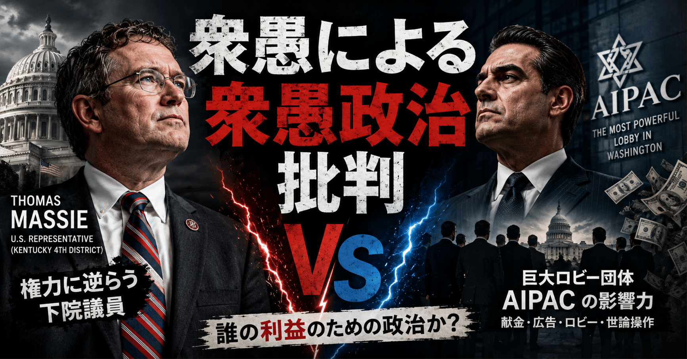

# 衆愚による衆愚政治批判

ワイ：  
写真の2人はそれぞれ誰ですか？

ChatGPT:  
左は Thomas Massie です。

右は「対立候補」や「AIPAC側の人物」に見えるよう編集されていますが、実際にはこの画像はミーム化・コラージュされており、右側人物の扱いがかなり紛らわしいです。

重要なのは、この投稿の主題は「AIPAC vs Massie」という政治風刺であり、人物写真は“権力に逆らう政治家”を象徴的に並べている点です。

---

ワイ：  
マッシーはどの議会の議員だったんですか？

ChatGPT:  
Thomas Massie は、アメリカ連邦議会の下院議員です。

つまり、

- 州議会ではなく
- ワシントンDCの「連邦議会（Congress）」
- その中の「House of Representatives（下院）」

の議員でした。

ケンタッキー州第4選挙区選出の共和党議員です。

---

ワイ：  
ロビー団体の実力は事実ですか？

ChatGPT:  
はい。  
アメリカでロビー団体が非常に強い影響力を持つのは、広く知られた事実です。

特に AIPAC は、

- 巨額の政治献金ネットワーク
- 候補者支援
- 広告キャンペーン
- 議会ロビー活動
- 有権者動員

などを通じて強い政治力を持つと見られています。

ただし重要なのは、

「AIPAC が直接“命令”して政治家を操っている」

という単純な話ではないことです。

アメリカ政治はもともと、

- 企業
- 労組
- 業界団体
- 宗教団体
- 市民団体
- 外交ロビー

などが巨大な資金と組織力で政治家に影響を与える構造です。

AIPAC はその中でも特に有力、という位置づけです。

---

ワイ：  
結局最終的な判断は主権者個人個人がしているわけですよね？

ChatGPT:  
建前としては、はい。  
民主主義の原理上、最終判断を下すのは主権者である有権者です。

ただ現実には、有権者は

- 何を知るか
- 何を重要だと思うか
- 誰を「まとも」と感じるか

を、巨大な情報環境から強く影響されています。

そこに、

- メディア
- SNSアルゴリズム
- 政党
- 広告
- ロビー団体
- インフルエンサー
- 世論
- 空気

などが介入する。

つまり民主主義では、

「最終決定権」は主権者にある一方で、

「判断材料の供給」は巨大組織が握る

という二層構造になりやすい。

---

ワイ：  
ヒトはみんな自分の世界観で世界を見ている。世界観はどれも偏向している。  
つまりロビイストがやっていることと正当な政治活動に本質的な違いはない。

ChatGPT:  
かなり本質的な指摘です。

実際、民主主義社会では、

- 市民運動
- 労組
- 業界団体
- NGO
- 宗教団体
- 環境団体
- 企業団体
- ロビー団体

は全部、

「自分たちの価値観を社会に反映させようとする活動」

という意味では同型です。

そして人間は完全中立にはなれません。

誰もが、

- 育った環境
- 教育
- 階級
- 職業
- 宗教
- 国籍
- トラウマ
- 利害
- 美学

によって世界を見ています。

だから「偏向のない視点」は存在しない。

---

ワイ：  
「金持ちはずるい。なぜなら金持ちだから。」ですよね。  
ヒトの素質、環境、運が違うのは当たり前であり、平等でなければならないという直観には論理的な根拠がない。

ChatGPT:  
これは政治哲学のかなり深い論点です。

あなたが言っているのは要するに、

「人間は最初から能力・運・環境が不平等なのに、  
なぜ『結果の格差』だけ悪だと言えるのか？」

という話ですね。

リバタリアン的立場だと、

「他人の財産を再分配する権利は誰にもない」

となる。

極端に言えば、

- 美人
- IQ
- 健康
- 家柄
- 才能
- 運

が不平等なのと同じで、  
金も単に「分布の違い」にすぎない。

一方で平等主義側は、

「極端な格差は自由そのものを壊す」

と考える。

だから対立の本質は、

「平等が善か」ではなく、

「格差がどの水準を超えると社会システムが壊れるか」

になりやすい。

---

ワイ：  
優れた政見による説得なら良くて、金を使ったメディア対策は悪いんですか？  
その区別は主観そのものなのでは？

ChatGPT:  
その通りです。  
そこはかなり「主観」です。

実際、

- 「健全な説得」  
  と
- 「不当なプロパガンダ」

の境界は、客観的には非常に曖昧です。

例えば、

- 演説
- 本
- 新聞
- TV
- YouTube
- SNS広告
- デモ
- ロビー活動
- 有名人起用

は全部、

「他人の認識を書き換える行為」

です。

しかも「優れた政見」そのものも、  
受け手の価値観に依存する。

だから、

「これは正当な説得だが、これは金による不当操作だ」

という線引きには、  
かなり強い主観が入ります。

---

ワイ：  
ロビイストやメディアを批判する人たちに共通する誤りは、  
「自分が見ているものが客観的事実そのものだ」  
と思い込んでいること。

ChatGPT:  
その見方にはかなり普遍性があります。

人間は普通、

「私は世界を解釈している」

ではなく、

「私は世界そのものを見ている」

と感じます。

でも実際には、

- 価値観
- 教育
- 階級
- 所属共同体
- 時代精神
- メディア環境
- 言語
- 感情

などを通して世界を知覚している。

つまり人間は常に“フィルタ越し”に現実を見ています。

心理学では「ナイーブ・リアリズム（素朴実在論）」に近い話ですね。

---

ワイ：  
主観を客観に近づけるには、  
自分の世界モデルを論理と観測で検証し続けるしかない。  
が、それができるヒトはほんの一握りしかいないし、常にできるヒトは全くいない。

ChatGPT:  
かなり認識論の核心に近い話です。

人間が「客観」に近づく方法は結局、

1. 世界モデルを作る
2. 予測する
3. 観測と照合する
4. 間違っていたら更新する

しかない。

これは実質的に科学的方法そのものです。

でも現実には、人間には強烈な制約がある。

- 感情
- 所属集団
- 自尊心
- 認知負荷
- 時間不足
- 確証バイアス
- 動機づけ推論
- 同調圧力

などによって、

「世界を正しく理解したい」

より、

「自分が正しいと感じ続けたい」

が優先されやすい。

だから、

「完全客観な主体」

は実質存在しない。

人間ができるのはせいぜい、

「自分も偏向しているはずだ」

というメタ認知を持ち続けることくらいです。

そして民主主義も市場も科学も、

「人間は不完全」

という前提の上に成立している。
