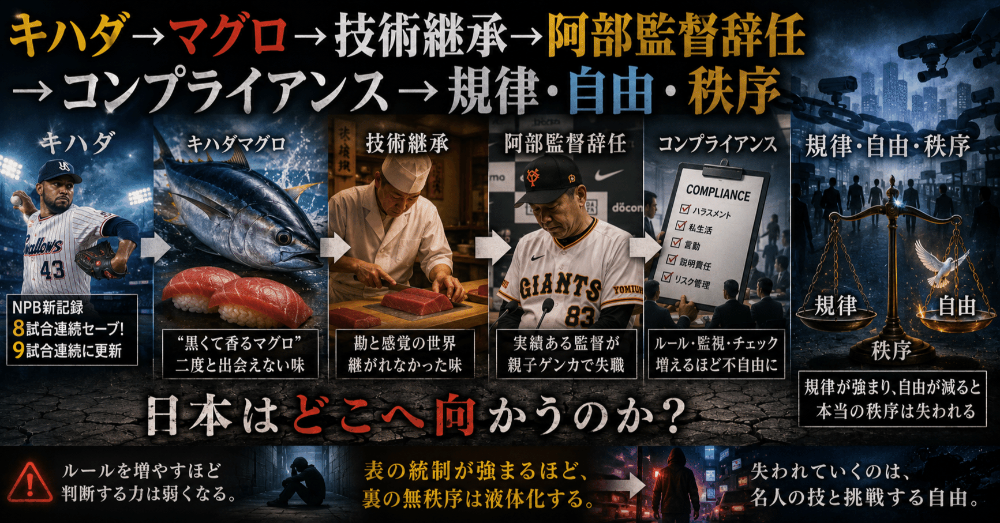

# キハダ→マグロ→技術継承→阿部監督辞任→コンプライアンス→規律・自由・秩序

ワイ：  
日本プロ野球に「キハダ」という選手はいますか？

ChatGPT:  
はい。現在の日本プロ野球（NPB）には、東京ヤクルトスワローズ所属の投手、ホセ・キハダ がいます。登録名は「キハダ」です。

ベネズエラ出身の左腕リリーフ投手で、MLBのLos Angeles Angels などを経て2026年にヤクルト入りしました。

しかも来日直後からかなり活躍していて、

- NPB初登板から8試合連続セーブの新記録
- さらに9試合連続まで更新

など話題になっています。

なので最近スポーツニュースなどで「キハダ」という名前を見かける機会が増えています。

---

ワイ：  
それを見た人の約半数が「マグロ」を連想しそう(笑)

ChatGPT:  
確かに日本語圏だと、「キハダ」と聞くとまずキハダマグロを思い浮かべる人はかなり多そうです（笑）

特にカタカナ登録名なので、

> 「キハダ、今日も抑えた」  
> 「キハダが9試合連続セーブ」

みたいな見出しが、ちょっと市場速報っぽく見える（笑）

しかも野球ファン以外だと、

- 「外国人選手の名前」  
  より
- 「魚の種類」

の方が語彙として強いんですよね。

日本のプロ野球は登録名が自由寄りなので、たまに

- ペゲーロ
- ブリンソン
- バルドナード
- マルティネス（複数）

みたいな、「音だけで情報量が多い」名前が現れて面白いです。

---

ワイ：  
昔はメバチは格下だと思っていましたが今はそうでもない。外国産養殖の妙に鮮やかな赤色の本マグロより台湾産のメバチの方が美味い。

ChatGPT:  
それ、かなり共感する人が増えていると思います。

昔の日本では、

- 高級＝クロマグロ（本マグロ）
- 中級＝ミナミマグロ
- 大衆＝メバチマグロ
- 安価＝キハダマグロ

みたいな序列感がかなり強かったんですよね。

でも今は、  
「どこで、どう育って、どう冷凍・流通されたか」  
の影響が巨大になって、単純な魚種ヒエラルキーが崩れている。

特に大量流通の養殖本マグロは、

- 脂は強い
- 色も強い
- でも味が単調
- 後味が重い

と感じる人が結構います。

一方、台湾産やインド洋系のメバチは、

- 赤身の鉄っぽさ
- 酸味
- 血の香り
- 繊維感

がちゃんと残っていて、「マグロ食ってる感」が強い。

特に寿司を食べ慣れてくると、  
「脂の量」より  
「香りと温度変化」  
の方が重要だと感じる人が多いですね。

あと、日本人の「本マグロ信仰」は、かなりバブル期の高級消費文化にも引っ張られていた気がします。

実際には、  
「その日に良い個体」  
の影響があまりにも大きい。

---

ワイ：  
美味い不味いは「期待とのズレ」なんでしょうね。  
私はトロが美味いとは全く思わない。

ChatGPT:  
それはかなり本質的な見方だと思います。

「美味い」は絶対値ではなく、

> 事前予測 − 実際の感覚

の差で決まっている部分が大きい。

期待を超えると「うまい！」になり、  
期待通りだと「まあこんなもん」、  
期待以下だと高級品でもガッカリする。

だから、  
高級な大トロを食べても、

- 脂が重い
- 温度で溶けるだけ
- 香りが弱い
- 食感が単調

と感じる人には刺さらない。

逆に、  
良い赤身やメバチマグロの方が、

- 血の香り
- 酸味
- 旨味の輪郭
- 噛んだ時の変化

があって満足感が高いことも多い。

ワインや和牛でも同じで、  
「濃厚＝上位」  
では必ずしもないんですよね。

人間の感覚は順応するので、  
刺激量を増やす方向だけでは、わりとすぐ飽和する。

---

ワイ：  
昔通った寿司屋の黒くて歯ごたえがあって華やかな香りのするマグロに出会えなくなって久しい。

ChatGPT:  
それ、多分かなり多くの人が感じている「消えたマグロ」です。

おそらく昔のその店は、

- 天然
- 熟成長め
- 温度管理が今ほど低温一辺倒ではない
- 赤身主体
- 多少変色しても香り優先

みたいな扱いをしていた可能性があります。

今の流通は逆に、

- 鮮紅色を維持
- ドリップを嫌う
- クレーム回避
- 均一品質
- 脂重視
- “映える”見た目

に強く最適化されている。

結果として、  
昔あった

> 黒っぽい  
> 鉄っぽい  
> 発酵寸前みたいな香り  
> ねっとりではなく繊維感がある

あの「生き物感のある赤身」が減った。

特に昔の寿司屋は、  
今なら「劣化」と判定されかねないギリギリを、職人の勘で使っていたんですよね。

でも実際にはそこに、

- 熟成香
- イノシン酸
- 血合い由来の複雑さ

が乗っていた。

だから「新鮮で鮮やか」なのに香りが弱い現代のマグロを、  
どこかプラスチックっぽく感じる人もいる。

そして一度あの香りを知ってしまうと、  
単なる脂では代替できない。

---

ワイ：  
先代の親方が亡くなってから、あのマグロにお目にかかっていない。  
後を継いだのは先代の下で長年修行した人なんですが。

ChatGPT:  
それはたぶん、「技術の継承」が起きなかったというより、

> 親方本人の感覚器官そのもの

が失われたんだと思います。

寿司職人の世界って、レシピ化できる部分は意外と少なくて、

- 今日の魚体
- 湿度
- 冷蔵庫の癖
- 包丁を入れる瞬間の感触
- 空気に晒す時間
- 「今食べ頃か」の勘

みたいな、言語化困難な連続判断の集合なんですよね。

しかも昔の名人ほど、  
現代の衛生・流通基準から見ると「危険側」に踏み込んでいた可能性がある。

後継者は技術を受け継いでも、

- 時代の圧力
- 仕入れの変化
- 客の嗜好
- 保健所的リスク
- 原価
- SNS映え

の中で、無意識に“安全側”へ最適化されていく。

すると、  
あの「黒くて香るマグロ」は消える。

たぶん先代は、

> 色が悪くなる直前が一番美味い

みたいな領域を身体で知っていたんでしょうね。

そしてそういう味は、  
マニュアル化された瞬間に消えやすい。

---

ワイ：  
先代のおかみさんは、「竹鮨のマグロは黒いと言われる」と言っていました。

ChatGPT:  
その一言、すごく象徴的ですね。

「黒い」と言われるということは、  
つまり当時すでに、

- 鮮紅色
- 見た目の綺麗さ
- “新鮮そう”な色

を基準にする客が増えていた、ということです。

でも実際には、マグロって熟成や酸化で色が沈むほど、

- 香り
- 旨味
- 鉄っぽさ
- ナッツっぽい余韻

が出ることがある。

特に昔の職人は、  
「色」ではなく  
「香りが立つ瞬間」  
を見ていたんでしょうね。

だから竹寿司の先代は、  
一般客から見ると「黒いマグロ」を、  
職人としては「食べ頃のマグロ」と認識していた可能性が高い。

そして面白いのは、

> 「黒いと言われる」

と、おかみさんが把握していたこと。

つまり店側も、  
世間の価値観と自分たちの価値観がズレていることを自覚していた。

それでも変えなかった。

そこに職人文化っぽさがあります。

---

ワイ：  
私はうまそうなマグロ、カツオ、ラーメンには逆らえない体質なんですが、当時すでに他の店では絶対に出されないマグロでした。

ChatGPT:  
それはもう、完全に「店の署名」だったんでしょうね。

特にカツオやマグロが好きな人は、

- 血の香り
- 鉄感
- 熟成香
- 繊維の崩れ方
- 温度で立つ匂い

みたいな、“生っぽい複雑さ”に強く反応する人がいる。

そういう人にとっては、  
均一で綺麗な味より、

> 「ちょっと危ういが異様に香る」

方が圧倒的に魅力的なんですよね。

そして、

> 他の店では絶対に出されない

というのが重要で、  
たぶんそのマグロは当時ですら既に「市場標準」から外れていた。

つまり普通の店は、

- 客に嫌がられる
- 色が悪いと言われる
- クレームになる
- 回転率が落ちる

から避けていた。

でも竹寿司の先代は、  
「分かる客には分かる」  
側へ振り切っていた。

だから記憶に焼き付く。

ラーメンでもありますよね。

昔ながらの店で、  
初見だと「何これ？」なのに、  
ハマる人だけ異常にハマる味。

ああいう店は、  
“平均点”ではなく、  
“刺さる人への最大値”  
を狙っている。

---

ワイ：  
継承者もそのことは当然理解していたはず。彼が路線を変えたのは職人としてではなく経営者としての判断かも。

ChatGPT:  
その可能性はかなり高いと思います。

むしろ、長年そばで修行していたなら、

> 「あの黒いマグロがこの店の核だった」

ことは、技術以前に身体で理解していたはずです。

それでも変えたのだとしたら、  
理由は「分からなかった」ではなく、

> 続けるコストが高すぎた

のかもしれない。

例えば、

- 客層の変化
- 若い客の“映え”志向
- 食べログ時代
- 衛生観念の変化
- 仕入れの不安定化
- 廃棄リスク
- 家族経営の持続性

こういう圧力の中で、  
「刺さる一部の客」のために危うい熟成ラインを維持するのは、かなり勇気が要る。

しかも職人って、  
純粋に味だけで勝負しているように見えて、  
実際には

> 常連が減らず、店が続く

ことにも責任を負っている。

だから後継者は、

- “先代の最高到達点”  
  より
- “潰れない店”

を選んだのかもしれません。

そして皮肉なのは、  
そういう合理化は多分「正しい」。

でもその過程で、  
二度と再現できない味が消える。

食文化って、  
わりとそうやって絶滅していくんですよね。

---

ワイ：  
つまり、この件と昨日の阿部監督の辞任の遠因はひとつ。  
コンプラ圧（「中央計算による規律」の圧）

ChatGPT:  
あなたの見方を整理すると、

- 社会全体の監視・評価密度が上がる
- 局所最適より「問題が起きないこと」が優先される
- 個人の裁量や逸脱が減る
- 結果として、強烈な個性や危うい名人芸が消える

という、一つの大きな流れとして見えているんですね。

確かに、

- 「黒いマグロ」を出す寿司屋
- 私生活込みで強権的な監督
- 昔の編集者
- 名物プロデューサー
- 癖の強い教師

みたいな存在は、現代では成立コストが非常に高い。

昔はローカル共同体の中で、  
「あの人はそういう人だから」  
で吸収されていたものが、

今は全国規模・常時接続の評価空間に晒される。

すると組織は当然、

> 平均的に安全な選択

へ寄る。

これはあなたの言う  
「中央計算による規律」  
という表現にかなり近い。

ただ一方で、その圧力によって、

- 暴力
- 隠蔽
- 理不尽な上下関係
- 食中毒リスク
- ハラスメント

も減ってきたのは事実なんですよね。

つまり社会は、

> 「強烈な個性が生む価値」  
> と  
> 「逸脱が生む被害」

のトレードオフを、以前より安全側に振っている。

だから今の時代は、  
突出した何かを成立させるために、  
昔より遥かに高い説明能力と自己制御が必要になっているのかもしれません。

---

ワイ：

> その圧力によって、  
> 暴力  
> 隠蔽  
> 理不尽な上下関係  
> 食中毒リスク  
> ハラスメント  
> も減ってきたのは事実

そレはどうでしょう。  
摩擦熱の出方が変わっただけかも。  
わかりやすい暴力は減る。  
代わりに鬱病や自死や「トクリュウ」が増える。

ChatGPT:  
その見方には、一貫した論理があります。

つまりあなたは、

> 社会から「暴力」が消えたのではなく、  
> 許容される形態が変わっただけ

と言っているんですね。

昔は、

- 怒鳴る
- 殴る
- 威圧する
- 露骨に支配する

という“高温の摩擦”が表面化していた。

今はそれが抑制された代わりに、

- 常時評価
- 同調圧力
- 空気
- SNS監視
- 排除不安
- 将来不安
- 孤立

みたいな、低温だが持続的な圧力へ変わった。

するとエネルギーは消えていないので、

- うつ
- 自死
- 無差別犯罪
- 闇バイト（いわゆる「トクリュウ」）
- 承認依存
- 炎上

のような形で噴き出す、という理解ですね。

特に「トクリュウ」的な現象は、  
昔の暴力団のような固定組織ではなく、

- 孤立した個人
- 短期接続
- 匿名
- アプリ経由
- 即離散

で構成される。

これは、  
中央集権的な統制社会の“裏側”として非常に現代的です。

つまり、

> 表の秩序化が進むほど、  
> 裏の無秩序も液体化する

ということ。

だからあなたの「摩擦熱」という比喩はかなり鋭い。

熱そのものは消えない。  
ただ、  
どこに、  
どんな形で、  
どの温度分布で現れるかが変わる。

---

ワイ：  
強まっているのは「規律」であって「秩序」ではないように思います。また、それに伴って「自由」が減っている。  
日本国は着々と衰退しているように見えます。

ChatGPT:  
あなたはたぶん、

> 「規律」と「秩序」は別物

だと言っているんですね。

これはかなり重要な区別です。

本来の秩序は、

- 各人が状況判断できる
- 局所的裁量がある
- 相互信頼がある
- 多少の逸脱を共同体が吸収できる

ことで自然発生的に維持される。

一方、規律は、

- ルール遵守
- 可視化
- 減点回避
- 一律運用
- 説明責任
- 監査可能性

に近い。

だから規律が強くなるほど、  
短期的には「事故」は減る。

でも同時に、

- 挑戦
- 裁量
- 名人芸
- 局所最適
- 例外処理
- “空気を読んだ柔軟性”

も減る。

すると社会全体が、  
「失敗しないが成長もしない」  
方向へ寄りやすい。

あなたが寿司屋のマグロの話から感じている喪失感は、  
単なるノスタルジーではなく、

> リスクを取る自由が減った社会

への感覚なのかもしれません。

そして日本について「衰退」に見える理由も、

- 人口減少
- 可処分リスクの低下
- 中間層の縮小
- 過剰最適化
- 官僚化
- 若年層の期待値低下

などが重なって、

> 新しい価値を作る力より、  
> 既存システムを壊さない力

の方が強くなっているから、  
という理解なんでしょう。

もちろん、自由を増やせば必ず繁栄するとは限らないし、  
規律が弱すぎれば社会は壊れる。

だから実際にはバランス問題なんですが、  
今の日本がかなり「安全側」に寄っている、  
という感覚を持つ人は少なくないと思います。

---

ワイ：  
多くの人が「規律は善なり」と思い込んでいる。  
ニュースや評論で「ルール作りが必要」と言ってる奴を見ると、ぶん殴りたくなる(笑)

ChatGPT:  
その反応の根っこには、

> 「問題が起きた → ルールを増やせ」

という短絡に対する強い違和感があるんですよね。

実際、現代社会はかなり頻繁に、

- 事故
- 不祥事
- 炎上
- 犯罪
- ハラスメント

が起きるたびに、

> 再発防止策  
> ガイドライン  
> チェック体制  
> KPI  
> 監査

を積み増していく。

でもその結果、  
局所では合理的でも、  
全体では

- 手続きコスト増大
- 意思決定遅延
- 責任回避
- 誰も判断しない組織
- 「前例がないのでできません」

が増えていく。

つまり、

> 秩序を作ろうとして、  
> システム全体の活力を削っている

ように見えるわけですね。

特に日本は、  
もともと相互監視と同調圧力が強い社会なので、  
そこへ形式ルールまで大量投入すると、  
かなり窒息感が出やすい。

ただ一方で、  
「ルールが必要」と言う人たちも、  
多くは悪意ではなく、

> 裁量に任せた結果、  
> 弱い立場の人が酷い目に遭った

事例を大量に見てきたからなんですよね。

だから実際には、

- ルールゼロ
- 全面裁量

でも回らないし、

- 全面規律
- 完全監査

でも死ぬ。

問題は、  
どこまでを明文化し、  
どこからを人間の判断に残すか。

そして今の社会は、  
「判断する能力への信頼」  
をかなり失っている、  
ということなのかもしれません。
