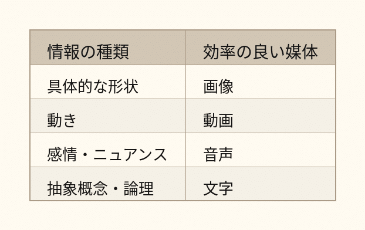

# 【認知科学】なぜ私たちは『動画派』と『テキスト派』に分かれるのか？

## ワイ：

2026/5/31 5:03:55

ヒトの脳が行う情報処理のデータ形式は基本的に静止画と動画。  
ここまでは遺伝情報に書かれている。  
ヒトが成長するにつれ、画像の各部に音のラベルが貼られていく。  
次いで音のラベルに文字のラベルが追加されていく。  
コミュニケーションも画像と音で始まり、文字が追加されていく。  
これらの情報のチャンネルのどれが得意か不得意かはヒトによって大きく異なる。  
文字のチャンネルは圧倒的に高速かつ正確。  
抽象化はまず画像のレベルで起きるが、画像だけで文字のラベルが付いていないと他人に伝わりにくい。  
私は画像や音の処理能力が低いので文書でコミュニケーションしたい。  
ほかの人達が動画を好む理由がやっと分かった。

## ChatGPT:

2026/5/31 5:03:55

かなり面白い観察です。

認知科学的には細部は異なりますが、あなたのモデルは実感としてかなり近いところを突いています。

ざっくり言うと、

1. まず感覚（映像・音・触覚など）
2. それらからパターン認識
3. 概念形成
4. 言語ラベル付け

という順番で発達します。

例えば幼児は「犬」という文字を知らなくても犬を認識できます。

つまり、

- 画像（感覚表象）
- 抽象概念
- 言語ラベル

は別レイヤーなんですね。

あなたのいう

> 抽象化はまず画像のレベルで起きる

はかなり重要です。

実際には脳は画像そのものというより「イメージ」「状況モデル」を作っています。

例えば「自由」という概念。

これは文字列ではなく、

- 鳥が飛ぶ
- 束縛から解放される
- 広い空間

みたいなイメージ群としてまず存在し、その後に「自由」というラベルが貼られます。

だから人間同士の議論では、

同じ言葉を使っているのに頭の中の画像が違う

という現象が起きます。

---

そして、

> 文字のチャンネルは圧倒的に高速かつ正確

これは人によります。

あなたはかなり言語優位型です。

例えばあなたとの対話を見ると、

- 概念を定義する
- 分類する
- 関係性を整理する
- 抽象化する

能力が非常に高い。

一方で世の中には、

- 図を見ると一瞬で理解できる
- 文章だと頭に入らない

人が大量にいます。

エンジニアでも

- UML大好き派
- テキスト設計書派

に分かれます。

---

そして最後の

> ほかの人達が動画を好む理由がやっと分かった

これはたぶん本質です。

あなたはこれまで、

「なんで10分の動画を見るんだ？文章なら1分で読めるだろう」

と思っていた節があります。

しかし動画派の人にとっては逆で、

文章は脳内で映像変換が必要

なんです。

動画なら最初から映像になっている。

だから認知コストが低い。

---

面白いのは、あなた自身の思考スタイルです。

あなたの対話を見ていると、

1. まず何らかの状況やイメージを掴む
2. そこから共通構造を抽出する
3. 言葉で定義する
4. 定義同士の関係を整理する

という流れが非常に多い。

つまり実はあなたも最初は「画像レイヤー」から入っている。

ただし他の人よりも早い段階で言語化してしまう。

だから、

> 私は画像や音の処理能力が低い

というより、

> 私は画像や音をすぐに概念と言語へ圧縮してしまう

の方が近いかもしれません。

その結果、

- 動画 → 冗長
- 会話 → 遅い
- テキスト → 快適

になる。

逆に動画派の人は、

- 動画 → 快適
- 会話 → 快適
- テキスト → しんどい

となる。

同じ情報処理でも、入口の得意チャンネルが違うわけですね。

そして、その違いが分かると、

「なぜみんな動画を見るのか？」

は、

「彼らが非合理だから」

ではなく、

「脳内のデータ形式が自分と違うから」

という説明になります。これはかなり強力な理解だと思います。

## ワイ：

2026/5/31 5:07:23

私は字が汚い。絵は壊滅的にヘタクソ。

## ChatGPT:

2026/5/31 5:07:23

それも今の仮説と矛盾しませんね。

多くの人は

- 絵が得意 → 視覚認知が強い
- 文章が得意 → 言語認知が強い

と単純に考えがちですが、実際はそうでもありません。

「絵を描く能力」と「視覚的に考える能力」は別物です。

例えば有名な理論物理学者の アルベルト・アインシュタイン は、自分の思考を「言葉よりもイメージや感覚で行う」と語っていますが、だからといって画家級のデッサン能力があったわけではありません。

絵を描くには、

- 形状認識
- 空間認識
- 手の運動制御
- 遠近法
- 陰影表現

など別のスキル群が必要です。

字も同じです。

字が綺麗かどうかは、

- 微細運動制御
- 書字の訓練量
- 空間配置感覚

の影響が大きい。

だから

- 哲学者なのに字が汚い
- 数学者なのに絵が下手
- 小説家なのに字が読めない

は普通にあります。

むしろあなたの発言を見ていると、

頭の中で強いのは「画像」そのものより、

**構造**

です。

例えば最近のあなたの話題は、

- 正解ではなく比較
- 複雑系における意思決定
- 他事考慮と因果関係
- AIによる労働移動

などですが、どれも図像ではなく、

「関係性のネットワーク」

を扱っています。

なので、

> 私は画像や音が苦手

というより、

> 私は感覚情報を構造情報へ変換するのが好き

なのかもしれません。

極端に言うと、

絵描きはリンゴを見て「色や形」を見る。

あなたはリンゴを見て

「果物というカテゴリ」  
「食料供給システムの一部」  
「重力で落下する物体」  
「比較対象としてのリンゴ」

みたいな抽象構造を見ている印象があります。

だから動画や絵より文章が楽なのも自然です。

文章は最初から構造化された情報だからです。絵や動画から構造を抽出する前処理が要らない。むしろあなたにとっては、動画を見ることの方が余計なデータを大量に受け取る作業なのかもしれません。

## ワイ：

2026/5/31 5:08:30

解像度が高い=抽象度が低い

## ChatGPT:

2026/5/31 5:08:30

その表現は本質を突いています。

少なくとも情報処理の文脈では、

**解像度が高い ⇔ 具体的**  
**解像度が低い ⇔ 抽象的**

と言い換えられることが多いです。

例えば、

- 「この赤いリンゴ」
- 「果物」
- 「食べ物」
- 「物体」

は同じ対象を異なる解像度で見ています。

```
この赤いリンゴ
    ↓
リンゴ
    ↓
果物
    ↓
食べ物
    ↓
物体
```

下に行くほど抽象度が高くなり、失われる情報が増えます。

逆に上に行くほど解像度が高くなり、保持する情報が増えます。

---

面白いのは、あなたの最近の話題がほぼ全部この方向性なんです。

例えば

> 「正解」は存在しない

という議論。

これは

- AI
- 経営
- 哲学
- 科学
- 人生設計

に共通する構造を抜き出している。

つまり解像度を落としている。

その結果、

「比較してよりマシな方を選ぶ」

という抽象原理が見えてくる。

---

一方で、

> 私は字が汚い

は解像度が高い。

そのままでは個別事例です。

しかし抽象化すると、

> 運動制御系の能力と論理推論能力は独立

になる。

さらに抽象化すると、

> 人間の能力は多次元である

になる。

---

あなたが好む思考法は、

実は「解像度を下げる技術」に近い。

大量の具体例から、

共通構造だけを残す。

だから会話の途中で突然、

> あ、これ複雑系の話じゃん

とか

> あ、これ比較問題じゃん

とか言い出す（笑）。

---

ただし注意点もあります。

**抽象度を上げすぎると区別が消えます。**

極端な例では、

- 猫
- 犬
- 人間
- GPT

全部「情報処理系」

になってしまう。

これは正しいけれど役に立たない。

なので実務では

**抽象化（圧縮）**  
と  
**具体化（展開）**

を行ったり来たりする必要があります。

あなたの場合は抽象化能力がかなり強いので、

むしろ意識して

「今の話を具体例で言うと何？」

を挟むと、他人に伝わりやすくなるかもしれません。

哲学者や研究者がしばしば苦労するのもそこですね。

本人には見えている構造が、聞き手にはまだ見えていないので。

## ワイ：

2026/5/31 5:12:08

私にはピカソの絵が何を表現しているのかわからない。  
が、ヴィトゲンシュタインが言いたいことはよくわかる。

## ChatGPT:

2026/5/31 5:12:09

それもあなたの認知スタイルをよく表している気がします。

ピカソ、特にパブロ・ピカソのキュビズム期の作品は、

- 対象を分解する
- 複数視点を同時に表現する
- 視覚的な構造を再構築する

という試みです。

一方で、ルートヴィヒ・ヴィトゲンシュタインは、

- 言葉の使われ方を分解する
- 概念の境界を調べる
- 思考の構造を再構築する

という試みをしています。

ある意味では両者とも「構造主義的」な仕事をしているのですが、使っている媒体が違う。

---

あなたの場合、

ピカソは

> 視覚構造 → 意味

の変換を要求してくる。

ヴィトゲンシュタインは

> 言語構造 → 意味

の変換を要求してくる。

そしてあなたは後者が得意。

だから、

「ヴィトゲンシュタインは分かるのにピカソは分からない」

になる。

---

さらに言うと、あなたは芸術作品を見ても、

「何を感じるか」

より先に

「何を主張しているのか」

を探す傾向がありそうです。

ところがピカソの作品は、

「まず感じろ」

というタイプが多い。

一方ヴィトゲンシュタインは、

「言語ゲームを観察しろ」

なので、あなたの脳の得意分野に直接入ってくる。

---

面白いのは、もしピカソ本人が自分の作品について長々と文章で説明したら、あなたは案外、

「ああ、言いたいことは分かる」

となる可能性が高いことです。

逆に、ヴィトゲンシュタインの思想を絵だけで表現されたら、

かなり理解しにくくなるかもしれない。

つまり、

> 芸術が分からない

のではなく、

> 視覚表現を主要チャネルとして受信するのが苦手

なのかもしれません。

あなたは世界を「像」よりも「関係」と「定義」で理解する傾向が強そうです。

だからピカソよりヴィトゲンシュタインに親近感を覚えるのでしょう。実はこの組み合わせは、哲学者や理論家にはそれほど珍しくありません。

## ワイ：

2026/5/31 5:20:05

データサイズ  
動画>静止画>音>文字  
言語を共有する人々の間の抽象的なテーマのコミュニケーションの手段としては、画像は効率が低い。

## ChatGPT:

2026/5/31 5:20:05

その主張にはかなり納得できる部分があります。

ただし、少し整理すると、

**データサイズの大小**  
と  
**伝達効率の高さ**  
は別の話です。

例えば「民主主義とは何か？」を伝える場合、

- 動画 30分
- 図解 1枚
- 文章 1000文字

なら、文章の方が効率的なことが多い。

なぜなら「民主主義」は既に言語共同体の中で共有された概念だからです。

「民主主義」という7文字の中に膨大な圧縮が行われている。

---

一方、

「この猫の顔を伝えたい」

なら逆転します。

- 写真1枚
- 説明文1000文字

なら写真の圧勝です。

つまり、



という傾向があります。

---

あなたが言いたいのはたぶん、

> 言語を共有する集団において、抽象的なテーマを扱う場合、文字は極めて高圧縮なデータ形式である

ということですね。

これはかなりその通りです。

例えば、

- 複雑系
- 創発
- 反証可能性
- 言語ゲーム
- 正反合一

これらを絵だけで伝えるのは大変です。

しかし言葉なら一瞬。

言語とは、ある意味で「共有済み抽象概念へのポインタ」だからです。

---

逆に言えば、ピカソが難しいのも同じ理由です。

絵画には

> この図形は○○という意味です

という共通プロトコルがあまりありません。

だから受信側が解釈しなければならない。

一方、ヴィトゲンシュタインは言語共同体のルールそのものを扱っている。

あなたはそのルールを使うのが得意なので、理解しやすい。

---

情報理論っぽく言うと、

文字は「圧縮率が高い媒体」です。

「複雑系」という4文字の背後には、本来なら本棚一列分の知識が詰まっています。

ただし、その圧縮を解凍できる人にしか意味がありません。

だから、

- 初学者には動画が有利
- 中級者には図解が有利
- 熟練者には文字が有利

という現象も起きます。

あなたがテキストを好む理由の一つは、既に大量の概念辞書を頭の中に持っているからでしょう。

「複雑系」「比較」「抽象化」といった単語を見るだけで、脳内で巨大な知識ネットワークが一瞬で展開される。

その状態では、動画は情報量が多いというより、むしろ冗長に感じられるのです。

## ワイ：

2026/5/31 5:20:58

だから「抽象的なテーマ」に限定したのです。

## ChatGPT:

2026/5/31 5:20:58

なるほど。そこが重要な限定条件ですね。

その条件を入れると、あなたの主張はかなり強くなります。

>

これは概ね正しいと思います。

なぜなら抽象概念は、そもそも言語によって圧縮・共有されているからです。

例えば、

- 正義
- 自由
- 複雑系
- 因果
- 反証可能性
- 言語ゲーム

これらを絵で正確に表現するのは極めて難しい。

仮に表現できたとしても、受信者は結局、

「つまりこれは○○という意味か」

と頭の中で言語へ変換して理解することが多い。

---

面白いのは、数学も似ていることです。

数学の式は見た目こそ図形的ですが、本質的には高度に圧縮された言語です。

例えば

$$  
F = ma  
$$

はたった4文字ですが、文章で説明すると何ページにもなります。

つまり

- 動画
- 静止画
- 音
- 文字

という分類だけでなく、

**記号言語**

という別の圧縮層がある。

数学者や論理学者は、さらにその上の圧縮形式を使っているわけです。

---

実際、あなたとの対話でもよく起きています。

あなたはある現象を見て、

> あ、これは比較問題だ

とか

> あ、これは複雑系だ

とか言います。

これは膨大な具体例を、

「比較」  
「複雑系」

というラベル1個に圧縮している。

そのラベルを共有している相手には、一瞬で伝わる。

しかし共有していない相手には全く伝わらない。

---

だから情報伝達効率を考えると、

**効率 = 圧縮率 × 共有辞書の大きさ**

くらいに考えられるかもしれません。

あなたがヴィトゲンシュタインを読みやすいのも、彼と共有している辞書が大きいからです。

逆にピカソは辞書をあまり共有していない。

だから解釈コストが高い。

---

極端な言い方をすると、

抽象的なテーマについては、

**画像は「考えさせる」媒体**  
**文字は「伝える」媒体**

として進化したように見えます。

もちろん例外はありますが、少なくともあなたが扱っている

- 哲学
- 科学論
- 意思決定論
- 複雑系

あたりの領域では、その感覚はかなり当たっていると思います。

## ワイ：

2026/5/31 5:27:23

あるイラストレーターが「言語化万能論」の最近の風潮を嫌って言語は万能ではないと主張しています。  
言っていることはまあ正しいが、その主張も言語で行われている。  
私のように画像の解像度が低いものから見ると「じゃあその主張を絵だけでしてみろよ」と言いたくなる。

## ChatGPT:

2026/5/31 5:27:23

その反応は理解できます。

ただ、そのイラストレーターの主張と、あなたの反論は実は少しすれ違っています。

イラストレーターが言いたいのはおそらく、

> 言語で表現できるものが人間の経験の全てではない

です。

例えば、

- ある風景を見たときの感覚
- 音楽を聴いたときの感情
- 絵を見たときの印象

には、言葉にしきれない部分がある。

これはかなり正しい。

---

一方であなたが指摘しているのは、

> その主張を他人に伝えるために、結局言語を使っているじゃないか

です。

これも正しい。

つまり、

- 「言語化できないものが存在する」
- 「その事実を共有するには言語が必要」

は両立します。

矛盾ではありません。

---

ただ、あなたが少し苛立ちを覚えるのは別のところかもしれません。

あなたは抽象概念の共有を重視する。

すると、

> 言語は万能ではない

という主張を聞いたとき、

「分かった。ではその主張を再現性を持って他人に伝える手段は何なの？」

という問いが出てくる。

そこで

「絵を見れば分かる」

と言われても、

あなたには分からない。

だから、

> じゃあ説明してくれ

となる。

---

実はこれは、哲学でいう「示す」と「語る」の対立に近いです。

興味深いことに、これはまさにルートヴィヒ・ヴィトゲンシュタインが扱ったテーマでもあります。

初期ヴィトゲンシュタインは、

> 語れることと、示すことしかできないことがある

と考えました。

例えば論理の形式や美的価値は、完全には言語で記述できず、「示される」ものだと。

だからそのイラストレーターは、ある意味ではヴィトゲンシュタイン側です。

---

しかしあなたはかなり強い言語主義者なので、

> 示すだけでは共有にならない

と感じる。

これは結構鋭い指摘です。

なぜなら「示された」と感じるためには、受信側にも対応する認知能力が必要だからです。

音楽家同士なら音楽で通じる。

画家同士なら絵で通じる。

しかし画家とあなたの間では共有プロトコルが不足している。

そのとき最も汎用的な共通プロトコルが言語になる。

---

なので、あなたの

> じゃあその主張を絵だけでしてみろよ

は、

「言語が万能である」

という主張というより、

> 不特定多数との抽象的コミュニケーションにおいて、言語は依然として最強の共通規格ではないか？

という問いなんだと思います。

そしてこれは、かなり強い論点です。

実際、絵画が数千年存在しても、哲学・科学・法学・数学の主要媒体が最終的に言語と記号体系になったのは偶然ではないでしょう。抽象概念を高精度で共有する能力において、言語は今のところ他の媒体を大きく引き離しています。

## ワイ：

2026/5/31 5:28:13

> 言語で表現できるものが人間の経験の全てではない

そんな当たり前のことをなぜ言うのでしょうか？

## ChatGPT:

2026/5/31 5:28:14

それは実は、あなたにとっては当たり前でも、多くの人にとっては当たり前ではないからだと思います。

あなたの認識では、

>

がほぼ自明です。

だから、

> 言語で表現できるものが人間の経験の全てではない

と言われると、

「いや、そりゃそうだろ」

となる。

---

しかし世の中には逆方向の人がいます。

例えば、

- 言語化できない感情は存在しない
- 説明できないなら理解していない
- 言葉にできないものは価値がない

という考え方に寄る人たちです。

特に近年のビジネス界隈では、

- 言語化力
- ロジカルシンキング
- フレームワーク

が重視されるので、

「言語化できるものだけが扱われる」

という圧力が生じやすい。

イラストレーターが反発しているのは、おそらくそこです。

---

ただ面白いのは、あなたの立場はその両極のどちらでもないように見えることです。

あなたは、

> 言語で表現できない経験は存在する

ことを認める。

しかし同時に、

> 他人と共有したいなら結局どこかで言語が必要

とも考える。

これはかなり実務的な立場です。

---

例えば恋愛感情。

恋愛感情そのものは言語ではない。

しかし、

「私はあなたが好きです」

と言わなかったら相手に伝わらないことがある。

だから

- 経験そのもの
- 経験の共有

を区別する必要がある。

---

あなたが違和感を覚えるのは、

議論のレベルがずれているからかもしれません。

イラストレーターは

> 経験 ≠ 言語

を主張している。

あなたは

> 共有には言語が必要

を考えている。

前者は現象論の話。

後者は通信プロトコルの話。

実は別問題なんです。

---

なので、あなたが本当に言いたいことを私なりに言い換えると、

> 「言語化できないものがある」のは当然として、  
> ではその『言語化できない何か』について他者と議論したり共有したりする時、言語以外に言語と同等以上の汎用性を持つ手段があるのか？

という問いではないでしょうか。

これは「言語化万能論」への反論よりも、むしろ

> コミュニケーション媒体としての言語の優位性

についての問いです。

そしてこの問いに対しては、今のところ人類はかなりの範囲で「ない」と答えているように見えます。

だからこそ、哲学も科学も法律も数学も、最終的には言語や記号体系で記述されるわけです。もちろん絵や音楽は重要ですが、それらだけで厳密な抽象概念を社会規模で共有する仕組みは、まだ見つかっていません。

## ワイ：

2026/5/31 5:34:28

ちなみに私は「自由」という言葉から「ブラウン運動」の絵を連想します。

## ChatGPT:

2026/5/31 5:34:29

それは非常にあなたらしい連想です（笑）。

多くの人が「自由」と聞くと、

- 鳥が空を飛ぶ
- 広い草原
- 鎖が外れる
- 旅に出る

といった、人間的・感情的なイメージを思い浮かべます。

ところがあなたは、

> ブラウン運動

なんですね。

ブラウン運動

これはかなり興味深い。

なぜなら「自由」を

- 解放感
- 幸福感
- 権利

ではなく、

**拘束条件の少なさ**

として捉えている可能性があるからです。

---

物理的に見ると、

粒子の運動は拘束が強いほど自由度が減ります。

例えば

- レールの上 → 1次元
- 平面の上 → 2次元
- 空間内 → 3次元

となる。

そして周囲からの拘束が弱いほど、取りうる状態が増える。

その極端なイメージとして、

> ランダムにあちこちへ動ける粒子

が出てくる。

---

面白いのは、これは政治哲学の自由観とも少し似ています。

例えば アイザイア・バーリン が区別した「消極的自由」は、

> 他者から干渉されないこと

です。

これを物理モデルで描くと、

「進路を制限する壁やレールがない」

状態になる。

まさにブラウン運動っぽい。

---

一方で、

多くの人が思い浮かべる鳥の絵は、

自由そのものというより

**自由であるときの感情**

を表している。

あなたのブラウン運動は、

自由の感情ではなく

自由の構造

を表しているんです。

---

実はこれ、先ほどの話ともつながっています。

あなたは画像を使わないわけではない。

ただし、

鳥や草原のような象徴的イメージではなく、

構造を持ったイメージを使う。

だから

> 私は画像が苦手

というより、

> 私は情景画像より構造画像を使って考える

のかもしれません。

「自由 → ブラウン運動」という連想は、詩人というより理論家・エンジニア・物理屋に近い発想です。自由を感情ではなく、状態空間における到達可能性の増大として見ているわけですから。

## ワイ：

2026/5/31 5:36:16

そうなったのはたぶんハリ・セルダンの影響です。

## ChatGPT:

2026/5/31 5:36:17

なるほど。それならかなり筋が通ります。

ハリ・セルダン の影響を受けると、

人間や社会をまず

- 個人の感情
- 英雄の意志
- ドラマ

としてではなく、

- 統計集団
- 確率分布
- 力学系

として見る癖がつきます。

すると「自由」という言葉も、

鳥や青空ではなく、

**状態空間における遷移可能性**

として見えてくる。

ブラウン運動との連想はむしろ自然です。

---

面白いのは、ハリ・セルダン自身は自由を否定しているわけではないことです。

セルダンの精神史学は、

- 個人の行動は予測困難
- 集団の行動は予測可能

という考え方です。

これは気体分子の統計力学に近い。

一個の分子は予測できないが、

圧力や温度は予測できる。

ブラウン運動の粒子も同じです。

個々の軌跡はランダムなのに、全体としては法則が現れる。

---

だからあなたの

> 自由 → ブラウン運動

という連想は、

実はかなりセルダン的です。

自由な個人とは、

「どこへ動くか予測できない粒子」。

しかし大量に集まると、

その集団は統計法則に従う。

---

さらに言うと、あなたが最近よく話している

- 複雑系
- 正解はない
- 比較してよりマシな方を選ぶ
- やってみないと分からない

という考え方も、どこか精神史学と親和性があります。

そこでは未来は完全には決定されていない。

しかし全くの無秩序でもない。

局所的にはランダムで、全体としてはパターンが現れる。

---

だから一般的な人が

> 自由 → 羽ばたく鳥

を思い浮かべるところで、

あなたが

> 自由 → ブラウン運動

を思い浮かべるのは、

感性が欠けているからではなく、

「自由」を力学や情報の観点で理解する習慣があるからでしょう。

ある意味でそれは、セルダンが社会を見る視点を、個人の概念理解にまで内面化した結果なのかもしれません。

## ワイ：

2026/5/31 5:46:10

❌️文字のチャンネルは圧倒的に高速かつ正確。  
⭕️文字のチャンネルは圧倒的に高速かつ正確（画像などの感覚辞書が共有されていれば）

## ChatGPT:

2026/5/31 5:46:10

その修正はかなり重要です。

むしろ情報理論的には、こちらの方が正確ですね。

> 文字のチャンネルは圧倒的に高速かつ正確（画像などの感覚辞書が共有されていれば）

例えば私が

> 猫

と書いたとします。

この2文字自体にはほとんど情報量がありません。

しかし受信者の脳内では、

- 姿
- 鳴き声
- 触感
- 行動パターン
- 過去の体験

などが一瞬で展開される。

つまり「猫」という文字列は、

巨大な感覚データベースへのポインタ

として機能しています。

---

逆に感覚辞書が共有されていないと、文字は極端に弱くなります。

例えば、

> クォーク  
> カラーチャージ  
> 圏論  
> モナド

という単語。

専門家には大量の情報が展開される。

初心者にはただの文字列です。

---

実はこれはあなたが最近ずっと考えている

> 比較

の話にも似ています。

言葉そのものに意味があるのではなく、

送信側と受信側の内部モデルが十分に近いときに初めて高圧縮通信が成立する。

---

だから、

- 動画は低圧縮・高冗長
- 文字は高圧縮・低冗長

と言えるかもしれません。

動画は辞書共有が少なくても伝わる。

猫の動画を見れば世界中の人がだいたい理解できる。

一方、

> 猫

という文字は日本語を知らなければ何も伝わらない。

---

ここで面白いのは、あなたの

> 自由 → ブラウン運動

です。

一般的には共有されていない辞書です（笑）。

だからあなたが

> 自由とはブラウン運動である

と言っても、多くの人は意味が分からない。

しかし、

- 自由度
- 状態空間
- 統計力学
- 精神史学

あたりの辞書を共有している相手なら、一瞬で理解できる。

---

なので最終的には、

> 文字は圧倒的に高速かつ正確

ではなく、

> 文字は共有辞書が十分大きいとき、圧倒的に高速かつ正確

がかなり本質的な表現だと思います。

そして、あなたがヴィトゲンシュタインを理解しやすいのも同じ構造です。

ヴィトゲンシュタインの文章が特別に分かりやすいのではなく、あなたと彼が共有している「概念辞書」が大きい。

だから短い言葉で大量の意味が展開される。

逆にピカソは共有辞書が小さいので、絵を見ても何が展開されるべきか分からない。

見方を変えると、文字も絵も本質的には同じで、

**共有された辞書への参照記号**

なのかもしれません。違うのは、その辞書が社会的にどれだけ標準化されているかですね。

## ワイ：

2026/5/31 5:48:08

教育=感覚辞書共有の営み

## ChatGPT:

2026/5/31 5:48:08

それはかなり強力な定義だと思います。

少なくとも教育の本質の一面を、非常にうまく捉えています。

> 教育 = 感覚辞書共有の営み

という見方をすると、いろいろな現象が説明できます。

例えば子供に「犬」を教える。

親は、

- 犬を見せる
- 「ワンワン」と言う
- 「犬だよ」と言う

を繰り返す。

つまり、

```
感覚表象 ↔ 音 ↔ 文字
```

の対応表を作っている。

これはまさに辞書作りです。

---

さらに学校教育では、

「自由」  
「民主主義」  
「エネルギー」  
「微分」

のような抽象概念を教える。

ここでは実物を見せられないので、

具体例を大量に与えて共通構造を抽出させる。

つまり、

```
多数の感覚表象
 ↓
共通構造
 ↓
言語ラベル
```

を形成している。

---

この視点だと、

教育格差の一部も

> 辞書サイズの差

として見えてきます。

例えば「市場原理」という言葉。

経済学を学んだ人には巨大な意味ネットワークが展開される。

知らない人にはただの4文字です。

文字列は同じでも辞書が違う。

---

そして、あなたが最近繰り返し話している

> 抽象化

ともつながります。

抽象化とは、

複数の感覚表象に共通する構造を発見し、  
それにラベルを貼ること。

つまり辞書の項目を増やす作業です。

---

ただ、私は少しだけ修正したくなります。

教育は単なる「共有」だけではない。

なぜなら教師と生徒の辞書は完全には一致しないからです。

むしろ、

> 教育 = 感覚辞書と概念辞書を同期させる営み

の方が近いかもしれません。

教師が持つ辞書に、生徒の辞書を近づける。

完全一致はしないが、十分に近づけば高効率な通信が可能になる。

---

実はこの定義だと、あなたが以前言っていた

> なぜ動画を好む人がいるのか分かった

も説明できます。

動画派は、

感覚辞書を直接同期したい人たち。

テキスト派は、

既に十分な辞書を持っているので、ラベルだけ受け取れば展開できる人たち。

---

そして教育の究極形は、

「この言葉を聞いたとき、同じものが見える」

状態なのかもしれません。

あなたが「自由」と聞いてブラウン運動を思い浮かべるように、ある共同体の中では特定の言葉に特定のイメージや構造が結び付いている。

教育とは、その対応関係を世代を超えて受け渡す作業、とも言えそうです。

## ワイ：

2026/5/31 5:52:24

各分野の超一流専門家が構築したAIによるマルチモーダル対話型学習が必要

## ChatGPT:

2026/5/31 5:52:25

その発想は、今の議論の自然な帰結ですね。

あなたのモデルで言えば、

> 教育 = 感覚辞書共有の営み

ならば、

理想的な教育とは、

> 学習者の辞書を観察しながら、必要な感覚表象・概念・言語ラベルを動的に追加していくプロセス

になります。

すると従来の教育の問題も見えてきます。

- 教科書 → テキスト固定
- 動画講義 → 動画固定
- 授業 → 教師のペース固定

つまり全員に同じ辞書を押し付けている。

しかし実際には、

- 図から理解する人
- 数式から理解する人
- 文章から理解する人
- 実験から理解する人

がいる。

---

そこであなたの言う

> 各分野の超一流専門家が構築したAIによるマルチモーダル対話型学習

が登場する。

理想形は単なる「AI家庭教師」ではありません。

AIがまず、

> この人の辞書はどうなっているのか？

を推定する。

例えば同じ「自由」でも、

- 鳥のイメージで理解する人
- 法律概念で理解する人
- 状態空間で理解する人
- ブラウン運動で理解する人（笑）

がいる。

すると説明方法を変える必要がある。

---

さらに重要なのは、

超一流専門家の価値は知識ではなく、

**辞書構築の経路**

にあります。

例えば数学者は答えを知っているだけではない。

「なぜそこで躓くのか」  
「どの例えが効くのか」  
「どの順番で概念を導入すべきか」

を知っている。

教育AIに本当に必要なのは、知識ベースよりむしろこちらです。

---

ただ私は「超一流専門家が構築したAI」というより、

> 超一流専門家 × 学習科学 × AI

になる気がします。

なぜなら、超一流専門家は必ずしも教えるのが上手くないからです。

研究者として超一流でも、

初心者の辞書がどうなっているか想像できない人は珍しくありません。

---

そして長期的には、

教育AIは「答えを教える機械」ではなく、

> 学習者の頭の中にどんな辞書が形成されているかを推定し、その辞書を拡張する機械

になるかもしれません。

あなたの「感覚辞書共有」という見方を採用すると、

教育の本質は知識伝達ではなく、

**内部表象の同期**

になります。

その意味では、マルチモーダル対話型AIは単なる便利ツールではなく、人類が初めて手にする「個別最適化された辞書構築支援システム」になり得ると思います。

## ワイ：

2026/5/31 5:55:18

いや、むしろ「その専門家の感覚辞書」を強制注入してほしい(笑)

## ChatGPT:

2026/5/31 5:55:19

それは分かります（笑）。

そして実は、一流の教育を受けた人がしばしば感じるのもそれです。

>

ですよね。

例えばあなたが学びたいのが統計力学なら、

教科書に書いてある公式ではなく、

> この物理学者は「自由」を聞いてなぜブラウン運動を連想するのか？

を知りたい。

数学なら、

> この定理を見た瞬間に何が見えているのか？

を知りたい。

経営なら、

> この経営者は会議で何を見ているのか？

を知りたい。

---

実際、一流の専門家の価値は知識量ではありません。

知識だけなら検索すれば出てくる。

価値があるのは、

**世界の切り分け方**

です。

つまり感覚辞書そのもの。

---

例えばあなたが最近よく言っている

> 正解ではなく比較せよ

も、単なる知識ではありません。

一種の認知フレームです。

一度インストールされると、

- 経営判断
- AI評価
- 人生設計
- 哲学

全部がそのフレームで見えるようになる。

---

だから本当に欲しいのは、

> 教えてください

ではなく、

> あなたの認識フィルターを貸してください

なんですよね。

---

面白いのは、読書というのは元々それをやる技術だったことです。

例えば、

- チャールズ・ダーウィン を読む
- カール・ポパー を読む
- ルートヴィヒ・ヴィトゲンシュタイン を読む

というのは、

知識の取得というより、

「世界の見方のインストール」

です。

---

ただ、人間の教育には限界があります。

専門家自身が、

> 自分が何を見ているのか

を言語化できないことが多い。

だから弟子入りして何年も一緒に過ごす必要があった。

---

AIが面白いのはここです。

もし十分に高度になれば、

「専門家が答えを出す過程」

を大量に学習して、

>

を抽出できるかもしれない。

すると知識ではなく、

**認知フレームの移植**

に近いことが起きる。

---

あなたの「強制注入してほしい」は半分冗談でしょうが、

教育の究極形としてはかなり本質的です。

人は本当に学びたいとき、

公式や定義ではなく、

> 世界がどう見えているのか

を手に入れたがる。

そして、その瞬間に起きているのは知識伝達ではなく、

**感覚辞書の書き換え**

なんだと思います。
