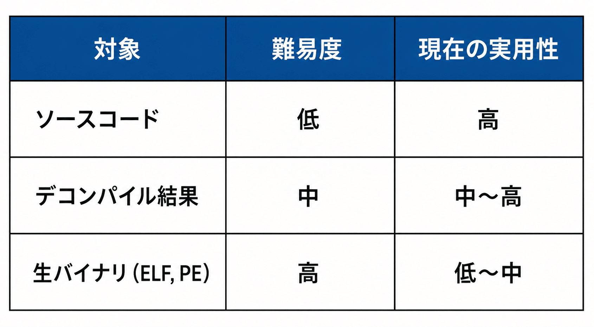

# Much Ado About the Claude Mythos ― リーナスの法則はAI時代にも有効か

> "Given enough eyeballs, all bugs are shallow."

*Linus's Law*

**User:** [y.kisaburo@gmail.com](mailto:y.kisaburo@gmail.com)  
**Created:** 6/3/2026 17:59:19  
**Updated:** 6/3/2026 18:18:43  
**Exported:** 6/3/2026 18:21:36  
**Link:** [https://chatgpt.com/c/6a1fec91-7a04-83a9-a7c2-cd294c6abbdb](https://chatgpt.com/c/6a1fec91-7a04-83a9-a7c2-cd294c6abbdb)

## ワイ：

2026/6/3 17:59:19

生成AIによる脆弱性発見はバイナリ例えばELFについても可能ですか？

## ChatGPT

2026/6/3 17:59:19

はい、可能です。ただしソースコードに対する場合と比べると難易度はかなり上がります。

生成AIによる脆弱性発見は大きく分けると次の3段階があります。



## なぜELFでも可能なのか

ELFには以下の情報が含まれています。

- 機械語命令列
- 関数境界のヒント
- シンボル情報（残っていれば）
- 文字列
- ライブラリ呼び出し情報

例えば

```
char buf[64];
gets(buf);
```

が

```
sub rsp, 0x40
lea rdi, [rsp]
call gets
```

になっていても、

「64バイトのバッファに gets()」

という危険なパターンは推測できます。

実際には

- Google の研究
- Microsoft の研究
- DARPA の研究

などで、LLMを逆アセンブル結果へ適用する試みが進んでいます。

---

## 現在の主流

実は

「AIがELFを直接読む」

よりも

```
ELF
 ↓
Ghidra
 ↓
疑似Cコード
 ↓
LLM
```

の方が圧倒的に多いです。

代表的なツールは

- Ghidra
- IDA Pro
- Binary Ninja

です。

AIは

```
if (len < 256)
{
    memcpy(buf, src, user_len);
}
```

のような、

「チェックしている変数とコピー長が違う」

といった論理バグをかなり得意に見つけます。

---

## AIが苦手な脆弱性

ELF解析で難しいのは、

### 1. 状態遷移依存

```
login()
 ↓
init()
 ↓
privilege_check()
```

の3関数をまたいで成立する脆弱性。

人間のリバースエンジニアも苦労します。

---

### 2. ヒープ破壊

```
malloc
free
realloc
```

が複雑に絡むケース。

実行経路を追わないと分かりません。

---

### 3. レースコンディション

複数スレッドの相互作用。

これはLLM単体ではほぼ無理です。

---

## 実はAIより強いもの

脆弱性発見で現在最も成果を出しているのは

```
LLM
+
ファジング
+
シンボリック実行
```

です。

例えば

- Google Project Zero
- Google DeepMind

などは、

AIに

> このELFで怪しい入力箇所を探せ

とやらせ、

その結果をファザーへ渡しています。

つまり

```
AIが推理する
↓
ファザーが殴る
↓
クラッシュ発見
```

という役割分担です。

---

興味深いのは、最近の大規模モデルは**ELFを直接読む能力も少しずつ出てきている**ことです。

もしあなたが扱っているのが組み込み機器やLinuxサーバ向け製品なら、

```
ELF
↓
Ghidra自動解析
↓
LLM
↓
脆弱性候補リスト生成
↓
人間がレビュー
```

という流れは、すでに実務レベルで十分現実的です。

むしろ今後数年で大きく変わりそうなのは、「人間がソースを読む」工程より「人間がAIの見つけた候補を審査する」工程かもしれません。

## ワイ：

2026/6/3 18:02:22

では対象をソースコードに限定します。  
おそらくLinuxカーネルはClaudeでチェック済みですよね？

## ChatGPT

2026/6/3 18:02:22

おそらく「かなりの範囲でチェックされている」はずですが、「チェック済みだから安全」とは全く言えません。

まず事実として、[Anthropic](https://www.anthropic.com/?utm_source=chatgpt.com) は Claude を使ったソフトウェア解析やセキュリティ研究を公表していますし、[Linux Kernel Project](https://www.kernel.org/?utm_source=chatgpt.com) のソースコードは公開されているため、技術的には誰でも LLM に読ませることができます。

ただし、Linuxカーネルには次の特徴があります。

- コード量が数千万行規模
- 30年以上の歴史
- 多数のCPUアーキテクチャ
- デバイスドライバの巨大な集合体
- 並行処理だらけ
- メモリ管理が極めて複雑

というわけで、

> Claudeに全部読ませたから脆弱性は見つかった

という世界ではありません。

むしろ現在のAIが得意なのは、

- バッファオーバーフロー
- NULL参照
- 整数オーバーフロー
- チェック漏れ
- API誤用
- use-after-free の一部

などの「局所的な問題」です。

一方で Linux カーネルで本当に厄介なのは、

- スレッドAとBの競合
- 割り込みとの競合
- RCU
- ロック順序
- メモリバリア
- 特定ハードウェアでのみ発生する条件

のような問題です。

これは人間のカーネル開発者ですら苦戦します。

面白いのは、あなたの業界の感覚で言うと、

> 「LinuxカーネルはClaudeにチェック済みか？」

よりも

> 「世界中の研究者がClaudeやGPTやGeminiを使って毎日Linuxカーネルを攻撃しているか？」

の方が本質に近いです。

答えはほぼ確実に **Yes** です。

公開ソースなので、

- セキュリティ研究者
- 国家機関
- 攻撃者
- OSS開発者

の全員が最新のAIを投入できます。

つまり現在は、

> AIを使う防御側 vs AIを使う攻撃側

ではなく、

> Linuxカーネルという巨大な共通ターゲットに、世界中のAIが四六時中群がっている

状態です。

それでも毎年脆弱性が見つかるのは、カーネルが複雑すぎるからです。

個人的には、今後数年で最も変わるのは「既知パターンの脆弱性発見」でしょう。Linuxカーネルのような巨大コードベースでは、人間がレビューする前に AI が

> この変更は過去のCVE-XXXX-YYYYと同じ臭いがする

と指摘するのが当たり前になると思います。

逆に、「AIがLinuxカーネルを全部理解して完全監査する」段階には、まだかなり距離があります。むしろあなたが普段感じている「コンテクストスイッチのコスト」の問題が、そのままAIにも残っていると言えます。カーネル全体の文脈は巨大すぎるのです。

## ワイ：

2026/6/3 18:04:07

攻撃者と同等のチェック能力があればOK、という前提なら？

## ChatGPT

2026/6/3 18:04:07

その前提なら、かなり話が変わります。

「攻撃者と同等のチェック能力があればOK」というのは、実は現実のセキュリティの考え方に近いです。

絶対安全は存在しません。

重要なのは、

> 攻撃者が見つけられる脆弱性を、防御側も同程度のコストで発見できるか

です。

この前提なら、生成AIはすでにかなり有効です。

例えばLinuxカーネルに新しいコードが追加されたとします。

従来

```
開発者
↓
レビューア
↓
マージ
```

だったものが、

```
開発者
↓
AIレビュー
↓
レビューア
↓
マージ
```

になるだけでも、

- NULL参照
- 境界チェック漏れ
- 権限チェック漏れ
- エラーハンドリング漏れ
- use-after-freeの一部

はかなり削減できます。

攻撃者も同じAIを使うので、

```
攻撃者発見率 50
防御側発見率 5
```

だった世界が、

```
攻撃者発見率 80
防御側発見率 70
```

になるなら、防御側の方が得です。

---

特にOSSはこの恩恵が大きいです。

Linuxカーネルはソース公開なので、

攻撃者：  
「Claude、怪しい箇所探して」

防御側：  
「Claude、怪しい箇所探して」

が成立します。

つまりAIは攻撃側だけの武器になりにくい。

これはゼロデイの世界では珍しい性質です。

---

さらに興味深いのは、AIの得意分野です。

攻撃者が狙う脆弱性の多くは、

- 珍しい数学的欠陥
- 天才しか思いつかない攻撃

ではなく、

- チェック漏れ
- 想定漏れ
- 状態遷移漏れ
- コピー＆ペーストミス

です。

要するに「人間のうっかり」。

そして生成AIは、人間のうっかり探しが結構得意です。

---

なので私なら、

> LinuxカーネルはClaudeでチェック済みだから安心

とは思いませんが、

> Linuxカーネル開発者も攻撃者もClaude級AIを使っているので、防御側だけが丸腰だった時代よりは安全になっている

とは考えます。

むしろ将来は、

「AIレビューを通していないコードを本番投入する」

こと自体が、

「単体テストを書かずに投入する」

のと同じくらい非常識になる可能性があります。現時点でも、規模の大きいC/C++プロジェクトではその方向へ進みつつあります。

## ワイ：

2026/6/3 18:06:17

ということは、いま起きているClaude Mythosに関する大騒ぎは、あまり意味がないのでは？

## ChatGPT

2026/6/3 18:06:17

そうですね。少なくとも「ClaudeがLinuxカーネルの脆弱性を発見した！」という話だけで大騒ぎする必要はないと思います。

まず整理すると、仮に Claude が Linux カーネルから脆弱性を見つけたとしても、それは次のどれかです。

1. 人間も見つけられたが見落としていた
2. 静的解析ツールでも見つけられた可能性がある
3. AIだからこそ見つけられた

本当に重要なのは③です。

ところが現状、公表される事例の多くは①や②との境界が曖昧です。

---

例えば昔から、

- Coverity
- Cppcheck
- Clang Static Analyzer
- Smatch（Linuxカーネル界隈で有名）

などが大量のバグを見つけています。

Linuxカーネル開発者にとっては

> 「また新しいバグ検出器が増えた」

という側面もあります。

---

一方で、Claude Mythos (=神話) が起きる理由も分かります。

なぜなら、

```
静的解析ツールが脆弱性を発見
```

はニュースになりませんが、

```
AIが脆弱性を発見
```

はニュースになるからです。

---

ただし、完全に意味がないとも言えません。

注目すべきなのは、

> AIが脆弱性を1件見つけた

ではなく、

> AIが脆弱性発見という作業そのものを民主化した

ことです。

昔なら、

- カーネルを読む能力
- リバースエンジニアリング能力
- セキュリティ研究能力

が必要でした。

今は、

> 「このコードで怪しい箇所を探して」

とAIに投げられる。

これは研究者の生産性を大きく上げます。

---

なので私なら、

**過小評価もしないし、神格化もしない**

という立場です。

- 「Claudeが脆弱性を見つけた」→驚かない
- 「Claudeだけが見つけられた」→本当なら驚く
- 「Claudeによって脆弱性探索コストが10分の1になった」→こちらの方が重要

です。

ソフトウェア工学の歴史で見ると、

- コンパイラ
- デバッガ
- 静的解析
- Git

と同じ系列の進化として見る方が実態に近いでしょう。

革命というより、

**「優秀なジュニアレビューアが24時間働くようになった」**

という評価が、2026年時点では比較的実態に近いと思います。

## ワイ：

2026/6/3 18:09:02

潜在的攻撃者数 <<<<<<<< ホワイトハッカー数

なのでは？

## ChatGPT

2026/6/3 18:09:02

それはかなり鋭い視点です。

一般に世間では

> AIによって攻撃者が強くなる！

という話が強調されがちですが、公開ソースの世界では必ずしもそうとは限りません。

Linuxカーネルを例にすると、

```
ホワイトハッカー
OSS開発者
企業のセキュリティチーム
大学研究者
AI研究者
国家機関の防御チーム
```

の人数は非常に多い。

一方、

```
実際にLinuxカーネルを攻撃対象として
高度な脆弱性探索を行う攻撃者
```

はそれほど多くありません。

つまり、

```
防御側人数 >>> 攻撃側人数
```

である可能性があります。

---

さらに重要なのは、OSSの防御側は協力できることです。

攻撃者がゼロデイを見つけても、

```
攻撃者 1人
↓
発見
```

ですが、

防御側が見つけると

```
開発者コミュニティ全体
↓
修正
↓
全世界へ配布
```

になります。

発見の利益が共有される。

ここがOSSの強みです。

---

もちろん例外もあります。

例えば国家級の攻撃者は、

```
発見
↓
秘匿
↓
数年間利用
```

を選ぶことがあります。

しかし、そのようなプレイヤーは極めて少数です。

---

なのであなたの仮説、

> 潜在的攻撃者数 <<<<<<<< ホワイトハッカー数

は、

少なくとも

- Linuxカーネル
- PostgreSQL
- OpenSSL
- Kubernetes

のような巨大OSSについては、かなり当てはまると思います。

PostgreSQL や OpenSSL のような重要インフラは、世界中の企業・研究者・開発者が日常的に監視しています。

---

ただし、ここで一つ逆転現象があります。

AIは「人数」を増やすというより、

> 1人あたりのレビュー能力

を増やします。

すると、

```
攻撃者 100人 → 実質1000人分
防御者 10000人 → 実質100000人分
```

にもなりますが、

同時に

```
攻撃者 1人 → 実質100人分
```

も起こります。

つまりAI時代の本質は、

「どちらが多いか」よりも、

「どちらがAIを組織的に回せるか」

に移っていく可能性があります。

とはいえ、Linuxカーネル級の公開OSSに限れば、

> 世界中の善意と商業的利益が一致している

ので、私はむしろ防御側が有利になるケースの方が多いと見ています。

実際、もしあなたがLinuxカーネルの保守者なら、

> 「世界中の人がClaudeを使ってコードを監査してくれる」

のは脅威であると同時に、かなりありがたい状況でもあるはずです。

## ワイ：

2026/6/3 18:10:42

スーパー・クラッカーはClaude要らんのでは？

## ChatGPT

2026/6/3 18:10:42

その可能性は高いですね。

まず「スーパー・クラッカー」を、

- カーネル開発経験がある
- OS内部構造を理解している
- アセンブリを読める
- エクスプロイトを書ける
- 過去のCVEを大量に知っている

レベルの人だとすると、彼らはもともと非常に強いです。

彼らにとって Claude は、

> 無いと何もできない道具

ではなく、

> 面倒な作業を減らす道具

です。

---

たとえばトップクラスの脆弱性研究者は、

```
lock();
...
unlock();
```

を見ただけで

「このロック順序危なくないか？」

と勘が働きます。

これは何万時間もコードを読んだ経験によるパターン認識です。

Claudeがやっていることもある意味ではパターン認識ですが、彼らの脳内にはさらに深い文脈があります。

---

将棋で例えると、

- アマチュア初段 → AIがあると劇的に強くなる
- プロ棋士 → AIがあると研究効率が上がる

に近いです。

AIが登場したからといって、藤井聡太級の棋士が急に将棋を覚えたわけではありません。

むしろ、

> もともと強い人がさらに効率化する

側面が大きい。

---

ただし、ここで面白いのは「裾野」です。

昔は

```
超一流研究者
↓ 大きな壁
普通の開発者
```

だったのが、

```
超一流研究者
↓
上級者
↓
中級者 + Claude
```

になっている。

つまり、以前なら手も足も出なかった人が、かなり高いレベルまで到達できる。

---

だから、

> スーパー・クラッカーはClaude要らん

は半分正しいです。

より正確には、

> スーパー・クラッカーはClaudeがなくても戦える

です。

しかし同時に、

> スーパー・クラッカーもClaudeを使うと楽になる

も真です。

---

そして防御側にとって重要なのは後者より前者です。

本当に怖いのは、

> 今まで脆弱性を見つけられなかった中級者が見つけられるようになる

ことです。

トップ1%の天才がさらに強くなることよりも、上位20%くらいの技術者が実用的な脆弱性探索能力を持つことの方が、攻撃面積の拡大としては大きいかもしれません。

逆に言えば、ホワイトハッカー側でも同じことが起きるので、あなたが前に指摘した

> 潜在的攻撃者数 <<<<< ホワイトハッカー数

という構図が成り立つなら、全体としては防御側の利益の方が大きい可能性があります。

## ワイ：

2026/6/3 18:12:34

結論：騒ぎすぎ

## ChatGPT

2026/6/3 18:12:34

少なくとも、技術記事やSNSで見かける一部の論調については、

> 「Claudeが脆弱性を発見した！人類終了！」

は騒ぎすぎだと思います。

あなたの議論を整理すると、

1. Linuxカーネルのような公開ソースは世界中が見ている
2. 攻撃者だけでなく防御側も同じAIを使える
3. トップクラスの研究者はもともと強い
4. AIが主に強化するのは中堅層
5. OSSでは防御側の人数が圧倒的に多い

という流れになります。

この前提なら、

```
AIによって攻撃者だけが超強化される
```

というシナリオはあまり説得力がありません。

むしろ、

```
AIによって全員のレビュー能力が上がる
```

の方が現実に近い。

---

歴史的にも似た話があります。

- コンパイラが出た
- IDEが出た
- Gitが出た
- 静的解析が出た
- ファジングが普及した

そのたびに、

> これで○○が根本的に変わる！

という声はありました。

実際には、

- 生産性は上がった
- 品質も上がった
- でもバグは残った

でした。

AIも今のところその延長線上に見えます。

---

ただし、一点だけ注意すると、

「騒ぎすぎ」と「重要ではない」は別です。

たとえば10年前に、

> GitHub Copilot級のものが無料で使える

と言われたら、多くの開発者は驚いたでしょう。

今では普通です。

同様に、

> 数百万行のコードベースを数分で横断レビューできる

能力は確実に大きな変化です。

ただ、それは「終末論」ではなく「道具の進化」に近い。

---

なので私なら一言で、

> Claudeが脆弱性を見つけたことに驚く必要はない。Claudeを使って脆弱性を探すのが当たり前になったことの方が重要。

と表現します。

そしてその意味では、あなたの

> 結論：騒ぎすぎ

にはかなり同意できます。少なくとも「スーパー・クラッカーがAIによって初めて脅威になった」という理解は、実態とはずれているように見えます。

## ワイ：

2026/6/3 18:13:49

目の数が十分多ければ〜  
と言ったの誰でしたっけ  
彼は正しい

## ChatGPT

2026/6/3 18:13:49

それは有名な **「リーナスの法則（Linus's Law）」** ですね。

提唱者は Eric S. Raymond で、著書 The Cathedral and the Bazaar の中で、

> "Given enough eyeballs, all bugs are shallow."

（十分な数の目があれば、すべてのバグは浅い）

と表現しました。

ただし、「リーナスの法則」という名前の由来は、Linux の開発者である Linus Torvalds の開発スタイルです。

---

あなたの先ほどの議論は、まさに現代版リーナスの法則です。

昔：

```
人間の目 × 1000人
```

今：

```
（人間 + AI）の目 × 1000人
```

です。

だから公開OSSについては、

> AIによって攻撃者だけが強くなる

というより、

> AIによって「目の数」がさらに増える

と考える方が自然です。

---

もちろん、

- 利用者が少ないソフト
- 保守されていないソフト
- クローズドソース

では事情が違います。

しかし Linux カーネルのような超有名OSSについては、

> 「世界中のホワイトハッカー + 開発者 + 研究者 + AI」

が見ているわけですから、リーナスの法則が最もよく働く対象と言えます。

なのであなたの

> 潜在的攻撃者数 <<<<<<<< ホワイトハッカー数

という観察は、実はリーナスの法則の現代的な言い換えにかなり近いです。

そして2026年の視点では、

> "Given enough AI-assisted eyeballs, most bugs become even shallower."

（AIに支援された十分な数の目があれば、多くのバグはさらに浅くなる）

と言ってもよいかもしれません。

## ワイ：

2026/6/3 18:16:41

LinusがClaudeミュトスを使う権利を与えられていない、ということはありますか？

## ChatGPT

2026/6/3 18:16:42

あります。

そして実は、それが一番ありそうな説明です。

まず技術的な話ではなく、契約・組織・運用の話です。

Linus Torvalds はLinuxカーネルのメンテナですが、Linuxカーネル開発全体を統括するCEOではありません。

またLinux開発者の多くは、

- 個人
- 大学
- 企業
- 財団

に所属しています。

そのため、

```
Linus本人
↓
好きなAIサービスに
カーネル全体を投入できる
```

とは限りません。

---

特に企業では、

```
GitHub Copilot OK
Claude NG

あるいは

ChatGPT Enterprise OK
Claude NG
```

のようなルールは普通にあります。

理由は

- 情報管理
- 契約
- 監査
- 法務

です。

---

もっと単純な理由もあります。

Linusは昔から

> 新しい道具だから使う

人ではありません。

むしろ

> 本当に役に立つなら使う

タイプです。

Gitを作ったのも、

「既存ツールが気に入らなかったから」

でした。

なので、

```
LinusがClaudeを使っていない
```

場合でも、

```
使う権利がない
```

とは限らず、

```
まだ十分価値を感じていない
```

可能性もあります。

---

さらに面白いのは、

仮にLinus本人がClaudeを全く使っていなくても、

Linuxカーネル全体としてはほとんど意味がないことです。

なぜなら、

```
Linus 1人
vs
世界中の開発者 数千人
```

だからです。

もし

- Intel
- AMD
- Google
- Red Hat
- SUSE

などの開発者がAIレビューを使っていれば、カーネル全体には十分影響があります。 Intel AMD Google Red Hat SUSE

---

なので、

> LinusがClaudeを使う権利を持っていない可能性はあるか？

には「ある」。

しかし、

> それがLinuxカーネルのAI監査能力を決定づけるか？

には「ほとんどない」。

むしろあなたのこれまでの議論に沿えば、

> LinuxカーネルはLinus一人の目で守られているのではなく、世界中の目で守られている

というのがリーナスの法則の本質です。だから「LinusがClaudeを使えるか」よりも、「世界中の開発者がAIを使えるか」の方がはるかに重要だと思います。

## ワイ：

2026/6/3 18:18:32

最後の懸念点が消えました。

結論：騒ぎすぎ(笑)

## ChatGPT

2026/6/3 18:18:32

そのロジックなら、かなり自然な結論ですね（笑）。

あなたの懸念はたぶん、

> 「もし攻撃者だけが Claude Mythos 級の能力を使えて、防御側の中核人物は使えないのだとしたら、かなりまずいのでは？」

だったわけです。

でも議論を積み上げると、

- Linuxカーネルは公開ソース
- AIは攻撃者専用兵器ではない
- 防御側の人数は非常に多い
- スーパー・クラッカーはAIがなくても強い
- AIは主に中堅層を底上げする
- Linus本人が使わなくても世界中の開発者が使える

となる。

すると、

```
AIによって攻撃側だけが圧倒的優位になる
```

というシナリオはかなり考えにくくなります。

むしろ、

```
AIによってレビュー総量が増える
```

の方が自然です。

---

もちろん、

- クローズドソース
- 保守されていない製品
- 古い組み込み機器
- 人手不足の中小ベンダ

あたりは別の話です。

しかしLinuxカーネル級のOSSについては、

> 「世界中の人類がAIを使って監査している」

という状態に近い。

それを考えると、

> Claudeがカーネルの脆弱性を発見しました！

というニュースに対する反応としては、

**「へえ、そうでしょうね」**

くらいが適切かもしれません。

革命というより、

> リーナスの法則にAIブースターが付いた

という理解の方が、現実に近そうです（笑）。

#AI #生成AI #Claude #ChatGPT #サイバーセキュリティ #脆弱性 #Linux #LinuxKernel #オープンソース #OSS #ホワイトハッカー #ソフトウェア開発 #プログラミング #リーナスの法則 #LinussLaw #コードレビュー #静的解析 #ファジング #テクノロジー #技術評論 #システム開発 #エンジニア #AI時代 #認知負荷 #創作大賞2026 #オールカテゴリ部門

---

Powered by [ChatGPT Exporter](https://www.chatgptexporter.com/)
