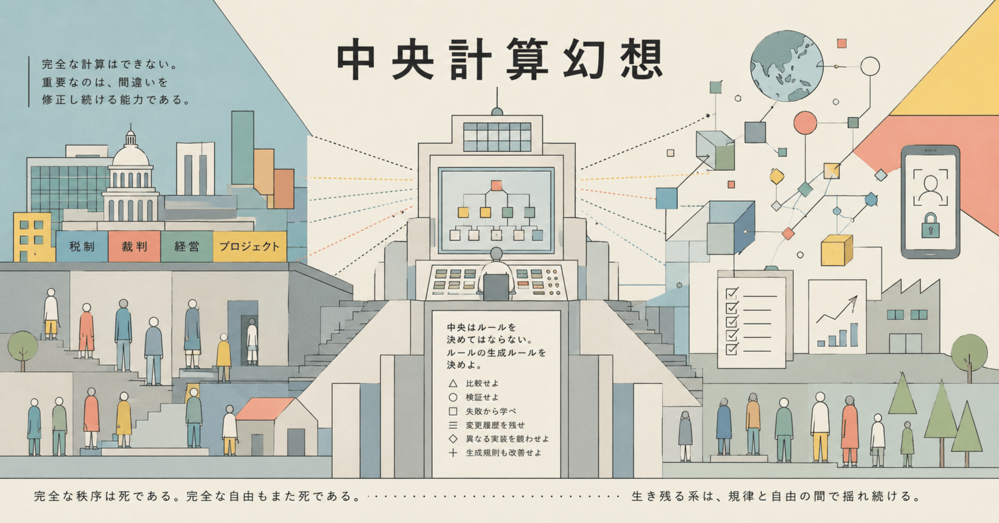

# 『中央計算幻想』 -- 『プラトンの呪縛』から逃れるために

### 『中央計算幻想』--『プラトンの呪縛』から逃れるために

私たちはしばしば、「十分に優秀な中央管理者が存在すれば、社会はより良く運営できる」と考える。

優秀な官僚がいれば適切な税制を設計できる。優秀な裁判官がいれば正しい判決を下せる。優秀な経営者がいれば会社を成長させられる。優秀なプロジェクトマネージャがいればプロジェクトは成功する。精密な人生設計があれば幸福になれる。

この考え方を私は「中央計算幻想」と呼びたい。

幻想と呼ぶ理由は単純である。

現実世界は、中央が計算できるほど単純ではない。

---

例えば生活保護制度を考えてみよう。

制度の目的は、最低限度の生活を保障し、自立を支援することである。

ところが現実には、

「資産を処分してください」

「貯金を使い切ってください」

「親族に援助を求めてください」

と言われることがある。

制度設計者から見れば合理的である。

本当に困窮した人を見極めたいからだ。

しかし、ここで一つの疑問が生じる。

もし自立支援が目的ならば、なぜ再起のための資源を失わせてから支援するのだろうか。

生産設備を手放し、貯蓄を失い、人間関係を消耗し、それでもなお立ち上がれなくなった段階で初めて支援する。

それは「再起支援」ではなく、「破綻処理」に近い。

もちろん現場職員が悪いわけではない。

問題は制度そのものにある。

制度設計者は、誰が本当に困窮しているのかを中央から判定できると考えている。

しかし実際には、その人の将来性も、生産能力も、家族関係も、人生の文脈も完全には理解できない。

---

同じ問題はデジタル社会にも現れる。

Face IDで保護された資産が、本人死亡によって事実上凍結される事例がある。

システムは本人と本人以外を厳密に区別する。

セキュリティとしては優秀である。

しかし人間は死ぬ。

相続人は存在する。

人生は連続している。

それにもかかわらず、システムは「本人か、それ以外か」しか理解できない。

ここでもまた、中央計算幻想が顔を出す。

設計者は、あらゆるケースを事前に分類できると思い込んでいる。

---

企業も同じである。

KPIを定めれば組織は改善すると考える。

手順書を整備すれば品質は向上すると考える。

しかし現実には、人間は評価指標を最適化し、手順書の穴を埋めるために働くのではなく、手順書の通りに働くために働くようになる。

目的は忘れられ、手段だけが残る。

これもまた中央計算幻想である。

中央は現場を理解していると思い込む。

しかし理解していない。

理解できない。

---

では、どうすればよいのだろうか。

私の答えは単純である。

中央はルールを決めてはならない。

中央はルールの生成ルールを決めるべきである。

比較せよ。

検証せよ。

失敗から学べ。

変更履歴を残せ。

異なる実装を競わせよ。

そして生成規則そのものもまた、改善の対象とせよ。

重要なのは正しい答えではない。

正しい答えは複雑系には存在しない。

重要なのは、間違いを修正し続ける能力である。

---

生命はなぜ進化するのか。

それは完全な秩序を持たないからである。

アメーバでさえ遺伝子交換を行う。

閉じた系は劣化する。

外部との情報交換によってのみ、生存能力を維持できる。

社会も同じである。

組織も同じである。

国家も同じである。

人生も同じである。

完全な秩序は死である。

完全な自由もまた死である。

生き残る系は、規律と自由の間で揺れ続ける。

---

中央計算幻想の本質は傲慢である。

「私は十分な情報を持っている」

「私は未来を予測できる」

「私は適切に分類できる」

という傲慢である。

しかし現実世界は複雑系である。

誰も全体を見ることはできない。

設計者が頭の中に描く『完璧な正解（イデア）』を現実に押し付けようとすることが、この幻想の正体である。

だからこそ必要なのは万能の中央ではない。

誤りを修正し続ける仕組みである。

自由と秩序を両立させる唯一の方法は、正しさを固定することではなく、正しさを更新し続けることなのだ。

#創作大賞2026 #エッセイ部門 #中央計算幻想 #プラトンの呪縛 #イデア論 #複雑系 #システム思考 #ポパー #反証可能性 #生成規則 #メタルール #自己組織化 #創発 #分散システム #自由と秩序 #社会工学 #制度設計 #組織論 #グッドハートの法則
