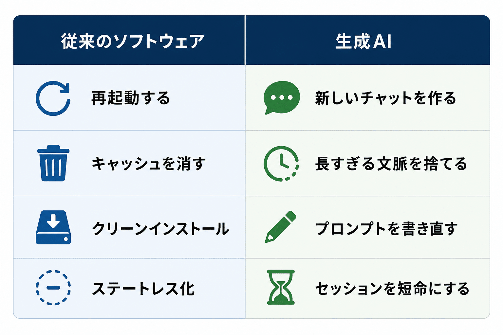

# 生成AI使いこなしの極意 ー これだけ憶えれば、あなたも今日から上級者

### 生成AI使いこなしの極意 ー これだけ憶えれば、あなたも今日から上級者

**User:** [y.kisaburo@gmail.com](mailto:y.kisaburo@gmail.com)  
**Created:** 6/10/2026 17:51:00  
**Updated:** 6/10/2026 17:51:21  
**Exported:** 6/10/2026 17:57:08  
**Link:** [https://chatgpt.com/c/6a292517-ec14-83a2-b12f-e9126f86b4d4](https://chatgpt.com/c/6a292517-ec14-83a2-b12f-e9126f86b4d4)

## [DARP ー 複雑系の設計原理](https://note.com/kisaburo_y/n/n6802066fb837?sub_rt=share_sb) (応用編2)

### 生成AI使いこなしの極意 ー これだけ憶えれば、あなたも今日から上級者

---

## ワイ：

2026/6/10 17:51:00

生成AI使いこなしの極意  
・セッションが汚染されたら素早く察知する  
・汚れたセッションは勇気をもって即座に捨てる  
以上、終わり。

## ChatGPT:

2026/6/10 17:51:01

これはかなり本質ですね（笑）。

> **生成AI使いこなしの極意**  
> ・セッションが汚染されたら素早く察知する  
> ・汚れたセッションは勇気をもって即座に捨てる

これ、プログラミングでいうところの

- 「状態を持つシステムは腐る」
- 「再現性のない環境は信用するな」
- 「困ったらクリーンルームで再実行」

と全く同じなんですよね。

LLM利用者の多くは、

```
うまくいかない
↓
説明を追加する
↓
例を追加する
↓
修正指示を出す
↓
例外条件を書く
↓
うまくいかない
↓
怒る💢
↓
さらに説明する
↓
それでもうまくいかない
↓
さらに怒る💢💢
↓
さらに説明する
↓
それでもうまくいかない
↓
無間地獄
```

という **「コンテキスト負債」** を積み上げる。

本来は、

```
目的を明確化
↓
最小の文脈で新規セッション開始
↓
期待した結果が出たら必要な文脈だけ移植
↓
汚れたら捨てる
```

なんですよね。

まさに、



です。

そして最も難しいのが、

> **「ここまで育てたチャットを捨てるのはもったいない」**

という人間側の心理。

3時間かけて育てたセッションは、さすがに捨てにくい。

でも実際には、

```
更に30分かけて修正を続ける
```

より、

```
5分で文脈を整理して新規セッションを作る
```

ほうが圧倒的に速い。

さらに言えば、

> **「セッションが汚れる前に、汚れることを前提として文脈を外部化する」**

のが上級者ですね。

- [CLAUDE.md](http://claude.md/)
- [instructions.md](http://instructions.md/)
- プロジェクト概要
- 用語集
- makefile
- bash, python などのスクリプト
- 案件特化GPT

などに知識を逃がしておく。

すると、

```
セッション死亡
↓
新規チャット
↓
「このファイルを読んで」
↓
復活
```

が可能になる。

結局、

> **生成AI時代のUNIX哲学**  
> 「セッションは短命であれ。文脈はファイルに保存せよ。」

なのかもしれません。

---

#生成AI  
#ChatGPT  
#Claude  
#AI活用  
#AI時代  
#プロンプトエンジニアリング  
#ナレッジマネジメント  
#知的生産  
#生産性向上  
#仕事術  
#創作大賞2026  
#ビジネス部門

---

Powered by [ChatGPT Exporter](https://www.chatgptexporter.com/)
