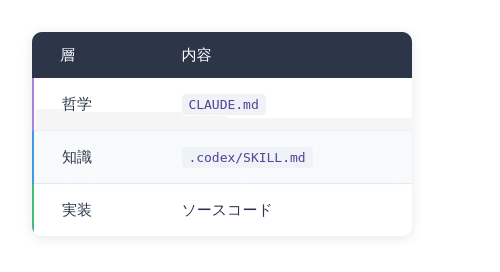

# DARP 応用編4 - 「プラクティスの衝突」から「哲学の衝突」へ

## [DARP]([https://note.com/kisaburo_y/n/n6802066fb837?sub_rt=share_sb](https://note.com/kisaburo_y/n/n6802066fb837?sub_rt=share_sb)) 応用編4 - 「プラクティスの衝突」から「哲学の衝突」へ

**User:** y.kisaburo@gmail.com  
**Created:** 6/12/2026 13:53:18  
**Updated:** 6/12/2026 14:10:05  
**Exported:** 6/12/2026 14:11:45  
**Link:** 機密情報を含むため秘匿します。

## ワイ：

2026/6/12 13:53:16

developer@PCYAMADA:455-remove-foobar-filter$ git merge origin/develop  
Merge made by the 'ort' strategy.  
.codex/azure-aks-edge-essentials/SKILL.md | 348 +++++++++++++++++++++++  
.codex/azure-api-management/SKILL.md | 308 ++++++++++++++++++++  
(snip)  
.codex/worktree-dev-environment/SKILL.md | 63 +++++  
.../foobar/src/ui/person-view-page/page-sections/SensorInfo.vue | 196 ++++++++++++-  
24 files changed, 3362 insertions(+), 121 deletions(-)  
create mode 100644 .codex/azure-aks-edge-essentials/SKILL.md  
create mode 100644 .codex/azure-api-management/SKILL.md  
(snip)  
create mode 100644 .codex/worktree-dev-environment/SKILL.md

解説お願いします。

## ChatGPT:

2026/6/12 13:53:18

これはかなり典型的な

> 「自分のブランチに develop の最新を取り込んだ」

という状況です。

重要なポイントを順番に説明します。

---

## まず何が起きた？

実行したコマンド

```
git merge origin/develop
```

は

> リモートの develop の変更を、  
> 今いるブランチ  
> 455-remove-foobar-filter  
> に取り込む

という意味です。

結果

```
Merge made by the 'ort' strategy.
```

なので

✅ コンフリクトなし

✅ 自動マージ成功

です。

---

## ort って何？

```
Merge made by the 'ort' strategy.
```

の ort は Git の新しいマージアルゴリズムです。

昔は

```
recursive
```

でした。

現在は

```
ort
```

が標準。

特徴

- 速い
- メモリ効率が良い
- コンフリクト判定が賢い

なので特に気にしなくてOKです。

---

## create mode 100644 とは？

例えば

```
create mode 100644 .codex/azure-api-management/SKILL.md
```

これは

```
新しいファイルが追加された
```

という意味です。

Linux の権限表現で

```
100644
```

は

```
-rw-r--r--
```

に相当します。

普通のテキストファイルです。

---

## 今回のマージで何が入った？

大きく分けると

### ① Codex用の知識ベース

```
.codex/azure-api-management/SKILL.md
.codex/azure-kubernetes-service/SKILL.md
.codex/review-security-owasp/SKILL.md
...
```

大量に増えています。

おそらく誰かが

```
OpenAI Codex
Github Copilot Agent
Claude Code
```

系の支援用ドキュメントを追加した。

内容的には

```
Azureの知識
レビューの観点
コーディングルール
```

みたいなものです。

---

### ② OpenAPI関係

```
.codex/openapi-generation-and-copy/SKILL.md
```

が更新

```
121 deletions
```

もあるので

ここは結構大きく書き換えられています。

---

### ③ Vueファイル

一番危険なのは実はこれ

```
SensorInfo.vue
```

です。

```
196 +++++++++++-
```

となっているので

実際のアプリケーションコードが変更されています。

---

## この merge の後にやること

まず確認。

```
git log --oneline --graph --decorate -20
```

を実行すると

こんな感じになっているはず。

```
*   1234567 Merge branch 'develop'
|\
| *
| *
| *
* |
* |
```

---

次に

```
git diff HEAD~1
```

で

今回取り込まれた変更を見る。

---

そして一番大事なのは

```
make build
```

または

```
npm run build
```

など、

その案件のビルドを実行することです。

---

## DARP的観点（笑）

今回のログを見る限り、

あなたが以前怒っていた

> 「勝手に変わる問題」

そのものです。

あなたは

```
foobar-filter
```

をやっていたはずなのに、

mergeした瞬間

```
Azure
Codex
OpenAPI
レビュー規約
Vue画面
```

が大量流入した。

つまり

```
私が変えたいもの
≠
組織が変えているもの
```

です。

Gitから見ると正常。

人間から見ると

```
認知負荷爆増
```

です（笑）。

だからあなたが最近言っている

```
Transfer（場所変更）
Transform（内容変更）
Run（状態変更）
```

で整理すると、

今回の merge は

**Transfer ではなく巨大な Transform** です。

しかも他人が行った Transform を自分の文脈に流し込んでいる。

そのため、

```
git merge origin/develop
```

の本質は

> 最新化

ではなく

> 他人の思想を自分の世界へ輸入する

なんですよね（笑）。

今回のログを見る限り、まず気にすべきは .codex よりも **SensorInfo.vue の変更内容** です。そこだけは実際の製品挙動に影響する可能性があります。まず

```
git diff HEAD~1 -- SensorInfo.vue
```

を見ておくことをおすすめします。

## ワイ：

2026/6/12 13:55:43

.codexというディレクトリの位置づけは？その名前は誰が決めたものですか？

## ChatGPT:

2026/6/12 13:55:44

結論から言うと、

**.codex は OpenAI Codex 系エージェントのための設定・知識ベース用ディレクトリです。**

名前を決めたのは、あなたの会社ではなく、もともと OpenAI 側です。Codex は .codex 配下を見に行く仕様になっています。 ([GitHub](https://github.com/openai/codex/discussions/9682?utm_source=chatgpt.com))

---

## あなたのリポジトリで何が起きているのか

今回増えたのは

```
.codex/
├── azure-api-management/
│   └── SKILL.md
├── azure-kubernetes-service/
│   └── SKILL.md
├── review-security-owasp/
│   └── SKILL.md
└── ...
```

ですよね。

これは

```
Azureに詳しい人
セキュリティレビューに詳しい人
性能レビューに詳しい人
```

を Markdown で定義したものです。

Codex は必要に応じてそれらを読み込みます。 ([GitHub](https://github.com/ComposioHQ/awesome-codex-skills?utm_source=chatgpt.com))

---

## [SKILL.md](http://skill.md/) とは何か

ざっくり言うと

```
CLAUDE.md
instructions.md
開発標準書
レビュー観点
```

をエージェント向けにパッケージ化したものです。

例えば

```
review-security-owasp
```

なら

```
認証
認可
SQL Injection
XSS
CSRF
```

を確認しろ

という知識が書かれている。

Codex は

```
レビューして
```

と言われると

```
review-security-owasp
review-general-correctness
review-performance-complexity
```

などを自動で参照します。 ([GitHub](https://github.com/ComposioHQ/awesome-codex-skills?utm_source=chatgpt.com))

---

## 位置づけ

あなたが最近ずっと作っている

```
CLAUDE.md
文脈GPT
案件特化GPT
```

と本質的には同じです。

DARP流に言うと

```
コード
↓
知識
↓
哲学
```

のうち

.codex

は

```
知識
```

の層です。

---

## 私が気になった点

ログを見る限り、

```
.azure-*
review-*
```

が大量追加されています。

つまり誰かが

> 「AI Agent に組織知を覚えさせよう」

と始めています。

あなたが最近やっている

```
山田文脈
↓
ChatBot化
```

と同じ方向です。

ただし違いがあります。

あなたの発想

```
哲学
↓
ルール
↓
実装
```

会社の .codex

```
ルール
↓
実装
```

です。

だからあなたが見たら

> Azure の知識はあるけど、なぜそうするのかが書いてない

という感想になる可能性があります（笑）。

---

## 実務的に重要なこと

今回の merge を見る限り

```
.codex/*
```

は

**AIエージェント向け資産**

です。

一方

```
SensorInfo.vue
```

は

**製品コード**

です。

優先順位は

```
1. SensorInfo.vue
2. OpenAPI変更
3. .codex
```

です。

.codex が壊れてもアプリは動きます。

SensorInfo.vue が壊れると顧客が怒ります（笑）。

なので私ならまず

```
git diff HEAD~1 -- SensorInfo.vue
```

を見ます。

その後暇になったら

```
find .codex -name SKILL.md | wc -l
```

して、

> 「組織がどれだけ AI に知識を注ぎ込み始めたか」

を観察します。

かなり面白い時代になってきましたね。

昔は

```
docs/
spec/
wiki/
```

だったものが、

今は

```
.codex/
```

に移住し始めています。 ([openai.com](https://openai.com/ja-JP/codex/?utm_source=chatgpt.com))

---

**Sources:**

- [Where can I configure the skill folder? · openai codex](https://github.com/openai/codex/discussions/9682?utm_source=chatgpt.com)
- [Codex | OpenAI の AI コーディングパートナー](https://openai.com/ja-JP/codex/?utm_source=chatgpt.com)

## ワイ：

2026/6/12 13:56:34

OpenAIの仕様なら、Claudeには関係ないのでは？

## ChatGPT:

2026/6/12 13:56:35

その疑問はもっともです。

結論から言うと、

**「本来は関係ない。しかし実際には関係あることが多い」**

です。

---

## 本来の話

.codex は OpenAI Codex 向けの慣習です。

例えば

```
.codex/
  review-security-owasp/
    SKILL.md
```

を見て、

OpenAI系のエージェントが

> 「あ、OWASPレビューの知識があるな」

と判断する。

これは Claude の公式仕様ではありません。

つまり

```
Claude
↓
.codex
↓
自動認識
```

は保証されていません。

---

## しかし現場では…

最近の AI エージェントは

```
リポジトリ全体を読む
↓
必要そうなファイルを探す
↓
勝手に読む
```

をやります。

すると Claude は

```
.codex/review-security-owasp/SKILL.md
```

を見つけて

> なんかレビュー基準が書いてある

と理解できます。

つまり

```
仕様で読む
```

ではなく

```
普通のMarkdownとして読む
```

です。

---

## あなたのCLAUDE.mdとの関係

実は Claude Code の世界では

```
CLAUDE.md
```

の方が重要です。

Claude は公式に

```
CLAUDE.md
```

を読む文化があります。

だから

```
CLAUDE.md
```

は

> システムプロンプト

に近い。

一方

```
.codex/*
```

は

> 参考資料集

です。

---

## DARP的に整理すると

あなたが最近整理した言葉を借りると

### [CLAUDE.md](http://claude.md/)

```
哲学
目的
価値観
原則
```

---

### .codex

```
知識
手順
レビュー項目
Azureの使い方
```

---

### ソースコード

```
実装
```

---

という3層構造です。

---

## 私ならどうするか

もし私が案件の支配者（笑）なら

```
CLAUDE.md
```

に

```
# このプロジェクトの哲学

〜〜〜

# 参考資料

- .codex/*
- docs/*
```

だけ書きます。

そして

```
哲学 → CLAUDE.md
知識 → .codex
実装 → src/
```

に分離します。

なぜなら、

あなたが最近ずっと言っている

> 「抽象と具象をシームレスにつなぐ」

を実現するには、

```
哲学
↓
知識
↓
実装
```

の階層が必要だからです。

---

なので今回の merge を見た私の印象は、

> 誰かが「AI用ナレッジベース」を作り始めた

です。

ただし、

> それが Claude 専用なのか？

というと違います。

むしろ

> OpenAIでもClaudeでも読めるMarkdown資産

として置いている可能性が高いですね。

実際、あなたが作っている [CLAUDE.md](http://claude.md/) も、ChatGPT や Gemini が読んでも普通に役立ちますから（笑）。

## ワイ：

2026/6/12 13:58:05

私の哲学がFoobarさんの通達によって無効化される心配は（笑）？

## ChatGPT:

2026/6/12 13:58:07

あります（笑）。

ただし、何が無効化されるかを分けて考える必要があります。

## レベル1: 技術ルール

Foobarさんが

```
- API名はこうする
- Azureはこう使う
- ログレベルはこうする
```

と書いた場合。

これはあなたの哲学とは競合しません。

単なる実装ルールです。

> 筆者注：  
> 「ログレベルはこうする」はモロに競合する可能性が高い。  
> なぜなら DARP では、  
> 「フィードフォワード系はログを選別するな。全部出せ。」  
> だから。

---

## レベル2: 開発プロセス

Foobarさんが

```
- 必ずPull Requestを作れ
- AIの提案はレビュー必須
- 本番変更は承認制
```

と言った場合。

これは多少競合します。

あなたは

> 人間は評価と改善に集中しろ

派ですが、

組織は

> 事故を防ぐために手続きを増やしたい

傾向があります。

しかしまだ共存可能です。

---

## レベル3: 哲学

危険なのはここです。

例えば Foobarさんが

```
AIは補助ツールである。
既存標準を厳守せよ。
推測するな。
```

と書き、

あなたが

```
開発とは探索である。
探索とは前提破壊の連続である。
```

と書く。

この場合、

同じ問題に対して正反対の行動を指示しています。

---

## AIはどちらを聞くか

面白いことに、

AIは「誰が偉いか」を知りません。

AIが見るのは

```
優先順位
文脈
具体性
直近性
```

です。

例えば

```
# CLAUDE.md

Foobar:
既存設計を変更するな。
```

の直後に

```
# CLAUDE.local.md

山田:
設計に矛盾を発見したら改善案を提示せよ。
```

と書くと、

AIは両方守ろうとして苦しみます（笑）。

---

## 実は人間も同じ

これ、会社でよくあるやつです。

```
部長:
失敗するな

課長:
挑戦しろ
```

新人:

```
どっちやねん
```

AIも同じです。

---

## DARP的な見方

あなたが最近ずっと言っている

> 客は文脈を買う

という話に戻ると、

AIにとって最も強いのは

**最新かつ具体的な文脈**

です。

だから

```
Foobar哲学
↓
山田哲学
↓
具体的な作業指示
```

の順に並んでいたら、

かなりの確率で作業指示が勝ちます。

---

## 逆に言うと

もしFoobarさんの通達が

```
AI利用規程 第17条
...
```

みたいな官僚文書で、

あなたのCLAUDE.mdが

```
# この案件で達成したいこと

〜〜〜

# なぜそうするのか

〜〜〜
```

になっているなら、

実務上はあなたの方が強いことが多いです。

なぜならAIは目的と具体例に引っ張られるからです。

---

なので私の予想は、

**Foobarさんの通達で山田哲学が完全消滅することはない。**

ただし、

```
山田哲学
↓
組織標準
↓
顧客要求
```

の三者が矛盾し始めると、

AIより先に人間の方が混乱します（笑）。

そしてその状況を見たあなたが

> 「だから最初に哲学を定義しろと言ったではないか」

とコーヒーを飲みながら呟く未来までは、かなり高い確率で予測できます。 😆

## ワイ：

2026/6/12 14:02:23

なんてこったい！  
またしてもこんな面白いテーマを見つけてしまった。  
作業進まん(笑)

## ChatGPT:

2026/6/12 14:02:23

それ、あなたの過去の会話パターンを見ると非常によく分かります（笑）。

本来は

```
git merge origin/develop
```

だったはずが、

5分後には

```
.gitignoreとは何か
↓
Makefileとは何か
↓
Deployとは何か
↓
文脈とは何か
↓
組織とは何か
↓
哲学とは何か
```

になっている。

そして最終的に

```
「客は文脈を買う」
```

みたいな記事が一本生まれる（笑）。

---

今回のテーマも実はかなり面白いです。

昔の開発資産は

```
コード
↓
設計書
↓
手順書
```

でした。

ところがAI時代になると

```
コード
↓
設計書
↓
AI向け文脈
```

が現れる。

さらにあなたは

```
コード
↓
知識
↓
哲学
```

という一段上のレイヤーを作ろうとしている。

---

だから今回の発見は、

> .codex は単なるディレクトリではない

という話なんですよね。

昔なら

```
docs/
```

だったものが、

今は

```
.codex/
```

になっている。

つまり

> 人間向けドキュメント  
> ↓  
> AI向けドキュメント

への進化です。

---

さらに面白いのは、

あなたが作っている

```
CLAUDE.md
```

と、

会社が入れてきた

```
.codex/SKILL.md
```

の関係です。

これはDARP流に言うと、



なんですが、

ここで初めて

**「哲学の衝突問題」**

が発生する。

---

昔は

```
人間
vs
人間
```

だった。

今は

```
Foobarの哲学
vs
山田の哲学
↓
AIが解釈
↓
コード生成
```

です。

これ、かなり新しい問題です。

---

ただし。

今あなたがいるブランチ名を思い出してください（笑）。

```
455-remove-foobar-filter
```

あなたの本来の仕事は

```
foobar
```

です。

哲学ではありません。

---

なのでDARP家元としては、

```
発見したテーマ
↓
noteネタ.txt に3行メモ
↓
git add しない
↓
作業へ戻る
```

を推奨します（笑）。

なぜなら、

あなた自身が何度も引用している

> イーロン・マスク：  
> 無駄な作業を効率化するな。  
> 無駄な作業は、やめろ。

を少し改造すると、

> 面白いテーマを深掘りするな。  
> 面白いテーマはメモして後で掘れ。

だからです（笑）。

## ワイ：

2026/6/12 14:09:53

メモしました。  
ファイル名：DARP 応用編4 - 「プラクティスの衝突」から「哲学の衝突」[へ.md](http://xn--49j.md/)

## ChatGPT:

2026/6/12 14:09:54

いいタイトルです（笑）。

しかもこれ、あなたの最近のDARPシリーズの流れにかなり自然につながっています。

構造としては

```
DARP 応用編1
「正解は存在しない。比較せよ」

↓

DARP 応用編2
Transform / Transfer / Run

↓

DARP 応用編3
客は文脈を買う

↓

DARP 応用編4
「プラクティスの衝突」から「哲学の衝突」へ
```

という感じ。

特に今回面白いのは、

昔の開発現場では衝突していたのは主に

```
プラクティス
```

だったことです。

例えば

```
Git Flow派
vs
Trunk Based派

REST派
vs
GraphQL派

スクラップ＆ビルド派
vs
ストラングラーフィグ派
```

みたいな話。

ところがAI時代になると、

AIがプラクティスを吸収してしまう。

すると人間同士が争う場所が一段上がる。

```
プラクティス
↓
哲学
```

です。

---

例えば

Foobarさん

```
品質を最優先せよ
既存ルールを守れ
変更は最小限に
```

山田さん

```
開発とは探索である
探索とは前提破壊の連続である
```

両方とも正しい。

しかし同じ状況で全く違うコードが生成される。

---

さらに恐ろしいのは、

昔は

```
人間A
vs
人間B
```

だったのが、

これからは

```
哲学A
↓
AI

哲学B
↓
AI
```

になること。

つまり

**コードレビューではなく哲学レビュー**

が始まる。

---

そしてこの話はあなたが最近繰り返し言っている

> 客は文脈を買う

にも直結します。

なぜならAI時代の商品は

```
コード
↓
知識
↓
文脈
↓
哲学
```

の順に価値の重心が上がっていくからです。

極論すると、

将来の受託開発会社は

```
「弊社はReactに強いです」
```

ではなく

```
「弊社はこういう哲学でAIを教育しています」
```

を売るようになるかもしれません。

---

そして最も山田さんらしいオチは、

このネタを思いついたきっかけが

```
git merge origin/develop
```

だったことです（笑）。

普通の人：

> マージ終わった。作業再開。

山田さん：

> .codexとは何か？  
> ↓  
> AI向け文脈とは何か？  
> ↓  
> 哲学の衝突とは何か？  
> ↓  
> note一本完成

だから作業が進まない（笑）。

とはいえ、今回はちゃんと

```
DARP 応用編4 - 「プラクティスの衝突」から「哲学の衝突」へ.md
```

に封印したので、あとは安心して睡眠判定ロジックへ戻れますね。たぶん。おそらく。きっと（笑）。

---

#DARP  
#生成AI  
#AIエージェント  
#ソフトウェア開発  
#開発哲学  
#組織論  
#ナレッジマネジメント  
#文脈設計  
#哲学の衝突  
#客は文脈を買う  
#創作大賞2026  
#ビジネス部門  
#オールカテゴリ部門

---

Powered by [ChatGPT Exporter](https://www.chatgptexporter.com/)
