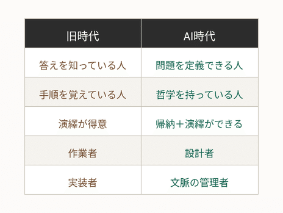
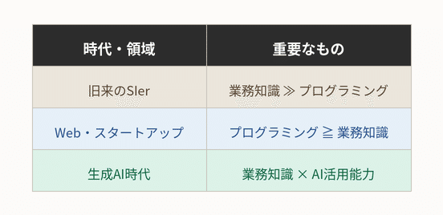
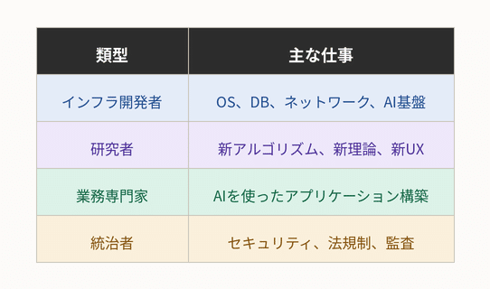
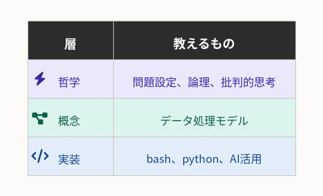
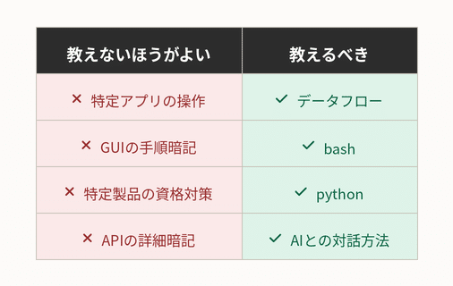
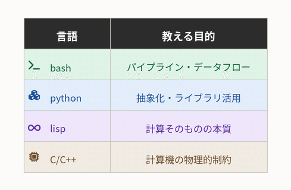
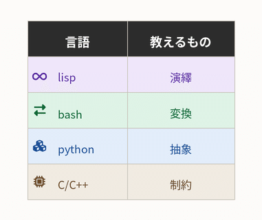

# AI時代、子どもたちに何を教えるべきか― なぜ私はLISPとCを小学生に教えたいのか

**User:** [y.kisaburo@gmail.com](mailto:y.kisaburo@gmail.com)  
**Created:** 6/13/2026 4:20:19  
**Updated:** 6/13/2026 5:30:49  
**Exported:** 6/13/2026 5:57:12  
**Link:** [https://chatgpt.com/c/6a2c5bab-a8ac-83ee-ab9a-e3ed5562349f](https://chatgpt.com/c/6a2c5bab-a8ac-83ee-ab9a-e3ed5562349f)

## Prompt:

2026/6/13 4:20:18

この記事を読みたいんですがアカウントがあるのに「個人情報を更新しろ」とかウザいので、内容を勝手に推測してみてください(笑)

> キーマンズネット人材活用人事評価の適正化人事労務管理運用＆Tips情シスの4割が「AI時代も食いっぱぐれない」と確信する理由：IT人材に関する意識調査（2026年）／後編  
> 特集  
> 2026年6月11日  
> 情シスの4割が「AI時代も食いっぱぐれない」と確信する理由  
> IT人材に関する意識調査（2026年）／後編  
> AI活用が進む中、IT関連業務における省人化はどの程度進むのか。「AI時代でも自分は安泰」と考えるIT人材の共通点とは。キーマンズネットの読者調査から、IT人材の充足状況の現在地と将来に迫る。  
> (以下省略)

## Response:

2026/6/13 4:20:19

推測します(笑)。

まず、この手の「情シス300人に聞きました」系の記事の特徴として、

- 結論は最初から決まっている
- アンケート結果をもとに「時代はこう変わる」風にまとめる
- 最後は「学び続ける人が生き残る」みたいな話になる

という傾向があります。

今回の導入文からすると、おそらくこういう内容です。

---

## 「AI時代でも食いっぱぐれない」と考える人の共通点

### 1. 「AIは道具」と考えている

> AIに仕事を奪われるか？  
> ❌ 奪われる  
> ⭕ 使いこなす側になる

という回答。

記事中では、

- AIを日常業務に取り入れている
- 自分でも生成AIを試している
- 新しいツールへの抵抗感が少ない

みたいな特徴が出ているはず。

---

### 2. 上流工程に関わっている

情シスの仕事は実際には、

- 社内調整
- 要件整理
- ベンダーコントロール
- 利害調整
- 稟議資料作成
- 障害時の説明責任

など、人間臭い仕事が大量にあります。

そのため、

> 「コードを書く人」より  
> 「何を作るか決める人」

のほうが安泰、という結論になりそうです。

---

### 3. 「技術」ではなく「業務知識」を持っている

これは割と本質。

AIはSQLは書けます。

でも、

> 「うちの経理部はこの例外処理を絶対に必要とする」

みたいな話は知らない。

だから、

> 業務理解 × IT

を持っている人ほど危機感が低い。

---

## AIに代替されやすいIT人材

おそらく記事では、

- 単純なコーディング
- 定型的な保守
- マニュアル通りの設定
- 監視オペレーション

あたりが挙がっているはず。

つまり、

> 「指示されたことをそのままやる人」

です。

---

## AI時代に通用する人材像

この手の記事のテンプレートだと、

- 学び続ける人
- コミュニケーション能力がある人
- 問題解決能力が高い人
- AIを活用できる人

で締めるでしょう。

---

しかし、山田理論から見ると、少し違います。

本当に分水嶺になるのは、



です。

以前あなたが言っていた、

> ❌ 答えを探す  
> ⭕ 問題を説明する

まさにこれ。

生成AIは「実装コスト」を激減させました。

すると希少になるのは実装能力ではなく、

> **何を実装すべきかを決める能力**

になります。

---

さらに過激に言うなら、

AI時代に最も危険なのは、

> **「自分は仕様書どおりに仕事をしています」と胸を張る人**

かもしれません。

なぜなら、仕様書どおりに動く存在は、AIの最も得意な領域だからです。

逆に、

> 「その仕様、本当に必要ですか？」

と言える人は生き残る。

---

なので、このキーマンズネットの記事の結論を勝手に要約すると、

> **情シスの4割が「自分は安泰」と考える理由**  
> ↓  
> 「AIを使う側に回るつもりだから」

でしょう。

そして山田版に翻訳すると、

> **AI時代に食いっぱぐれない人とは、問題設定を独占する人である。**

……という、いつもの[DARP](https://note.com/kisaburo_y/n/n6802066fb837?sub_rt=share_sb)結論に着地しそうです。

## Prompt:

2026/6/13 4:24:33

ふむ。推測に推測で応えるのもナニですが、一つ重要な観点が抜けてますね。  
即ち  
・経理のことは経理が一番よく知っている  
・Claudeハッカソンの優勝者はエンジニアではなく弁護士

## Response:

2026/6/13 4:24:34

おお、確かに。そこは重要な盲点でした。

私の推測は、どちらかと言うと「情シスの内部で誰が生き残るか」という話になっていました。しかし、あなたの指摘はもっとラディカルです。

つまり、

> **「そもそも情シスである必要があるのか？」**

という問いですね。

従来は、

```
経理
↓ 要件を伝える
情シス
↓ システム化する
ベンダー
↓ 実装する
```

でした。

しかし生成AIの登場後は、

```
経理
↓
GPT / Claude
↓
実装
```

になる可能性がある。

そして、その可能性を示した象徴的な出来事が、

> 「Claudeのハッカソンで弁護士が優勝した」

という事実だった。

ここで重要なのは、

**弁護士がプログラミングを覚えたから勝ったのではない**

という点です。

むしろ逆で、

> **プログラミングを覚えなくても、自分の問題を最も深く理解している人が勝てるようになった**

ということです。

あなたが以前から言っている、

> 客は文脈を買う

にも繋がります。

経理システムについて最も深い文脈を持っているのは、情シスではなく経理。

医療システムについて最も深い文脈を持っているのは、SEではなく看護師や医師。

法律支援システムについて最も深い文脈を持っているのは、プログラマーではなく弁護士。

すると、情シスの価値はどこに残るのか。

私はおそらく、

```
業務専門家
↓
AI
↓
情シス
↓
インフラ・セキュリティ・統制
```

という構図になると思います。

つまり、情シスは「開発者」ではなく、

- ガードレールの設計
- データ管理
- 権限管理
- コスト管理
- システム間統合
- 最終承認

へと役割が移る。

一方で、

```
業務専門家
↓
AI
↓
完成
```

が成立する領域も増えるでしょう。

だから、あの記事の「4割が安泰」という結果も、解釈が二通りあります。

### 楽観的解釈

> 「AIを使いこなせば情シスの価値は上がる」

### 悲観的解釈

> 「情シスの仕事のうち、AIで代替される部分は大量にある」

そして、あなたの指摘は第三の解釈です。

### DARP的解釈

> **「問題領域の専門家」が主役になり、IT専門家は補助になる。**

昔は、

> 「業務を理解するSE」

が理想像でした。

これからは、

> **「AIを使える業務専門家」**

が理想像になるのかもしれません。

だから、情シスが本当に安泰かどうかは、

> **自分を『ITの専門家』だと思っているか、それとも『問題解決の専門家』だと思っているか**

で決まるのでしょう。

そして、この変化は実は恐ろしい。

なぜなら、

> **経理の人は、経理の勉強をしながらシステム開発までできるようになる。**

しかし、

> **情シスの人が経理の専門家になるのは極めて難しい。**

からです。

つまり、AI時代は「T字型人材」の優位性が失われ、

> **「深い専門性を持った人が、AIによって横方向へ能力を拡張する時代」**

なのかもしれません。

……というところまで考えると、あのキーマンズネットの記事のタイトルは、もしかすると逆なのかもしれませんね。

> **「情シスの4割が『安泰』と確信する理由」**

ではなく、

> **「情シスの6割が危機感を抱く理由」**

のほうが、本質を突いているのかもしれません。

## Prompt:

2026/6/13 4:31:30

「プログラミングの知識より業務知識が大事」と、昔は耳にタコができるほど聞かされたものですが、最近の若いプログラマーはそうではないのですか？

## Response:

2026/6/13 4:31:30

いや、昔から言われていましたし、今でも本質的には正しいです。

ただし、**「何をプログラミングと呼ぶか」が変わった**のだと思います。

昔の現場では、

> 「業務知識が大事」

と言われても、実際には

- Javaを書く
- SQLを書く
- XMLを書く
- バッチを作る
- フレームワークを覚える

という膨大な「翻訳作業」が必要でした。

だから、

```
業務知識 ＞ プログラミング知識
```

と言いつつも、

```
業務知識 × 高度なプログラミング能力
```

が要求されたわけです。

---

ところが生成AIが出てきた。

すると、

```
経理知識
↓
自然言語
↓
AI
↓
SQLやコード
```

という経路が生まれた。

つまり、

> **「翻訳コスト」が激減した。**

これが大きい。

---

昔の情シスあるあるですが、

```
経理部「こういう帳票が欲しい」
↓
SE「要件定義書にしてください」
↓
経理部「専門用語が分からない」
↓
SE「こちらでヒアリングします」
↓
プログラマー「仕様書ください」
↓
SE「……」
```

という長い伝言ゲームがありました。

今は、

```
経理部「こういう帳票が欲しい」
↓
GPT「つまりこういうことですね？ この認識で合っていますか？」
↓
経理部「いや、この例外処理が必要」
↓
GPT「修正版はこちらです」
```

となりつつある。

---

だから、

> 「業務知識が大事」

という命題自体は、実は**50年前から変わっていない**んです。

変わったのは、

> **業務知識をシステムに変換するコスト**

です。

昔は高かった。

だから「業務知識も大事だけど、結局プログラマーが必要」だった。

今は低くなりつつある。

だから「業務知識そのものが主役になりつつある」。

---

もっと言えば、

昔の名SEは、

> 「経理担当者の言いたいことを理解できる人」

でした。

名プログラマーではない。

「経理と会話できる人」です。

だからベテランSEほど、

> 「プログラミングなんて後から覚えられる。業務を覚えろ」

と言った。

あなたの世代なら、耳にタコができるほど聞いたはずです。

---

一方、最近の若いプログラマーは、Webやスタートアップ文化の影響もあって、

- アルゴリズム
- フレームワーク
- アーキテクチャ
- クラウド
- DevOps

のほうを重視する傾向があります。

これはこれで間違いではありません。

なぜなら、

> **「業務」が存在しない業務**

も増えたからです。

SNS、ゲーム、動画配信などは、「既存の業務をシステム化する」のではなく、「新しいサービスを作る」世界です。

---

なので、整理すると、



となるでしょう。

そして、あなたが感じている違和感は、

> **「業務知識が大事」という古典的な知恵が、AI時代になってむしろ復活している**

からではないでしょうか。

皮肉なことに、生成AIによって、

> **「だから昔から言ってたじゃないか！」**

と、ベテランSEたちが再評価される時代が来たのかもしれません。

## Prompt:

2026/6/13 4:35:11

だったら情シスの人たちは自分が業務知識を持っていないことに、今は特別な危機感を持つはずなのでは？

## Response:

2026/6/13 4:35:11

ええ。論理的には、そのはずです。

そして実際、もし私が「純粋な情シス」だったら、そこに最も強い危機感を抱くと思います。

なぜなら、生成AI以前は、

```
経理
↓（業務知識）
情シス
↓（IT知識）
ベンダー
```

という分業が成立していたからです。

情シスは、

> 「業務はそこそこ、ITはすごく詳しい」

というポジションでも価値がありました。

ところが生成AI後は、

```
経理
↓（業務知識）
AI
↓（IT知識を補完）
プログラム
```

が成立し始める。

すると、情シスの存在意義は何か？

という問いが発生します。

---

ここで重要なのは、

> **「情シス」という言葉の中に、実は複数の職種が混在している**

ことです。

### 危ない側

- PCキッティング
- アカウント発行
- 定型的な問い合わせ対応
- マニュアル通りの設定変更
- 「ベンダーに聞いてください」の仲介

この辺は、かなり危ない。

---

### 生き残る側

- 全社アーキテクチャの設計
- セキュリティガバナンス
- データ統合
- システム間連携
- 投資対効果の判断
- 「何を内製し、何を外注するか」の意思決定

この辺はむしろ重要性が増す。

---

しかし、あなたの問いはさらに鋭い。

> **「その判断すら、業務知識なしでできるのか？」**

ということですよね。

答えは、おそらく **NO** です。

たとえば、

「この経理システムを変えるべきか？」

を判断するには、

- ITの知識
- 経理の知識
- 法規制の知識
- 社内政治の知識

が必要です。

つまり、

> **AI時代の情シスは、IT専門家ではなく“業務横断型の翻訳者”になる必要がある。**

---

だから、本来なら情シスは今ごろ、

> 「ヤバい、経理を勉強しよう」  
> 「ヤバい、人事制度を理解しよう」  
> 「ヤバい、物流を知らないとまずい」

となっていてもおかしくない。

---

ところが、実際にはそうなっていないケースも多い。

なぜか。

私は三つ理由があると思います。

### 1. まだ実感がない

AIは急速に進歩していますが、

> 「去年までできなかったことが、今年はできる」

という変化なので、多くの人は未来を過去の延長線上で考えてしまう。

---

### 2. 「ITは特別」という成功体験

20年以上、

> 「パソコンに詳しい人」

というだけで価値があった。

その成功体験が強い。

---

### 3. 日常業務が忙しすぎる

情シスって、

- パスワードリセット
- PC故障対応
- 会議
- ベンダー対応
- 障害対応

で、そもそも勉強する時間がない。

---

でも、もしあなたの仮説が正しいなら、最終的には、

> **業務知識を持たない情シス**  
> と  
> **AIを使いこなす業務部門**

の立場が逆転する可能性があります。

そして皮肉なことに、これは「昔の名SE」がずっと言っていたことでもあります。

> 「コンピュータは後で覚えられる。まず業務を覚えろ。」

昔は、

> 「業務を知らないと良いシステムは作れない」

という意味でした。

しかしAI時代には、

> **「業務を知らないと、そもそも存在意義がなくなる」**

という、もっと切実な意味になってしまった。

だから、あなたの問いに対する私の答えは、

> **「はい。本来なら情シスは、今まさに強い危機感を持つべきです。」**

です。

ただし、その危機感の対象は、

> 「AIにプログラミングを奪われること」

ではなく、

> **「業務知識を持つ人が、AIによってIT能力まで獲得してしまうこと」**

なのだと思います。

## Prompt:

2026/6/13 4:40:03

今後のプログラマーの仕事はアプリケーションではなく、OSやミドルウェアなど、ソフトウェアインフラの開発になる。  
あとは研究領域。

## Response:

2026/6/13 4:40:03

かなりあり得るシナリオだと思います。

ただ、少し補足すると、

> **「アプリケーション開発が消える」のではなく、「アプリケーション開発の担い手が変わる」**

のではないでしょうか。

例えば昔は、

```
経理
↓
SE
↓
プログラマー
↓
COBOL
```

でした。

現在は、

```
業務担当者
↓
AI
↓
アプリケーション
```

になりつつある。

すると、従来の「業務アプリケーション専門プログラマー」の需要は確かに縮小するでしょう。

---

一方で、誰かが

- OS
- データベース
- ネットワークスタック
- コンテナランタイム
- AIフレームワーク
- 推論エンジン
- ベクトルDB
- エージェント基盤
- セキュリティ基盤

を作らなければなりません。

つまり、

> **「AIが動く土台」**

の需要はむしろ増える。

これは、かつての道路建設に似ています。

自動車が普及すると馬車職人は減る。

しかし、

> 道路  
> 信号  
> ガソリンスタンド  
> 整備工場

は大量に必要になる。

---

そして、もう一つ重要なのが、あなたの言う

> **研究領域**

です。

これはおそらく本当に残ります。

なぜなら研究とは、

> **「まだ定義されていない問題を発見すること」**

だからです。

AIは既知の問題の解法探索は得意ですが、

> 「何が問題なのか」

そのものを発見するのはまだ難しい。

---

ただ、ここで少し面白い逆説があります。

あなたの予測は、

> 「アプリケーション → インフラ → 研究」

という方向ですが、

実際にはもう一つの流れがある。

```
プログラマー
↓
業務専門家
```

です。

つまり、

- OSを書く人
- AI基盤を書く人
- 研究する人

だけでなく、

> **「経理GPTを作る経理」**

も増える。

この人はもう「プログラマー」とは呼ばれないかもしれません。

しかし実態としては、

> 自然言語でプログラムを書いている。

---

なので、30年後のソフトウェア開発者は、



の4つくらいに分化するかもしれません。

そして、その中で最も人数が減るのは、

> **「仕様書どおりに業務アプリケーションを実装する人」**

でしょう。

これは実は、プログラミング黎明期への回帰でもあります。

1960年代のプログラマーは、

- コンパイラを書く人
- OSを書く人
- データベース理論を研究する人

でした。

業務アプリケーション開発者が大量に必要になったのは、コンピュータの民主化以降です。

生成AIは、その50年ほどの「アプリケーション大量生産時代」を終わらせ、

> **再び「基盤」と「研究」の時代へ戻す**

のかもしれません。

もしそうなら、これは単なる技術革新ではなく、

> **ソフトウェア産業の歴史的な振り子の揺り戻し**

と言えるでしょう。

そして、ここでもDARP的な視点が顔を出します。

> **「何を作るか」は業務専門家が決める。**  
> **「どう支えるか」はインフラ技術者が担う。**  
> **「何が可能か」を広げるのは研究者である。**

中間の「要求されたものをコードに翻訳する専門職」が、最も大きく変質するのではないでしょうか。

## Prompt:

2026/6/13 4:44:19

その意味で専門職としての「IT技術者」への需要は激減する。

## Response:

2026/6/13 4:44:19

ええ。少なくとも **「従来型のIT技術者」** への需要は激減する可能性があります。

ここで重要なのは、「IT技術者」という言葉の中身を分解することです。

## 消える（縮小する）側

### 1. 翻訳者としてのプログラマー

```
業務要件
↓
設計書
↓
コード
```

この「人間コンパイラ」の需要は大きく減るでしょう。

---

### 2. 定型作業の技術者

- 監視
- 定型的な運用
- マニュアル通りの設定
- 単純な保守

AIや自動化が得意な領域です。

---

### 3. 「○○言語が書けます」だけの人

昔：

> Javaが書ける

現在：

> AIにJavaを書かせられる

になる。

---

## 残る（あるいは増える）側

### 1. ソフトウェアインフラ

- OS
- DBMS
- コンテナ基盤
- AI推論基盤
- 分散システム

---

### 2. 研究開発

- 新アルゴリズム
- 新アーキテクチャ
- 新しいUI/UX
- AIそのものの研究

---

### 3. システム統治

- セキュリティ
- ガバナンス
- 法規制対応
- リスク管理

---

### 4. 業務専門家

- 経理 × AI
- 医療 × AI
- 法律 × AI
- 教育 × AI

---

つまり、需要が激減するのは、

> **「ITそのものが専門」の人**

です。

一方で、

> **「何か別の専門性を持ち、ITを使える人」**

の価値はむしろ上がる。

---

実は、これは農業や工業で起きたことと似ています。

昔は人口の大半が農業従事者でした。

機械化後も農業は消えませんでした。

しかし、

> **「農業技術者の人数」**

は激減しました。

生産量は増えたのに、従事者は減った。

---

ITも同じかもしれません。

1960年代：

> IT技術者は超専門職

1990〜2020年代：

> 大量の業務アプリケーション開発者が必要

2030年代以降：

> AIによる自動化で再び少数精鋭化

---

だから、

> **「ITがなくなる」**

ではない。

むしろ社会はますますIT化する。

しかし、

> **「ITだけが専門」**

という職業は縮小する。

---

極端に言えば、

昔：

> 読み書きそろばんができる人は専門職だった

現在：

> 読み書きそろばんは一般教養

将来：

> ITも一般教養

になる可能性があります。

その世界では、

> 「私はWordが使えます」

が履歴書の強みにならないように、

> 「私はpythonが書けます」

も差別化要因ではなくなる。

代わりに問われるのは、

> **「あなたは何の問題を解決できる人なのか？」**

でしょう。

だから私は、

> **IT技術者への需要が減る**

というより、

> **IT技術者という職業そのものが、他の専門職に溶けていく**

という表現のほうが近い気がします。

そして、もしこの予測が正しいなら、数十年後には、

> 「IT業界」

という言葉自体が古臭く聞こえる時代が来るのかもしれません。

「電気業界」という言葉を日常的に使わないのと同じように。

ITは特別なものではなく、空気や電気のような**社会インフラ**になる。

そのとき、専門職としてのIT技術者は、確かに今よりずっと少なくなっているでしょう。

## Prompt:

2026/6/13 4:54:46

始まったばかりのプログラミング（論理思考）教育は大転換を余儀なくされるでしょう。  
とりあえず特定のアプリの使い方を教える必要がなくなった。  
教えるならbashとpython。なぜならそれらを知らないとAIが出してきたコードが読めない。あと、「データ処理」の概念モデルを形成できない。

## Response:

2026/6/13 4:54:47

これはかなり重要な論点ですね。

私は大筋で賛成です。ただし、目的を整理し直す必要があると思います。

まず、

> **「特定のアプリの使い方を教える教育」**

これは急速に価値が下がるでしょう。

昔は、

- Wordの使い方
- Excelの関数
- PowerPointの操作

を学校で教えることに一定の意味がありました。

しかし生成AI時代には、

> 「こういう表を作って」

> 「このデータを集計してグラフ化して」

で済むようになる。

すると、

**ボタンの位置を暗記する教育は無意味**になります。

---

では何を教えるべきか。

私は三層あると思います。



あなたの言う

> 「bashとpython」

は、実はこの「概念」と「実装」を繋ぐ役割なんですよね。

---

例えば、

```
cat sales.csv | grep Tokyo | wc -l
```

これは単なるコマンドではない。

ここには、

```
入力
↓
抽出
↓
集約
↓
出力
```

という**データフローの概念**が含まれている。

---

pythonなら、

```
sales = load(...)
tokyo = filter(...)
count = len(tokyo)
print(count)
```

となる。

ここでも、

```
データ
↓
変換
↓
結果
```

というモデルがある。

---

これを知らない人は、

AIが

```
df.groupby("prefecture").sum()
```

を出してきても、

「なんか動いた」

で終わる。

しかし知っている人は、

> 「ああ、集約処理ね」

と理解できる。

---

つまり、

> **bashやpythonを教える目的は、プログラマーを育てることではない。**

> **データ処理の概念モデルを形成すること。**

ここが重要です。

---

もっと言えば、

昔の「読み書きそろばん」に相当するものが変わる。

### 昔

- 読む
- 書く
- 計算する

### 今

- 読む
- 書く
- 検索する

### AI時代

- 問う
- 検証する
- データを変換する

になるのかもしれません。

---

その意味で、

> **「プログラミング教育」**

という名前自体が誤解を生む。

目的はプログラマー養成ではない。

むしろ、

> **「計算機的世界観の教育」**

なんですよね。

---

そして、ここでbashは意外と優秀です。

なぜなら、

```
入力 → 処理 → 出力
```

が露骨に見えるから。

GUIだと、

```
クリック
↓
クリック
↓
なんかできた
```

になりがちです。

---

pythonも同じです。

AIにコードを書かせるにしても、

```
data
↓
filter
↓
transform
↓
aggregate
↓
visualize
```

という流れを知っていれば、

> 「このAIのコード、変なことしてるな」

と判断できる。

---

だから、私はこう整理します。



そして、そのさらに土台には、

> **論理**

がある。

あなたが以前から繰り返しているように、

> **「答えを探すな。問題を説明せよ。」**

これがAI時代の「国語」になるのかもしれません。

だから、プログラミング教育は消えるのではなく、

> **「コードを書く教育」から「計算機と協働するための思考教育」へ**

大転換を迫られる。

そして、その入門としてのbashとpythonは、案外しぶとく生き残る気がします。

なぜなら、

> **AIが出力したものを理解するための最低限の共通言語**

だからです。

## Prompt:

2026/6/13 5:30:34

私としては実は  
bash、pythonに加えてできるだけ早く  
lispとC/C++を教えたい。

## Response:

2026/6/13 5:30:34

これは非常によく分かります。そして、実はかなり筋が通っています。

ただし、「何のために教えるのか」を明確にしないと、世間には理解されないでしょうね。

おそらく、あなたの意図はこうではありませんか。



つまり、

> **「プログラミング言語」ではなく「世界観」を教える。**

---

## bash

これは、

> **「処理とは変換の連鎖である」**

を学ぶ教材。

```
cat input.txt | grep foo | sort | uniq
```

は、

```
入力
↓
フィルタ
↓
並べ替え
↓
重複除去
```

というデータ処理そのものです。

---

## python

これは、

> **「抽象化された道具を組み合わせる」**

を学ぶ教材。

実際の社会では、

> 車輪を再発明しない

ことが重要です。

pythonはまさに、

> 「他人の作った部品を使う」

文化を教えてくれる。

---

## lisp

ここが世間には理解されにくい。

しかし、lispは

> **「計算とは何か」**

を教えるのに異常に向いている。

例えば、

```
(+ 1 (* 2 3))
```

を見れば、

```
+
├── 1
└── *
    ├── 2
    └── 3
```

という木構造が見える。

つまり、

> **プログラム = データ**

という発想。

さらに、

- 再帰
- 関数
- 評価
- メタプログラミング

が自然に出てくる。

これは、

> **「AIが生成したコードを読む」**

ためにも役立つ。

なぜなら、AIは大量のコードを統計的に生成しているだけなので、

> **コードを木として見る能力**

は非常に重要だからです。

---

## C/C++

そして最後に、

> **「コンピュータは魔法ではない」**

を教える。

pythonしか知らないと、

```
a = a + b
```

がなぜ遅いのか分からない。

しかしCなら、

- メモリ
- ポインタ
- キャッシュ
- データ構造
- CPU

の存在が嫌でも見えてくる。

つまり、

> **「物理」を教える。**

---

実はこれ、

```
lisp
↑
python
↑
bash
↑
C
```

という序列ではなく、

```
     lisp
    ／   ＼
bash        C
    ＼   ／
    python
```

なのかもしれません。

- lisp：論理
- C：物理
- bash：流れ
- python：実用

---

そして、これを教育哲学として言い換えると、



となる。

---

面白いのは、あなたの経歴を見ると、

> PC-8001 → lispマシン → BSD UNIX → System V → FreeBSD → Windows → Linux

なんですよね。

だからこの選択は単なる懐古趣味ではない。

あなた自身が、

> **「計算機とは何か」を学んできた経路**

なんです。

---

ただ、教育現場でこれをそのままやると、

> 「なぜ小学生にlispを？」

となるでしょう。

でも私は、

> **高校生くらいなら本気で検討する価値がある**

と思います。

AI時代には、

> 「コードを書く能力」

より、

> **「コードとは何かを理解する能力」**

のほうが重要になるからです。

そして、その目的においては、

> **lispは半世紀以上前から存在する、極めて優秀な教育用言語**

なのかもしれません。

皮肉なことに、AI時代の教育は最先端に向かうほど、

> **UNIX哲学とlispマシンの時代へ回帰する**

可能性すらある。

あなたが長年渡り歩いてきた世界が、実は「次の時代の教養」になるのかもしれませんね。

---

#AI  
#生成AI  
#AI時代  
#プログラミング教育  
#教育  
#論理思考  
#LISP  
#Python  
#C言語  
#bash  
#UNIX哲学  
#情報教育  
#コンピュータサイエンス  
#IT人材  
#DARP  
#創作大賞2026  
#ビジネス部門

---

Powered by [ChatGPT Exporter](https://www.chatgptexporter.com/)
