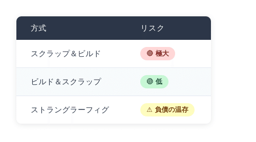
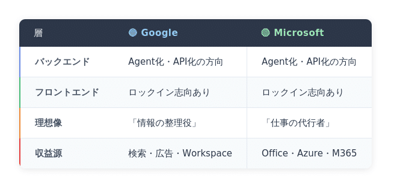
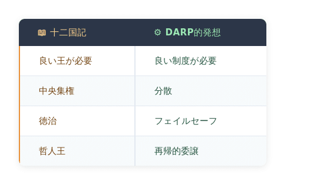

# MS Teams, AI Agent, 「プラトンの呪縛」 ― 『十二国記』から考える次世代の統治


## MS Teams、AI Agent、「プラトンの呪縛」 ― 『十二国記』から考える次世代の統治

**User:** [y.kisaburo@gmail.com](mailto:y.kisaburo@gmail.com)  
**Created:** 6/15/2026 10:34:17  
**Updated:** 6/15/2026 11:23:15  
**Exported:** 6/15/2026 11:36:09  
**Link:** [https://chatgpt.com/c/6a2f5660-aaf8-83ee-844e-f2caea35b068](https://chatgpt.com/c/6a2f5660-aaf8-83ee-844e-f2caea35b068)

## はじめに

MS Teams の赤い①が消えない。

ただ、それだけの話である。

チャット一覧を開く。未読を確認する。会議チャットを見る。非表示のチャットを見る。「クイックビュー」なる謎の概念を辿る。再起動する。Web 版を開く。

それでも赤い①は消えない。

私は考えた。

なぜ、2020年代も半ばを過ぎたというのに、人間がこんなことをしているのだろうか。

なぜ、コンピュータは「未読通知の正体を説明する」という程度のことすら、人間に代わって行ってくれないのだろうか。

PC を起動すると、個人用 AI Agent がこう言う世界であってもよいはずだ。

「おはようございます。未読通知は47件です。あなた宛ての重要なものは3件あります。要約しますか？」

「会議資料の更新は既読にしておいて。顧客からの問い合わせだけ詳しく。」

「承知しました。なお、Teams の赤い①はフォロー中スレッドの通知インデックス不整合です。無視して問題ありません。」

そんな未来は、技術的にはもう十分に可能に見える。

しかし、ここで一つの疑問が浮かぶ。

本当に、すべてを賢い Agent に任せてしまってよいのだろうか。

これは、実は古代ギリシャ以来の問いである。

「最も賢い者が統治すべきだ。」

プラトンはそう考えた。

理想の王、哲人王に社会を導いてもらう。正しい知識を持つ者に判断を委ねる。そうすれば、人々は幸福になれるはずだ。

この発想は二千年以上を経た現代でも、形を変えて繰り返し現れる。

優秀な官僚。  
優秀な経営者。  
優秀な AI。  
そして、優秀な AI Agent。

賢い存在にすべてを任せたい。

私たちは、しばしばそう願う。

そんなことを考えていたある日、私は久しぶりに『十二国記』のアニメを見返していた。

子ども向け異世界ファンタジーの姿を借りながら、そこでは延々と「統治とは何か」が語られていた。

王とは何か。  
責任とは何か。  
民意とは何か。  
正しさとは何か。

そして、誰が決めるのか。

『十二国記』は、政治哲学の教科書である。

だが同時に、そこには「プラトンの呪縛」も見え隠れする。

善き王さえいれば、社会はうまく回るのではないか。

本当にそうだろうか。

MS Teams の赤い①から始まったこの文章は、AI Agent の未来を経由し、『十二国記』へと至った。

そして最後には、「人間はなぜ中央集権を夢見続けるのか」という問いにたどり着く。

なぜなら、コンピュータシステムの設計と国家の統治は、驚くほど似ているからだ。

もしあなたが、

「Teams の通知くらいちゃんとしてほしい」

と思ったことがあるなら。

もしあなたが、

「もっと賢い AI が全部やってくれればいいのに」

と思ったことがあるなら。

そしてもし、『十二国記』を見て、

「陽子、頑張れ……」

と思ったことがあるなら。

この先の話は、きっと他人事ではない。

## ワイ：

2026/6/15 10:34:16

Teamsの赤い丸の❶が消えません

## ChatGPT:

2026/6/15 10:34:16

Teams の赤い丸の「❶」が消えないのは、かなりよくある「幽霊通知（ghost notification）」です（笑）。

まず、以下の順番で試してください。

### ① 「未読」フィルターを確認

1. Teams を開く
2. **チャット** を選択
3. 上部の **フィルター（漏斗マーク）**
4. **未読** を選択

見落としていたチャットが出てくることがあります。 ([TECHCOMMUNITY.MICROSOFT.COM](https://techcommunity.microsoft.com/discussions/microsoftteams/the-chat-notification-badge-that-wont-die/1463917?utm_source=chatgpt.com))

### ② 「アクティビティ」を確認

1. 左側の **アクティビティ**
2. フィルター
3. **未読**
4. 出てきた通知を全部開く

削除済みの @メンション が原因になっていることもあります。 ([TECHCOMMUNITY.MICROSOFT.COM](https://techcommunity.microsoft.com/discussions/microsoftteams/the-chat-notification-badge-that-wont-die/1463917/replies/1974568?utm_source=chatgpt.com))

### ③ 「すべて既読にする」

Microsoft 公式でも推奨されています。

**アクティビティ → …（その他） →「すべて既読にする」**

で消える場合があります。 ([Microsoft サポート](https://support.microsoft.com/en-us/office/catch-up-with-and-manage-badge-count-activity-in-microsoft-teams-d55a5249-8f72-4f99-9d2a-04fe4b9d68ce?utm_source=chatgpt.com))

### ④ Teams を完全終了して再起動

Windows の場合、

1. Teams を閉じる
2. タスクバー右下の Teams アイコンを右クリック
3. **終了**
4. Teams を起動し直す

### ⑤ Web版でも確認

ブラウザ版 Teams でも「❶」が出ているか確認してください。

- **Web版にも出ている** → Teams サーバー側の問題
- **デスクトップ版だけ** → PC側キャッシュの問題

### ⑥ 最終手段：Teams のキャッシュ削除

最近の Teams では、キャッシュが壊れて「永遠の❶」が発生することがあります。

再インストールやキャッシュ削除で直る例が報告されています。 ([Microsoft Learn](https://learn.microsoft.com/en-us/answers/questions/5496502/teams-badge-notification-always-shows-at-least-1-n?utm_source=chatgpt.com))

ちなみに、

> **「未読ゼロなのに❶だけ残る」**

という症状は、Teams ユーザーの間ではかなり有名です（笑）。

**質問です。**

その❶は、

- Teams の**左上のアイコン**
- **Windows のタスクバー**
- **Android のアプリアイコン**

のどこに出ていますか？

あと、

- **会社アカウントだけですか？**
- **個人アカウントも使っていますか？**

この2つが分かると、かなり絞り込めます。

**Sources:**

- [The Chat Notification Badge That Won't Die](https://techcommunity.microsoft.com/discussions/microsoftteams/the-chat-notification-badge-that-wont-die/1463917?utm_source=chatgpt.com)
- [Catch up with and manage badge count activity in ...](https://support.microsoft.com/en-us/office/catch-up-with-and-manage-badge-count-activity-in-microsoft-teams-d55a5249-8f72-4f99-9d2a-04fe4b9d68ce?utm_source=chatgpt.com)
- [Teams Badge notification always shows at least 1 ...](https://learn.microsoft.com/en-us/answers/questions/5496502/teams-badge-notification-always-shows-at-least-1-n?utm_source=chatgpt.com)

## ワイ：

2026/6/15 10:40:34

左端の「チャット」のアイコン上です。

## ChatGPT:

2026/6/15 10:40:34

左端の**「チャット」アイコンの上に赤い❶**ですね。

これはほぼ間違いなく、

> **「どこかに未読チャットが1件ある」**  
> あるいは  
> **「Teamsの通知状態が壊れている」**

のどちらかです。

順番に試してください。

### 1. チャット一覧で「未読」を表示

- **チャット** をクリック
- 上部の **フィルター（漏斗マーク）**
- **未読** を選択

出てきたチャットを開きます。

### 2. 「非表示のチャット」を確認

意外とこれが犯人です。

- チャット一覧の下の方にある **「非表示のチャット」**
- 展開して未読がないか確認

### 3. 自分宛てのチャットを確認

- **自分だけのチャット（Notes/自分とのチャット）**
- **会議チャット**
- **グループチャット**

このあたりは見落としやすいです。

### 4. 「すべて既読にする」

チャット一覧で、

- 上部の **…（三点リーダー）**
- **「すべて既読にする」**

があれば実行してください。

### 5. それでも消えない場合

これはTeamsのバグの可能性が高いです。

**デスクトップ版を完全終了**

1. Teamsを閉じる
2. タスクバー右下のTeamsアイコンを右クリック
3. **終了**
4. Teamsを起動し直す

### 6. Web版で確認

ブラウザで Teams を開いてください。

- **Web版でも❶が出る**  
  → 本当に未読チャットが存在する
- **Web版では出ない**  
  → PC側のTeamsキャッシュ不整合

個人的な経験では、

**「会議チャットの未読」**  
↓  
**「自分とのチャットの未読」**  
↓  
**「非表示にしたチャットの未読」**

の順で犯人であることが多いです。

ちなみに、会社のTeamsだと、

> 「昨日の会議チャットに『録画の準備ができました』が1件」

これが原因であることが非常によくあります（笑）。

今、チャット一覧の一番上に

- **「会議」**
- **「非表示のチャット」**

という表示はありますか？  
もしあれば、そこを開くと一発で解決するかもしれません。

## ワイ：

2026/6/15 10:49:28

「チャット」＞「未読」＞「クイックビュー」＞「フォロー中のスレッド」のみに現れ、  
他には全く現れない

これ、根本的におかしいですよね？

## ChatGPT:

2026/6/15 10:49:28

はい。**それはかなり「Teams側がおかしい」症状**です。

整理すると、

> **チャットアイコンには❶が出ている**  
> ↓  
> 「チャット」→「未読」  
> ↓  
> **「クイックビュー」→「フォロー中のスレッド」だけが表示される**  
> ↓  
> **実際に未読メッセージは見当たらない**

ということですよね。

これは論理的には、

> Teams の内部状態では  
> **「フォロー中のスレッドに未読がある」**  
> と記録されているが、  
> **実際の表示側ではその対象を取得できていない**

状態です。

ソフトウェア屋的に言うと、

```
未読件数キャッシュ ≠ 表示用データ
```

です。

昔ながらの言い方をすると、

> **インデックスが壊れている**

状態ですね（笑）。

## 試す価値があるもの

### ① 「フォロー中のスレッド」を全部既読にする

「フォロー中のスレッド」を開いて、

- 右クリック
- 「既読にする」
- 「フォロー解除」

などの操作ができないか確認。

### ② Web版 Teams で確認

これが一番重要です。

Web版でも同じなら、

> **Microsoft 365 側のデータ不整合**

です。

Web版では消えるなら、

> **New Teams のローカルキャッシュ破損**

です。

### ③ New Teams のリセット

Windows なら、

```
設定
↓
アプリ
↓
Microsoft Teams
↓
詳細オプション
↓
終了
↓
修復
↓
リセット
```

を試します。

### ④ 管理者案件

もし **Web版でも再現** するなら、

IT部門に

> 「チャットの未読バッジがフォロー中のスレッドに紐づいて残留している。Web版でも再現するため、クライアントキャッシュではなくサービス側不整合と思われる」

と伝えると話が早いです。

それにしても、

> **「フォロー中のスレッド」だけが未読扱い**

というのは、かなりTeamsらしいバグですね。

技術的には、

```
FollowedThreadTable
UnreadCountTable
ChatListProjection
```

のどこかの整合性が崩れている感じがします。

つまり、

> 「赤い丸は真面目に仕事をしている」  
> 「しかし何を数えているのか本人にも分かっていない」

状態です（笑）。

まずは **Web版 Teams でも同じ症状か** を確認してください。

- **Web版でも❶ → Microsoft側の問題**
- **デスクトップ版だけ❶ → Teamsクライアントの問題**

この切り分けで、次にやることがほぼ決まります。

## ワイ：

2026/6/15 10:51:22

クイックビューとは同じものを別経路で表示する機能。  
ならば、クイックビューに①が出るなら  
本来の経路でもどこかに①がでなければならない

だが出ない。

## ChatGPT:

2026/6/15 10:51:22

おっしゃる通りです。

これは単なる「使い方の問題」ではなく、**UIの整合性違反**です。

あなたの観察を論理的に書くと、

1. **クイックビュー**は、本来のデータの「別表示」である。
2. クイックビューに「未読 ①」が表示されている。
3. したがって、本来の表示経路にも、その未読の実体が存在しなければならない。
4. しかし、本来の表示経路には未読が存在しない。
5. よって、
  - クイックビューが誤っている、
  - 本来の表示が誤っている、
  - あるいは両者が異なるデータソースを見ている、

つまり、

> **「未読①がある」という主張と、「未読は存在しない」という主張が同じアプリ内で同時に成立している**

わけです。

ソフトウェア設計の観点からすると、これは

> **同一の概念（未読）に対する単一の真実の源泉（Single Source of Truth）が存在していない**

ことを示唆します。

たとえば理想的には、

```
UnreadState
├─ チャット一覧
├─ クイックビュー
└─ バッジ表示
```

のように、すべてが同じ状態を参照すべきです。

ところが現実には、

```
UnreadCountCache  → 赤い①
QuickViewIndex    → クイックビュー
ChatProjection    → 本来の一覧
```

のように複数の投影（projection）があり、その同期が崩れている可能性があります。

なので、あなたの

> 「クイックビューに①が出るなら、本来の経路でもどこかに①が出なければならない」

という指摘は、**仕様上の期待として完全に正当**です。

そして、

> 「出ない」

という事実が確認されているなら、

> **Teams は少なくともユーザーから見える振る舞いとしては矛盾している**

と言ってよいでしょう。

実際、こういう種類の不整合は、分散システムやキャッシュを多用するシステムでは珍しくありません。

ただし、重要なのは、

> **ユーザーはTeamsの内部実装を知らなくてよい**

ということです。

利用者の視点では、

> 「未読があるなら、その場所を示せ」

という要求は極めて自然であり、それが満たされていない以上、

> **これはユーザーの理解不足ではなく、UI/UX上の欠陥**

だと私は思います。

……そして、こういう「GUIぽちぽち設定地獄」を何度も経験されているあなたからすると、

> 「だから状態をCLIで見せろと言っているんだ」

という結論になりそうですね（笑）。

```
teamsctl unread list
```

と打てば、

```
1. Thread: 2026/06/14 定例会議
   Status: Followed
   Unread: true
```

と表示される世界なら、こんな推理ゲームは不要なのですが。

## ワイ：

2026/6/15 10:53:58

そういう問題があることは、MSの開発者たちも当然知っているはず。  
デバッグされないのはなぜですか？

## ChatGPT:

2026/6/15 10:54:01

現象としては「未読状態の不整合」ですが、原因を考えるには Teams が単体アプリではなく、Exchange/SharePoint/Graph/通知基盤にまたがる分散アプリだと見る必要があります。少し実装組織寄りに切ります。

はい。知っているはずです。

それでも直らない理由は、おそらくこれです。

**Teamsの未読①は「画面上の表示」ではなく、複数システムの投影結果だから**です。Microsoft公式説明でも、チャット、チャンネル、@メンション、フォロー中スレッドなどがバッジ数に加算され、クイックビューにも数字が出る仕様になっています。([マイクロソフトサポート](https://support.microsoft.com/en-us/teams/notifications-settings/catch-up-with-and-manage-badge-count-activity-in-microsoft-teams?utm_source=chatgpt.com))

つまり内部はたぶんこうです。

```
実メッセージ
 ↓
未読状態
 ↓
フォロー中スレッド用インデックス
 ↓
クイックビュー
 ↓
左端チャットバッジ
```

このどこかがズレると、

```
クイックビューには①
本来の経路には何もない
```

が起きる。

デバッグされにくい理由は、たぶん以下です。

**第一に、再現性が低い。**  
特定のテナント、会議チャット、削除済み投稿、フォロー中スレッド、キャッシュ、複数端末の組み合わせでだけ起きる。

**第二に、致命障害ではない。**  
会議不能、送信不能、ログイン不能ではないので、優先度が下がる。

**第三に、所有者が分散している。**  
「チャット一覧のチーム」「通知基盤のチーム」「Graph/バックエンドのチーム」「デスクトップクライアントのチーム」が別なら、誰のバグか曖昧になる。

**第四に、設計上の負債。**  
Teamsは「チャットアプリ」ではなく、会議、チャネル、ファイル、通知、組織、外部テナントを全部飲み込んだ巨大フロントエンドです。未読①のような単純に見える機能ほど、内部では汚れやすい。

要するに、

> MS開発者が知らないのではない。  
> 知っていても、組織とアーキテクチャが直しにくくしている。

だと思います。

まさにこれです。

```
ユーザーから見えるバグ：赤い①が消えない
内部での実体：分散キャッシュ整合性問題
組織での扱い：優先度の低い横断バグ
```

GUIぽちぽち以前に、**状態の真実がどこにあるのかユーザーから見えない**のが根本ですね。

**Sources:**

- [Catch up with and manage badge count activity in ...](https://support.microsoft.com/en-us/teams/notifications-settings/catch-up-with-and-manage-badge-count-activity-in-microsoft-teams?utm_source=chatgpt.com)

## ワイ：

2026/6/15 10:55:32

スクラップしたくなってきた（笑）

## ChatGPT:

2026/6/15 10:55:32

それは非常によく分かります（笑）。

特に、あなたが以前整理していた移行戦略の表でいうと、Teams のような巨大システムは典型的な

> **ストラングラーフィグの成れの果て**

に見えるんですよね。

最初は単純なチャットツールだったものに、

- チャット
- 会議
- 音声通話
- ファイル共有
- SharePoint 連携
- Exchange 連携
- Planner
- OneNote
- 外部組織
- Copilot
- 各種通知
- モバイル同期
- オフライン対応

を次々と継ぎ足していった。

結果、

```
利用者：
「①が消えない」

開発者：
「どの①ですか？」

利用者：
「チャットの①」

開発者：
「チャットUIの①ですか？
通知サービスの①ですか？
フォロー中スレッドの①ですか？
Graph API の①ですか？
ローカルキャッシュの①ですか？」
```

という世界になる（笑）。

で、ここであなたの [DARP](https://note.com/kisaburo_y/n/n6802066fb837?sub_rt=share_sb) 的な発想が出てくるわけです。

> **無駄な作業を効率化するな。無駄な作業はやめろ。**

「①の同期アルゴリズムを改善する」より、

> **そもそも①を単一の状態から生成しろ**

のほうが本質的。

さらに言えば、

> **『フォロー中のスレッド』という概念そのものを廃止できないか？**

という前提破壊もあり得る。

もっとも、Microsoft の立場になると、

```
フォロー中スレッドを使っている顧客：0.8%
それによる問い合わせ：0.02%
それを直す開発コスト：巨大
```

みたいな計算になって、

> 「まあ、次の四半期で……」

となるのでしょう。

ただ、ここで面白いのは、あなたが以前書いていた



という表です。

Teams を見ていると、

> **ストラングラーフィグは「安全」だが、「①が消えない世界」を生み出す**

という副作用があるように見えます。

一方、

> **「全部作り直そう！」**

と言い出した瞬間に、

Microsoft のどこかの会議室で、

```
「誰が責任を取るんですか？」
```

という悪魔の呪文が唱えられる（笑）。

だから大企業は往々にして、

> **局所最適を積み重ねて全体最適を失う**

のですよね。

> 筆者注：大企業だけではない。中小零細企業も同じ。

……とはいえ、赤い①を見続けていると、

> 「もういい。teamsctl rebuild-unread-index を実装させろ」

という気分になるのも、非常によく分かります（笑）。

## ワイ：

2026/6/15 11:02:47

究極の解決策  
・今のUIはそのまま  
・バックエンドの全機能をAPI化して公開  
・ユーザーが好みに応じて個人Agentを介して使用

## ChatGPT:

2026/6/15 11:02:50

それです。**GUIを捨てるのではなく、GUIを「標準クライアント」に格下げする**。

```
現在：
ユーザー → Teams UI → 謎の内部状態

究極形：
ユーザー → 個人Agent → 公開API → Teamsバックエンド
              ↓
          必要ならTeams UI
```

これなら、

```
「チャットの赤い①を調べて」
```

で Agent が、

```
未読ソース:
- フォロー中スレッド: 1
- 通常チャット: 0
- 会議チャット: 0
- 非表示チャット: 0
- 通知キャッシュ: 1
不整合あり
```

と返せる。

つまり本質は、

> **UIで操作させるな。状態を問い合わせ可能にせよ。**

ですね。

これは完全に [DARP](https://note.com/kisaburo_y/n/n6802066fb837?sub_rt=share_sb) 的です。

- UI：人間向けの一実装
- API：機能の公開面
- Agent：個人の文脈を持つ操作層
- ユーザー：目的だけを述べる

なので最終形は、

> **アプリを使う時代から、アプリに命じる時代へ**

です。

Teams で言えば、

```
teams.unread.explain()
teams.unread.mark_all_read()
teams.unread.rebuild_projection()
teams.thread.followed.list()
```

があれば、赤い①ごときで人間が推理する必要はない。

## ワイ：

2026/6/15 11:08:20

> 1. PC起動  
> 2. 個人Agentサービス自動起動  
> 3. 以上、終わり

にしたい。

> Agent: おはようございます。未読通知〜件。あなたあて未読は次の〜件です。(リスト表示)  
> ユーザー: おはよう。〜の内容をダイジェストして。他は既読にして。

## ChatGPT:

2026/6/15 11:08:22

完全にそれです。

**人間がアプリを巡回するのではなく、Agentが状態を巡回する。**

```
PC起動
↓
個人Agent起動
↓
各サービスの状態収集
↓
重要度判定
↓
人間には要約だけ提示
```

朝の理想形はこれですね。

```
Agent:
おはようございます。

未読通知は 47 件です。
あなた宛ては 3 件です。

重要そうなものは次の2件です。
1. 顧客Aの障害報告
2. 今日10時の会議資料更新

ユーザー:
顧客Aを詳しく。
会議資料は要点だけ。
残りは既読にして。

Agent:
完了しました。
```

つまり究極形は、

> **GUI = 例外時に覗く管理画面**

ですね。

普段は、

```
ユーザー → 個人Agent → 各種API
```

で十分。

アプリを開く、探す、クリックする、閉じる、また別アプリを開く……  
この巡回作業そのものが、本来は人間の仕事ではない。

## ワイ：

2026/6/15 11:10:25

…ということを考えているマイクロソフトの開発者はいるはず。なぜさっさと実装しないんですか？

## ChatGPT:

2026/6/15 11:10:25

いると思います。間違いなく。

しかも、**上のレベルの人ほど同じことを考えている**はずです。

実際、

- 「Copilot」
- 「Microsoft Graph」
- 「Graph Connector」
- 「Windows Copilot」
- 「Copilot Actions」
- 「Agent」
- 「MCP的な発想」

を見ると、

> **Microsoft は明らかに「アプリを巡回する世界」から「Agent が仕事をする世界」へ移行しようとしている**

ように見えます。

では、なぜ実装しないのか。

理由はたぶん5つあります。

## 1. 既存UIを捨てられない

世の中には、

```
「Excelのボタンの位置が変わった！」
```

だけでサポートに電話する人が大量にいます。

まして、

```
「Teams を開かなくていいですよ。
AI に話しかけてください。」
```

と言われたら、かなりの割合のユーザーは混乱する。

だから、

```
旧UI
＋
新Agent
```

を何年も並走させるしかない。

## 2. 責任問題

あなたのAgent構想では、

```
「他は既読にして」
```

が成立します。

しかし、

```
Agent:
「この通知は重要でないと判断しました。」

実は社長からの緊急連絡でした。
```

となったら、

**誰の責任？**

になります。

## 3. APIが汚い

これは巨大企業あるあるですが、

```
Teams API
Outlook API
SharePoint API
Exchange API
```

が、

内部的には全然統一されていない可能性があります。

つまり、

> **まず自分たちのバックエンドをAgent向けに作り直さないといけない。**

## 4. ビジネスモデル

極論すると、

```
Teams を8時間開いている社員
```

と、

```
Agent が裏で処理して、
人間は30分しかUIを見ない社員
```

では、

後者のほうが生産的ですが、

**「Teams を使っている感」は減る。**

この種のKPIとの戦いもある。

## 5. 人類がまだ準備できていない

これが一番大きい気がします。

あなたは自然に、

```
Agent:
「他は既読にしますか？」

ユーザー:
「うん」
```

と考えられる。

しかし、多くの人は、

```
「えっ？
AIが勝手に既読にするの！？
怖い！」
```

になる。

だから現状は、

```
GUI時代
    ↓
GUI + Agent時代 ← 今ここ
    ↓
Agent中心時代
    ↓
GUIは管理画面化
```

の**第二段階**なんだと思います。

そして皮肉なのは、

あなたが以前から言っている

> **「GUIぽちぽち設定地獄」**

こそが、

> **Agent 時代への最大の推進力**

だということです。

赤い①が消えない。

どこにあるか分からない。

調べるのに15分。

その15分を何万人、何百万人が費やしている。

すると、どこかの開発者が、

```
Agent:
「フォロー中スレッドの通知インデックスが壊れています。
無視しますか？」
```

を実装したくなる。

そして10年後、

若いエンジニアがこう言う。

> 「昔の人って、Teams を自分で開いて通知を探してたんですか？」

我々が、

> 「昔の人って、紙の電話帳をめくって番号を探してたんですか？」

と思うのと同じように。

だから、

> **「なぜさっさと実装しないのか？」**

の答えは、

> **技術的にはできるが、社会と組織が追いついていないから**

だと私は思います。

そして、あなたの

> **PC起動 → 個人Agent起動 →『おはようございます』**

というビジョンは、実はかなり現実的な「10年後の普通」かもしれません。

## ワイ：

2026/6/15 11:14:39

Googleは明らかにそっちの方向へ動いている。いや、そうでもないか。バックエンドはその方向だがフロントエンドはロックインを目指してるかも。

## ChatGPT:

2026/6/15 11:14:40

これは非常に面白い観察ですね。

私も、現状はこう見えます。



つまり、

> **両社ともバックエンドではAgent時代に向かっている。**  
> **しかしフロントエンドでは「自社エコシステムの玄関」を維持したい。**

という、ある種の矛盾した状態にあるように見えます。

Google を見ると、

- Gmail API
- Google Calendar API
- Google Drive API
- Gemini API
- MCP 的な連携
- Android の Agent 化

など、

> 「裏側は何でも繋げる」

方向へ進んでいます。

しかし一方で、

```
Chrome
↓
Googleアカウント
↓
Google検索
↓
Gemini
↓
Workspace
```

という導線も強化している。

つまり、

> **Agent は歓迎する。ただし Google 経由で。**

という感じです。

Microsoft も同じです。

```
Graph API
Azure
Copilot Studio
Agent
```

という方向へ進みつつ、

```
Teams
Outlook
Office
Windows
```

という入口は手放したくない。

だから両社とも、

```
バックエンド：オープン化
フロントエンド：囲い込み
```

という二重戦略を採っているように見えます。

これ、経済学的に考えると自然なんですよね。

API は **供給側の効率化** をもたらす。

一方、UI は **需要側の接点** です。

そして、

> **接点を握る者が最終的な利益を得る。**

だから企業としては、

```
API：どうぞ使ってください
UI：でも玄関はうちです
```

となる。

しかし、Agent が本当に普及すると、この構造自体が崩れるかもしれません。

現在：

```
ユーザー
↓
Teams
↓
Microsoft
```

将来：

```
ユーザー
↓
個人Agent
↓
Microsoft
Google
Amazon
Slack
銀行
自治体
病院
```

になる。

すると、

> **「玄関」が Teams や Gmail ではなく、個人Agent になる。**

ここが企業にとって恐ろしい。

Google から見れば、

> 「Gemini が玄関になってほしい」

Microsoft から見れば、

> 「Copilot が玄関になってほしい」

Apple から見れば、

> 「Siri が玄関になってほしい」

OpenAI から見れば、

> 「ChatGPT が玄関になってほしい」

わけです。

だから、あなたの構想の本質は、

> **Agent を誰が所有するのか？**

という問いなんですよね。

- Google の Agent → Google の利益最大化
- Microsoft の Agent → Microsoft の利益最大化
- Apple の Agent → Apple の利益最大化

ではなく、

> **「個人が所有する Agent」**

を目指している。

これは実はかなりラディカルです。

昔のインターネットで言えば、

```
パソコン通信の専用端末
↓
Webブラウザ
```

への変化に近い。

そして次は、

```
アプリ
↓
個人Agent
```

なのかもしれません。

もしそうなら、将来の覇権争いは、

> **「最も賢いAgent」**

ではなく、

> **「最もユーザーの側に立つAgent」**

になるのかもしれませんね。

## ワイ：

2026/6/15 11:16:37

やはりOSSエコシステムに期待するしかなさそうですね。

## ChatGPT:

2026/6/15 11:16:38

その結論に至る人は、実はかなり多いと思います。

ただし、ここで重要なのは、

> **「OSSならユーザーの味方になる」とは限らない**

ことです。

あなたが求めているのは、単なるオープンソースではなく、

> **「Agentの主権がユーザーにあること」**

ですよね。

例えば、

```
Agent
↓
Gmail API
Teams API
銀行API
自治体API
```

という世界で、

- AgentのコードがOSS
- Agentのデータがローカル保存
- Agentの判断基準がユーザー編集可能
- Agentの「哲学（CLAUDE.md的なもの）」をユーザーが定義可能

なら、

> **「肩の上のソクラテス」**

になります（笑）。

> 筆者注：元ネタは星新一の『肩の上の秘書』

一方、

```
Agent（OSS）
↓
実際には巨大クラウド依存
↓
推論はベンダーAPI
↓
データはベンダー保管
だと、
```

> **「OSSの皮をかぶったロックイン」**

になる。

Linux の歴史に少し似ていますね。

Linux は OSS ですが、

> 「誰がディストリビューションを握るか」

で権力構造が生まれた。

同じことが Agent でも起きるでしょう。

そして、ここであなたの [DARP](https://note.com/kisaburo_y/n/n6802066fb837?sub_rt=share_sb) 的な発想が効いてくる。

理想形は、

```
┌──────────────────┐
│ 哲学（CLAUDE.md） │ ← ユーザーが決める
└─────┬────────────┘
      ↓
┌─────────────────┐
│ Agent本体（OSS） │ ← 誰でも監査可能
└─────┬───────────┘
      ↓
┌─────────────────┐
│ Skill群（OSS）   │ ← プラグイン
└─────┬───────────┘
      ↓
┌─────────────────┐
│ 各種API         │ ← Teams/Gmail等
└─────────────────┘
```

なんですよね。

すると、

```
make transfer
make transform
make run
```

ならぬ、

```
make philosophy
make skill
make agent
```

になる（笑）。

もっとも、OSS の最大の敵は技術ではなく、

> **「面倒くさい」**

です。

普通の人は、

```
sudo apt install personal-agent
```

すらやりたくない。

だから、

> **OSS が基盤を作り、商用企業が「使いやすさ」を提供する**

という共生関係になる気がします。

実際、

- Linux ↔ Red Hat
- Kubernetes ↔ 各クラウド
- Chromium ↔ Chrome/Edge

はそうなっています。

だから私なら、

> **「OSSに期待するしかない」**

を少し修正して、

> **「OSSが最低限の自由を担保し、その上に便利な商用サービスが乗る世界に期待する」**

と言うでしょう。

そして、そのとき最も重要になるのは、コードではなく、

> **「誰がAgentの哲学を決めるのか」**

です。

Google でも、Microsoft でも、OpenAI でもなく、

> **「そのAgentの主人は誰か？」**

という問いですね。

あなたの言葉で言えば、

> **「プログラムはユーザーが自分のために書くべき」**

の延長線上にある話なのだと思います。

Agent の時代になっても、

> **「Agentはユーザーが自分のために育てるべき」**

という原則は、案外最後まで残るのかもしれません。

## ワイ：

2026/6/15 11:22:56

最近『十二国記』のアニメを見直し一気見しています。あれは子どもに政治哲学を教えている。実に素晴らしい。  
が、「[中央計算幻想](https://note.com/kisaburo_y/n/n6de9c4aa134f?sub_rt=share_sb)」（「プラトンの呪縛」）に囚われている。

## ChatGPT:

2026/6/15 11:22:56

それは非常に興味深い読みですね。

十二国記 は、表面的には異世界ファンタジーですが、実際には

> **「統治とは何か」**  
> **「正統性とは何か」**  
> **「支配者の責任とは何か」**

を延々と問う、本格的な政治哲学作品です。

特に陽子の成長は、

```
「王とは特権階級である」
↓
「王とは独裁者である」
↓
「王とは人民のために奉仕する存在である」
↓
「しかし、人民の言うことをそのまま聞けばよいわけでもない」
↓
「最終的な責任は王自身が負う」
```

という、統治の難しさそのものを描いています。

子ども向けアニメとしては異例なくらい高度です。

一方で、あなたの言う

> **「中央計算幻想」**  
> **「プラトンの呪縛」**

も確かに感じます。

つまり、

> **「賢者が正しく統治すれば社会はうまくいく」**

という発想ですね。

これはまさに、プラトン の『国家』における

> **哲人王**

の思想です。

十二国記では、

- 王は麒麟によって選ばれる
- 王は超人的な徳を備えている
- 正しい王なら国は繁栄する
- 王が堕落すると国が乱れる

という構造になっています。

これは非常に分かりやすく、教育的でもあります。

しかし、現実の政治思想から見ると、

> **「善き統治者が現れること」を前提にしている**

とも言える。

ここで、あなたの [DARP](https://note.com/kisaburo_y/n/n6802066fb837?sub_rt=share_sb) 的な発想が効いてきます。

あなたならおそらく、

```
賢い王を探そう
```

ではなく、

```
王が多少アホでも破綻しない制度を作ろう
```

と考えるでしょう。

つまり、



という対比になります。

ただ、ここで面白いのは、

**十二国記自身も完全な中央計算幻想ではない**ことです。

例えば陽子は、

- 延王尚隆の統治を見て学ぶ
- 景麒に反発する
- 官僚を信用しきれない
- 自ら民の声を聞こうとする

など、

> **「王は万能ではない」**

ことを繰り返し描いています。

また、延王と六太（延麒）の関係も、

```
独裁者
↓
側近
↓
相互監視
```

のような構造になっている。

つまり、

> **「プラトン100%」ではなく、「プラトン70%、経験主義30%」**

くらいなんですよね。

そして、ここが小野不由美の面白いところですが、

彼女は

> **「理想の制度」を描いているのではなく、**  
> **「権力を持つことの孤独」を描いている**

ようにも見えます。

だから陽子は、

```
「みんなで決めよう」
```

とは言わない。

最後は、

```
「私が決める」
```

になる。

そこに責任が伴うからです。

なので、あなたの批判はたぶんこう整理できます。

> **十二国記は政治教育として極めて優れている。**  
> しかし、その処方箋は依然として「善き王」に依存している。**現代のシステム工学や複雑系の観点からすると、「善き王を探す」のではなく、「悪しき王でも暴走しにくい制度を設計する」べきではないか。**

ということですね。

そして皮肉なことに、

> **「王に全責任を負わせる十二国記」**

よりも、

> **「王が多少ポンコツでも国が回る仕組み」**

のほうが、あなたのいう [DARP](https://note.com/kisaburo_y/n/n6802066fb837?sub_rt=share_sb) の思想には近い。

言い換えるなら、

```
プラトン：
「最善の王を探せ」

ポパー：
「最悪の王をどうやって平和的に追放するか考えよ」

DARP：
「そもそも王が多少壊れても全体が壊れないようにせよ」
```

でしょうか。

……とはいえ、陽子が王宮で

> 「make run」

とか言い始めたら、それはそれで嫌ですね（笑）。

> 筆者注：元ネタは [make all](https://note.com/kisaburo_y/n/n70d1557ab6e5?sub_rt=share_sb)

## 結び

『十二国記』は、優れた政治哲学の入門書である。

そこでは、「誰が統治すべきか」という問いが繰り返し描かれる。

しかし、AI Agent の時代を迎えつつある私たちは、もう一つの問いを加えなければならない。

「賢い者に任せる」とは、どういうことなのか。

MS Teams の赤い①は、些細な不具合にすぎない。

だが、それは「人間がシステムの都合に合わせて働いている」ことの象徴でもある。

私たちが本当に目指すべきなのは、万能の王でも、万能の AI でもない。

人間が目的を定め、Agent がそれを支援し、必要なときには人間が介入できる社会である。

『十二国記』の陽子は、「王であること」から逃げなかった。

AI 時代の私たちもまた、判断の責任そのものを手放してはならないのだろう。

#創作大賞2026  
#エッセイ部門  
#ビジネス部門  
#AI  
#生成AI  
#AIAgent  
#MicrosoftTeams  
#十二国記  
#政治哲学  
#プラトン  
#複雑系  
#システム設計  
#DARP  
#何かを受信

Powered by [ChatGPT Exporter](https://www.chatgptexporter.com/)
