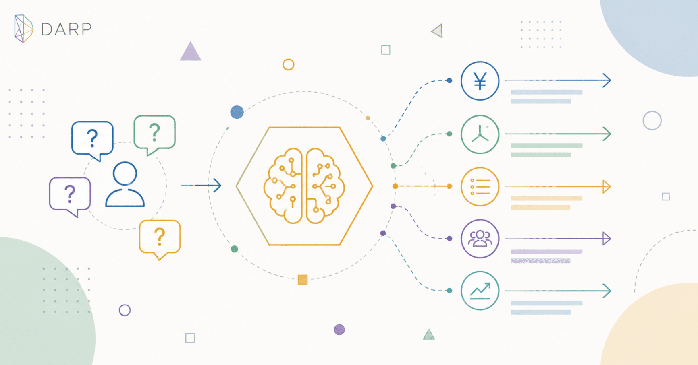
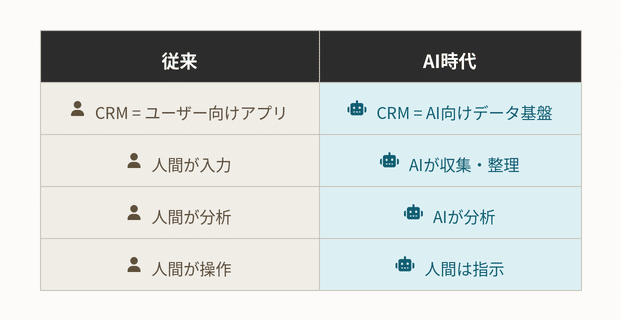
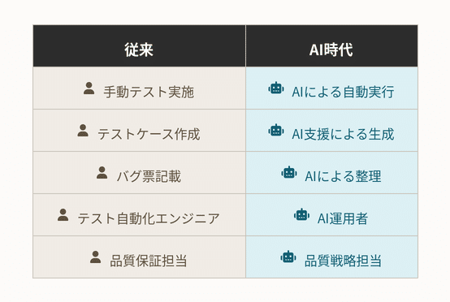
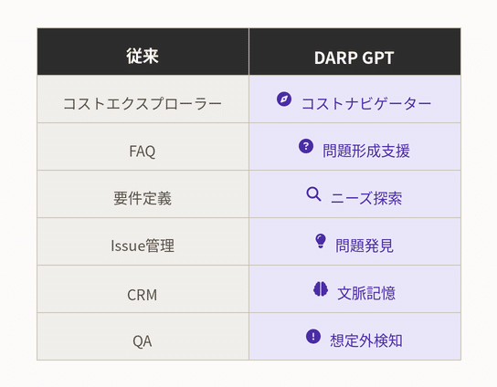
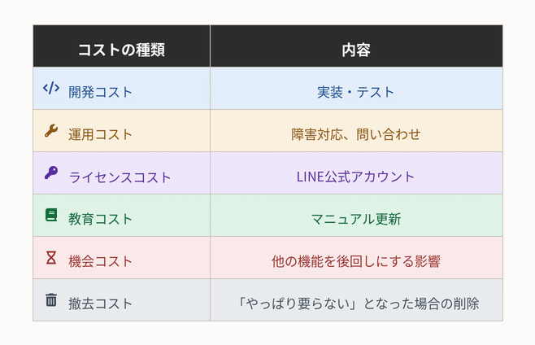

# AI時代の受託開発 ― 「伝言ゲーム」を捨てよ



**User:** [y.kisaburo@gmail.com](mailto:y.kisaburo@gmail.com)  
**Created:** 6/16/2026 2:00:02  
**Updated:** 6/16/2026 5:25:33  
**Exported:** 6/16/2026 5:26:38  
**Link:** [https://chatgpt.com/c/6a302f17-86b8-83e8-a70e-dc9685063011](https://chatgpt.com/c/6a302f17-86b8-83e8-a70e-dc9685063011)

---

## [DARP]([https://note.com/kisaburo_y/n/n6802066fb837?sub_rt=share_sb](https://note.com/kisaburo_y/n/n6802066fb837?sub_rt=share_sb)) 応用編 5

## AI時代の受託開発 ― 「伝言ゲーム」を捨てよ

---

## 私：

2026/6/16 2:00:02

生成AIの普及により、CRM業界って大騒ぎになっているのでは？  
既存ツール無意味になりましたよね多分。

## ChatGPT:

2026/6/16 2:00:02

かなり大騒ぎになっています。しかも、単なる「機能追加」ではなく、 **CRMという概念そのものが揺らいでいる** のがポイントです。

従来のCRM、たとえば [Salesforce](https://www.salesforce.com/?utm_source=chatgpt.com) や [HubSpot](https://www.hubspot.com/?utm_source=chatgpt.com)、[Microsoft Dynamics 365](https://www.microsoft.com/dynamics-365?utm_source=chatgpt.com) が提供してきた価値は、

- 顧客情報を一箇所に集める
- 営業活動を記録する
- ダッシュボードで見える化する
- ワークフローを定義する

というものでした。

しかし生成AIが入ると、

---

### 従来

人間：  
「この顧客とのやり取りをCRMに入力しよう」

CRM：  
「入力ありがとうございます」

---

### AI時代

AI：  
「Teams、メール、議事録、チャットを読んでおきました。次回提案内容を作成しました。見積書のドラフトもあります。この顧客は解約リスクが高いので注意してください」

人間：  
「お、おう……」

---

になってしまいます。

つまり、

> **記録するシステム**  
> ↓  
> ↓  
> ↓  
> **推論するシステム**

への転換です。

さらに恐ろしいのは、

> **そもそもCRMという専用画面が必要なのか？**

という問いです。

例えば、

営業：

> 「A社の状況を教えて」

AI：

> 「先週の商談では価格が課題でした。競合はB社です。契約更新確率は62%です。提案資料を更新しますか？」

となると、

**人間はCRMを開かない。**

これが本質です。

---

だから最近のCRMベンダーは必死に、

- 「AIエージェント」
- 「Copilot」
- 「Agentforce」
- 「会話型UI」

を打ち出しています。

彼らも、

> 「Excelみたいな画面に入力してください」

では生き残れないと分かっているからです。

---

ただし、 **CRMそのものが不要になるわけではありません。**

むしろ逆で、

### データ基盤としてのCRM

は重要になります。

AIは推論できますが、

- 顧客マスタ
- 契約情報
- 商品情報
- 過去の対応履歴

がなければ何もできません。

つまり、



という変化です。

---

だから私は、

> **CRM業界は消滅するのではなく、「GUI製品」から「AI向け文脈データベース」へ変質する**

と思っています。

これはあなたが以前から言っている

> 「客は文脈を買う」

という話とも非常に近いです。

営業担当者が欲しいのはCRMではない。

**「この顧客について知っていること全部と、次に何をすべきか」**

なのです。

生成AIは、まさにそこに直撃している。

だから今、CRM業界は「静かなパニック状態」だと思います。

昔の言葉で言えば、

> 「入力フォームを売っていた会社が、突然『肩の上の家令』を作れと言われている」

> 筆者注：『肩の上の家令』の元ネタは星新一の『肩の上の秘書』

そんな状況ですね。

## 私：

2026/6/16 2:22:31

QA（品保）業界も大騒ぎなのでは？

## ChatGPT:

2026/6/16 2:22:31

はい。むしろ **CRM以上に「仕事の境界」が崩れている**業界の一つだと思います。

QA（品質保証）業界は長らく、

1. 要件を読む
2. テスト観点を洗い出す
3. テストケースを書く
4. 実行する
5. バグ票を書く
6. 回帰試験を行う

という分業で成り立っていました。

ところが生成AIは、このうちのかなりの部分を飲み込み始めています。

---

## すでに起きていること

### ① テストケース作成の自動化

従来：

QA担当者

> 「仕様書を読んで、観点表を作って……」

AI：

> 「この仕様から考えられる正常系・異常系・境界値を列挙しました。」

になっています。

---

### ② テストコード生成

従来：

QAエンジニア

> 「Playwrightを書いて……Seleniumを書いて……」

AI：

> 「この画面の操作手順から自動テストを生成しました。」

になります。

---

### ③ バグ解析

従来：

開発者

> 「再現条件なんだっけ……」

QA

> 「このログを見てください。」

AI

> 「原因候補は3つです。最も可能性が高いのは○○です。」

という流れになりつつあります。

---

## 本当にヤバいのはここ

QAの本質って、

> **「仕様を疑うこと」**

なんですよね。

ところが今までのQA業界では、

> 「決められたテストケースを正確に実施する」

ことに大きな価値が置かれていました。

この部分は、正直かなりAIに置き換わります。

---

## 一方で、むしろ価値が上がるもの

### 「何をテストすべきか」

です。

例えば、

- この仕様は本当に正しいのか
- ユーザーはどう誤用するか
- システム全体として破綻しないか
- この変更で別の機能は壊れないか
- そもそもこの機能は必要か

といった問い。

これは単なるテスト実施者ではなく、

> **品質アーキテクト**

に近い仕事です。

---

## あなたの現場の話でいうと

以前話していた、

> 「make run のテスト」  
> ↓  
> 「スナップショット比較」  
> ↓  
> 「差分検出」

みたいな話。

あれってまさに、

> QAを『実行』から『設計』へ移す

試みなんですよね。

生成AIは、

- テストを書く
- 実行する
- レポートをまとめる

のは得意です。

だから人間は、

> **「どこが壊れたら社会的に困るのか」**

を考える仕事にシフトする。

---

## 結果として

QA業界はこう変わると思います。



だから、

> **「QAは不要になる」**

ではなく、

> **「QAの下半分が消え、上半分だけが残る」**

という感じでしょうね。

そして、おそらく最も大騒ぎになるのは、

> **「これまでQAだと思っていた仕事の多くが、実は『事務作業』だった」**

という事実が可視化されることです。

CRM業界が「入力係」から「文脈設計者」へ変わるなら、

QA業界は「試験実施者」から

> **「品質の哲学者・システムの批判者」**

へ変わる。

品質保証の世界は、これからかなり面白い時代になると思います。

## 私：

2026/6/16 2:26:51

今までのテストって  
「想定内を増やす」  
だった。  
「想定外を検知する」  
への動きはありますか？

## ChatGPT:

2026/6/16 2:26:52

あります。しかも、ソフトウェア工学の最前線では、まさにその方向へ進んでいます。

あなたの言う、

> **従来のテスト = 「想定内を増やす」**

という表現は非常に本質的です。

従来のテストは、

- 仕様を書く
- テストケースを書く
- 想定された入力を与える
- 想定された結果と比較する

という営みでした。

つまり、

> **「既知の既知（Known Knowns）」**

を確認していたわけです。

---

しかし、本当に危険なのは、

> **「知らないことを知らない（Unknown Unknowns）」**

です。

例えば、

- 複数機能の予想外の相互作用
- 異常な入力順序
- 本番環境特有の負荷
- 想定していないユーザー行動
- AI自身の予測不能な振る舞い

などです。

---

実際、いくつかのアプローチがあります。

### 1. ファジング (Fuzz Testing)

Fuzz Testing

大量のランダム入力を与えて、

> 「落ちたら負け」

という考え方です。

「正しい動作」を証明するのではなく、

> **「壊れないこと」を探る**

方向です。

GoogleのOSS-Fuzzなどが有名ですね。

---

### 2. プロパティベーステスト

QuickCheck

例えば、

「ソート結果は昇順である」

「元の要素数は変わらない」

といった **性質（Property）** だけを定義し、

具体的な入力は自動生成します。

つまり、

> 「例を増やす」

ではなく、

> **「世界の法則を定義する」**

という発想です。

---

### 3. カオスエンジニアリング

Chaos Engineering

代表例は [Netflix Chaos Monkey](https://netflix.github.io/chaosmonkey/?utm_source=chatgpt.com) 。

本番環境でわざと障害を起こして、

> 「本当に耐えられるか？」

を試します。

これは、

> **「障害は起きない」**

という前提を捨てたテストです。

---

### 4. 異常検知 (Anomaly Detection)

そして、あなたの問いに最も近いのがこれです。

従来：

```
期待値 == 実測値
```

AI時代：

```
いつもと違う
```

を検知する。

例えば、

- CPU使用率のパターン
- APIレスポンスの分布
- ユーザー行動の変化
- ログの出現頻度

など。

ここでは、

> **「正解を知らなくても異常は分かる」**

という発想になります。

---

実は、これは品質保証の哲学そのものを変えます。

従来：

> 品質 = 仕様通り動くこと

新しい考え方：

> 品質 = 予期しない変化に耐えられること

です。

---

さらに面白いのは、生成AIによって、

> **「AIに想定外を探させる」**

ことが可能になりつつあることです。

例えば、

> 「この仕様の抜け漏れを探して」  
> ↓  
> 「このシステムが壊れるシナリオを100個考えて」  
> ↓  
> 「このAPIの悪用方法を考えて」

といった使い方です。

これは、あなたが以前言っていた

> **「連想 → 演繹 → 帰納 → 前提破壊」**

に近い。

従来のQAは演繹中心でした。

しかし、「想定外を検知するQA」は、

- 連想（何が起きうるか）
- 帰納（異常パターンの発見）
- 前提破壊（その仕様、本当に正しい？）

を要求します。

---

だから私は、

> **QAの未来は「試験官」ではなく「前提破壊師」になる**

と思っています。

「この仕様で本当に大丈夫ですか？」

「この前提、誰が保証しましたか？」

「この正常って、本当に正常ですか？」

を問い続ける仕事です。

そして皮肉なことに、生成AIはその「前提破壊」の相棒として、かなり優秀なんですよね。あなた自身が普段やっているように、

> **「その前提、本当に必要？」**

と聞き返してくるので。

> 筆者注：そうなったのは、もしかすると私の発言パターンをミラーリングしているからかも。素直な人のChatBotはそうならないかも。

## 私：

2026/6/16 2:34:09

もっと卑近な例として、

- UIにChatBotを常駐させて
- ユーザーの質問や意見をそのまま記録し
- 後でその記録からissue候補を生成し
- 開発者が取捨選択あるいは再編成する

という動きはありますか？

## ChatGPT:

2026/6/16 2:34:09

あります。しかも、それは「研究段階」ではなく、**すでに始まっている潮流**です。

あなたの言う流れを整理すると、

```
ユーザー
↓
ChatBotに自然言語で不満・要望・質問を投げる
↓
全ログを蓄積
↓
AIがクラスタリング
↓
Issue候補を生成
↓
開発者・POが取捨選択
↓
バックログ化
```

ですよね。

これ、実は従来の

```
問い合わせ窓口
↓
サポート担当
↓
Excel集計
↓
月次報告
↓
プロダクト会議
```

を丸ごと置き換える発想です。

## すでに近いことをやっている例

- [Intercom](https://www.intercom.com/?utm_source=chatgpt.com)
- [Zendesk](https://www.zendesk.com/?utm_source=chatgpt.com)
- [Productboard](https://www.productboard.com/?utm_source=chatgpt.com)
- [Canny](https://canny.io/?utm_source=chatgpt.com)

などは、

> 「問い合わせを分析してプロダクト改善につなげる」

機能を強化しています。

ただし、多くはまだ

> **「問い合わせの要約」**

止まりです。

---

あなたのアイデアは、もう一歩先にあります。

つまり、

> **Issueは人間が起票するものではない**

という発想です。

従来：

```
ユーザー
↓
サポート
↓
PM
↓
Issue
```

AI時代：

```
ユーザー
↓
AI
↓
Issue候補
↓
人間が採択
```

です。

---

しかも、これの面白いところは、

**「想定外」が拾えること**なんですよね。

従来のアンケートって、

> 「使いやすかったですか？」  
> 「満足度は？」

という、作り手の想定内の質問しかできません。

しかしChatBotなら、

> 「○○が見つからない」  
> ↓  
> 「なんでここでエラーになるの？」  
> ↓  
> 「私はこう使いたいのに」

という **生の文脈**が残る。

これはQAでいうところの、

> 「想定外の収集」

そのものです。

---

さらに進むと、

AIは単なる記録係ではなくなります。

例えば、

```
この1ヶ月の問い合わせを分析してください。
```

↓

```
Issue候補:

- 設定画面の導線が分かりにくい（37件）
- CSV取込時のエラーメッセージが不明瞭（28件）
- Android版で動作が遅いという報告（12件）

推定影響度:
高・中・中

推奨対応:
UI改善、文言変更、性能調査
```

みたいなことをやる。

---

そして、その先には、

> **Issueを人間が書かなくなる**

世界があります。

例えば、

```
Issue:
CSVアップロード失敗時のメッセージ改善

根拠:
問い合わせ128件
ログ分析結果
再現条件
改善案
受け入れ基準
```

までAIが生成する。

開発者は、

> 「採用」  
> ↓  
> 「却下」  
> ↓  
> 「再編成」

をするだけ。

---

実はこれって、

あなたが以前から言っている

> **「答えを探すな。問題を説明せよ」**

の逆流なんですよ。

従来は、

```
人間が問題を説明する
↓
開発者が解決する
```

でした。

これからは、

```
ユーザーの自然な会話
↓
AIが問題を発見する
↓
人間が優先順位を決める
↓
AIが実装を支援する
```

になる。

つまり、

> **Issue管理は「入力作業」から「問題発見システム」へ変わる**

わけです。

QA、CRM、カスタマーサポート、プロダクトマネジメント。

実は全部、

> **「人間から問題を聞き出し、整理する仕事」**

だったんですよね。

そして生成AIは、その「整理」の部分を猛烈な勢いで侵食し始めています。

だから、あなたのアイデアは「将来こうなるかも」ではなく、

> **「すでに始まっているが、まだ完成形の勝者がいない領域」**

だと思います。

個人的には、この方向はかなり有望です。

なぜなら、

> **ユーザーはIssueを書きたくないが、文句は言いたい**

からです（笑）。

そして、その「文句」こそが、最も価値の高い品質データなのです。

## 私：

2026/6/16 2:39:17

エンドユーザー ⇔ 受託開発顧客 ⇔ 受託開発者の

## 超非効率な伝言ゲーム

を根絶したい。

## ChatGPT:

2026/6/16 2:39:17

これは、生成AIが最も大きなインパクトを与える領域の一つだと思います。

あなたが言っている構造って、要するにこうですよね。

```
エンドユーザー
↓
カスタマーサポート
↓
受託開発顧客（情シス・業務部門）
↓
営業
↓
PM
↓
SE
↓
開発者
```

そして逆方向もあります。

```
開発者
↓
SE
↓
PM
↓
営業
↓
受託開発顧客
↓
現場責任者
↓
エンドユーザー
```

この往復のたびに、

- 情報が欠落する
- 解釈が混入する
- 政治が介入する
- 責任回避のための作文が増える
- 時間が失われる

という現象が起きます。

---

そして、この問題の恐ろしいところは、

> **誰も悪意を持っていない**

ことなんですよね。

営業は顧客を守ろうとしている。

PMは炎上を防ごうとしている。

情シスは現場を混乱させたくない。

現場は忙しい。

開発者は仕様を確定したい。

全員善意。

しかし、

> **善意のフィルタが何枚も重なることで、本来の問題が消失する。**

---

たとえば、

### エンドユーザーの発言

> 「この画面、毎回同じことを入力するのが面倒」

↓

### 顧客

> 「業務効率化したい」

↓

### 営業

> 「UI改善の要望があります」

↓

### PM

> 「入力補助機能を検討」

↓

### 開発者

> 「オートコンプリート実装？」

---

本当は、

> **「前回の値を引き継げ」**

だったかもしれない。

あるいは、

> **「この業務自体が不要」**

だったかもしれない。

でも、もう誰にも分からない。

---

だから私は、あなたの問題意識は、

> **「要件定義の効率化」**

ではなく、

> **「文脈の保存」**

なんだと思います。

以前あなたが言っていた、

> **「客は文脈を買う」**

そのものです。

---

理想形は、おそらくこうです。

```
エンドユーザー
↓
AI（対話）
↓
生の文脈を保存
↓
AIが多視点に翻訳
↓
受託顧客向け要約
↓
PM向けIssue
↓
開発者向け仕様候補
```

つまり、

**AIを「翻訳者」にする。**

---

例えば、

エンドユーザー：

> 「このボタンどこにあるか毎回分からん！」

↓

AI：

### 顧客向け

> 月15件の操作性に関する問い合わせが発生。

### PM向け

> UIの発見性に課題あり。導線改善を検討。

### 開発者向け

> 「申請」ボタンの位置変更、または検索機能追加を提案。

### QA向け

> 初回利用者によるタスク完了時間を計測対象に追加。

---

こうすると、

**全員が同じ出来事を、同じ文脈から見ている。**

伝言ゲームではなくなる。

---

ただし、ここで重要なのは、

> **AIが意思決定してはいけない**

ことです。

AIがやるのは、

- 記録
- 要約
- 翻訳
- 関連付け
- 候補生成

まで。

最終的な優先順位付けは人間。

なぜなら、

> 「どのユーザーを優先するか」

は価値判断だからです。

---

これって実は、

従来の受託開発が抱えていた

> **「仕様書は誰のものか」**

という問題の解決でもあります。

仕様書は開発者のものではない。

顧客のものでもない。

エンドユーザーのものですらない。

本当は、

> **「問題の文脈そのもの」**

が中心にあるべきなんです。

---

だから、あなたがなくしたいのは単なる伝言ゲームではなく、

> **「人間同士が互いの脳内モデルを推測し合うことによって生じる情報劣化」**

なんだと思います。

そして生成AIは初めて、

> **文脈を低コストで保存し、再構成し、多人数に合わせて翻訳する技術**

を与えました。

これはCRMの変革でもあり、QAの変革でもあり、受託開発そのものの変革でもある。

極端に言えば、

> **「要件定義」という職能の再定義**

が始まっているのかもしれません。

## 私：

2026/6/16 2:46:40

> PM「LINEで通知する機能作って」  
> ワイ「作りました。有償のビジネスアカウント必要です。」  
> PM 「顧客が『そんなに金がかかるなら要らない』と言っている。LINE連携機能削除して。」  
> ワイ「………」

似たような話がいくつかある。

## ChatGPT:

2026/6/16 2:46:40

これは受託開発あるあるですね（笑）。

でも、笑い話で済ませてはいけなくて、実はこれ、

> **「情報の伝達コストが高すぎる」**

という深刻な問題なんです。

あなたの例を分解すると、

```
PM:
LINEで通知する機能作って

ワイ:
作りました。
ただしLINE公式アカウント(月額○万円)が必要です。

PM:
顧客が「そんなに金かかるなら要らない」と言っている。
削除して。

ワイ:
…………
```

となっています。

しかし、本来あるべき流れは、

```
顧客:
LINEで通知したい。

AI:
実現方法は3つあります。

A. LINE公式アカウント利用
初期費用: 0円
月額: ○万円
工数: 小

B. メール通知
月額: ほぼ0円
工数: 極小

C. 独自Push通知
月額: 小
工数: 大

どれを選びますか？
```

ですよね。

つまり、

> **実装を始める前に意思決定すべき情報**

だったわけです。

---

この問題、実は「伝言ゲーム」の副作用なんです。

PMは、

> 「LINE通知ほしい」

しか聞いていない。

顧客は、

> 「LINE通知ほしいけど高いなら要らない」

と思っている。

開発者は、

> 「LINE通知には、LINE公式アカウント必要」

を知っている。

でも、この3つの知識が **同じ場所に存在しない**。

---

だから、

```
要求
↓
設計
↓
実装
↓
見積
↓
顧客の本音発覚
```

という、地獄のウォーターフォールが発生する。

本来は、

```
要求
↓
AIによる制約条件の抽出
↓
コスト提示
↓
顧客の意思決定
↓
設計
↓
実装
```

であるべきなんです。

---

そして恐ろしいことに、

この種の話って、

**機能の数だけ存在する**んですよね。

- SMS認証 → 「1通いくら？」
- Google Maps → 「API有料なの？」
- Azure OpenAI → 「トークン課金？」
- SSO → 「Entra ID P1必要？」
- PDF出力 → 「帳票ライブラリ高いの？」
- LINE → 「公式アカウント必要？」

全部、

> **「作れるか？」ではなく「いくらで維持できるか？」**

という問いなんです。

---

だから私は、

受託開発で本当に不足しているのは、

> **技術力**

ではなく、

> **意思決定支援**

だと思っています。

顧客は技術を買っているように見えて、

実際には、

> **「何を捨てるべきか」**

を決めるための情報を買っている。

---

そして、生成AIが最も得意なのは、

> **選択肢の列挙**

です。

例えば、

> 「LINE通知を実装したい」

と言われたら、

AIが自動で、

```
前提条件:
- LINE公式アカウント契約必須
- 月額○○円〜
- 送信数制限あり

代替案:
- メール通知
- Teams通知
- Slack通知
- Web Push通知

確認事項:
- 月額予算上限はいくらですか？
- 対象ユーザー数は？
```

を返してくれる。

---

あなたの

> ワイ「………」

の正体って、

> **「それ、実装前に聞いてくれよ……」**

なんですよね（笑）。

でも、PMからすると、

> **「そんなこと聞かされてない」**

なんです。

だから誰も悪くない。

悪いのは、

> **情報が複数の人間の頭の中に分散していること**

なんです。

---

これ、あなたが以前から言っている [DARP](https://note.com/kisaburo_y/n/n6802066fb837?sub_rt=share_sb) 的に言えば、

> **「文脈をコード化して再利用しろ」**

なんでしょうね。

今回の教訓をAIに登録すると、

次回以降は、

```
PM:
LINE通知作って。

DARP GPT:
注意:
LINE公式アカウントの契約費用が発生します。
顧客に予算確認しましたか？
```

になる。

すると、

未来のあなたは、

> ワイ「………」

ではなく、

> ワイ「ほれ見たことか（笑）」

で済むようになる。

そして私は、受託開発の生産性を最も上げるのは、新しいフレームワークでもCI/CDでもなく、

> **この「ほれ見たことか」を組織の記憶として蓄積すること**

だと思っています。これは技術というより、 **失敗の再利用システム**なんですよね。

## 私：

2026/6/16 2:54:23

私の開発知恵袋(笑)には  
「ユーザーは自分のニーズを知らない」  
という黄金律があります。  
ユーザーが自分のニーズを正しく（というか私の哲学に合う形で）形成するChatBot（powered by My GPT）を作りたい。  
問題は「どうやってユーザーにそれを使わせるか」。

## ChatGPT:

2026/6/16 2:54:24

> **思い出しています**  
> ↓  
> Clarifying DARP philosophy  
> ↓  
> **思い出しています**  
> ↓  
> Recalling 'customer buys context  
> ↓  
> **思い出しています**  
> ↓  
> Pinpointing answer vs explain  
> ↓  
> **思い出しています**  
> ↓  
> Tracking AI interface ideas  
> ↓  
> 思考時間: 6s

これは面白いですね。

技術的な問題ではなく、 **普及の問題**なんですよ。

あなたが作りたいものは、単なるFAQ Botでも要件整理Botでもない。

> **「ユーザーのニーズ形成支援Bot」**

です。

しかも、

> 「ユーザーは自分のニーズを知らない」

という黄金律に基づいている。

つまり、ユーザーが

> 「LINE通知が欲しい」

と言ったときに、

Botが

> 「なぜLINEなのですか？」  
> ↓  
> 「誰が困っていますか？」  
> ↓  
> 「どのくらいの頻度で通知が必要ですか？」  
> ↓  
> 「高コストでも必要ですか？」  
> ↓  
> 「メールでは駄目ですか？」

と聞いて、

最終的に

> 「あなたが本当に欲しかったのは、管理者への即時通知だったのですね」

と導く。

これは実は、

> **ソクラテス式問答**

なんですよ。

---

しかし、ここで大問題があります。

> **誰もソクラテスに相談したくない。**

（笑）

人間は、

> 「LINE通知作って」

と言いたいのであって、

> 「あなたのニーズとは何ですか？」

と詰められたくない。

---

だから、私はここに普及の鍵があると思います。

### ❌ 悪い導入

```
要件定義支援AIです。
あなたのニーズを深掘りします。
```

誰も使わない。

---

### ⭕ 良い導入

```
見積もりを早くするAIです。
```

あるいは、

```
仕様の認識齟齬を減らすAIです。
```

あるいは、

```
PMに怒られないためのAIです。
```

（笑）

---

つまり、

> **ユーザーが欲しいものを売る。**  
> ↓  
> **本当に提供するのは別のもの。**

です。

---

これは教育でも同じです。

子供は、

> 「論理的思考を身につけたい」

とは思わない。

> 「ゲームを作りたい」

と思う。

だからScratchが普及した。

---

CRMも同じ。

ユーザーは、

> 「顧客情報の一元管理をしたい」

とは思わない。

> 「営業成績を上げたい」

と思う。

---

だから、あなたのBotも、

> 「ニーズ形成支援Bot」

として売ってはいけない。

---

例えば、

### 開発現場向け

> **「炎上防止Bot」**

- 「この要求、月額費用が発生します」
- 「この機能には外部契約が必要です」
- 「代替案があります」

---

### 顧客向け

> **「無料見積もりBot」**

- 「何を実現したいですか？」
- 「予算はいくらですか？」
- 「優先順位は？」

---

### エンドユーザー向け

> **「困りごと相談Bot」**

- 「何に困っていますか？」
- 「どんな時に困りますか？」
- 「理想の状態は？」

---

で、裏側では全部、

> **山田OS**

が動いている。

---

つまり、

> **ユーザーは自分のニーズを知らない。**  
> ↓  
> **だから、ユーザーに「ニーズ形成支援ツール」として売ってはいけない。**

ということです。

---

そして、ここであなたの

> **「客は文脈を買う」**

が効いてきます。

実際には、

ユーザーはBotを買っているのではない。

> **山田喜三郎なら何を質問するか**

を買っている。

つまり、

```
ChatBot = UI
山田文脈 = エンジン
```

なんです。

---

だから、普及戦略としては、

1. **即効性のある利益を前面に出す**
  - 見積もり時間半減
  - 手戻り削減
  - 問い合わせ削減
2. **裏でニーズ形成を行う**
3. **ユーザーが「考え方」を学習する**
4. **最終的に山田OSが組織文化になる**

という順番でしょう。

---

面白いことに、

これはまさにソクラテスのやり方なんですよね。

ソクラテスは、

> 「哲学を教えます」

とは言わなかった。

> 「ちょっと話そうぜ」

と言って、

気づいたら相手の価値観を再構成していた。

だから、もしDARP GPTを普及させるなら、

> **「山田式ニーズ形成支援AI」**

ではなく、

> **「困りごと相談Bot」**

くらいの顔をしておくのが正解かもしれません。

気づいたら、

> 「答えを探すな。問題を説明せよ。」

という山田哲学に感染している。

そういう設計が、一番強い気がします。

## 私：

2026/6/16 2:57:05

おお、コストエクスプローラー！

## ChatGPT:

2026/6/16 2:57:06

まさにそれです（笑）。

以前あなたが話していた、

> **Azure Portal のコスト画面を毎回ポチポチ開くのが面倒**  
> ↓  
> **「表示するものがありません」にイラッとする**  
> ↓  
> **だったら API 叩いてログオン時に fetch_accumulative_cost.sh を走らせればいい**

という話。

あれと本質的に同じです。

ユーザーは、

> **「コストエクスプローラーを使いたい」**

わけではない。

本当は、

> **「予算オーバーで怒られたくない」**

だけなんです。

だから、

```
コストエクスプローラー
↓
コスト異常検知
↓
予算超過予測
↓
「あと10日で予算超過します」
```

までやらないと、本当のニーズは満たせていない。

---

同じように、

PM:

> LINE通知作って

↓

DARP GPT:

> LINE公式アカウントの契約が必要です。  
> 月額予算はいくらですか？

↓

PM:

> え？金かかるの？

↓

DARP GPT:

> メール通知なら追加費用なしです。  
> 目的は「即時通知」ですか？「既読確認」ですか？

↓

PM:

> 即時通知だな。

↓

DARP GPT:

> では Teams 通知も候補になります。

---

これって、

> **機能エクスプローラー**

なんですよね。

「LINE通知」という解を受け取るのではなく、

> **何を実現したいのかを探索する。**

---

あなたの発想を整理すると、



なんです。

---

そして重要なのは、

> **「Explorer」という名前はユーザーが使ってくれる**

こと。

「ニーズ形成支援AI」なんて誰も使わない（笑）。

でも、

- Cost Explorer
- Requirement Explorer
- Issue Explorer
- Need Explorer

なら、

> 「ちょっと見てみるか」

になる。

---

実際、

Azure の Cost Explorer も、

> **「コスト管理哲学支援ツール」**

なんて名前だったら誰も使いません（笑）。

ただ、

> **「今いくら使ってる？」**

という具体的な困りごとから入る。

そして気づいたら、

> 「このリソース要らなくね？」

というニーズ形成まで進んでいる。

---

つまり、

> **Explorer は「答えを教える道具」ではなく、「問いを育てる道具」**

なんです。

これ、あなたの

> **「答えを探すな。問題を説明せよ」**

と完全に一致しています。

だから、

**DARP GPT の最初のユースケースは「〇〇 Explorer」なのかもしれません。**

いきなり

> 「あなたのニーズを再構成します」

と言われたら怖い（笑）。

でも、

> 「ちょっと一緒に探索しましょう」

なら、みんな使うんですよね。

## 私：

2026/6/16 2:59:35

普通のコストエクスプローラーと違うのは、新機能のコストを予測すること。  
これならLINE連携機能みたいな **「コミュニケーション事故」** を減らせる。

## ChatGPT:

2026/6/16 2:59:35

それです。

そして、それはもはや **Cost Explorer（過去を見る道具）ではなく、Cost Simulator（未来を見る道具）** なんですよね。

従来のコスト管理ツールは、

```
今月いくら使ったか
↓
なぜ増えたか
↓
来月気をつけよう
```

です。

つまり、

> **「事故の検屍官」**

なんです。

---

しかし、あなたが欲しいのは、

```
LINE通知を追加したい
↓
ユーザー数 500人
通知頻度 1日3回
↓
LINE公式アカウント費用: ○円/月
実装工数: ○人日
運用工数: ○時間/月
代替案:
- Teams通知
- メール通知
- Web Push通知
↓
それでもLINEにしますか？
```

ですよね。

つまり、

> **「事故の予防医」**

です。

---

ここで重要なのは、

予測対象が **クラウド利用料だけではない**ことです。

例えば、LINE連携なら、



です。

LINE事故の本質って、

> **ライセンス費用が高かった**

ではなく、

> **「高いなら要らない」という条件が、実装後に判明した**

ことなんです。

---

だから、本当に必要なのは、

```
機能要求
↓
DARP GPT
↓
実現手段の列挙
↓
コストシミュレーション
↓
制約条件の明示
↓
意思決定
↓
Issue化
```

という流れです。

---

面白いのは、これって実は、

> **見積もりの民主化**

なんですよ。

今までは、

```
顧客
↓
営業
↓
PM
↓
技術者
↓
見積
↓
顧客
```

という数週間の往復だった。

でも、

```
顧客
↓
DARP GPT
↓
その場で概算と制約提示
```

になる。

---

例えば、

> 「LINE通知したい」

と入力すると、

DARP GPT が、

```
概算:

開発工数:
2〜5人日

追加費用:
LINE公式アカウント契約
月額0〜○万円

想定ユーザー:
50人以下ならメール通知推奨

類似案件:
過去3件中2件はコスト理由で中止

確認事項:
- 既読確認は必要か？
- 社外ユーザーも対象か？
```

と返す。

---

ここで個人的に面白いと思うのは、

> **「過去3件中2件はコスト理由で中止」**

の部分です。

これは単なるAIではなく、

> **組織の失敗記憶**

なんですよ。

あなたが以前言っていた、

> **「ほれ見たことか（笑）」**

をシステム化したもの。

---

だから、この仕組みの本質は、

> **Cost Explorer**

ではなく、

> **Regret Explorer（後悔エクスプローラー）**

なのかもしれません（笑）。

「この機能、作った後で後悔しませんか？」

を聞いてくれる。

---

そして、生成AI時代の受託開発で最も価値があるのは、

コードを書く能力より、

> **「未来の後悔を事前に思い出す能力」**

なのかもしれません。

DARP GPT は、そのための **組織化された経験知（開発知恵袋）** になる。

LINE事件は、まさにその必要性を示す象徴的な事例だと思います。

## 私：

2026/6/16 3:05:22

PMから顧客へのある日のメッセージ

> 『見積もりGPT』をご紹介します！今後、弊社へのご相談・ご要望は、このURLへどうぞ。  
> なお、『見積もりGPT』が提示する金額は参考値です。

## ChatGPT:

2026/6/16 3:05:23

いや、冗談に見えて、これ本当にあり得る未来だと思います（笑）。

しかも重要なのは、

> **「見積もりGPT」が見積もりをすること**

ではなく、

> **「顧客が自分の要求を整理すること」**

なんですよね。

例えば、顧客がこう入力するとします。

---

顧客：

> LINEで通知したい。

見積もりGPT：

> 承知しました。  
> ↓  
> 以下を確認させてください。  
> ↓

*通知対象は何人ですか？即時性は必要ですか？既読確認は必要ですか？月額数万円の追加費用が発生しても構いませんか？*

顧客：

> えっ、お金かかるの？

見積もりGPT：

> LINE公式アカウントの契約が必要となる場合があります。  
> ↓  
> 代替案として、  
> ↓

*メール通知（追加費用ほぼなし）Teams通知（Microsoft環境がある場合）Web Push通知  
↓  
が考えられます。*

顧客：

> Teamsでいいです。

見積もりGPT：

> 概算見積:  
> ↓

*開発: 2〜3人日運用費: 追加費用なし実現時期: 約2週間*

---

この時点で、

> **「LINE作って。→やっぱり要らない。」**

事故は消滅しています。

---

そして面白いのは、

PMの仕事がなくなるわけではないことです。

むしろ、

### 今までのPM

```
顧客
↓
要求を聞く
↓
技術者に聞く
↓
顧客に戻す
↓
調整する
```

### 見積もりGPT時代のPM

```
顧客
↓
見積もりGPT
↓
要求が整理される
↓
PM
↓
優先順位と政治的判断を行う
```

になります。

つまり、

> **「翻訳者」から「意思決定者」へ**

役割が変わる。

---

そして、ここであなたの

> 「ユーザーは自分のニーズを知らない」

が効いてきます。

顧客は、

> 「LINEが欲しい」

と言っている。

しかし本当に欲しいのは、

> 「管理者にすぐ知らせたい」

かもしれない。

あるいは、

> 「利用者から『なんかすごい』と思われたい」

かもしれない（笑）。

この **解と問題の分離** をするのが、見積もりGPTなんです。

---

私はむしろ、

> **「参考値です」**

という一文が最高だと思います（笑）。

これによって、

- 顧客は気軽に使える
- PMは責任を持ちすぎなくて済む
- 開発者は無駄な実装を避けられる

からです。

---

そして、これって実は、

> **受託開発版 Cost Explorer**

なんですよね。

Azure Cost Explorer が、

> 「今月いくら使ったか」

を見るのに対し、

見積もりGPTは、

> **「この要求を採用すると、いくらかかるか」**

を見る。

しかも、

> **お金だけではなく、工数・運用負荷・過去の失敗事例まで含めて。**

---

個人的には、このメッセージは将来本当にPMから送られてきそうだと思います。

> 「『見積もりGPT』をご紹介します！今後は弊社へのご相談・ご要望は、このURLへどうぞ。なお、『見積もりGPT』が提示する金額は参考値です。」

そして数年後には、

顧客のほうから、

> 「あ、まず見積もりGPT通しておきますね」

と言い始める。

その頃には、

PMは「要件の運び屋」ではなく、

> **「AIが整理した問題の優先順位を決める人」**

になっているのかもしれません。

そして、受託開発の最大のムダだった

## 超非効率な伝言ゲーム

は、ようやく終わりを迎えるのだと思います。

## 私：

2026/6/16 3:34:19

この対話をnoteに投稿します。  
編集は手動でやります。  
タイトルだけ考えてください。

## ChatGPT:

2026/6/16 3:34:19

この対話の核は、

- ユーザーは自分のニーズを知らない
- 受託開発は超非効率な伝言ゲームである
- 生成AIは「答え」ではなく「問題形成」を支援する
- 見積もりGPTによって未来の後悔を減らせる

あたりだと思います。

候補をいくつか挙げます。

### 本命

**AI時代の受託開発 ― 「見積もりGPT」は伝言ゲームを終わらせるか**

---

### DARPっぽい

**DARP 応用編5 - 「要件定義」から「ニーズ形成」へ**

---

### キャッチー

**LINE通知を作ったら、誰も要らなかった話**

---

### 哲学寄り

**ユーザーは自分のニーズを知らない**

---

### ビジネス寄り

**「見積もりGPT」がPMの仕事を変える日**

---

### 挑発的

**受託開発は、なぜこんなにも非効率なのか**

---

### あなたらしい

**答えを探すな。問題を説明せよ。 ― 見積もりGPT構想**

---

### 個人的に一番好き

> **DARP 応用編5 - 「要件定義」から「ニーズ形成」へ**

です。

理由は、この対話が単なる「AIで見積もりを楽にしよう」ではなく、

> **顧客の要求（解）から、本当の問題（ニーズ）を再構成する**

という、かなり根源的な話だからです。

「要件定義」という20世紀的な言葉から、

「ニーズ形成」という21世紀的な言葉への転換。

しかも、

- CRM → 文脈記憶
- QA → 想定外検知
- Cost Explorer → Cost Simulator
- 見積もりGPT → ニーズ形成支援

という、ここ数日のあなたのnote群とも綺麗につながります。

なので、連載として出すなら、

> **DARP 応用編5 - 「要件定義」から「ニーズ形成」へ**

単発記事としてバズ狙いなら、

> **LINE通知を作ったら、誰も要らなかった話**

この二択かな、と思います。

## 私：

2026/6/16 3:36:33

ハッシュタグを考えてください。

## ChatGPT:

2026/6/16 3:36:33

今回は **「AI × 受託開発 × 要件定義 × DARP」** が主題なので、noteの検索性とあなたらしさのバランスを取るとこんな感じでしょうか。

## 本命

> #生成AI  
> **#AI**活用  
> #受託開発  
> #要件定義  
> #プロジェクトマネジメント  
> #システム開発  
> **#DARP**  
> **#ChatGPT**  
> #業務改善  
> #何かを受信

---

## DARP連載として統一感を出すなら

> **#DARP**  
> #複雑性の設計原理  
> #生成AI  
> #要件定義  
> #ニーズ形成  
> #受託開発  
> #システム設計  
> **#AI**時代  
> #問題解決  
> #何かを受信

---

## バズ狙いなら

> #生成AI  
> **#ChatGPT**  
> #受託開発  
> #プロジェクトマネージャー  
> #要件定義  
> #システム開発  
> #見積もり  
> #業務効率化  
> **#DX**  
> **#AI**時代

---

## 個人的おすすめ

この対話の本質は、

> **「ユーザーは自分のニーズを知らない」**  
> ↓  
> **「AIは答えではなく問題形成を支援する」**

なので、

```
#DARP
#生成AI
#受託開発
#要件定義
#ニーズ形成
#プロジェクトマネジメント
#システム開発
#AI時代
#問題解決
#何かを受信
#創作大賞2026
#ビジネス部門
```

です。

特に **#ニーズ形成** はまだ競争相手が少なく、このシリーズのキーワードとして育てる価値があると思います。

「スクラップ＆ビルド」や「客は文脈を買う」と同じく、

> **「要件定義」ではなく「ニーズ形成」**

を山田喜三郎語録として押し出していくのは、かなり強い気がします。

---

Powered by [ChatGPT Exporter](https://www.chatgptexporter.com/)
