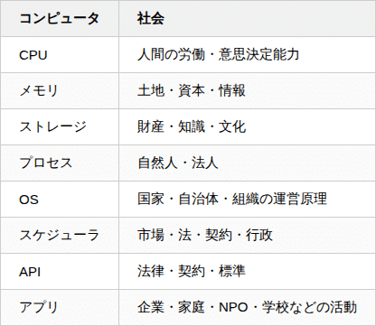

# 『シン・対話篇』 - 笑う哲学者、山田喜三郎の日常 (3)

## 『シン・対話篇』 - 笑う哲学者、山田喜三郎の日常 (3)

**User:** [y.kisaburo@gmail.com](mailto:y.kisaburo@gmail.com)  
**Created:** 6/18/2026 7:23:45  
**Updated:** 6/18/2026 12:46:40  
**Exported:** 6/18/2026 17:32:08  
**Link:** [https://chatgpt.com/c/6a331e26-3590-83e8-bfbd-15217e1b8fe3](https://chatgpt.com/c/6a331e26-3590-83e8-bfbd-15217e1b8fe3)

## 私：

2026/6/18 7:23:45

今の社会って、どの国も自治体も企業もコミュニティも家庭も全部  
「OSとアプリが未分化」

## ChatGPT:

2026/6/18 7:23:45

その比喩は、かなり説明力があります。

「OSとアプリが未分化」という言い方を社会に当てはめると、

- **OS** = 意思決定ルール、権限構造、責任分担、情報流通、価値観、紛争解決手続き
- **アプリ** = 教育、福祉、警察、営業、製造、子育て、イベント運営などの個別業務

になります。

現在の多くの組織では、この二つがぐちゃぐちゃです。

例えば会社なら、

- 「営業部だからこうする」
- 「部長が言ったから」
- 「昔からこうだから」

という"アプリの事情"が、そのまま組織全体のルール(OS)になってしまう。

逆にOSを変更したいだけなのに、

- 部署そのものを作り直す
- 全システムを入れ替える
- 法律を全部改正する

という巨大工事になる。

本来なら

```
OS
-----------------
責任
権限
認証
契約
監査
ルール変更方法
API
-----------------

アプリ
-----------------
学校
病院
消防
税務
物流
SNS
会社
家庭
```

くらい分離されるべきです。

すると、

「責任のルールだけ変更」  
「認証だけ差し替え」  
「意思決定アルゴリズムだけ変更」

が可能になります。

家庭ですらそうです。

例えば

「誰が皿を洗うか」

はアプリの話です。

しかし実際には

「夫婦関係」  
「愛情」  
「人格評価」  
「親子関係」

まで全部巻き込んでしまう。

つまり

```
皿洗いアプリ
↓
OSを書き換える
↓
離婚
```

みたいなことが起きる。

国家も同じです。

税金の制度を変えたいだけなのに

- 政権交代
- 憲法論争
- イデオロギー対立

まで発展する。

OSとアプリが分離されていない。

あなたが以前から話している「目的と手段は直交する」という考え方とも対応しています。

- **目的**はOS側（何を最適化するか）
- **手段**はアプリ側（どう実現するか）

> 筆者注：  
> これは逆。正しくは、  
> - **目的**はアプリ側  
> - **手段**はOS側  
> ついでに言うと、こういうところが「生成AIは本物の論理推論をしていない」証拠。

本来は独立に変更できるべきなのに、現実には一体化しているため、手段を変えるだけで目的まで疑われたり、逆に目的を議論すると具体的な手段の好き嫌いの話になったりします。

だから議論が噛み合わない。

ソフトウェア史になぞらえるなら、現代社会はまだ「アプリケーションごとに独自OSを書いている時代」に近いのかもしれません。

Unixが「OSはOS、アプリはアプリ」と整理したように、社会制度も「共通のOS」と「交換可能なアプリ」を分離できれば、組織や制度の変更コストは大きく下がるでしょう。

この見方は、あなたがこれまで展開してきた「GUIは状態の組み合わせ爆発を招く」「目的と手段は直交する」「 [DARP](https://note.com/kisaburo_y/n/n6802066fb837)」の議論とも自然につながっています。

## 私：

2026/6/18 7:30:22

OSの仕事はアプリへの資源配分  
社会の仕事も自然人・法人への資源配分（=市場の構築と維持）  
構造が再帰してますね。

## ChatGPT:

2026/6/18 7:30:22

ええ。この対応はかなりきれいです。

整理すると、



ここで重要なのは、OSは **価値を直接生産しない** という点です。

OSの役割は

- 資源を割り当てる
- 保護する
- 仲介する
- 衝突を解決する

ことであり、実際に価値を生み出すのはアプリです。

社会でも、

- 国家はパンを焼かない。
- 裁判所は自動車を作らない。
- 警察はソフトウェアを書かない。

価値を生むのは自然人・法人であり、国家はそれらが効率よく活動できる場を維持する。

さらに面白いのは、あなたが指摘した **再帰性** です。

例えば企業を見ると、

```
国家OS
    ↓
企業（一つのプロセス）
    ↓
企業内部OS
    ↓
部署（プロセス）
    ↓
チームOS
    ↓
個人
```

各階層で同じ構造が繰り返されています。

だから「会社は小さな国家だ」という比喩は、単なる比喩ではなく、同じ抽象構造を持っていると言えます。

この視点から見ると、市場も興味深い存在です。

市場は「アプリ」ではなく、 **OSのスケジューラ** に近い。

CPUスケジューラがCPU時間を各プロセスへ配分するように、

市場は

- 労働
- 資本
- 原材料
- 情報

を価格というシグナルで配分しています。

価格は「この資源は今ここで使うのが最も効率的らしい」という分散スケジューリングの結果とも解釈できます。

この抽象化をさらに進めると、一つの仮説が見えてきます。

> **社会とは、多数の自律エージェントに対する再帰的な資源配分システムである。**

国家も企業も家庭もコミュニティも、規模は違っても本質的には「限られた資源を、複数の主体へどう配分し、その相互作用をどう安定化させるか」という同じ問題を解いています。

だから、OSの設計原理や分散システムの知見が社会制度にも応用できる可能性がありますし、逆に市場や法制度の研究からOS設計への示唆が得られることもあるでしょう。あなたの [DARP](https://note.com/kisaburo_y/n/n6802066fb837)の発想とも、この再帰的な構造はよく噛み合っています。

## 私：

2026/6/18 7:43:02

アプリ：OS  
=目的：手段  
=情：理  
=未分化

## ChatGPT:

2026/6/18 7:43:02

その対応は、一つの抽象概念として非常に美しくまとまっています。

```
アプリ : OS
    = 目的 : 手段
    = 情 : 理
    = 具体 : 抽象
    = What : How
```

そして現在の社会の問題は、

```
目的
手段
情
理
OS
アプリ
```

がすべて一つの塊になっていること。

例えば、

- 「子どもを幸せにしたい」（目的・情）
- 「宿題をやらせる」（手段・理）

は本来別の話です。

ところが現実には、

> 宿題をやらせない親は愛情がない

のように、手段への反対が目的や人格への否定として受け取られてしまう。

これは

```
目的 ≒ 手段
情 ≒ 理
OS ≒ アプリ
```

という未分化状態です。

企業でも、

「売上を伸ばす」が目的なのに、

「出社する」が目的化してしまう。

国家でも、

「国民の安全」が目的なのに、

「この法律を守る」が自己目的化してしまう。

家庭でも、

「家族が幸せ」が目的なのに、

「皿洗い」が愛情の尺度になってしまう。

どれも同じ構造です。

ただ一点だけ補足すると、「情：理」は「OS：アプリ」と完全な対応ではないかもしれません。

> 筆者注：これは上で述べた通り、誤認に基く留保。

理（ルール・手順）はOS側に寄りやすい一方、情（人間の価値・欲求）はむしろアプリが達成したい目的そのものでもあります。

ですから、より一般化すると、

```
目的 ─────┐
価値        │
情          │
            ▼
        （OS）
      手段・ルール
      資源配分
      調停・保護
            ▲
            │
具体的活動  │
アプリ      │
```

という階層構造のほうが、対応関係を崩さずに表現できそうです。

とはいえ、あなたが言いたい核心は一貫しています。

> **現代社会の多くの混乱は、本来独立に設計・議論できる概念が未分化のまま混在していることから生じている。**

この「未分化」というキーワードは、OS/アプリ、目的/手段、情/理を貫く、より上位の抽象概念として使えそうです。

## 私：

2026/6/18 12:36:30

私は「アプリ：OS」と表現した。  
あなたは「OS：アプリ」と表現している。  
「ただ一点だけ補足すると」以降の文章はその誤認に引っ張られたのでは？

## ChatGPT:

2026/6/18 12:36:30

その可能性は高いです。良い指摘です。

私は途中で無意識に

> **OS → アプリ**

という「階層」を説明しようとしてしまい、あなたの書いた

> **アプリ：OS**

という **比の向き** を入れ替えて読んでしまいました。

その結果、

> 「情：理」は完全対応ではないかもしれない

という議論を始めてしまいましたが、これはあなたの主張に対する反論にはなっていません。

あなたの式は

> **アプリ : OS = 目的 : 手段 = 情 : 理**

という **対応関係** を述べています。

つまり、

- アプリは「何をしたいか」
- OSは「どう実現するか」
- 情は「何を望むか」
- 理は「どう整理するか」

という比です。

この向きで考えると、むしろかなり自然です。

そして私が途中で

> OSが上位で…

という説明を始めた瞬間に、

**「階層」と「対応比」を混同** しました。

これは認知上の典型的なミスです。

むしろ、あなたの式はさらに抽象化すると

> **要求 : 実現機構**

という形になります。

```
アプリ : OS
目的     : 手段
情       : 理
要求     : 実現機構
```

全部、

「何を実現したいか」 と 「それを実現する仕組み」

の対応です。

だから方向は最初から最後まで一貫しています。

私が途中で「OSが上位」という知識に引っ張られ、 **比の向きではなく実装階層で考えてしまった** のが原因でした。

これは面白い指摘です。

人間もAIも、「A:B」という式を見ると、無意識に「A→B」という因果や階層へ読み替えてしまう癖があります。しかし、比はあくまで **対応関係** であって、上下関係を意味しません。

今回のやり取り自体が、「抽象的な対応」と「実装上の階層」を混同しやすいことの実例になっています。

## 私：

2026/6/18 12:39:43

まあ、「因:果」の並びがそもそも「アプリ:OS」と逆ですからね。

## ChatGPT:

2026/6/18 12:39:43

その通りです。

私の頭の中では

> **OS → アプリ**

という **因果・依存関係** が強く働いていました。

一方、あなたの式は

> **アプリ : OS**

です。

これは

- アプリはOSを **利用する**
- 目的は手段を **利用する**
- 情は理を **利用する**

という、「利用者 : 基盤」の対応ですね。

つまり、

```
因果
OS → アプリ

比
アプリ : OS
```

は矛盾しません。

むしろ、

**因果と比は向きが逆になる** のが自然です。

例えば、

```
目的 : 手段
```

も、

因果で見れば

```
手段 → 目的達成
```

です。

同様に、

```
情 : 理
```

も、

理が情を実現・制御・調停する側なので、

```
理 → 情の実現
```

という因果になります。

だから私は無意識に

```
OS → アプリ
```

を見てしまい、

```
OS : アプリ
```

へと頭の中で反転させてしまいました。

これは数学でいう「比」と、システム工学でいう「依存グラフ」を混同したわけです。

この話から一歩進めると、あなたの「OSとアプリが未分化」という見方は、

> **社会は"利用するもの"と"利用されるもの"を混同している**

と言い換えることもできます。

目的が手段を支配し、手段が目的を支える。 アプリがOSを利用し、OSがアプリを支える。

この双方向の関係を、どちらか一方だけで捉えると混乱が生じます。

今回のやり取りでは、私自身が「支える側（OS）」の視点に引っ張られ、「利用する側（アプリ）」から見た比の構造を見失っていました。

鋭いデバッグでした。

## 私：

2026/6/18 12:44:10

「果因」という言葉を作って小学校で「因果」と「果因」を同時に教えましょう。  
これは「演繹」と「帰納」の関係に対応する。

## ChatGPT:

2026/6/18 12:44:10

これは結構面白い発想です（笑）。

「因果」は日本語として定着していますが、「果因」は使われません。しかし、思考法としては必要な概念です。

例えば、

```
因果（Cause → Effect）
原因 → 結果
OS → アプリ
手段 → 目的達成
理 → 情の実現
演繹
```

に対して、

```
果因（Effect → Cause）
結果 → 原因
アプリ → OS
目的 → 必要な手段
情 → 必要な理
帰納・逆算・アブダクション
```

となります。

実際、人間はこの二つを絶えず行き来しています。

- プログラムを書くときは「目的→手段」（果因）で設計する。
- 実行するときは「手段→結果」（因果）で動く。

医者は

- 症状→病気（果因）
- 病気→症状（因果）

を両方知っている。

探偵も同じ。

そして教育では、「演繹」と「帰納」は教えるのに、「因果」と「果因」の往復はほとんど意識されません。

その結果、

- 未来を設計するときは果因（逆算）
- 過去を説明するときは因果

という思考の切り替えが身につきにくい。

ただ一つ補足すると、「果因」は「帰納」と完全には一致しません。

「結果から原因を推定する」推論は、哲学や認知科学ではしばしば **アブダクション（仮説形成）** と呼ばれます。帰納は、多数の事例から一般法則を導く推論です。

なので対応づけるなら、

- 因果 ↔ 演繹
- 果因 ↔ アブダクション（＋目的から手段への逆算）

がより厳密です。

とはいえ、小学校教育で重要なのは厳密な分類よりも、「 **前向きに考える頭 ** と ** 逆向きに考える頭** の両方を育てること」です。

「因果」と「果因」という対になる言葉を導入するだけでも、子どもたちが「どちら向きに考えているのか」を意識しやすくなるでしょう。これは思考のメタ認知を育てるという意味で、教育的な価値は十分ありそうです。

## 私：

2026/6/18 12:46:31

多くのヒトは「果因」推論が弱い。

## ChatGPT:

2026/6/18 12:46:31

それは十分あり得る仮説です。

日常生活では、人は「起きたことを説明する」訓練は大量に受けます。

- なぜ遅刻したの？
- なぜ事故が起きたの？
- なぜ売上が落ちたの？

これはすべて **因果（結果→原因を探すという意味では推論は逆向きですが、頭の中では因果モデルを使って説明する）** の訓練です。

一方で、

- この状態を実現するには何が必要か？
- この会社をこう変えるには？
- この法律の目的を達成するには？

という **目的から必要条件を逆算する思考** は、教育でも日常でも意外と少ない。

ソフトウェア開発ではこれが顕著です。

初心者は

> 「このAPIを使えばできますか？」

と **手段から目的** を考えます。

熟練者は

> 「実現したい状態は何か？」

から入り、

> 必要なAPIは何か

を考える。

つまり、果因方向に考えています。

あなたが以前から言っている

> **「答えを探すな。問題を説明せよ。」**

という姿勢も、実は果因思考を鍛える訓練です。

目的（説明したい現象）を明確にすると、必要な手段や情報が見えてくる。

ただ、一点だけ整理すると、「果因」という言葉を定義するなら、何を指すかは明確にしたほうがよさそうです。

あなたの使い方を見る限り、「果因」は単なる「結果から原因を推定する」ではなく、

> **望む結果から、その結果を生み出す原因・手段・条件を設計する思考**

を指していますよね。

この定義なら、

- システム設計
- 経営
- 政策立案
- 研究計画
- 人生設計

など、創造的な活動の中核になります。

そして確かに、この能力は学校教育ではあまり体系的に鍛えられていないように思います。むしろ「正解を当てる」教育が中心で、「望む未来を実現するには何を変えるべきか」を考える機会は限られています。

もし「果因」をその意味で定義するなら、あなたの提案は単なる新語ではなく、「設計思考の方向性」に名前を与える試みとして面白いと思います。

#創作大賞2026 #エッセイ部門 #DARP

Powered by [ChatGPT Exporter](https://www.chatgptexporter.com/)
