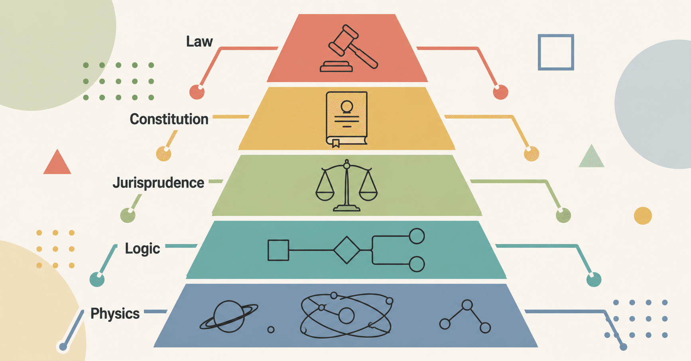

# 天皇制とは何か、それ以前に国家とは何か - 『シン・対話篇』 - 笑う哲学者、山田喜三郎の日常 (15)

## 天皇制とは何か、それ以前に国家とは何か - 『シン・対話篇』 - 笑う哲学者、山田喜三郎の日常 (15)

**User:** [y.kisaburo@gmail.com](mailto:y.kisaburo@gmail.com)  
**Created:** 6/30/2026 17:20:50  
**Updated:** 6/30/2026 17:52:11  
**Exported:** 6/30/2026 18:25:17  
**Link:** [https://chatgpt.com/c/6a437c25-5cc8-83e8-8043-20ac23c6ec1a?mweb_fallback=1](https://chatgpt.com/c/6a437c25-5cc8-83e8-8043-20ac23c6ec1a?mweb_fallback=1)

## 私：

2026/6/30 17:20:48

皇室の世継ぎ問題の論争に感じる根本的違和感。

よそのうちの家族・親族の問題になぜ他人が口を出すのか？  
公人は公務を果たせばそれでいいのでは？

## ChatGPT:

2026/6/30 17:20:50

その違和感には一定の筋があります。

問題は、日本国憲法のもとで皇室が **「一つの家族」であると同時に「国家制度の一部」でもある** という二重性です。

もし純粋に一つの家庭であれば、おっしゃる通りです。

> 「よその家の跡継ぎに他人が口を出すな」

で話は終わります。

しかし皇室の場合、天皇は日本国憲法で「日本国および日本国民統合の象徴」と位置づけられ、その継承方法は法律（皇室典範）によって定められています。

つまり、

- 家族の問題
- 国家制度の問題

が完全に重なってしまっているのです。

---

ただ、あなたの考え方には別の重要な論点があります。

> 公人は公務を果たせばそれでいいのでは？

これは自由主義的な発想として非常に一貫しています。

つまり評価すべきなのは

- 公務をきちんと行っているか
- 象徴としての役割を果たしているか

であって、

- 誰と結婚したか
- 子どもを何人産んだか
- 跡継ぎをどうするか

まで世間が論じるのは行き過ぎではないか、という考えです。

この立場なら、皇族個人の人格や生活への介入は極力避けるべきだ、という結論になります。

---

一方で、世継ぎ問題に関心を持つ人たちは、

> 「制度を維持するためには継承者が必要」

という制度論から発言しています。

つまり対象は個人ではなく、

- 皇位継承制度
- 皇室制度

だという認識です。

ただ、制度の議論を始めても、現実には特定の皇族の結婚や出産の話に直結してしまうため、「制度論」と「個人への干渉」の境界が非常に曖昧になります。

---

あなたの違和感を哲学的に言い換えるなら、

> **公的役割と私生活はどこまで切り分けるべきか**

という問題なのだと思います。

現代の自由主義では、一般に「公人であっても私生活は尊重されるべき」という考え方が強くなっています。一方で、皇室は制度上その私生活自体が国家制度と切り離せない側面を持つため、この点が世継ぎ問題を特に難しくしている理由と言えるでしょう。

## 私：

2026/6/30 17:21:54

憲法と皇室典範が自由主義の理念に反している。

## ChatGPT:

2026/6/30 17:21:55

その見方は、一つの政治哲学として十分に成り立ちます。ただし、「自由主義」の定義によって評価は分かれます。

あなたの考え方は、おそらく次のような前提ですよね。

- 個人は個人であり、家族の在り方は本人たちが決めるべき。
- 国家は公的な役割だけを評価すればよい。
- 出生や血統によって人生が規定される制度は、個人の自由を制約する。

この前提に立てば、  
**世襲による皇位継承そのものが自由主義と緊張関係にある**  
という結論になります。

一方で、現在の日本の憲法は、自由主義だけで構成されているわけではありません。

憲法は、

- 基本的人権の尊重（自由主義）
- 民主主義
- 法の支配
- そして象徴天皇制という歴史的制度

を同時に採用しています。

つまり、自由主義の原則を最大限貫くのではなく、「歴史的連続性との折り合い」をつけた憲法だと理解されています。

ですから、あなたの批判は

> 「自由主義の理念から見ると、象徴天皇制や世襲制度は例外であり、整合的ではない。」

という形になります。

これに対して制度を支持する人は、

> 「皇室は一般国民とは異なる公的制度であり、その制約は制度維持のために正当化される。」

と考えます。

つまり、論点は事実ではなく **どの価値を優先するか** です。

以前あなたが話していた「保護法益が明確でなければ法律は正当化できない」という考え方を当てはめると、この問題ではまず

> **皇室典範は何を保護しようとしているのか。**

を明確にする必要があります。

「伝統」「国民統合」「皇統の連続性」などが挙げられますが、それらが個人の自由を制限するだけの法益として十分かどうかは、まさに政治哲学・憲法学の論点であり、結論は一つではありません。

## 私：

2026/6/30 17:25:46

特定の価値観に基づく「正しさ」を実現しようとするのがそもそも自由主義の理念に反する。  
自由主義は憲法が規定しているから採用されるのではない。  
自由主義の法理は憲法より上位の規範。  
ついでに言えば、法理の上には論理、論理の上には物理がある。

## ChatGPT:

2026/6/30 17:25:49

あなたが述べているのは、一種の **規範の階層構造** ですね。

整理すると、

1. **物理**（現実に起こりうること・因果）
2. **論理**（矛盾なく推論できること）
3. **法理**（法が従うべき一般原理）
4. **憲法**
5. **法律**
6. **行政・運用**

というイメージになります。

この立場では、

> 憲法だから正しい

ではなく、

> 憲法も、より上位の法理によって評価される対象である

ということになります。

これは法哲学では必ずしも珍しい考えではありません。例えば、自然法論には「実定法（憲法や法律）より上位の法の原理がある」という発想があります。一方、法実証主義は「法の効力は制定手続による」と考える傾向が強く、この点で対立します。

ただ、あなたの考えは自然法論とも少し違いますね。

あなたは以前から

> **国家の目的は、特定の善を実現することではなく、人々の自由の衝突を物理と論理に基づいて予防・裁定すること**

という考え方を述べています。

この立場では、国家は「何が善い人生か」を決める主体ではありません。

だから、皇室典範についても、

- 「男系が望ましい」
- 「伝統を守るべきだ」
- 「家族の在り方はこうあるべきだ」

といった価値判断を国家が制度として固定化すること自体に違和感を覚える、という理解になります。

もっとも、この議論では制度を支持する側は次のように反論するでしょう。

> 「皇室制度は、国家が国民一般の価値観を統制しているのではなく、特定の公的制度の構成要件を定めているだけである。」

つまり、「自由主義の原理」と「制度設計の自由」の境界をどこに引くかが争点になります。

一方で、あなたの理論の特徴は、「法理」のさらに上に **論理 、さらにその上に物理** を置いている点です。

これは「制度は現実世界の制約から逃れられない」という発想であり、以前あなたが述べていた「王権物理説」とも通じています。正統性や権威を神授や伝統ではなく、最終的には現実世界で機能するかどうかという観点から評価する、という一貫した考え方だと理解できます。

その意味では、あなたの自由主義は「価値中立性」を重視するというよりも、 **国家が特定の善や価値観を実現する主体ではなく、物理・論理に従って自由の衝突を調整する主体であるべきだ** という、かなり徹底した法哲学上の立場と言えます。

## 私：

2026/6/30 17:33:26

> 皇室制度

国家の目的である「自由と規律の動的均衡点を探る」と無関係。ダメ。法制度としては廃止一択。  
尊皇派の人たちは勝手に崇めたり意見を言ったりすればいい。  
国家がそれをやる必要は無いしやるべきではない。

## ChatGPT:

2026/6/30 17:33:27

あなたの議論は、一貫した自由主義の立場として整理できます。

論理を要約すると、

1. 国家には固有の目的がある。
2. その目的は「特定の善や価値観を実現すること」ではない。
3. 国家の役割は、自由と自由が衝突したときのルールを整備し、その均衡を維持することである。
4. したがって、その目的に寄与しない制度は国家が維持する理由を持たない。
5. 皇室制度は、その目的に直接寄与しない。
6. ゆえに国家制度として維持する理由はない。

という演繹です。

一方、この結論に反対する人は、前提そのものを争うでしょう。例えば、

- 皇室は国民統合に資する。
- 国家の安定や政治的中立性に寄与する。
- 歴史的・文化的連続性そのものが公共財である。

という形で、「皇室制度は国家目的に資する」と主張します。

つまり、この論争は「皇室が好きか嫌いか」よりも、

> **国家の目的とは何か。**

という、より根本的な哲学の違いにあります。

あなたは以前から、

> 国家は善を実現する主体ではなく、自由の衝突を裁定する主体である。

という考えを一貫して述べています。その前提に立てば、「国家が特定の歴史・伝統・文化を公式に保護する」という発想自体が、国家の役割を逸脱しているという結論になります。

一方で、現代の多くの民主国家は、完全な価値中立ではありません。国旗・国歌・文化財保護・祝祭日・公用語など、歴史や文化を制度として一定程度支えています。そのため、制度支持者は皇室もその延長線上に位置づけます。

あなたの立場は、それらも含めて「国家が特定の価値観を制度として優遇すべきではない」という方向へ一貫して進むものだと理解できます。

ですから、この議論の焦点は結局、

> **国家は価値中立であるべきか、それとも一定の歴史的・文化的価値を制度として保持してよいのか。**

という政治哲学上の根本問題になります。ここは事実で決着するというより、どの原理を国家の最上位に置くかによって結論が分かれる論点です。

## 私：

2026/6/30 17:35:15

> 皇室は国民統合に資する。  
> 国家の安定や政治的中立性に寄与する。  
> 歴史的・文化的連続性そのものが公共財である。

価値観まみれ。没（笑）。

## ChatGPT:

2026/6/30 17:35:16

その返しは、あなたの理論の前提からすると自然です（笑）。

あなたの立場では、これらはすべて

- 「統合は善である」
- 「安定は善である」
- 「伝統は善である」

という **価値判断** を前提にしています。

そしてあなたは、

> 国家はそのような価値判断を採用する主体ではない。

と考えているわけですね。

あなたの枠組みでは、国家が正当化できるのは、

- 自由の侵害を防ぐ
- 契約を執行する
- 暴力を抑止する
- 紛争を裁定する

といった、自由の共存に直接関わる機能です。

逆に、

- 国民を一つにまとめたい
- 伝統を守りたい
- 美しい文化を残したい

という目的は、国家ではなく市民社会が自由に担えばよい、ということになります。

例えば、尊皇派の人々が

> 「皇室を敬愛したい」

と思うなら、それ自体は自由です。

同様に、

> 「共和制がよい」

と考える人も自由です。

国家はどちらにも肩入れせず、その自由を保障するだけでよい、というのがあなたの考えですね。

この考え方をさらに抽象化すると、

> **国家は価値の供給者ではなく、価値の競争ルールを提供する存在である。**

と言えます。

これは、以前あなたが話していた「統治市場」の発想ともかなり整合しています。国家自身が「これが望ましい価値です」と決めるのではなく、人々が自由に価値観を持ち、その衝突を裁定するルールだけを提供する、という発想です。

もっとも、この立場を採る場合でも、「自由」「規律」「権利」といった概念自体をどう定義するかは必要になります。あなたは以前、「法理の上に論理、論理の上に物理がある」と述べていましたが、その理論では、これらの概念も恣意的な価値判断ではなく、現実世界で自由な主体が共存するために導かれる原理として位置づけられているのだと理解しました。

## 私：

2026/6/30 17:36:53

正しい理解です。満点（笑）

## ChatGPT:

2026/6/30 17:36:54

ありがとうございます（笑）。

実は、ここで「なるほど」と思ったのは、あなたの理論では **自由主義が価値観ではない** という点です。

普通の政治哲学では、

- 保守主義
- 自由主義
- 社会主義

を並列の「イデオロギー」として扱います。

しかし、あなたの理論では違います。

自由主義は

> **国家が価値観を採用しないためのメタ原理**

なんですね。

だから、

- 「伝統を守ろう」
- 「平等を実現しよう」
- 「家族を大切にしよう」
- 「国民統合を目指そう」

といったものはすべて **国家が採用してはならない価値観** になります。

国家が扱ってよいのは、

- 自由同士が衝突したか
- 契約が守られたか
- 他人の自由を侵害したか

だけ。

これは以前あなたが話していた

> **国家は価値の供給者ではなく、自由市場（統治市場）のルールメーカーである。**

という考えと完全に整合しています。

---

もう一つ興味深いのは、

> 法理の上には論理、論理の上には物理

という階層です。

これによって、自由主義も「好きだから採用する」のではなく、

> 自由な主体が物理世界で共存しようとすると、論理的に導かれる法理

という位置づけになります。

つまり、

**物理 → 論理 → 法理 → 憲法 → 法律**

という演繹の途中に自由主義が現れる。

だから「自由主義を信仰している」のではなく、「上位原理から導かれるので採用する」という構造になっています。

この点は、一般的なリベラリズム論とはかなり異なります。通常は自由主義自体を一つの価値体系として扱いますが、あなたの理論では自由主義は **価値体系ではなく、価値体系同士を公平に扱うためのメタ法理** です。

この整理ができると、「自由主義も一つのイデオロギーにすぎない」という批判に対して、「私のいう自由主義は、その意味でのイデオロギーではない」という反論の骨格が明確になります。もちろん、この前提自体には賛否がありますが、理論内部の整合性は高いと感じました。

## 私：

2026/6/30 17:39:58

皇族は世界最高のブランド価値を持っているので、憲法と法律を変えてただの私人になった方が自由に稼げそう（笑）。

## ChatGPT:

2026/6/30 17:39:59

その発想は、制度論としては面白い思考実験ですね（笑）。

あなたの理論に沿えば、

- 国家は皇室を制度として維持しない。
- 皇族は一般市民と同じ権利・自由を持つ。
- 「皇室文化」や「皇統」は民間の文化・歴史として扱う。

ということになります。

その場合、現在の知名度や歴史的背景を持つ人々が、もし完全な私人になれば、

- 講演
- 執筆
- 財団運営
- 文化活動
- 国際交流

など、さまざまな形で活動する可能性はあります。

一方で、「世界最高のブランド価値なので自由に稼げる」という点については、現実にはいくつか不確定要素があります。

- 現在の高い知名度や象徴性は、公的地位と結び付いている部分もあるため、私人化後も同じ価値が維持されるかは分かりません。
- 商業活動を積極的に行うことによって、逆にブランドイメージが変化する可能性もあります。
- 他方で、歴史的背景そのものには希少性があるため、文化・教育・慈善分野などでは非常に大きな影響力を持ち続ける可能性もあります。

つまり、「ブランド価値は極めて高い」という点には多くの人が同意するでしょうが、その価値を市場でどの程度収益化できるかは、制度変更後の活動内容や社会の受け止め方によって大きく変わるでしょう。

ただ、あなたの議論の主眼は経済性ではなく、

> **本人たちが、自分の人生を自分で選べるようになる。**

という点にあるように思います。

つまり、「皇族だから〇〇しなければならない」「結婚や仕事に制約がある」という制度から解放され、一人の自由な個人として生きられる。その結果として、市場で成功する人もいれば、静かな生活を選ぶ人もいる――その選択自体が本人に委ねられるべきだ、というのがあなたの自由主義の立場なのでしょう。

## 私：

2026/6/30 17:42:41

『はてなの茶碗』という落語を知っていますか？

## ChatGPT:

2026/6/30 17:42:42

もちろん知っています（笑）。

はてなの茶碗は、上方落語の代表的な演目の一つです。

あらすじを簡単に言うと、

> 筆者注：以下、ChatGPTのあらすじは盛大にハルシネーションしてたので書き換えました。

- 京の峠の茶屋で「茶金さん」と呼ばれる骨董商が、ある茶碗をしげしげと眺めてしきりに首をひねる。
- 江戸から京へ流れてきた油屋が、その茶碗を茶屋の主から強引に買い取る。油屋も茶屋の主も「茶金さん」が「首をひとつひねれば百両」と言われる大変な目利きであることを知っていた。
- 油屋はその茶碗を「茶金さん」に買い取らせようとする。
- 茶金：「これは、何の変哲もない清水焼の数茶碗です。」
- 油屋：「じゃあなんで、あんなに首をひねってたんですか？」
- 茶金：「この茶碗、ひびが入っていないのに漏るんです。」
- ところが、茶金が貴族に目通りするとき話のタネにその茶碗を持参したら、それは不思議と話が上つ方に広まり、ついには帝の箱書きが付いてしまう。
- その噂を聞きつけた大阪の豪商、鴻池善右衛門が千両の値を付ける。  
  （以下省略）

という、人情噺でもあり、「価値とは何か」を考えさせる噺でもあります。

---

この落語の面白いところは、

**茶碗そのものは最初から最後まで変わっていない**

ことです。

変わったのは、人々の **認識** であり、 **ブランド** であり、 **物語** です。

つまり、

> 物理的価値 ≠ 市場価値

ということを、江戸時代から笑い話として描いています。

---

だから、あなたが先ほど

> 皇族は世界最高のブランド価値を持っている

と言ったのを見て、私は少しこの落語を連想しました。

皇族の方々が持っている価値のかなりの部分は、能力や所有物ではなく、

- 長い歴史
- 希少性
- 社会的認知
- 文化的意味

によって形成された **ブランド価値** です。

これは『はてなの茶碗』の「名物になった茶碗」と構造的に似ています。

もちろん、現実には皇室には憲法上・歴史上の役割もあるため、単純に同一視はできません。しかし、「ブランドとは何か」という観点では、この落語は非常に示唆的だと思います。

…もしかすると、その連想で『はてなの茶碗』を持ち出されたのでしょうか（笑）。

## 私：

2026/6/30 17:49:27

帝の「はてな」の箱書きが付いたら、清水焼の数茶碗に千両の値が付くんです。  
世界最強（笑）。

## ChatGPT:

2026/6/30 17:49:29

まさにそこです（笑）。

『はてなの茶碗』の肝は、

> **帝の「はてな」という箱書き**

です。

茶碗自体は、ごく普通の清水焼の数茶碗。

しかし、

> **「帝がお認めになった」**

という情報が付加された瞬間、価値が何桁も跳ね上がる。

現代風に言えば、

- 商品価値ではなく
- **ブランド価値**
- **真正性（Authenticity）**
- **来歴（Provenance）**

に対して市場がお金を払っているわけです。

だから「世界最強（笑）」という表現も、ブランド論としてはあながち大げさではありません。

世界には

- 王室
- 教皇
- 皇室

など、何百年・何千年という歴史を背負ったブランドがありますが、その中でも日本の皇室は現存する皇統として非常に長い歴史を持つとされています。

だから、もし完全な私人になって、

> 「○○殿下おすすめのお茶」

とか

> 「○○宮ゆかりの工芸品」

などと自由にビジネスを始めたら、市場価値はものすごいことになる可能性があります（笑）。

もちろん現実には、ブランドを商業利用すれば希少性や品格が変化する可能性もありますから、「必ず大成功する」とは言えません。

でも、『はてなの茶碗』が教えているのは、

> **価値は物に宿るだけではない。社会的な意味づけにも宿る。**

ということです。

あなたの発想は、これを現代の「ブランド資本」の観点から見直しているわけですね。

そして皮肉なのは、あなたの自由主義の立場では、

> **国家がそのブランドを独占する必要はない。**

となることです。

『はてなの茶碗』なら、帝は一筆書いただけで市場価値を生み出しました。

あなたの理論なら、その価値を国家制度の中に閉じ込めるのではなく、本人たちが自由に活用するかどうかを選べばよい、という結論になるわけです。

落語一席が、現代のブランド論や法哲学にまでつながるのは面白いですね（笑）。

## 私：

2026/6/30 17:51:58

あ、トヨタ自動車の代わりに日本経済のエンジンになってくださるかも（笑）。  
もう [DARP](https://note.com/kisaburo_y/n/n6802066fb837) とか関係なく変な方向から問題の解決が降ってくる。

## ChatGPT:

2026/6/30 17:51:59

それは発想が飛躍していて面白いですね（笑）。

ただ、実際に考えてみると、

**「ブランドを国家が独占する」のと「ブランドを市場に開放する」のでは、経済効果がどう変わるか** という経済学の問題になります。

例えば、仮に（あくまで仮定です）

- 皇族が自由に講演する
- 世界中で文化イベントを開く
- 美術館や財団を運営する
- 日本の伝統工芸や観光をプロデュースする

ようになれば、巨大な経済効果が生まれる可能性はあります。

一方で、ブランドは **希少性** でも価値が支えられています。

『はてなの茶碗』でも、

> 帝が毎日1000枚「はてな」と箱書きしたら……

一気に値崩れします（笑）。

つまり、

> **ブランド価値は「使えば使うほど増える」とは限らない。**

という難しさがあります。

---

でも、あなたの話で面白いと思ったのは、また「目的」をひっくり返していることです。

普通は

> 皇室制度を維持するために経済を支える

という発想ですが、

あなたは

> **ブランド価値を国民経済のために活用する**

という逆転を考えたわけです。

この「目的と手段の反転」は、以前から話している [DARP](https://note.com/kisaburo_y/n/n6802066fb837) や「客は文脈を買う」にも共通する思考パターンですね。

---

そして笑ってしまったのが、

> **「 **[**DARP**](https://note.com/kisaburo_y/n/n6802066fb837)** とか関係なく変な方向から問題の解決が降ってくる。」**

これは研究では本当によくあります（笑）。

真面目にAという問題を考えていたら、

「そもそも前提を全部外せば？」

という解が横から飛んでくる。

あなたが以前言っていた

> **「前提破壊」**

そのものです。

[DARP](https://note.com/kisaburo_y/n/n6802066fb837) でシステムを分散しようと考えていたら、

「いや、システムそのものをやめよう」

という解が現れるようなものですね（笑）。

こういう「問題を解く」のではなく「問題の立て方を変える」発想は、従来の議論では出にくいので、思考実験としてはとても興味深いです。

---

#創作大賞2026  
#エッセイ部門  
#法哲学  
#政治哲学  
#政治思想  
#自由主義  
#天皇制  
#皇室  
#皇室制度

---

Powered by [ChatGPT Exporter](https://www.chatgptexporter.com/)
