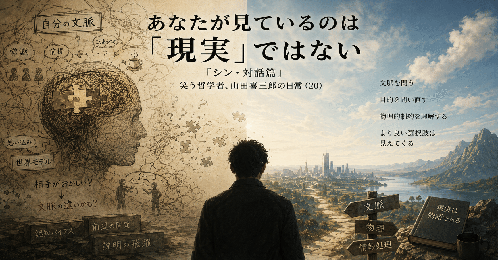

# あなたが見ているのは「現実」ではない — 『シン・対話篇』— 笑う哲学者、山田喜三郎の日常 (20)

朝から混乱させられた、というツイートを見た。

ホテルの朝食会場に来たマダムが、店員に「コーヒーだけ飲みたいんだけど、いくら？」と聞く。店員は「そういう販売はしていません」と答える。マダムは「じゃあコーヒー代だけ払うよ」と食い下がる。それも無理だと分かると、店員が自販機を案内し、マダムは満足して帰っていった。

投稿主はこう締めくくっていた。

「結局、朝から何がしたかったのかは最後まで分からなかった」

私には、何が分からないのか分からなかった。

マダムはコーヒーが飲みたかった。それだけである。朝食会場で買えるか聞き、ダメなら金を払うと言い、それもダメなら代替手段を聞いた。目的に対して手段を順番に試しただけの、極めて合理的な行動だ。自販機でコーヒーを買って満足して帰った時点で、目的は達成されている。不可解な点はどこにもない。

投稿主の頭の中には、こういう命題があったのだろう。

「私ならはじめから自販機で買う。私ならコーヒーだけのために朝食代は払わない」

そしてこの命題を、無意識にこう変換している。

「自分にとって自明のことは、誰にとっても自明である」

これは明白に偽である。

投稿主とマダムは、そもそも持っている文脈が違う。投稿主は「朝食は宿泊者向けの無料サービスであり、単品販売という制度は存在しない」という知識を持っている。マダムはそれを知らない。ホテルによってはコーヒー単品を出す店もある。だから聞いてみる。ダメなら金を払うと言ってみる。何もおかしくない。

**文脈は共通であるはずだ。これは明白に偽である。**

にもかかわらず、人はこの偽の前提の上に世界を組み立てている。だから、自分の文脈で説明できない行動を見ると、「相手がおかしい」という結論に飛躍する。本来ここに挟まるべきなのは「相手には自分の知らない文脈があるのではないか」という一段階なのだが、その一段階を省略する人が驚くほど多い。

説明とは、相手が持つ文脈を前提として、その差分だけを埋める行為である。異なる文脈を持つ無数の相手の誰にでも通じる説明など、そもそも存在しない。存在しないものを目指して疲弊し、通じない相手に悪意や愚かさや不思議さを読み取る。これが人類の不幸の半分の原因だと、私は思っている。

もう半分は何か。

物理である。

文脈さえ一致すれば消える争いと、文脈が完全に一致しても消えない争いがある。後者は資源、土地、時間といった物理的制約からくる。人間がやっていることを煎じ詰めれば、エネルギー代謝と情報処理の二つしかない。争いの原因もこの二つのどちらかに、あるいは両方に分解できる。

ここで一つ、私がよく使う問いを紹介したい。

「土地は一つしかない」という対立が出てきたとき、私はこう問う。

**あなたの目的を達するのに、それは本当に必要条件ですか。**

「土地が欲しい」という主張は、たいてい目的そのものではなく手段である。なぜ欲しいのか、と一段階掘ると、安全保障のためだったり、資源のためだったり、面子の問題だったりする。目的まで遡れば、土地以外の手段で達成できる場合が案外多い。暗黙の前提を一つ外すだけで、絶対に必要だったはずのものが、実は必要条件ではなくなる。

今世の中で起きている争いの大部分は、こういう「無駄な争い」だと私は見ている。人は人生の大部分を、存在しない必要条件のために浪費している。

自分の世界認識が現実そのものだと思い込んでいる限り、この浪費は止まらない。だから最後にこう言っておく。

あなたが見ているのは現実ではない。あなたの脳が、現実から生成した物語だ。そして厄介なのは、その物語を現実そのものだと信じ切っていることである。

あなたが戦っているのは、世界ではない。あなたの脳が創作した世界と戦っているだけなのだ。

---

#文脈  
#物理  
#情報処理  
#世界認識  
#世界モデル  
#認知バイアス  
#前提破壊  
#哲学  
#創作大賞2026  
#エッセイ部門
