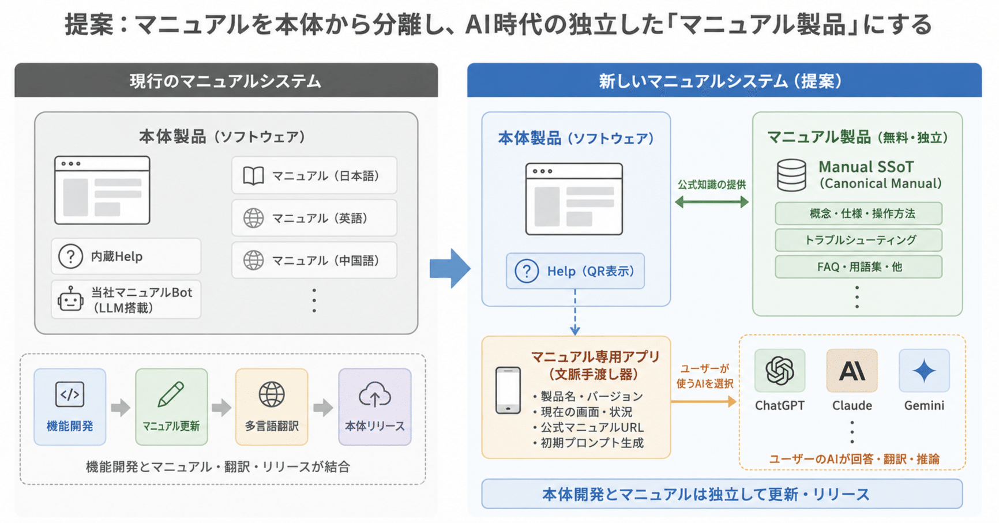

# 提案：マニュアルを本体から分離し、AI時代の独立した「マニュアル製品」にする​



## 1. 現状の問題​

現在、当社製品のマニュアルはフロントエンドに組み込まれている。​

この構造では、機能開発が完了しても、​

**機能実装 → マニュアル更新 → 多言語翻訳 → フロントエンド反映 → リリース**

という作業が続く。​

つまり、機能そのものとは本来独立しているはずの​

- マニュアル​
- 翻訳​
- フロントエンド​
- リリース​

が結合している。​

そのため開発者は、​

> 「出来たー！」​  
> ↓​  
> 「あ、マニュアル更新しなきゃ」​  
> ↓​  
> 「多言語対応めんどくせー」​

を繰り返すことになる。​

これは作業量の問題というより、 **責務の境界の問題** ではないだろうか。​

## 2. マニュアルを本体製品から分離する​

そこで、マニュアルを本体製品の一部として扱うことをやめる。​

**マニュアルそのものを、無料の独立した製品とする。**

たとえばGitリポジトリ等をSSoTとして、​

```
product-manual/​  
├── README.md​  
├── concepts/​  
├── operations/​  
├── troubleshooting/​  
├── faq/​  
├── glossary/​  
└── versions/​  
```

のように、製品知識を体系的に管理する。​

本体製品とマニュアル製品は、それぞれ独立して更新・公開できるようにする。​

```
┌─────────────────┐​  
│    本体製品      │​  
└─────────────────┘​  

        別製品​  

┌─────────────────┐​  
│  Manual SSoT     │​  
│  無料・公開      │​  
└─────────────────┘​  
```

これだけでも、​

**本体リリースとマニュアル更新の結合を切る**

ことができる。​

## 3. マニュアルの歴史的な趨勢​

自動車、電話機、ソフトウェアなどを見ると、マニュアルには共通した変化がある。​

かつては、​

> 製品に紙のマニュアルを付属させ、人間が体系を読んで操作方法を理解する​

ものだった。​

その後、​

> 紙 → 内蔵Help → Web​

と、マニュアルは次第に製品本体から **外部化** されてきた。​

そして生成AIによって、もう一つ大きな変化が起きている。​

人間がマニュアルの体系を探索する必要がなくなりつつある。​

ユーザーは、​

> 「第8章のどこに書いてある？」​

ではなく、​

> 「これ、どうすればいい？」​

とAIに質問できる。​

ただし、体系そのものが不要になるわけではない。​

むしろAIが正確に回答するためには、その向こう側に、​

- 正確な仕様​
- 用語​
- 操作方法​
- 制約​
- 例外​
- トラブルシューティング​
- バージョンごとの差異​

などが体系的に整理されている必要がある。​

つまり、​

> **体系は消えるのではない。人間から見えなくなる。**

## 4. では、当社で「マニュアルBot」を作るべきか​

一見すると、​

```
ユーザー​  
   ↓​  
当社Manual Bot​  
   ↓​  
Manual SSoT​  
```

とすればよさそうに見える。​

しかし、ここには別の問題がある。​

役に立つマニュアルBotには、単なる製品知識だけでは足りない。​

ユーザーは必ずしも正しい製品用語を使って質問してくれるわけではない。​

たとえば、​

> 「昨日まで出てたグラフがなくなった」​

という質問から、​

- 表示期間​
- フィルタ​
- データ取得​
- センサー状態​
- 通信​
- 権限​
- 設定変更​
- 不具合​

などの可能性を考えなければならない。​

これには製品固有知識だけでなく、広範な一般知識と高い推論能力が必要になる。​

つまり、本当に役に立つBotを作ろうとすると、結局ChatGPT、Claude、Gemini級の汎用AIが欲しくなる。​

すると今度は、​

> **誰がその推論コストを負担するのか**

という問題が発生する。​

## 5. Botを当社で作らない​

ここで発想を逆転する。​

**高性能な汎用AIは、すでに存在する。**

しかも多くのユーザーは、ChatGPT、Claude、Gemini等をすでに利用している。​

ならば当社がもう一つAIを作る必要はない。​

当社が提供すべきなのは、​

> **当社しか持っていない、正確な製品固有知識**

だけでよい。​

```
          当社​  
           │​  
           ▼​  
   Official Manual​  
       （SSoT）​  
           ▲​  
           │​  
 ┌─────────┼─────────┐​  
 │         │         │​  
ChatGPT  Claude    Gemini​  
 │         │         │​  
 └─────────┼─────────┘​  
           ▲​  
           │​  
        ユーザー​  
```

つまり、​

> **メーカーは知能を作らない。​  
> メーカー固有の知識を、既存の知能から参照可能にする。**

という分担にする。​

## 6. 多言語対応も原則としてAI側へ移せる​

この構造にはもう一つ大きな利点がある。​

当社が、​

- 日本語版​
- 英語版​
- 中国語版​
- その他言語版​

という複数のマニュアル成果物を管理する必要がなくなる可能性がある。​

当社が管理するのは、正確なCanonical Manualだけ。​

```
             Canonical Manual​  
                    │​  
          ┌─────────┼─────────┐​  
          ▼         ▼         ▼​  
       ChatGPT    Claude    Gemini​  
          │         │         │​  
          ▼         ▼         ▼​  
        日本語    English    中文​  
```

翻訳を効率化するのではない。​

**翻訳済みマニュアルを当社が成果物として保有・同期する必要そのものをなくす。**

これにより、​

> 原文更新​  
> → 各言語へ翻訳​  
> → 翻訳レビュー​  
> → 各言語版更新​

という変更伝播を大幅に減らせる。​

## 7. 残る問題：AIへマニュアルをどう渡すか​

ここまででバックエンド側はかなり単純になる。​

しかしUX上、一つ問題が残る。​

ユーザーに毎回、​

> 「このURLが公式マニュアルなので、ChatGPTに貼り付けて質問してください」​

と要求するのは格好が悪いし、使い勝手も悪い。​

そこで、将来的には **マニュアル専用スマホアプリ** を用意する方法を検討する。​

役割はマニュアルそのものを表示することではない。​

**本体製品の文脈を、ユーザーが選んだAIへ引き渡すこと** である。​

たとえば、​

```
当社製品​  
   │​  
   │ Help​  
   ▼​  
QRコード​  
   │​  
   ▼​  
Manual App​  
   │​  
   ├─ 製品名​  
   ├─ バージョン​  
   ├─ 現在の画面​  
   └─ Official Manual​  
   │​  
   ▼​  
「どのAIを使いますか？」​  
   │​  
 ┌─┴────────────┐​  
 ▼              ▼              ▼​  
ChatGPT       Claude         Gemini​  
```

という導線にする。​

理想的には、​

1. PCの当社製品でHelpを押す​
2. QRコードが表示される​
3. スマホで読み取る​
4. Manual Appが製品・バージョン・画面・公式マニュアルを認識する​
5. ユーザーが普段使っているAIを選択する​
6. AIとの質問を開始する​

という流れになる。​

Manual App自身にLLMを搭載する必要はない。​

したがって当社側には、AI推論による従量課金も発生しない。​

## 8. 提案する責任分界​

最終的には次のように責務を分けたい。​

**本体製品**

通常操作については、原則として画面を見れば使い方が分かるUIを目指す。​

**Manual製品**

仕様、概念、例外、詳細操作、トラブルシューティングなどの公式知識体系を管理する。​

**Manual App**

製品とユーザー所有AIの間を接続する。​

**ChatGPT / Claude / Gemini等**

自然言語理解、推論、翻訳、ユーザーとの対話を担当する。​

## 9. 期待できる効果​

この方式にすると、当社が管理すべきものが大幅に減る。​

従来は、​

```
製品​  
＋ UI​  
＋ マニュアル​  
＋ 各言語版​  
＋ Help​  
＋ Bot​  
＋ Bot用LLM​  
```

まで抱え込む可能性があった。​

提案方式では、​

```
本体製品​  
      ＋​  
Canonical Manual​  
      ＋​  
薄いManual App​  
```

まで責務を縮小できる。​

特に期待できるのは、​

- マニュアル更新と本体リリースの分離​
- 多言語マニュアルの保守コスト削減​
- 専用ChatBot開発の回避​
- LLM API運用費の回避​
- ChatGPT等の性能向上をそのまま利用できる​
- 特定AIベンダーへのロックイン回避​

である。​

## 10. まず何をするか​

最初からManual Appまで作る必要はない。​

まず、​

> **マニュアルを本体製品から切り離し、独立したManual SSoTとして成立させる**

ことを第一段階とする。​

そのうえで、ChatGPT / Claude / Gemini等にManualを参照させ、​

> **実際のユーザー質問に十分答えられるか**

をPoCする。​

十分な品質が確認できたら、次の段階としてManual Appによるスマートな連携方法を検討する。​

## 結論​

今回の提案は、「AIを使って高性能なマニュアルBotを開発しよう」という話ではない。​

むしろ逆である。​

> **マニュアルをBotにするのではない。​  
> マニュアルを外に出し、Botはユーザーに選ばせる。**

当社が作るべきなのは、もう一つのAIではない。​

**どのAIからでも利用できる、正確で体系化された公式製品知識である。**
