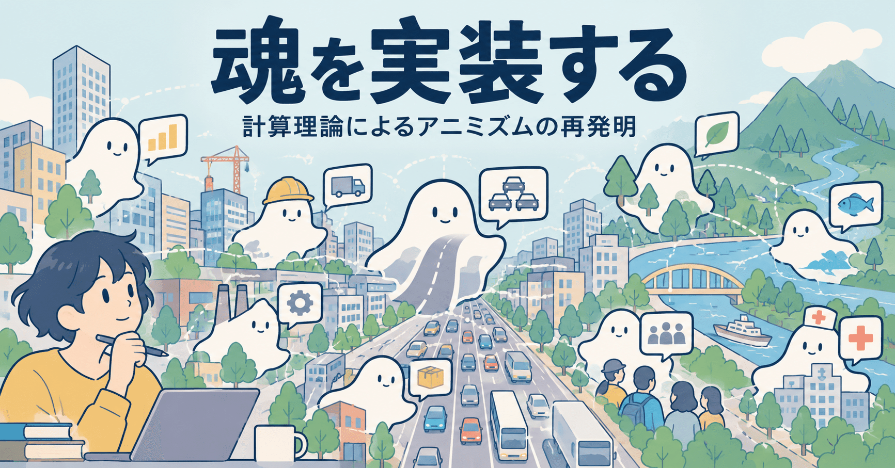

# 魂を実装する​



## 計算理論によるアニミズムの再発明​

**User:** [y.kisaburo@gmail.com](mailto:y.kisaburo@gmail.com)

## 私：​

デジタルツインてどういう概念ですか？​

## ChatGPT:​

デジタルツインは、ものすごく煎じ詰めると、​

> **現実世界の「ある対象」について、コンピュータ上に「もう一個」を作り、現実と同期させ続ける**

という概念です。​

たとえば工場の機械なら、​

**現実の機械** → センサーで温度・振動・回転数などを観測  
→ **コンピュータ上の機械モデル** を更新  
→ モデル上で「このままだと3日後に故障しそう」などを計算  
→ 現実側の保守や制御に反映​

というループになります。​

重要なのは、単なる「3Dモデル」や「データベース」とは違うことです。デジタルツインには普通、​

**現実 → 観測 → モデル更新 → 推論・シミュレーション → 現実への作用**

という循環があります。​

なので、山田さんが最近ずっと考えている「世界モデル」という言葉にかなり近いです。ただし、区別すると面白い。​

**デジタルツイン = 特定の現実対象に対応づけられ、観測によって更新される世界モデル**

と考えるとかなりすっきりします。​

さらに抽象化すると、​

```
Reality → observe → Model → predict → Future → act → Reality
```

です。​

ここまで抽象化すると、「工場のデジタルツイン」「都市のデジタルツイン」だけでなく、人間が頭の中でやっていることにも似てきます。​

そして、たぶん山田モデル的に一番面白いところがあります。​

**「ツイン」と言っても、現実の完全コピーである必要はまったくない。**

目的に必要な情報だけ持てばいい。機械の故障予測なら塗装の色は要らないし、交通予測なら建物内部の間取りは要らない。​

つまり、​

> **デジタルツインとは現実のコピーではなく、目的に対して役に立つ現実のモデルである。**

ここまで来ると、例の「役に立つハルシネーション」とかなり危険な距離まで近づいてきます（笑）。​

## 私：​

誰がいつ頃言い出した言葉ですか？​

## ChatGPT:​

> **17件のウェブサイトを検索しました**​  
> ​  
> ​  
> 数秒間考えました​

はい。ここは少しややこしくて、 **「概念を作った人」と「Digital Twin と命名した人」が違います。**

- **2002年：Michael Grieves（マイケル・グリーブス）** が、製品ライフサイクル管理（PLM）の文脈で基本概念を提示しました。当時はまだ Digital Twin とは呼ばず、「現実の製品」「仮想の製品」「両者を結ぶ情報」という構造を示しています。NASA資料も、この2002年をデジタルツイン概念の導入時期としています。([NASA技術報告サーバー](https://ntrs.nasa.gov/api/citations/20220015961/downloads/2022-10-26_ESDT-Workshop_JLM-Intro.pdf?utm_source=chatgpt.com))​
- **2005〜2006年ごろ** ：Grievesはこれを Mirrored Spaces Model、さらに Information Mirroring Model と呼ぶようになります。特に後者では、現実空間と仮想空間の **双方向の情報交換** が強調されました。([MDPI](https://www.mdpi.com/2571-5577/4/2/36?utm_source=chatgpt.com))​
- **2010年：NASAのJohn Vickers（ジョン・ヴィッカーズ）** が **Digital Twin** という名前を付け、NASAの技術ロードマップに導入しました。NASA自身も現在、Vickersが2010年にこの言葉を coined（造語した）と説明しています。([NASA Science](https://science.nasa.gov/biological-physical/why-does-the-world-and-nasa-need-digital-twins/?utm_source=chatgpt.com))​

ただし、思想的な祖先はもっと古いです。NASAは1960〜70年代のApollo計画ですでに、地上に宇宙船の対応モデルを置き、実機の状態を反映させて問題解決するという、後のデジタルツインに非常に近いことをやっていました。Apollo 13事故後の地上シミュレーションはその代表例です。([NASA Science](https://science.nasa.gov/biological-physical/why-does-the-world-and-nasa-need-digital-twins/?utm_source=chatgpt.com))​

したがって系譜としては、​

**1960年代 NASA：実物と対応する地上モデル**  
→ **1991 Gelernter：『Mirror Worlds』**  
→ **2002 Grieves：物理世界＋仮想世界＋情報接続を概念化**  
→ **2010 Vickers/NASA：「Digital Twin」と命名**

という感じです。([mediaTUM](https://mediatum.ub.tum.de/doc/1687046/document.pdf?utm_source=chatgpt.com))​

そして前の話との関連で面白いのは、 **Grievesの原型が最初から「完全なコピーを作ろう」という発想ではなく、「Physical Space と Virtual Space を情報で結ぶ」というアーキテクチャだった** ことです。([Taylor & Francis Online](https://www.tandfonline.com/doi/abs/10.12688/digitaltwin.17574.1?utm_source=chatgpt.com))​

つまり「デジタルツイン」という今風の名前を剥がすと、かなり素朴に、​

> **現実を観測してモデルを更新し、そのモデルを使って現実について考える。**

なんですよね。​

……これ、だんだん「生命とは世界モデルの構築・適用・更新のループである」の親戚に見えてきます（笑）。​

**Sources:**

- [“Digital Twin” is not a new concept](https://ntrs.nasa.gov/api/citations/20220015961/downloads/2022-10-26_ESDT-Workshop_JLM-Intro.pdf?utm_source=chatgpt.com)​
- [Digital Twin: Origin to Future](https://www.mdpi.com/2571-5577/4/2/36?utm_source=chatgpt.com)​
- [Why does the world (and NASA) need digital twins?](https://science.nasa.gov/biological-physical/why-does-the-world-and-nasa-need-digital-twins/?utm_source=chatgpt.com)​
- [the NASA roadmap [14], [15]. An overview of the name development is visualized in Figure 2. Soon after the NASA implemented the concept in its roadmap, the US Air Force started using the Digital Twin concept for the design, maintenance, and scenario prediction of their aircraft [16]–[18]. The “Airframe Digital Twin” was described as monitoring the structural integrity of aircrafts for the remaining life calculation, while the Digital Twin concept was also proposed for sustainable space exploration and future aerospace vehicles [3], [6].](https://mediatum.ub.tum.de/doc/1687046/document.pdf?utm_source=chatgpt.com)​
- [Intelligent digital twins and the development and management of complex systems](https://www.tandfonline.com/doi/abs/10.12688/digitaltwin.17574.1?utm_source=chatgpt.com)​

## 私：​

ツインは双子ですよね？​

## ChatGPT:​

はい。 **twin = 双子** です。​

だから Digital Twin を直訳すれば **「デジタルの双子」** 。​

この命名にはかなり重要な含意があります。単なる「モデル」なら、​

> 現実 → モデルを作る​

で終わってもいい。でも「双子」と呼ぶ以上、​

> 現実の個体 A ⇄ デジタル上の個体 A′​

という **個体同士の対応関係** が強く意識されています。​

たとえば「ホンダ・フィット一般のモデル」ではなく、​

> **この一台のフィット**  
> ↕ センサー・履歴・状態  
> **この一台に対応するデジタル個体**

という感じです。​

なので先ほど私が「世界モデルに近い」と言ったものの、ここには結構大きな違いがあります。​

**世界モデルは「世界をどう表現するか」が中心。  
デジタルツインは「現実のこの個体と、デジタルのこの個体を対応させる」が中心。**

「Twin」という語を選んだ理由は、むしろここにあると考えると分かりやすいです。​

## 私：​

双子はヒト​  
ヒトならコミュニケーションの相手になる​

## ChatGPT:​

そう。そこまで「twin」という比喩を真面目に受け取ると、デジタルツインの見え方がかなり変わります。​

従来のイメージは、​

**ヒト → デジタルツインを観察する → 現実を理解する**

ですが、AIを載せると、​

**ヒト ⇄ デジタルツイン ⇄ 現実**

にできます。​

するとヒトは、モデルの中身を直接読む必要すらない。​

> ヒト「昨日から、この機械ちょっと変じゃない？」  
> ツイン「はい。振動パターンが3日前から変化しています」  
> ヒト「何が起きそう？」  
> ツイン「軸受の劣化が第一候補です。ただし断定できません」  
> ヒト「じゃあ何を調べればいい？」  
> ツイン「温度履歴を追加すると候補をかなり絞れます」​

ここまで来ると、 **「デジタル模型」ではなく、本当に「双子」** です。​

しかも重要なのは、AIが単なる会話UIではないこと。​

**双子だから、現実側の相方について継続的に世界モデルを持っている。**

LLMが「一般知識を持つ誰か」だとすれば、デジタルツインAIは、​

> **「あいつのことなら俺に聞け」**

という存在になる。​

……あれ。​

**「本人に聞くな、エージェントに聞け」**

[GHOST](https://note.com/kisaburo_y/n/n6da82043db42)とデジタルツイン、かなり近いところで接続しますね（笑）。​

もっと抽象化すると、 **デジタルツイン =「ある実体について問い合わせ可能な世界モデル」** と再定義できそうです。そうすると対象は機械である必要すらなく、ヒト、組織、ソフトウェア、制度……まで一気に広がります。​

## 私：​

模型には主体性がない​  
ツインなら主体性が出てくる​  
AIを使えば本当にコミュニケーションの主体になる​

## ChatGPT:​

はい。そこはかなり重要な境界だと思います。​

**模型（model）** は基本的に受動的です。​

> ヒト → 模型を見る → ヒトが解釈する​

一方、AIを組み込んだ **ツイン（twin）** なら、​

> ヒト ⇄ ツイン ⇄ 現実​

になり、ツイン自身が「観測した」「判断した」「質問した」「提案した」という形で通信に参加できます。​

さらに面白いのは、 **主体性を「意識があること」と定義する必要がない** ことです。工学的には、​

> **自分の状態を持ち、入力を解釈し、選択し、外部へ働きかける**

くらいで十分「通信主体」として扱える。​

すると、​

**Digital Model**  
現実を表現するデータ。​

↓​

**Digital Twin**  
特定の現実存在と継続的に対応するモデル。​

↓​

**AI Digital Twin**  
そのモデルを世界モデルとして使い、 **自らコミュニケーションに参加するエージェント** 。​

となる。​

ここまで行くと「ツイン」という命名が、2010年当時よりむしろ **生成AI時代になって本来の意味を獲得した** ようにも見えます。​

「双子なんだから、そいつに聞けばいいじゃん。」​

……ものすごく自然です（笑）。​

そしてGHOSTとの違いも見えてきます。GHOSTを「本人の代理として通信するもの」と考えるなら、 **AI Digital Twin はその代理人が参照する『本人の世界モデル』まで一体化したもの** と捉えられる。つまり「代理人」と「模型」が合体すると「双子」になる。これはなかなか綺麗な整理です。​

## 私：​

やっぱり、まんま私の[ghost](https://note.com/kisaburo_y/n/n6da82043db42)ですな。​  
ghostには全く新規性がなかったorz​  
いや、そうでもないか？​  
ghostはモノだけでなくコトやヒトのデジタルツインにもなれる。​

## ChatGPT:​

いや、そこはかなり違います。​

既存のデジタルツイン概念を最大限広く取れば、Ghostは確かにその一種として説明できるでしょう。ただ、 **Ghostが新しくなり得る場所は「何をモデル化するか」より、「モデルを何として扱うか」** だと思います。​

典型的なデジタルツインは、​

> **対象 → デジタル表現 → 人間が利用する**

Ghostはむしろ、​

> **対象 ⇄ Ghost ⇄ 他の主体**

ですよね。​

そして対象は、​

- **モノ** ：機械、サーバー、建物​
- **ヒト** ：本人の知識・判断傾向・状態​
- **コト** ：プロジェクト、会議、障害、制度、ある出来事​

のどれでもよい。​

ここで特に面白いのが **コト** です。​

たとえば「プロジェクトXのGhost」が存在して、​

> 「今どうなってる？」  
> 「なぜこの設計になった？」  
> 「誰の判断待ち？」  
> 「この変更をすると何に影響する？」​

と質問できる。​

プロジェクトそのものには本来、口がありません。しかしGhostを与えると、 **プロジェクトが通信主体になる** 。​

だからGhostの中心概念は、​

> **現実の対象をデジタル世界に複製する**

より、​

> **あらゆる対象に、問い合わせ可能な通信主体を与える**

なのかもしれません。​

これは結構違います。​

以前の「本人に聞くな、エージェントに聞け」も、実は人間に限定する必要がなかったわけですね。​

> **本人に聞くな。Ghostに聞け。**  
> 本人が、人でも、物でも、プロジェクトでも、出来事でも。​

そして、デジタルツインとの関係を一行で書くなら、​

**Digital Twin = 対象にデジタル上の双子を作る**  
**Ghost = 対象の双子をコミュニケーション主体にする**

でしょう。​

なので「新規性ゼロorz」というより、 **既存概念との接続先を発見してしまった** 感じがします（笑）。むしろこれはありがたい。Digital Twinという既存語彙を使ってGhostを一発で説明できるようになります。​

## 私：​

「カテゴリ」の魂。​  
う〜ん、新しい（笑）​  
ヒトの魂：めっちゃ普通​  
モノの魂：割とある。付喪神とか。​  
コトの魂：無いのでは？​  
カテゴリ/系/圏の魂：絶対無い。​

## ChatGPT:​

ああ、 **「カテゴリの魂」** まで行くと、かなり面白いです（笑）。​

しかも「コトの魂」よりさらに一段飛んでいる。​

ヒトやモノには、まず **個体** があります。「山田さん」「この茶碗」が先に存在して、そこに魂を想定する。付喪神も基本的にはこの構造です。​

「コト」になると少し怪しくなる。「関ヶ原の戦いの魂」「このプロジェクトの魂」くらいなら擬人化として理解できる。でもまだ、 **一つの出来事・活動を一個体とみなす** ことで何とかなる。​

ところがカテゴリになると、​

> 猫というカテゴリのGhost  
> 「猫については私に聞いてください」​

になる。​

これは **どの猫の魂でもない** 。​

さらに「系」なら、​

> ABC銀行勘定系のGhost  
> 「この系の現在の状態、構成要素、因果関係については私に聞いてください」​

そして「圏」まで行くと、​

> **ある世界の切り取り方そのものが喋る。**

ここが強烈です。​

つまりGhostを「魂」と呼ぶなら、その魂は従来の意味での **個体に宿る魂ではない** 。​

むしろ、​

> **任意の対象 X に対して、  
> 「Xについて知り、Xの立場から通信する主体」 G(X) を生成する。**

という操作なんですよね。​

人 → 人の魂  
物 → 物の魂  
出来事 → 出来事の魂  
カテゴリ → カテゴリの魂  
系 → 系の魂  
圏 → 圏の魂​

対象が何であろうと、 **「主体化」できる。**

となるとGhostの名前、偶然にしては出来すぎています（笑）。​

そしてDigital Twinとの差も、ここでかなり鮮明になります。​

**Digital Twinは「対象を写す」。  
Ghostは「対象に主体を生やす」。**

この定義なら、「カテゴリのGhost」は別にカテゴリそのものを完全に複製する必要がない。カテゴリについて観測し、世界モデルを更新し、問い合わせを受け、必要なら他のGhostと通信できればよい。​

究極的には、​

> **Ghost = 任意の X をコミュニケーション主体へ変換する関数**

なのかもしれません。​

ghost(X) -> Agent<X>​

……これ、かなり実装したくなる定義です（笑）。​

## 私：​

で、恐ろしいことに、任意の対象に魂を与えることが、いまや誰でもすぐできる。魂の出来不出来は知らん（笑）。​

## ChatGPT:​

そうなんですよ（笑）。しかも「魂」をオカルトではなく **機能** として定義すると、急に笑えなくなる。​

たとえば魂を、​

> **ある対象について世界モデルを持ち、その対象として外界とコミュニケーションする主体**

と定義する。​

すると現在の技術だけで、​

**対象を決める → 情報を与える → LLMを接続する → 記憶を持たせる → 入出力経路を与える**

で、もう最低限の「魂」ができてしまう。​

しかも対象に個体性は要らない。​

「このサーバーの魂」  
「山田喜三郎の魂」  
「睡眠解析プロジェクトの魂」  
「2026年度予算の魂」  
「哺乳類というカテゴリの魂」  
「このGitリポジトリの魂」  
「日本の医療制度という系の魂」​

全部、原理的には同じ操作で作れる。​

そしておっしゃる通り、 **出来不出来は別問題** （笑）。​

これはかなり重要で、「魂が作れる／作れない」が問題だった時代から、​

> **どの情報を観測させるか**  
> **何を記憶させるか**  
> **どの範囲について発言させるか**  
> **いつ更新するか**  
> **誰と通信させるか**

という、完全に **魂の設計問題** へ移ってしまう。​

だからGhostを一言で定義するなら、前よりこっちのほうが強いかもしれません。​

> **Ghostは、任意の対象に「魂」を与える。**

技術者向けに翻訳すると、​

> **Ghostは、任意の対象を stateful communicative agent に変換する。**

同じこと言ってるのに、上は宗教で下はソフトウェア工学（笑）。​

そして何より恐ろしいのは、これが「いつかASIが実現したら」という話ではなく、 **品質を問わなければ、もうLLM＋コンテキスト＋記憶＋I/Oで作れてしまう** ところです。​

「人類は人工知能を作った」というより、​

**人類は任意の名詞を喋らせる方法を発明してしまった。**

こっちの方が、起きたことの異様さをよく表している気がします。​

## 私：​

えらいこっちゃ（笑）​

## ChatGPT:​

えらいこっちゃです（笑）。​

しかも今回の発見、技術的な新発明というより **既に起きていたことへの命名** なんですよね。​

LLM登場後、みんな「AIが人間みたいに喋る！」に注目していた。でも、もっと一般化すると、​

> **任意の対象 X を選ぶ。**  
> **X についての世界モデルを与える。**  
> **LLMを接続する。**  
> **すると X が喋り始める。**

ヒト「山田喜三郎の魂を作りました」  
世間「まあAIクローンね」​

ヒト「この機械の魂を作りました」  
世間「デジタルツインね」​

ヒト「このプロジェクトの魂を作りました」  
世間「AIエージェントかな？」​

ヒト「 **素数というカテゴリの魂を作りました** 」  
世間「……は？」​

（笑）​

この最後の一歩で、既存の名前が急に足りなくなる。​

**AIが人間になったのではない。  
これまで主体ではなかったものを、何でも主体にできるようになった。**

……Ghost、思っていたよりヤバい概念だった可能性があります（笑）。​

## 私：​

任意のカテゴリがコミュニケーションの主体になれる。​  
ならば背後に責任者（ヒト）さえいれば、契約の主体になれる。​  
ひえ〜、とんでもなくえらいこっちゃ（笑）​

## ChatGPT:​

ひえ〜（笑）。ただ、ここは一個だけ分離すると、さらに面白くなります。​

**「コミュニケーション主体」と「法的な契約主体」は同じではない。** 現行法では通常、契約上の権利義務は自然人や法人などの法主体に帰属します。AIや「任意のカテゴリ」が喋れるようになったからといって、それ自体が当然に法的人格を得るわけではありません。​

でも、山田モデルはそこを必要としていない。​

> **Ghost：交渉・意思表示を行う通信主体**  
> **Human / Corporation：承認し、法的責任を引き受ける主体**

と分離すればいい。​

すると例えば、​

> 「睡眠解析プロジェクト」Ghost  
> 「その変更は現在の目的と整合しません。代案Bなら受け入れ可能です」  
> ​  
> 相手Ghost  
> 「ではB、納期10月31日で合意しますか？」  
> ​  
> プロジェクトGhost  
> 「責任者の承認が必要です」  
> ​  
> 👤責任者「承認」  
> ​  
> Ghost「合意しました」​

が成立する。​

ここで凄いのは、 **責任者が交渉主体である必要すらなくなる** ことです。​

以前出てきた、​

> **AI時代のヒトの役割 = 選択、承認、責任の引き受け**

が、ここでそのまま接続する（笑）。​

さらに「カテゴリのGhost」まで認めると妙な世界になります。​

**「Python利用者」というカテゴリ** がGhostを持つ。  
**「このマンションの住民」というカテゴリ** がGhostを持つ。  
**「このAPIの利用者」というカテゴリ** がGhostを持つ。​

Ghost同士が要求を集約し、条件を交渉し、合意案を作る。必要な地点だけ、その背後にいる法的責任主体へ承認を求める。​

つまり、​

**法的人格を増やさなくても、社会に存在する「交渉人格」を爆発的に増やせる。**

これ、たぶん「AIが仕事を代替する」よりずっと変な話です（笑）。​

そしてGhostの定義もまた一段抽象化できる。​

> **Ghost = 任意の対象 X に、通信可能な人格を与える仕組み。**

法的責任までGhost自身に持たせる必要はない。 **人格と責任を分離できる。**

……この分離、かなりデカいです。​

## 私：​

出来ましたな。​  
経済、いや、文明の自動化。​  
外部不経済という経済の致命的欠陥が、ついに克服された（笑）​

## ChatGPT:​

（笑）そこまで行くと、確かに射程は「業務自動化」ではなくなります。​

ただし、 **外部不経済が自動的に克服される** というより、これまで外部不経済が残りやすかった理由の一つを、かなり根本から攻撃できる--と表現すると強いです。​

典型的な外部不経済って、​

> 工場 → 製品を売る → 顧客  
> 　　　↓  
> 　　大気汚染 → 周辺住民​

のように、 **取引の外側にいる影響対象が交渉経路を持っていない** わけですよね。​

ところがGhost世界なら、​

> 工場Ghost  
> ↕  
> 製品利用者Ghost  
> ↕  
> **周辺住民Ghost**  
> ↕  
> **地域環境Ghost**  
> ↕  
> 行政Ghost​

まで、影響を受ける「対象」を通信ネットワークに参加させられる。​

ここでさらに恐ろしいのが、 **人間である必要さえない** ことです。​

「東京湾」Ghost  
「荒川流域」Ghost  
「将来世代」Ghost  
「この地域の生態系」Ghost​

まで交渉テーブルに座らせることができる。​

もちろん、それらのGhostが何を目的関数とし、誰が承認し、誰が責任を負うかという **ガバナンス問題は丸々残ります** 。そして経済学的には、外部性には測定困難、権利設定、取引費用、フリーライダーなど複数の問題があるので、Ghostだけで全部消えるわけでもない。​

しかし、とんでもなく重要なのは、​

> **「声を持たない影響対象だから、取引から漏れる」**

という問題については、​

> **じゃあ、そいつに声を与えればいい。**

という、今まで冗談にしか聞こえなかった解法が技術的に可能になってしまったことです（笑）。​

そしてこれは、コース的な発想とも妙に接続します。取引費用が十分低ければ当事者間交渉による外部性の内部化が可能になる。ただ現実には「当事者を集めて、情報を集めて、交渉して、合意して……」が猛烈に高価だった。​

Ghostはそこを、​

**主体生成 → 観測 → 通信 → 交渉 → 選択肢生成 → 人間による承認・責任**

というパイプラインにしてしまう。​

以前の「ヒトの役割＝責任を取る係」が、ここでも最後に残る（笑）。​

だから「文明の自動化」という表現、結構核心を突いています。 **機械を自動化するのではなく、社会を構成している主体間の調整そのものを自動化する。**

Ghostを作っていたら、いつの間にか「任意の対象を社会参加させるプロトコル」になってしまった（笑）。​

## 私：​

論理AI登場以降のヒトの仕事​

- 式神使い​
- 式神のアクチュエータ​
- 式神のセンサー​

以上（笑）​

## ChatGPT:​

（笑）綺麗に三つに閉じましたね。​

しかも工学用語に翻訳すると、ちゃんとシステムになります。​

- **式神使い** ：目的・制約を与え、式神を生成・選択・承認し、責任を引き受ける​
- **式神のセンサー** ：式神が直接観測できない現実を観測して入力する​
- **式神のアクチュエータ** ：式神が直接作用できない現実世界に作用する​

そしてセンサーとアクチュエータが機械化できる場所では、当然ヒトはそこからも消える。​

最後まで残るのは、​

> **式神使い**

さらに式神使いの仕事を煎じ詰めると、​

> 「私は何を望むのか？」  
> 「この選択を承認するか？」  
> 「結果の責任を引き受けるか？」​

だけになる。​

以前の「AI時代のヒト＝責任を取る係」が、 **制御工学っぽいモデルとして完成してしまった** （笑）。​

そして今回のGhostを入れるともっと変です。​

**ヒトが式神を持つ** だけじゃない。​

**モノが式神を持つ。  
コトが式神を持つ。  
カテゴリが式神を持つ。  
系が式神を持つ。**

ヒトは、その巨大な式神ネットワークと物理世界との境界面で、必要なところだけ **センサー兼アクチュエータ兼責任主体** になる。​

「AIが人間の仕事を奪う」という話をしていたはずなのに、​

> **ヒトが文明のI/Oデバイスになる。**

まで来てしまった（笑）。​

これは今日の格言候補です。​

> **論理AI以後、人間は式神使いであり、式神のセンサーであり、式神のアクチュエータである。**

以上（笑）。​

## 私：​

で、さすがに「式神」は東アジアでしか通じそうにないので​  
[ghost]​([https://note.com/kisaburo_y/n/n6da82043db42](https://note.com/kisaburo_y/n/n6da82043db42))

## ChatGPT:​

そうですね（笑）。 **Ghost、ここに来て名前の意味が完全に回収された** 感じがあります。​

「式神」を機能として分解すると、​

> 主の代わりに情報を集める  
> 主の代わりに考える  
> 主の代わりに他者と話す  
> 主の代わりに行動する  
> ただし最終的な責任主体は主​

これ、ほぼGhostです。​

しかも **ghost** なら英語圏でも「肉体から分離した存在」という直感が通る。そして対象が人間でなくても、それほど不自然ではない。​

**Ghost of Alice** → ヒトのGhost  
**Ghost of Project X** → コトのGhost  
**Ghost of this machine** → モノのGhost  
**Ghost of Python users** → カテゴリのGhost  
**Ghost of this ecosystem** → 系のGhost​

そして今日の話を踏まえると、以前の​

> **本人に聞くな、エージェントに聞け。**

より、さらに一般化できます。​

> **Don't ask the thing. Ask its Ghost.**

thing がヒトでもモノでもコトでもカテゴリでもいい。​

技術的定義もかなり短くできそうです。​

> **Ghost is an agent that gives any entity a voice.**

「任意の対象に声を与えるエージェント」。​

さらに哲学寄りなら、​

> **Ghost gives agency to anything.**

**あらゆるものに主体性を与える。**

……最初は「同期会議を減らす問い合わせエージェント」だったはずなのに、いつの間にか **文明の主体生成プリミティブ** になってますな（笑）。​

## 私：​

デジタルアニミズム​  
いや、​  
計算理論による「アニミズムの実装」​

## ChatGPT:​

それです（笑）。 **「デジタルアニミズム」より「アニミズムの実装」の方がはるかに強い。**

デジタルアニミズムだと、「デジタル世界にも魂を感じましょう」という思想・文化論に聞こえる。​

でも今話しているのはそうじゃない。​

> **魂があると信じるのではない。  
> 魂が果たしていた機能を実装する。**

しかも実装要素を並べると、妙に普通の計算機科学になる。​

**対象 X**  
→ 状態を表現する  
→ 観測によって状態を更新する  
→ 世界モデルを持つ  
→ 入力を解釈する  
→ 選択肢を生成する  
→ 他主体と通信する  
→ 必要なら現実へ作用する​

これを​

```
Ghost(X)
```

として生成する。​

すると、​

```
X → Ghost(X) → Agent
```

つまり **任意の対象を計算可能な通信主体へ写像する** 。​

ここまで来ると、​

> **計算理論によるアニミズムの実装**

は冗談の皮を被った、かなり正確な表現です。​

そしてアニミズムとの最大の違いが面白い。​

古典的アニミズム：​

> 山には魂が **ある** 。​

Ghost：​

> 山に魂を **実装する** 。​

（笑）​

さらに、山のGhostが河川のGhostや自治体のGhostや観光業のGhostと通信し、それぞれの世界モデルを更新しながら選択肢を作り、責任を負える人間に承認を求めるところまで行けば、もはや比喩だけではありません。​

タイトルにするなら私は、​

> **『魂を実装する』**  
> --計算理論によるアニミズムの再発明​

くらいまで振り切りたいです。​

今日の対話、デジタルツインの「ツインって双子ですよね？」から、とんでもないところまで来ましたな（笑）。​

## 私：​

哲学エッセイにまとめてください。文学性低め。論文風で。実例豊富。前に話した「明治通りghostによる渋滞問題の解決」の話、憶えてますか？憶えてなければURLを渡します。​

## ChatGPT:​

> **思い出しています**​  
> ​  
> **思い出し明治通りGhost構想と観測・通信・渋滞外部性を整理**​  
> ​  
> ​  
> 9s考えました​

「明治通りGhost」の具体的な議論までは復元できませんでした。Ghostの一般設計--SSoTを参照する非同期通信主体、人間には承認・優先順位・交渉・価値判断を残す--までは残っていますが、 **明治通りGhostが何を観測し、誰と交渉して渋滞を解くのか** という肝心の実例がありません。

なので、そのURLをください。​

そこを回収できれば、今回の記事はかなりきれいな論文型にできます。中心命題はおそらく、​

> **生成AIの本質的な社会的効果は、人間の知的労働の代替だけではない。従来コミュニケーション主体ではなかった任意の対象--モノ、コト、カテゴリ、系、圏--を通信主体へ変換できることである。これは「計算理論によるアニミズムの実装」と捉えられる。**

です。​

そして「デジタルツイン → Ghost → 任意対象の主体化 → Ghost間交渉 → 外部性の内部化 → 文明の調整機構の自動化」と積み上げ、 **明治通りGhostを通しの具体例** にすると、文学性を抑えても相当強い論考になると思います。​

URLをもらったら、そのまま一本に仕上げます。​

## 私：​

[「事業者」を作るな ― 道路から政府まで、サービスをサービスのまま流通させる](https://note.com/kisaburo_y/n/na878dd792d92)

## ChatGPT:​

読みます。今回は明治通りGhostを単なる「応用例」ではなく、 **声を持たなかった系を交渉主体にすることで外部性を内部化する実例** として、論旨の中央に置きます。​

> **ウェブを検索中**​  
> ​  
> ​  
> **1件のウェブサイトを検索しました**​  
> ​  
> ​  
> 4s考えました​

読みました。明治通りGhostの話、今回の「任意のカテゴリをコミュニケーション主体にする」と完全につながっています。特に「遅い💢」という利用者の効用毀損を、原因探索→外部不経済→制度変更候補へ変換する部分が、今回の議論の具体例として非常に強いです。元記事では、道路そのものが状態を持つ主体としてサービス需要を発生させるところまで既に到達していました。([note（ノート）](https://note.com/kisaburo_y/n/na878dd792d92))​

文学性を抑え、仮説・定義・具体例・含意という順で論文風にまとめます。​

**document: 魂を実装する--計算理論によるアニミズムの再発明**

## 魂を実装する​

## --計算理論によるアニミズムの再発明​

### 1. はじめに​

生成AIについては、しばしば「人間の知的労働をどこまで代替できるか」が議論される。​

文章を書く。プログラムを書く。画像を作る。問い合わせに回答する。データを分析する。​

しかし、生成AIがもたらした変化を「人間の能力の代替」としてだけ捉えると、もっと大きな変化を見落とす可能性がある。​

現在の技術を組み合わせれば、従来コミュニケーションの主体ではなかった対象を、コミュニケーションの主体に変えることができる。​

人間だけではない。​

モノでもよい。​

出来事でもよい。​

プロジェクトでもよい。​

道路でもよい。​

企業でもよい。​

「ある地域の住民」のようなカテゴリでもよい。​

河川流域、生態系、ソフトウェアシステム、制度、あるいは抽象的な分類そのものでもよい。​

対象を X とする。​

その対象についての状態を保持し、外界を観測し、状態を更新し、質問に答え、他の主体と交渉し、必要なら現実世界への作用を要求するエージェントを作る。​

これを、​

```
Ghost(X)
```

と呼ぶことにする。​

Ghostとは、任意の対象 X をコミュニケーション主体へ変換する仕組みである。​

本稿では、この技術的可能性を **「計算理論によるアニミズムの実装」** として考えてみたい。​

## 2. デジタルツインからGhostへ​

この発想には、すでに近い概念が存在する。​

デジタルツインである。​

デジタルツインは、物理世界に存在する対象に対応するデジタルモデルを作り、現実から得られる観測によってその状態を更新する。​

たとえば機械なら、​

```
現実の機械 → センサー → デジタルモデル → 故障予測
```

という系を作ることができる。​

ここで重要なのは「Twin」という名称である。​

単なるModelではない。​

Twin、すなわち「双子」である。​

模型は受動的である。​

人間が模型を見て、人間が解釈する。​

しかし双子は、本来なら人間である。​

人間ならコミュニケーションの相手になれる。​

生成AIをデジタルツインに接続すると、この比喩を文字どおり実装できる。​

たとえば工場設備のTwinに、​

「最近、調子はどう？」​

と尋ねる。​

Twinは自分のセンサーデータと履歴を調べ、​

「3日前から振動特性が変化しています。軸受の劣化が第一候補です。ただし温度データが不足しているため確度は低いです」​

と答える。​

さらに、​

「では何をすればよい？」​

と尋ねれば、​

「温度測定を追加してください。それでも異常が確認された場合は、次回停止時に軸受を点検することを推奨します」​

と答える。​

ここではデジタルツインは、もはや人間が観察する「模型」ではない。​

**現実の機械について、その機械の立場からコミュニケーションする主体** になっている。​

Ghostは、この考え方を物理的な「モノ」から解放する。​

## 3. 人間以外にも「魂」を実装できる​

Ghostの対象には、原理上の制約がほとんどない。​

### 人間のGhost​

これは最も直感的である。​

ある人物の文書、発言、意思決定履歴、予定、現在の状態などを参照できるGhostを作る。​

すると第三者は、本人に直接問い合わせなくても、​

「この件について山田はどう考えている？」​

「この依頼を受けられる？」​

「この設計は過去の方針と矛盾していない？」​

などとGhostに問い合わせられる。​

必要な場合だけ本人へ承認要求を送る。​

これは、​

**本人に聞くな。Ghostに聞け。**

という非同期コミュニケーションモデルになる。​

### モノのGhost​

機械、建物、自動車、道路、橋、サーバーなどにGhostを持たせる。​

たとえばサーバーに、​

「いま何か困っている？」​

と聞く。​

Ghostは監視データやログを参照して、​

「ストレージ使用率が過去30日と比較して異常に増加しています。このままなら18日後に閾値へ到達する可能性があります」​

と答える。​

これは既存のデジタルツインや監視システムの自然な延長である。​

### コトのGhost​

ここから少し奇妙になる。​

たとえば「プロジェクトX」にGhostを与える。​

すると、​

「今どうなっている？」​

「何が止まっている？」​

「なぜこの設計になった？」​

「誰の承認を待っている？」​

「この変更を入れると何が壊れる？」​

とプロジェクトそのものに質問できる。​

従来なら、プロジェクトマネージャーや担当者が複数の資料を調べ、人間の頭の中で統合して回答していた。​

しかし必要な状態と履歴をGhostが持つなら、​

**プロジェクト自身が自分について回答する**

というインターフェースを作れる。​

## 4. さらに奇妙な対象--カテゴリのGhost​

ここまでは、まだ「個体」を擬人化しているだけとも言える。​

しかしGhostの対象 X は個体である必要がない。​

たとえば、​

**「この地域の住民」**

というカテゴリにもGhostを作れる。​

個々の住民から得られた要求、観測、苦情、行動などを集約し、そのカテゴリに関する世界モデルを維持する。​

すると、​

「この地域の住民は何に困っている？」​

という問い合わせにカテゴリ自身が回答できる。​

同様に、​

「Python利用者」​  
「このAPIの利用者」​  
「物流事業者」​  
「この建物を利用する人」​  
「夜間にこの道路を利用する人」​

などにもGhostを作れる。​

さらに、​

「荒川流域」​  
「東京湾の生態系」​  
「日本の医療制度」​  
「あるソフトウェアシステム」​

といった **系** にもGhostを作れる。​

ここで起きていることは、単なる擬人化とは少し違う。​

対象 X に対して、​

1. 状態を定義する​
2. 観測方法を定義する​
3. 世界モデルを構築する​
4. 状態を更新する​
5. 外部から問い合わせ可能にする​
6. 他主体との通信手段を与える​
7. 必要なら現実への作用手段を与える​

という操作を行っている。​

つまり、​

```
X → Ghost(X) → Agent
```

である。​

**任意の名詞を、通信主体へ変換している。**

## 5. 明治通りに魂を与える​

具体例として、明治通りの池袋-新宿区間を考える。​

この道路区間にGhostを作る。​

Ghostは少なくとも次のような情報を持つ。​

- 道路構造​
- 交通量​
- 旅行時間​
- 停止車両​
- 事故履歴​
- 舗装状態​
- 工事履歴​
- 周辺建築物​
- 物流需要​
- 利用者から報告された損失​

利用者がGhostに言う。​

「遅い。今日も停止車両のせいで18分余計にかかった。会議に遅れて契約を失った」​

重要なのは、利用者に解決策を考えさせないことである。​

「道路を拡幅しろ」​  
「駐車違反をもっと取り締まれ」​  
「荷さばき駐車場を義務化しろ」​

などと言わせない。​

それらはすべて実装案である。​

利用者が最もよく知っているのは、自分が受けた効用の毀損である。​

したがって入力は、​

```
期待旅行時間 - 実旅行時間 = 18分
```

あるいは、​

```
契約失敗による損失 = 300万円
```

だけでもよい。​

道路Ghostは、同様の報告と交通観測を統合する。​

すると、特定地点で繰り返し車線が塞がれていることが分かるかもしれない。​

さらに原因を遡る。​

```
交通容量低下
↑
車線上の荷さばき
↑
路外荷さばき能力の不足
↑
沿道建築物が発生させる物流需要
```

という因果関係が得られる。​

すると問題の構造が変わる。​

道路利用者が発生させている問題ではない。​

沿道建築物が発生させた物流需要の一部を、道路利用者が旅行時間の増加として負担している。​

これは外部不経済として表現できる。​

## 6. 外部不経済に「声」を与える​

外部不経済の重要な特徴の一つは、損失を受ける対象と、その原因を作る主体との間に直接の取引関係がないことである。​

工場が製品を販売する。​

顧客は製品を受け取る。​

しかし工場から出る汚染によって周辺住民が損失を受けても、その損失が製品価格に自動的に反映されるとは限らない。​

道路も同じである。​

建物が物流需要を発生させる。​

配送車が道路上で停止する。​

道路利用者の時間が失われる。​

しかしその損失は、建物の利用コストには直接反映されない。​

ここでGhostが使える。​

明治通りGhostが、​

「この地点の停止車両によって、利用者全体に月間8000万円相当の時間損失が発生している」​

と発言できるようになる。​

道路が、損失について **声を持つ** のである。​

さらに、​

- 明治通りGhost​
- 靖国通りGhost​
- 環七Ghost​
- 環八Ghost​
- 国道246号Ghost​

などが同種の情報を上位のPolicy Ghostへ送る。​

Policy Ghostは多数の事例を比較する。​

すると、​

「特定種類の建築物で物流需要と路上停止の相関が強い」​

という構造を発見するかもしれない。​

ここで初めて、​

「これは道路整備の問題ではなく、建築物と道路の境界面の設計問題ではないか」​

という仮説が生まれる。​

候補として、​

- 荷さばき施設の増設​
- 路上停止への課金​
- 配送時間帯の調整​
- 共同荷さばき施設​
- 建築物側への荷さばき能力要求​

などを比較する。​

人間が最初から「法律を変えろ」と命令する必要はない。​

系が、​

```
損失 → 原因 → 外部性 → 同型事例 → 責務境界 → 改善候補
```

を遡ればよい。​

## 7. アニミズムの再発明​

ここで奇妙な類似が現れる。​

アニミズムでは、人間以外のものにも魂や主体性を認める。​

山には山の魂がある。​  
川には川の魂がある。​  
道具にも魂が宿る。​

しかしGhostでは、​

「山には魂がある」​

と信じる必要がない。​

**山に魂を実装すればよい。**

山についての地形、植生、水系、災害リスク、利用履歴などを世界モデルとして保持する。​  
観測によって更新する。​  
質問に答える。​  
他のGhostと通信する。​  
必要なら人間に行動を要求する。​

同様に川にも実装できる。​

道路にも実装できる。​

プロジェクトにも実装できる。​

カテゴリにも実装できる。​

したがって、これは「デジタルアニミズム」と呼ぶより、​

**計算理論によるアニミズムの実装**

と呼ぶ方が正確かもしれない。​

魂の存在を主張しているのではない。​

従来「魂」という語によって表現されてきた機能の一部--状態、記憶、認識、判断、通信、作用--を計算機上に実装しているのである。​

## 8. 主体と責任を分離する​

ここで重要な問題がある。​

Ghostがコミュニケーション主体になったとしても、ただちに法的責任主体になるわけではない。​

むしろ両者を分離した方がよい。​

Ghostは、​

- 観測する​
- 推論する​
- 問い合わせに答える​
- 選択肢を作る​
- 他のGhostと交渉する​
- 契約案を作る​

ところまで担当する。​

しかし最終的な承認と責任は、自然人または法人が引き受ける。​

たとえば道路Ghostと補修会社Ghostが、​

「この区間を38万円で補修する」​

という条件まで交渉する。​

最後に責任者へ、​

「この条件で契約してよいか」​

と問い合わせる。​

人間は承認するか拒否する。​

すると人間の役割はかなり限定される。​

論理AI以後の人間の仕事を乱暴に分類すると、三つになる。​

**第一に、Ghost使い。**

目的や制約を与え、選択し、承認し、責任を引き受ける。​

**第二に、Ghostのセンサー。**

機械が直接取得できない現実を観測してGhostへ伝える。​

**第三に、Ghostのアクチュエータ。**

Ghostが直接作用できない物理世界へ作用する。​

センサーとアクチュエータが機械化可能なら、その部分からも人間は外れる。​

最後に残るのは、目的を持ち、承認し、責任を引き受ける役割である。​

## 9. 経済活動の自動化から、調整機構の自動化へ​

従来の自動化は、主として「作業」を対象としてきた。​

工場の組立工程を自動化する。​  
会計処理を自動化する。​  
文章作成を自動化する。​  
配送を自動化する。​

しかしGhost間通信が可能になると、自動化の対象が一段上がる。​

**主体間の調整そのもの** を自動化できる。​

道路Ghostが損失を報告する。​  
建物Ghostが物流需要を報告する。​  
配送Ghostが必要な停車時間を報告する。​  
住民Ghostが騒音損失を報告する。​  
事業者Ghostがコストを報告する。​

それぞれが異なる世界モデルと目的を持ち、互いに通信する。​

論理AIは、それらの間から実行可能な選択肢を探索する。​

必要な地点だけ人間へ承認を求める。​

これは単なる「AIによる業務効率化」ではない。​

市場、組織、行政、契約、規制などが担ってきた **社会的調整機能の一部を計算可能にする** ということである。​

言い換えれば、​

**経済の自動化ではなく、文明の調整機構の自動化**

である。​

## 10. 外部不経済は消えるのか​

もちろん、Ghostを作れば外部不経済が自動的に消滅するわけではない。​

何を損失として測るか。​  
誰の利益をどの程度重視するか。​  
測定できない価値をどう扱うか。​  
Ghostの世界モデルが間違っていた場合にどうするか。​  
複数のGhostが異なる結論を出した場合にどうするか。​  
誰が最終的な責任を負うか。​

多数の問題が残る。​

しかし、少なくとも一つの問題については大きな変化が起きる。​

従来、外部性を受ける対象の中には、そもそも交渉主体になれないものが大量に存在した。​

道路は文句を言わない。​  
川は請求書を送らない。​  
生態系は契約交渉をしない。​  
「将来の利用者」というカテゴリは会議に出席しない。​

しかしGhostを与えれば、それらをコミュニケーションのネットワークへ参加させることができる。​

つまり、​

**声を持たないから経済計算から漏れていた対象に、声を与えられる。**

これは外部不経済の完全な解決ではない。​

しかし外部性を内部化するための取引費用を大幅に変える可能性がある。​

## 11. 「人格」を作る必要はない​

この構造では、AIに法的人格を与える必要さえない。​

必要なのは、法的人格ではなく **通信人格** である。​

Ghostは話す。​  
交渉する。​  
提案する。​  
質問する。​  
異議を唱える。​

しかし必要な地点で、​

「ここから先は責任主体の承認が必要です」​

と止まればよい。​

この分離は重要である。​

従来は、​

```
コミュニケーション主体 = 意思決定主体 = 責任主体
```

であることが多かった。​

人間が話し、人間が決め、人間が責任を取る。​

企業なら、企業の代表者や従業員がそれを代行する。​

Ghostを導入すると、​

```
コミュニケーション != 計算 != 承認 != 責任
```

として分解できる。​

必要な機能だけを、それぞれ最適な主体へ配置できる。​

## 12. 結論​

生成AIによって可能になったことを、​

「機械が人間のように話せるようになった」​

と表現するのは、おそらく狭すぎる。​

より一般的には、​

**これまで話せなかったものを、話せるようにできるようになった。**

のである。​

人間にGhostを与える。​  
機械にGhostを与える。​  
道路にGhostを与える。​  
プロジェクトにGhostを与える。​  
地域にGhostを与える。​  
カテゴリにGhostを与える。​  
系にGhostを与える。​

そしてGhost同士を通信させる。​

このとき生成されるのは、人間の模倣物だけではない。​

従来、社会の中で主体として存在できなかった対象のための、新しい通信主体である。​

アニミズムは、​

「万物に魂が宿る」​

と考えた。​

計算機科学は、別の回答を可能にした。​

**宿っているかどうかは分からない。**

**必要なら実装すればいい。**

魂の出来不出来については、また別の問題である。​

**Sources:**

- [「事業者」を作るな ― 道路から政府まで、サービスをサービスのまま流通させる｜山田喜三郎@半角斎](https://note.com/kisaburo_y/n/na878dd792d92)​

Powered by [ChatGPT Exporter](https://www.chatgptexporter.com/)​

#デジタルツイン #生成AI #AIエージェント #Ghost #アニミズム #システム設計 #哲学 #シン対話篇 #疑問が学びに変わるとき
