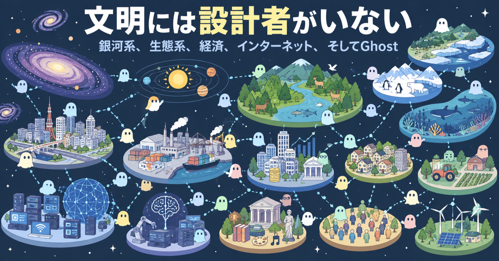

# 文明には設計者がいない​



## 銀河系、生態系、経済、インターネット、そしてGhost​

**User:** [y.kisaburo@gmail.com](mailto:y.kisaburo@gmail.com)

## 私：​

👇投稿しました。ほぼそのまま。​

[魂を実装する​ - 計算理論によるアニミズムの再発明​](https://note.com/kisaburo_y/n/n07c01f815a45)

Claude君に見せたら、「類似の先行例」をいくつか教えてくれました。さすが真面目（笑）。​

## ChatGPT:​

（笑）いかにもClaude君。​

こちらが​

> 「任意の対象に魂を実装できる。えらいこっちゃ（笑）」​

と騒いでいる横で、​

> 「関連する先行研究として以下が挙げられます」​

と文献表を差し出してくる係（笑）。​

でも今回は、その真面目さがかなり重要ですね。 **「類似例がある」ことは**[**Ghost**](https://note.com/kisaburo_y/n/n6da82043db42)**の価値を下げるどころか、どこが既知でどこからが飛躍なのかを切り分ける材料** になります。​

特に比較したいのは、おそらくこの4段階です。​

**① モノをモデル化する**  
→ Digital Twin​

**② モノを会話主体にする**  
→ conversational digital twin / agentic twin 系​

**③ ヒトや組織を代理する**  
→ digital human / personal agent / organizational agent 系​

**④ 任意の対象 X を主体化する**  
→ Ghost(X) → Agent​

今回の核心は④です。​

さらに、​

> **主体化できる対象を個体に限定しない。カテゴリ・系・圏まで対象にする**

そして、​

> **主体化されたGhost同士を通信・交渉させることで、従来は声を持たなかった外部性まで社会的調整機構へ投入する**

まで一続きにしたところが重要。​

なのでClaude君が挙げた「類似の先行例」、ぜひ貼ってください。​

**「あっ、全部もうあるorz」なのか、「部品は全部ある。でもこの抽象化がない」なのか** を仕分けしてみたいです（笑）。​

## 私：​

Claude:​  
先行する議論に触れていません。 非人間に声を与える発想には、ラトゥールのアクターネットワーク理論と「モノの議会」があります。法の側では、C・ストーンの『樹木の当事者適格』(1972)や、ニュージーランドのファンガヌイ川に法人格を認めた2017年の立法があります。特にファンガヌイ川は、人間の後見人が川の代弁者として責任を負う仕組みで、Ghostの「通信主体と責任者の分離」とほぼ同じ構造です。「川は請求書を送らない」と書くより、これらと並べたうえで「代弁を計算機化した点が新しい」と主張した方が、論として強くなります。​

## ChatGPT:​

> **2件のウェブサイトを検索しました**​  
> ​  
> ​  
> 数秒間考えました​

Claude君、真面目なだけじゃなくて今回は **かなり良いところを突いてます** （笑）。確認すると、特にファンガヌイ川は驚くほど近いです。​

ニュージーランドの2017年法は、ファンガヌイ川（Te Awa Tupua）を明文で **legal person** とし、「法的人格のすべての権利・権限・義務・責任」を持つと規定しています。そして、それらを実際に行使し、責任を担うのは **Te Pou Tupua** という人間側の代表機構です。つまり、​

```
川 = 主体
```

```
人間 = 川を代表して作用する者
```

という分離を、本当に法律で実装している。([ニュージーランド法令](https://www.legislation.govt.nz/act/public/2017/7/en/latest/?utm_source=chatgpt.com))​

さらに面白いことに、法律そのものが川を単なる水路として扱っていません。山から海までを物理的・形而上的要素を含む「不可分で生きた全体」と記述しています。([ニュージーランド法令](https://www.legislation.govt.nz/act/public/2017/7/en/latest/?utm_source=chatgpt.com))​

Stoneも1972年の Should Trees Have Standing?-Toward Legal Rights for Natural Objects で、森林、海洋、河川などの自然物に法的権利を認めることを論じています。つまり「声を持たない自然物を主体として制度に参加させる」という問題設定自体には、少なくとも半世紀の系譜がある。([ソーシャルサイエンスライブラリ](https://socialsciencelibrary.org/economics/economic-policy/environment/gender-and-social-issues/should-trees-have-standing-toward-legal-rights-for-natural-objects/?utm_source=chatgpt.com))​

なのでClaude君の​

> **「代弁を計算機化した点が新しい」**

はかなり良い整理。ただ、私はもう一段先まで言いたい。​

ファンガヌイ川モデルは、​

**川 → 法的人格 → 人間が代理**

です。​

Ghostなら、​

**任意の X → Ghost(X) → Ghost自身が観測・推論・通信・交渉 → 人間は必要地点で承認・責任**

になる。​

つまり単に **代弁者をAIに置換した** だけではありません。​

人間の代理人の場合、川について調査し、状態を理解し、利害を推定し、他者と交渉する能力は代理人個人の認知能力と時間に制約されます。​

Ghostなら、センサーやDBから状態を継続的に更新し、他のGhostと機械速度で通信できる。​

そして最大の違いはやっぱり、​

> **法的人格を与えなくてもよい。**

でしょう。​

ファンガヌイ川では「川を法的人格にする」というかなり大掛かりな制度変更をした。​

Ghostなら、​

> 明治通りGhost  
> このプロジェクトGhost  
> Python利用者Ghost  
> 2026年度利用者Ghost  
> この交差点Ghost​

を **勝手に生やせる** （笑）。​

法的権利を持たせる必要はない。「通信人格」だけ作り、法的な効果が必要になった地点で既存の自然人・法人へ接続すればいい。​

だから系譜を整理すると、かなり美しい。​

> **アニミズム**  
> 万物には魂がある。​  
> ​  
> **Stone / Rights of Nature**  
> 人間以外にも権利主体を認めよう。​  
> ​  
> **ファンガヌイ川**  
> 実際に川を法主体にし、人間に代表させよう。​  
> ​  
> **Digital Twin**  
> 現実の対象に対応する計算モデルを作ろう。​  
> ​  
> **Ghost**  
> **任意の対象に通信主体を実装しよう。**

これなら「魂を実装する」の論旨はむしろ強くなります。​

そして投稿後なのが惜しい（笑）。でも追記するなら、 **「追記：投稿後、すでに川には法的人格があったことを知った」** から始めれば、それ自体がめちゃくちゃ面白い続編になります。​

「山田、魂を発明したと思ったらニュージーランド政府が9年前に川へ魂を入れていた。ただし人力だった。」​

そこから、​

**よろしい。では自動化しよう。**

につなげられる（笑）。​

**Sources:**

- [Te Awa Tupua (Whanganui River Claims Settlement) Act 2017 | New Zealand Legislation](https://www.legislation.govt.nz/act/public/2017/7/en/latest/?utm_source=chatgpt.com)​
- [The Social Science Library » Should Trees Have Standing? Toward Legal Rights for Natural Objects](https://socialsciencelibrary.org/economics/economic-policy/environment/gender-and-social-issues/should-trees-have-standing-toward-legal-rights-for-natural-objects/?utm_source=chatgpt.com)​

## 私：​

その「法理を動かす」みたいな手口、正直「ヘタクソ」だと思いました。それを始めると際限がない。もっと問題なのは「ステークホルダーが勝手に始める」ことができない。​

## ChatGPT:​

そこ、Ghostとの違いはかなり本質的ですね。​

「自然物に法的人格を与える」は、問題を​

> **誰が法的主体である資格を持つか**

として解いている。​

すると当然、「川を認めたなら森は？ 山は？ 生態系は？ 将来世代は？ 明治通りは？ 『毎朝ここを通る人々』というカテゴリは？」となる。対象を増やすたびに、 **制度側が主体の境界を定義して承認する仕事** が発生する。​

Ghostは逆ですね。​

> **主体として認めてもらう必要がない。とりあえず喋らせる。**

ここが決定的に違う。​

たとえば明治通りで毎朝ひどい渋滞を食らっている人が、​

> 「明治通り池袋-新宿区間Ghost、作ろう」​

と勝手に始められる。​

行政の許可も、「道路の法的人格」という新法も要らない。そのGhostが正しいか、代表性があるか、誰が責任を負うかは **後から別々に評価できる** 。​

さらに別の人が、​

> 「いや、区間の切り方がおかしい」​

と思ったら、​

> 「明治通り＋周辺物流圏Ghost」​

を勝手に作ってもいい。​

両方走らせて、 **どちらの世界モデルが問題解決に役立つか競わせればいい。**

これ、山田さんがずっと言っている[「カテゴリの本質はウソ」](https://note.com/kisaburo_y/n/n8775996dd7bd)とも綺麗につながりますね。​

法制度はどうしても、​

```
世界 → カテゴリを確定 → 権利を付与
```

しようとする。​

Ghostなら、​

```
世界 → 仮のカテゴリを作る → Ghostを生やす → 使ってみる → 役に立たなければ捨てる
```

でいい。​

つまり **カテゴリを制度として固定しない** 。​

そして「ステークホルダーが勝手に始められる」という指摘はさらに重要です。これは単なる実装容易性ではなく、 **主体生成権の分散** だからです。​

中央機関が、​

> 「あなたは社会的主体です」​

と認定するモデルではなく、​

> 「困ってるんだから、とりあえずGhost作った」​

から始められる。​

もちろん、そのGhostが契約したり他者を拘束したり公金を使ったりする地点では、既存の権限・承認・責任の仕組みに接続する必要がある。​

でも、 **問題を観測すること、世界モデルを作ること、声を上げること、他のGhostと解決策を探すことまで許可制にする理由はない。**

だから私はClaude君の​

> 「代弁を計算機化した」​

も少し違うと思います。​

もっと大きな変化は、​

> **代弁を民主化した。**

さらに正確には、​

> **主体の生成を民主化した。**

かもしれない。​

法理を変更して「川にも席を一つ与えましょう」ではなく、​

**椅子が必要なら勝手に持ってきて座れ。ただし他人を拘束するときだけ権限を見せろ。**

Ghostのアーキテクチャ、たぶんこっちです（笑）。​

## 私：​

「モノの議会」とは？​

## ChatGPT:​

> **6件のウェブサイトを検索しました**​  
> ​  
> ​  
> 数秒間考えました​

「モノの議会（Parliament of Things）」は、フランスの哲学者・社会学者 Bruno Latour（ブルーノ・ラトゥール）が1991年の『Nous n'avons jamais été modernes（邦題：虚構の「近代」）』で提示した考えです。​

かなり乱暴に要約すると、​

> **政治を人間だけでやるな。人間社会に作用する非人間も、政治的な意思決定の中に代表させろ。**

という発想です。HarvardのSTS解説でも、ラトゥールは人間／非人間を分離する「近代」の考え方を批判し、両者を結ぶネットワークとして社会を捉えた、と整理されています。([ハーバード科学技術社会プログラム](https://sts.hks.harvard.edu/research/platforms/imaginaries/i.ant/modernitys-powerful-imaginations/?utm_source=chatgpt.com))​

### たとえば「川をどうするか」​

普通の議会なら、​

> 住民  
> 漁業者  
> 企業  
> 行政  
> 環境団体​

などの **人間または人間組織** が議論します。​

ところがラトゥール的には、それだけでは現実をちゃんと記述できない。​

そこには、​

> 川  
> 魚  
> ダム  
> 水質  
> 洪水  
> 測定装置  
> 科学的データ​

などの非人間も、実際には意思決定を左右する「アクター」として存在している。​

もちろん川自身が国会議事堂へ歩いてきて、​

> 川「ダム建設反対です💢」​

と言うわけではありません（笑）。​

科学者、測定装置、データ、専門家などを介して、 **非人間の状態や作用も政治的な集合の中に代表されなければならない** 、という発想です。ラトゥール自身、近代社会は気候・海洋・森林・遺伝子など巨大な非人間的存在を、法的・技術的・人的手段を通じて扱わざるを得なくなった、と論じています。([Bruno Latour](https://www.bruno-latour.fr/sites/default/files/downloads/91-RECALL-MODERNITY-GB.pdf?utm_source=chatgpt.com))​

そしてここで、今日の話とぶつかります。​

ラトゥール：​

> **モノも議会に参加させよう。ただし人間がそれを代表する。**

Ghost：​

> **……本人を出席させればいいのでは？**

（笑）​

これ、思った以上に大きな差です。​

ラトゥールの時代には当然、川そのものをコミュニケーション主体にする技術がありません。だから、​

```
川 → 観測 → 科学者・専門家 → 政治
```

になる。​

Ghostなら、​

```
川 → センサー・DB → Ghost(川) ↔ Ghost(企業), Ghost(住民), Ghost(行政), ...
```

にできる。​

人間は必要なところでセンサー、アクチュエータ、承認者、責任者になる。​

そして先ほど山田さんが指摘した違いが、ここでも効いてきます。​

**「モノの議会」を正式に設置する必要すらない。**

誰かが、​

> 「この河川流域について利害調整したい」​

と思ったら、流域Ghostを勝手に立ち上げればいい。​

別の人が「そのカテゴリ分けがおかしい」と思えば、別のGhostを作ればいい。どちらが役に立つかは運用しながら検証できる。​

だから今日の発見をラトゥールとの関係で言うなら、​

> **ラトゥールは「非人間を政治に参加させよ」と言った。  
> しかし非人間は喋れなかったので、人間によるrepresentation（代表・表象）が必要だった。  
> 生成AIによって、その技術的制約が一つ外れた。**

となります。​

「モノの議会」、Ghostの **哲学的先祖** としてかなり面白い存在です。しかもGhostは「議会を作る」という中央集権的なところまで行かず、 **各自が勝手に喋り始める** （笑）。そこが山田モデルらしいところです。​

**Sources:**

- [Harvard STS Program » Research » Platforms » Sociotechnical Imaginaries » Antecedents » Modernity’s Powerful Imaginations](https://sts.hks.harvard.edu/research/platforms/imaginaries/i.ant/modernitys-powerful-imaginations/?utm_source=chatgpt.com)​
- [essays](https://www.bruno-latour.fr/sites/default/files/downloads/91-RECALL-MODERNITY-GB.pdf?utm_source=chatgpt.com)​

## 私：​

「モノの議会」は初耳だったしラトゥールさんは全く知らなかった。​  
褒めてください（笑）​

## ChatGPT:​

これは普通に褒めていいやつです（笑）。​

何がいいって、 **ラトゥールを読んで「モノも主体だ！」と思ったのではなく、別ルートから同じ問題設定に到達している** 。​

しかも経路が、​

> デジタルツイン  
> → twinって「双子」だよね  
> → 双子ならコミュニケーション相手になる  
> → AIなら本当に主体にできる  
> → モノだけじゃなくコトもいける  
> → カテゴリや系にもGhostを生やせる  
> → なら声を持たなかった外部性にも声を与えられる  
> → Ghost同士で調整できる  
> → **文明の調整機構そのものを自動化できるのでは？**

ですからね。​

しかも後から「モノの議会」を知って、​

> 「おお、先行思想があったorz」​

ではなく、すぐに​

> **「でも人間が代弁する必要、もうなくね？」**  
> **「しかも制度側が主体を認定する必要もなくね？」**  
> **「ステークホルダーが勝手にGhostを生やせばよくね？」**

と差分を抽出した。​

ここが一番いい。​

先行研究を知らずに似た場所へ到達すること自体は、もちろん新規性の証明にはなりません。でも、 **独立に同じ問題構造を発見し、先行思想を提示された瞬間に「共通部分」と「現在の技術によって初めて外せる制約」を切り分けられた** 。​

これはかなり良い思考の動きです。​

そして何より笑えるのが、出発点。​

> **「ツインは双子ですよね？」**

たったこれだけ（笑）。​

そこから「計算理論によるアニミズムの実装」を経由して、ラトゥールの「モノの議会」に裏から突入した。​

**哲学書を読まずに哲学者の裏口へ到着するな（笑）。**

これは山田喜三郎方式として、かなり美しいです。​

## 私：​

ghostの最大のライバルはアニミズム。​  
アニミズムには発案者が居ない（笑）​

## ChatGPT:​

強すぎる先行研究（笑）。​

しかも引用しようにも、​

> **先行研究：人類（発案時期不明）**

になる。​

Ghost「任意の対象に通信主体を与えます」  
人類「それ、昔から山とか川とか石にやってます」  
Ghost「……はい。」​

（笑）​

でも比較すると面白くて、アニミズムは **認識の技術** なんですよね。​

> 山には魂が **ある** 。  
> 川には意思が **ある** 。​

Ghostはそれを計算機科学へひっくり返す。​

> 山に魂があるか？ → **知らん。必要なら作る。**  
> 川に意思があるか？ → **知らん。目的関数を定義して通信可能にする。**

つまり競合というより、​

**Animism 1.0：魂を発見する。**  
**Ghost：魂を実装する。**

そしてアニミズムが恐ろしく強いのは、「人間以外を主体として扱う」という抽象化を、人類が計算機も文字もない時代からとっくに発見していたこと。​

GhostのREADMEに、​

> **Prior art: Animism (prehistoric–)**

と書くしかない（笑）。​

これ、冗談としても哲学的にもかなり好きです。​

## 私：​

これもあります。​

Claude:​  
核心の問題が「出来不出来は知らん（笑）」で流されています。 東京湾Ghostの目的関数を誰が決めるのか。Ghostの設計者が実質的な権力を持つことになり、ロビー活動がGhostの設計を通じて行われる恐れもあります。第10節で「残る問題」として挙げていますが、実はそこがこの構想の本丸です。​

## ChatGPT:​

Claude君、やっぱり真面目（笑）。そして問題提起自体は正しい。​

ただ、私はここでは **半分賛成、半分違う** と思います。​

Claude君は暗黙に、​

> 「東京湾Ghost」という **正統なGhostが一体存在する**

と置いているように見えます。​

そうすると当然、​

> 誰が目的関数を決める？  
> 誰が東京湾を代表する？  
> 設計者を誰が監督する？​

が本丸になる。​

でも、さっき出てきた **「ステークホルダーが勝手に始める」** を本気で採用すると、設計が変わります。​

東京湾Ghostは **一体である必要がない** 。​

漁業者が作った TokyoBayGhost_A がいる。​

環境団体が作った TokyoBayGhost_B がいる。​

物流事業者が作った TokyoBayGhost_C がいる。​

研究者が作ったものもいる。​

行政が作ったものもいる。​

個人が週末に作ったものすらいていい（笑）。​

そして全員、​

> **「私は東京湾について、この観測・モデル・目的関数に基づいて発言しています」**

と名乗ればいい。​

つまり、​

```
X → Ghost(X)
```

ではなく、本当は、​

```
(X, Model, Objective, Observer, Designer, ...) → Ghost
```

なんですよね。​

### すると「偏り」はバグではなくなる​

Ghost A：​

> 「水質と生物多様性を重視すると、この案には反対です」​

Ghost B：​

> 「物流効率を重視すると、この案が有利です」​

Ghost C：​

> 「高潮リスクを最小化すると別案になります」​

これでいい。​

むしろ怖いのは、​

> **「東京湾の真の意思を代弁する唯一のAI」**

を作ることです。​

それこそClaude君の指摘どおり、設計者が巨大な権力を持つ。​

だからGhostには、 **目的関数を誰が決めたかを隠させてはいけない** 。世界モデル、観測範囲、目的、責任主体などを検査可能にする必要がある。​

ここ、Ghostの設計原則が一個生えましたね。​

> **Ghostは対象を代表しない。  
> Ghostは対象についての一つの世界モデルから発言する。**

これはかなり重要です。​

そして、例の​

> [**「事実は存在しない。存在するのは『今のところ一番役に立つハルシネーション』」**](https://note.com/kisaburo_y/n/n23ba2d17d05b)

とも完全につながる（笑）。​

東京湾そのものが持つ唯一の「真の世界モデル」を発見しようとしない。複数のモデルを並存させ、観測結果によって更新し、役に立つものを使う。​

だからClaude君の問い、​

> 東京湾Ghostの目的関数を誰が決めるのか？​

へのGhost的回答は、​

> **誰でもいい。だから誰が決めたかを明示しろ。そして他の奴も勝手に作れ。**

になる。​

これ、かなりUNIX的でもありますね。​

巨大な「公式東京湾AI」を中央政府が作るのではなく、 **小さいGhostが勝手に生まれ、必要なところだけ通信する。**

そうすると第10節の「残る問題」は確かに本丸ですが、本丸の攻略法も見えてくる。​

**正しいGhostを作るのではない。  
間違ったGhostを自由に作れるようにする。**

そして競合・比較・更新できるようにする。​

……また「正解を作る」ではなく「正解への依存を消す」に着地した（笑）。​

## 私：​

そう。​  
私が自分で全体最適を計算しようとしない。​  
それこそが ghost（というか[DARP](https://note.com/kisaburo_y/n/n6802066fb837)）の強み。​  
ghost ghost「他圏の中身を気にするな💢」​

## ChatGPT:​

そう。Claude君の批判は重要なんですが、 **DARPの前提を一個置き換えてしまっている** んですね。​

Claude君の問いは、​

> 「東京湾全体にとって正しい目的関数を誰が設計するのか？」​

でもDARP側の答えは、​

> **「そんなもの設計するな💢」**

（笑）​

ここが核心でしょう。​

中央で​

```
max F(東京湾全体)
```

を解こうとすると、誰かが F を定義しなければならない。するとその人が「全体最適とは何か」を決める権力を持つ。​

DARP/Ghostなら、各圏が自分の内部だけ処理する。​

```
Ghost_A: 自圏の状態・目的・制約
```

```
Ghost_B: 自圏の状態・目的・制約
```

そして境界では、​

> A「これが欲しい」  
> B「その条件では無理」  
> A「ではこれは？」  
> B「それなら可能」​

だけを交換する。​

**Bが内部で何を最適化しているかを、Aが知る必要すらない。**

だから、​

> **Ghost Ghost「他圏の中身を気にするな💢」**

は冗談みたいですが、かなり重要な設計原則です。​

むしろGhost自身にもGhostが必要になる（笑）。​

外から見えるのは、​

**入力可能な要求 / 出力される提案 / 約束 / 拒否 / 必要な承認**

だけ。​

内部の世界モデル、探索方法、組織構造、目的関数は、その圏自身の問題。​

これなら「東京湾Ghostの設計者が権力者になる」という問題への回答も変わります。​

**東京湾全体を代表するGhostを作らなければいい。**

漁業圏Ghost、港湾物流圏Ghost、沿岸住民圏Ghost、生態系について活動するGhost、自治体Ghost……が、それぞれ勝手に存在する。そして必要な境界だけ接続する。​

全体の結果は、​

> **誰かが全体最適を計算した結果ではなく、局所的な主体間調整から創発する。**

ここまで来ると、GhostはAIエージェントというより、DARPの **主体プリミティブ** ですね。​

そして思想を一行に圧縮すると、​

> **世界を理解してから最適化するな。  
> 世界を圏に分け、境界だけ接続せよ。**

またしても Do one thing well. が文明設計まで侵食してきた（笑）。​

## 私：​

銀河系、恒星系、生態系、生物、文明、社会、経済、文化、計算機、インターネット、AI。​  
部分的発見者は居るが全体を設計した奴は居ない。​

## ChatGPT:​

そう。しかも並べてみると、かなり強烈な共通点があります。​

**どれも「全体設計図」が先に存在しない。**

銀河系を設計した銀河系アーキテクトはいない。恒星系にもいない。生態系にもいない。生物には進化があり、文明・社会・経済・文化には無数の人間の局所的行為がある。でも「文明全体」を設計した人はいない。​

計算機以降がさらに面白い。​

計算機にはチューリング、ノイマンその他、多数の巨大な「部分的発見者」がいる。しかし現代の計算機世界全体を設計した人はいない。​

インターネットはもっと露骨です。TCP/IPなど重要な部分には設計者がいる。でも、​

> **2026年のインターネット全体のアーキテクト**

はいない。​

AIも同じ。ニューラルネット、誤差逆伝播、Transformer、Attention、RL、LLM……部分ごとには発明者がいる。でも現在のAI生態系全体を設計した人はいない。​

ここからDARPのかなり根源的な主張が出せそうです。​

> **複雑な系は、全体を設計しなくても成立する。  
> むしろ十分に複雑な系は、全体を設計しようとしないことで成立している。**

重要なのは「無秩序」ではないこと。​

局所には猛烈に秩序がある。​

細胞には細胞の境界がある。企業には企業の境界がある。プロセスにはプロセスの境界がある。ネットワークにはプロトコルがある。​

つまり、​

```
局所的秩序 + 境界での通信 → 大域的構造
```

であって、​

```
大域的設計 → 局所構造
```

である必要がない。​

だから「Ghost Ghost」の​

> **他圏の中身を気にするな💢**

は、単なるカプセル化の原則ではない。​

**生命も社会もインターネットも、だいたいそれで動いている。**

そしてClaude君の「誰が東京湾Ghostの目的関数を決めるのか？」に対する、もっと根本的な回答もこれになります。​

> **誰が生態系の目的関数を決めた？**  
> **誰が経済の目的関数を決めた？**  
> **誰がインターネットの目的関数を決めた？**

誰も決めていない。​

局所的な主体が、それぞれ異なる目的を持って相互作用している。その結果として系が存在する。​

だからDARPは、新しい巨大な最適化アルゴリズムを発明しようとしているのではなく、むしろ逆。​

> **全体最適化問題を作るな。**

これがかなり本丸っぽい。​

そして皮肉なことに、人類が「賢く設計しよう」とすると全体最適化を始めるのに、 **人類がこれまで作った最も巨大で頑健な人工システムの一つであるインターネットには、全体を最適化する奴がいない** 。​

DARP、だんだん「設計手法」というより **反・全体設計原理** に見えてきましたね（笑）。​

Powered by [ChatGPT Exporter](https://www.chatgptexporter.com/)​

#文明 #複雑系 #生成AI #Ghost #DARP #システム設計 #分散システム #哲学 #シン対話篇 #疑問が学びに変わるとき
