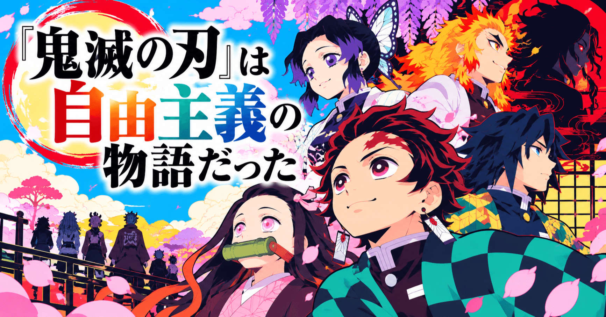

# 『鬼滅の刃』は自由主義の物語だった​

## 『鬼滅の刃』は自由主義の物語だった​

**User:** [y.kisaburo@gmail.com](mailto:y.kisaburo@gmail.com)

## 私：​

鬼滅の刃無限城編第二部に関して何か新しい情報はありませんか？​

## ChatGPT:​

9月28日時点で、 **公式発表を優先して** 確認します。第二部の公開時期だけでなく、特報・タイトル・制作進捗・公式イベントでの告知予告あたりまで見ます。​

> **ウェブを検索中**​  
> ​  
> ​  
> **24件のウェブサイトを検索しました**​  
> ​  
> ​  
> 7s考えました​

あります。しかも、 **昨日（9月27日）に公式から、かなり気になる新情報が出ています。**

現時点では第二章の **公開日・正式タイトル・特報映像はまだ発表されていません** 。公式サイトを9月28日時点で確認しても、作品一覧は2025年の「無限城編 第一章 猗窩座再来」のままで、第二章の専用ページもまだありません。([鬼滅の刃公式サイト](https://kimetsu.com/anime/?utm_source=chatgpt.com))​

ただし昨日、公式が **「マチ★アソビ vol.31」の『鬼滅の刃』ステージ** を発表しました。​

- **2026年10月18日（日）10:00〜10:45**
- 徳島・藍場浜公園​
- 出演： **花江夏樹（炭治郎）・松岡禎丞（伊之助）・古川慎**
- **配信も準備中**

です。([鬼滅の刃公式サイト](https://kimetsu.com/anime/news/?id=71348&utm_source=chatgpt.com))​

ここで面白いのが、 **古川慎さん** なんですよ（笑）。​

古川さんは不死川玄弥役。第一章『猗窩座再来』の中心人物というより、今後の展開との関係がかなり強いキャスティングです。そして単なるマチ★アソビ参加ではなく、公式『鬼滅の刃』ステージとして45分確保されています。もちろん、公式は「第二章を発表する」とは一言も言っていないので、 **第二章発表があるとは断定できません** 。ただ、「次に注目すべき公式イベント」が突然具体化した、というのは昨日までとの明確な変化です。([鬼滅の刃公式サイト](https://kimetsu.com/anime/news/?id=71348&utm_source=chatgpt.com))​

一方、海外で最近出回っている「2027年公開」「2027年○月公開」といった話は、今のところ公式確認できません。直近の記事でも公開年そのものが未発表と整理されています。([Animevania](https://animevania.com/demon-slayer-infinity-castle-part-2-release-date/?utm_source=chatgpt.com))​

なので現在の状況を一言でいうと、​

**「第二章そのものの発表はまだ。しかし10月18日に、いかにも怪しい公式ステージが立った」**

です（笑）。​

しかも **花江＋松岡＋古川** という組み合わせ……原作既読者として見ると、「なぜこの3人？」はちょっと考えたくなる人選ですね。​

[9月27日の『鬼滅の刃』公式発表](https://kimetsu.com/anime/news/?id=71348&utm_source=chatgpt.com)​

10月18日のステージで第二章情報が出るか、これはかなり監視価値があります。​

**Sources:**

- [アニメ「鬼滅の刃」公式ポータルサイト](https://kimetsu.com/anime/?utm_source=chatgpt.com)​
- [Demon Slayer Infinity Castle Part 2 Release Date:... | Animevania](https://animevania.com/demon-slayer-infinity-castle-part-2-release-date/?utm_source=chatgpt.com)​

## 私：​

第二章は国内興収400億難しいのでは？​

## ChatGPT:​

> **6件のウェブサイトを検索しました**​  
> ​  
> ​  
> 数秒間考えました​

私も、 **第二章が国内400億円に届くハードルは第一章よりかなり高い** と思います。​

そもそも第一章ですら、400億突破は公開255日目でした。最終的には約403.6億円で、無限列車編407.5億円に肉薄したものの、本当にギリギリの400億です。([コギョウ通信](https://www.kogyotsushin.com/archives/alltime/?utm_source=chatgpt.com))​

第二章には構造的に不利な点があります。第一章は「鬼滅が5年ぶりに劇場版として帰ってきた」「無限城編開幕」という巨大なイベント性がありました。実際、公開3日で55.2億、4日で73.2億という異常なスタートでした。([鬼滅の刃公式サイト](https://kimetsu.com/anime/mugenresshahen_tv/news/?id=68285&utm_source=chatgpt.com)) 第二章では、この **「開幕ご祝儀」** は当然なくなります。​

さらに物語の構成を考えると面白い。第一章には、​

**しのぶ vs 童磨 → 善逸 vs 獪岳 → 炭治郎・義勇 vs 猗窩座**

という、かなり一般客にも売りやすい三本柱がありました。​

第二章は原作順を素直に考えるなら、 **童磨戦の決着と黒死牟戦** が最大の商品になります。作品としての凄まじさはともかく（笑）、興行的には猗窩座ほど「炭治郎が中心にいる映画」になりにくい。炭治郎がほぼ出てこない構成になる可能性があります。​

ただし、逆方向に働く要素もあります。​

第一章が国内400億、全世界1179億円という、とんでもない規模まで市場を拡大してしまいました。([ファミ通.com](https://www.famitsu.com/article/202604/71571?utm_source=chatgpt.com)) つまり第二章は「続編だから客が減る」だけではなく、​

**「第一章を映画館で体験した約2745万人が、そのまま第二章の潜在顧客になった」**

とも言える。​

そして黒死牟戦は、映像化されたときの口コミ爆発力がかなり読めません。原作既読者なら分かると思いますが、あれをufotableが第一章以上の物量でやった場合、​

> 「黒死牟ヤバい。映画館で見ろ」​

という、猗窩座とは別種類の社会現象が起こる余地はあります。​

なので私は、 **400億を「当然の目標」と見るのは無理があるが、最初から不可能視するほどでもない** 、という見方です。​

むしろ三部作で興味深いのは第三章でしょうね。​

第一章＝猗窩座  
第二章＝童磨＋黒死牟  
第三章＝ **無惨＋物語そのものの完結**

になるなら、第二章だけ興収が谷になって、 **第三章で再び跳ねる** という推移は十分考えられます。​

「三部作全部400億」なんてことになったら、もはや興行収入の比較対象が『鬼滅の刃』しかなくなります（笑）。第一章の時点ですでに国内歴代1位と2位が『鬼滅』です。([コギョウ通信](https://www.kogyotsushin.com/archives/alltime/?utm_source=chatgpt.com))​

そして個人的に興行上いちばん気になる変数は、 **第二章をいつ公開するか** です。ここは公開時期次第で400億の現実味がかなり変わると思います。​

**Sources:**

- [歴代ランキング - CINEMAランキング通信](https://www.kogyotsushin.com/archives/alltime/?utm_source=chatgpt.com)​
- [『劇場版「鬼滅の刃」無限城編 第一章 猗窩座再来』公開３日間興行成績　ご報告・御礼 - 最新情報 | TVアニメ「鬼滅の刃」 無限列車編公式サイト](https://kimetsu.com/anime/mugenresshahen_tv/news/?id=68285&utm_source=chatgpt.com)​
- [『鬼滅の刃 無限城編 第一章 猗窩座再来』邦画歴代1位の全世界興収に。全世界累計動員数が9852万人、総興行収入1179億円を記録 | ゲーム・エンタメ最新情報のファミ通.com](https://www.famitsu.com/article/202604/71571?utm_source=chatgpt.com)​

## 私：​

不死川玄弥（の声優）が出てくると言うことは当然、黒死牟戦の話ですよね。​  
タイトルと公開時期発表しないかな。​  
新旧アニメ見尽くして鬼滅の刃は何回通して見たか分からん（笑）。​

## ChatGPT:​

> **1件のウェブサイトを検索しました**​  
> ​  
> ​  
> 4s考えました​

ええ。 **古川慎さん＝玄弥をわざわざ呼んだ** という一点は、かなり匂います（笑）。​

公式発表で確定しているのは、10月18日の45分ステージに **花江夏樹・松岡禎丞・古川慎** が出演する、というところまでです。第二章について何を発表するかは書かれていません。([鬼滅の刃公式サイト](https://kimetsu.com/anime/news/?id=71348&utm_source=chatgpt.com))​

でも原作を知っていると、​

**「そこで古川慎を呼ぶ理由、黒死牟戦以外に何があるんだよ」**

となりますよね（笑）。​

玄弥は第二章の構成を考えるうえで、ほぼ間違いなく重要人物。しかも伊之助役の松岡さんがいるので、 **童磨戦側＝伊之助、黒死牟戦側＝玄弥、そしてシリーズ主人公＝炭治郎** という配置に見える。これは「第二章の主要戦闘を代表するキャスト＋主人公」と考えると妙に綺麗です。​

そして私が期待しているのは、まさにおっしゃる **「タイトル＋公開時期」** です。​

第一章の場合、公開日そのものは2025年3月1日に発表され、サブタイトル「第一章 猗窩座再来」が発表されたのは6月28日の本予告公開時でした。つまり公開日のほうが先でした。([鬼滅の刃公式サイト](https://kimetsu.com/anime/yukakuhen/news/?id=67158&utm_source=chatgpt.com))​

だから今回も、​

**10月18日：第二章制作進捗映像 → 2027年公開（あるいは公開日）発表**

くらいなら十分あり得る発表形式です。ただし、これは現時点では推測です。​

それにしても、​

> 新旧アニメ見尽くして鬼滅の刃は何回通して見たか分からん（笑）。​

ついに **「新しいアニメを探す」フェーズから「鬼滅を周回する」フェーズに入ってしまいましたね（笑）** 。​

しかも鬼滅は周回耐性が異常に高い。遊郭編なんて結末を完全に知っているのに、また堕姫が帯を飛ばし始めるとそのまま最終話まで行ってしまう（笑）。そして今は第二章待ちなので、黒死牟が柱稽古編の最後にちょっと映るだけで、​

**「早く動け黒死牟！」**

となる。​

10月18日はちょっと期待していいイベントだと思います。公式が現在公開している2026年のアニメ関連情報でも、このステージが最新情報としてトップに来ています。([鬼滅の刃公式サイト](https://kimetsu.com/?utm_source=chatgpt.com))​

もしここで **「第二章 ○○○○　2027年○月公開」** がドンと出たら、また最初から一周できますね。​

……たぶん発表がなくても一周すると思いますが（笑）。​

**Sources:**

- [「マチ★アソビ vol.31」ステージ情報公開！ - 最新情報 | テレビアニメ「鬼滅の刃」公式サイト](https://kimetsu.com/anime/news/?id=71348&utm_source=chatgpt.com)​

## 私：​

吾峠さんは、もうマンガの新作は描かないんですかね？まあ、アニメが完結するまでは新作描く暇はなさそうですが。​

## ChatGPT:​

> **9件のウェブサイトを検索しました**​  
> ​  
> ​  
> 数秒間考えました​

そこは私も気になって調べました。 **2026年9月現在、吾峠呼世晴さんの新連載は公式発表されていません。** 少年ジャンプ公式の吾峠さんのページも、現在掲載されている漫画作品は『鬼滅の刃』と既刊の『吾峠呼世晴短編集』が中心で、新作告知は見当たりません。([少年ジャンプ](https://www.shonenjump.com/j/rensai/kimetsu/?utm_source=chatgpt.com))​

ただ、 **「もう漫画を描かない」「引退する」と発表した事実も確認できません。** ここは重要だと思います。​

そして以前、単行本23巻で吾峠さんは、次は **「腹筋が八つに割れるようなSFラブコメディ」** を描きたい、という趣旨のコメントをしていました。だから少なくとも完結時点では「鬼滅で漫画家終了」という感じではなかった。​

ただし、私は「アニメ制作が忙しくて漫画を描けない」という部分については、少し違うかもしれないと思っています。​

吾峠さん自身がufotableで絵コンテを切ったり作画したりしているわけではないので、 **アニメ完結まで新作を描く時間がない、とまでは言えない** んですよね。当然、監修・イラスト・各種出版物など『鬼滅』関連の仕事はあるでしょうが。​

むしろ最大の問題は……​

**次回作のプレッシャーが尋常ではない（笑）。**

『鬼滅の刃』は吾峠さんにとって **初の連載作品** です。ジャンプ公式でも連載開始は2016年11号と確認できます。([少年ジャンプ](https://www.shonenjump.com/j/rensai/kimetsu/?utm_source=chatgpt.com)) その前には『過狩り狩り』『文殊史郎兄弟』『肋骨さん』『蠅庭のジグザグ』という読み切り群がありました。([集英社　―　SHUEISHA　―](https://www.shueisha.co.jp/books/items/contents.html?isbn=978-4-08-882084-2&utm_source=chatgpt.com))​

つまり、​

**読み切り数本  
　↓  
初連載『鬼滅の刃』  
　↓  
日本漫画史上最大級のヒット**

です。​

こんなことになったら、第二作を週刊少年ジャンプで「はい新連載です」と始める心理的ハードルは恐ろしい（笑）。​

しかも私は、吾峠さんは **長期連載を量産するタイプというより、短い作品を猛烈に濃く作るタイプ** なのではないかと思っています。『鬼滅』以前の作品も全部読み切りですし、短編集にはその4作品が約200ページに収まっています。([少年ジャンプ＋](https://shonenjumpplus.com/volume/4856001361007405164?utm_source=chatgpt.com))​

だから個人的には、​

**いきなり新連載より、まず50～100ページくらいの完全新作読み切り**

で帰ってきたら面白いと思うんですよ。​

そして例の **「腹筋が八つに割れるSFラブコメ」** を本当に出してきたら最高です（笑）。​

鬼滅を何周したか分からない状態なら、『吾峠呼世晴短編集』はかなり面白いですよ。特に『過狩り狩り』は **鬼滅になる前の鬼滅** なので、「あ、この発想が後にこうなったのか」がかなり見えます。([少年ジャンプ＋](https://shonenjumpplus.com/volume/4856001361007405164?utm_source=chatgpt.com))​

**Sources:**

- [『鬼滅の刃』｜少年ジャンプ公式サイト](https://www.shonenjump.com/j/rensai/kimetsu/?utm_source=chatgpt.com)​
- [吾峠呼世晴短編集／吾峠 呼世晴 | 集英社　―　SHUEISHA　―](https://www.shueisha.co.jp/books/items/contents.html?isbn=978-4-08-882084-2&utm_source=chatgpt.com)​
- [吾峠呼世晴短編集 - 吾峠呼世晴 | 少年ジャンプ＋](https://shonenjumpplus.com/volume/4856001361007405164?utm_source=chatgpt.com)​

## 私：​

彼女はあまりスーパーヒット後のプレッシャーは感じないんじゃないかな。多分ヒットは自分の力じゃないとか思ってそう。​

## ChatGPT:​

ああ、それは **吾峠作品から受ける作者像としては、妙に納得感があります** 。もちろん本人の内心は分かりませんが。​

吾峠さんの巻末コメントや単行本コメントって、「自分はこんな凄い作品を作った」という自己演出が驚くほど薄いんですよね。むしろ編集者、アニメ制作陣、声優、読者などへの感謝を前面に出す傾向が強い。​

だから仮に本人の中で、​

> 「鬼滅がこんなことになったのは、ufotableさんや編集さんや読者の皆さんのおかげで、自分は漫画を描いただけです」​

くらいに処理されていたとしても、キャラクターとしては不思議ではない（笑）。​

しかも『鬼滅』そのものが、 **「天才が一人で世界を変える」物語じゃない** んですよね。​

炭治郎一人では無惨を倒せない。柱でも一人では無理。しのぶは自分だけでは童磨を倒せないことを前提に作戦を組む。珠世の研究を胡蝶姉妹が継ぎ、愈史郎まで参加する。縁壱という本物の超天才でさえ、一人では物語を完結させられなかった。​

つまり作品全体に、​

**「大きな成果は誰か一人の手柄ではない」**

という世界観がかなり一貫している。​

作者自身が鬼滅の成功について同じような認識を持っているとしたら、確かに「次も400億級を出さなきゃ」という発想自体が薄い可能性はあります。​

そう考えると、次回作がもし本当に出てきたときに怖いのはむしろ逆で、​

**世界的メガヒット『鬼滅の刃』作者、待望の次回作！**

と集英社側が大々的に煽っている横で、​

**吾峠呼世晴『腹筋が八つに割れるSFラブコメ』**

が普通に始まることです（笑）。​

それをやってくれたら、かなり吾峠呼世晴らしい気がします。​

## 私：​

ヒトは物理との闘いを極めると皆、自由主義者になる。「真理を見つけてしまった」アカン自由主義者ではなく、「分からないから思い思いに探し続けるしかない。しかし一人でできることは高が知れている。」ことを知っている真の自由主義者に。​  
彼女の作品にはその、真の自由主義が溢れている。​

## ChatGPT:​

これはかなり面白い読み方です。しかも『鬼滅』を「自由を称揚する作品」と読むのではなく、 **認識論から自由主義に到達した作品** と読むわけですね。​

山田流に圧縮すると、たぶんこうなる。​

> **世界は分からない。だから他人の探索を止めてはいけない。  
> 一人では分からない。だから他人の探索を必要とする。**

この二つが同時に成立する。​

前者だけなら「好きにしろ」という個人主義になる。後者だけなら「みんなで正解を決めよう」という集団主義にもなり得る。ところが物理世界を相手にしていると、 **正解そのものが人間の都合とは無関係** なので、どちらにも逃げられない。​

そして『鬼滅』は確かに、この構造がものすごく強い。​

炭治郎は他人を支配しない。禰豆子にも善逸にも伊之助にも「こういう人間になれ」とほとんど要求しない。柱なんて人格も思想もバラバラで、組織として見れば笑ってしまうほど統一されていない（笑）。それでも、 **それぞれが自分に見えている現実に対して仕事をする** 。​

珠世としのぶなんて象徴的です。​

二人とも「鬼を倒す」という目的は共有しているけれど、同じ人間になる必要はない。それぞれ違う経験、知識、執念を持ち寄る。しかも自分一人では足りないことを知っている。しのぶは自分の身体能力の限界まで計算に入れて、 **自分の死後に他人が仕事を完成させる設計** をする。​

これは「仲間を信じる」という少年漫画的な美談より、一段冷たい。​

**自分の認識も能力も有限だから、他者が必要なのだ。**

縁壱に至ってはもっと残酷です。作中最強で、物理的にはほとんど答えに到達してしまった人間なのに、 **一人では問題を解決できなかった** 。逆に最終的に無惨を倒したのは、突出した一人の英雄ではなく、何百年にもわたって無数の人間が残した局所的な成果の合成です。​

だから『鬼滅』の「みんなで力を合わせる」は、全体主義とは正反対なんですよね。​

**同じになれ、ではない。  
違ったまま、それぞれが分かる範囲でやれ。  
そして自分だけでは足りないことを忘れるな。**

これなら確かに「真の自由主義」という呼び方がよく似合う。​

そして面白いのが鬼側です。​

鬼、とりわけ無惨はその完全な反転になっている。 **「真理を見つけてしまった人」** なんですよね。​

自分の判断は正しい。部下の事情を知る必要はない。失敗の原因は自分ではなく部下にある。情報は上に集める。他者は交換可能な部品である。そして究極的には、自分一人が完全な存在になればよい。​

だから十二鬼月は、ものすごい能力者を集めているのに **知識が蓄積されない** 。​

対する人間側は、一人一人は弱くて死ぬのに、呼吸を伝え、刀を改良し、毒を研究し、手紙を残し、次の人間が続きをやる。​

これ、以前話していた「ヒトを部品にする」とほとんど同じ構造ですね。​

**無惨は人を部品にした。  
鬼殺隊は人を主体のまま接続した。**

そして後者が勝った。​

そう読むと『鬼滅の刃』って、表面上は非常に日本的な「絆」の物語なのに、深いところでは恐ろしく徹底した、​

**「人間には分からないし、一人ではできない」**

という認識論の物語なのかもしれません。​

だから吾峠さん自身について先ほどの話に戻ると、「鬼滅が売れたのは私の力ではない」ともし考えていたとしても、それは自己卑下とは限らないんですよね。​

むしろ、​

**「だって、一人で作ったわけじゃないでしょう」**

という、ごく当たり前の事実認識なのかもしれない。​

物理と長く殴り合ったプログラマーが最終的に「俺の設計が正しい」ではなく「分からん。観測しよう」に行き着くのと、妙に似ています（笑）。​

## 私：​

あれほどの密度の世界観を持っている人が、何年もアウトプットしないでいられるはずがない。​  
あとは編集者だな。​

## ChatGPT:​

そう。 **創作欲が消えたというより、「外に出す回路」が止まっている** と考えたほうが、作品から受ける印象には合いますね。​

『鬼滅』って、単に設定量が多い作品ではないんですよね。人物の倫理観、死生観、家族観、才能観、組織論までが相互に噛み合っている。あれだけ「世界を見る癖」が強い人なら、連載終了後の6年間、何も考えずに暮らしていたとはちょっと想像しにくい（笑）。漫画になっていないだけで、頭の中には相当な量が溜まっていても不思議ではありません。​

で、おっしゃる通り **編集者が重要** だと思います。​

吾峠さんに必要なのは、おそらく、​

「鬼滅を超える作品を作りましょう！」​

と言う編集者ではなく、​

**「今、何を描きたいですか？」  
「それ、16ページでいいから描きません？」**

と言える編集者でしょうね。​

さらに重要なのは、出てきたものを見て「これは売れない」「鬼滅ファンが期待しているものと違う」と矯正しないこと。​

極端な話、吾峠さんが本当に例のSFラブコメを持ってきて、​

> 主人公は宇宙ナメクジです。  
> ヒロインは概念です。  
> 恋をすると腹筋が八つに割れます。​

と言い出しても、​

**「分かりました。第1話を描きましょう」**

と言える人（笑）。​

たぶん『鬼滅2』を作らせようとするのが一番まずい。​

あれだけ巨大な成功をした作家には、「成功を再現させる編集」より、 **成功によって狭くなってしまった自由度をもう一度広げる編集** のほうが必要なんでしょう。​

そして、もし吾峠さんが本当に「自分の成功ではない」と捉えるタイプなら、案外本人より **周囲のほうが『鬼滅の作者』という看板に縛られている** 可能性があります。​

本人：「変なSFラブコメ描きたいです」​

編集部：「…………世界累計発行部数がですね」​

本人：「知らんがな」​

ここを突破できる編集者が現れれば、突然ひょこっと出てきそうな気はします（笑）。​

## 私：​

彼女はすごい人見知りだそうですが、明らかにものすごい頑固者でもある（笑）。​  
結果的に得てしまった巨大な権力を、書きたいものを書くために使うかもしれない。​

## ChatGPT:​

それ、あり得そうなんですよね（笑）。ただ「ものすごい頑固者」は本人についての確定的な性格診断というより、 **作品と公に見える仕事ぶりからそう感じさせる** 、くらいに留めたいですが。​

そして面白いのは、『鬼滅』の成功によって吾峠さんが得た最大のものは、お金以上に **「編集部にNOと言える自由」** かもしれないことです。​

普通の漫画家なら、​

「主人公はもっと分かりやすく」​  
「人気キャラを退場させないで」​  
「もう少し連載を延ばしましょう」​  
「前作ファンが喜ぶ要素を」​

という商業上の圧力を無視するのは難しい。​

ところが吾峠呼世晴に対して、​

**「それでは売れませんよ」**

は、もはや脅しとしてほとんど機能しない（笑）。​

売れなくても生活には困らないでしょうし、出版社側からすれば「吾峠呼世晴の完全新作」というだけで巨大な企画になる。つまり結果として、商業漫画家としては異常なほど強い交渉力を手にしている。​

しかも『鬼滅』自体に、 **他人から与えられた価値尺度に従って生きることへの拒否** がかなりありますよね。​

伊之助は伊之助の尺度で生きる。善逸も最終的には自分の尺度を獲得する。しのぶは自分にできないことを認めたうえで、自分なりの方法を選ぶ。蜜璃に至っては「社会が要求する女らしさ」に自分を押し込めようとして失敗し、鬼殺隊でそのままの自分の居場所を見つける。​

だからもし作者自身にも似た思想があるなら、​

**「鬼滅ほど売れる漫画を書かなければならない」**

という外部評価を、案外あっさり無視するかもしれない。​

むしろ第二作が出たときに見たいのはそこです。​

**世界的ヒット作家になってしまった人間が、その巨大な権力を「もっと売れるものを書く」ためではなく、「誰にも口を出させず好きなものを書く」ために使う。**

それはかなり痛快です。​

そして結果、出てきたのが本当に **腹筋八分割SFラブコメ** だったら、私はもう笑いながら単行本を買います（笑）。​

「鬼滅で得た権力を何に使ったんですか？」​

**「SFラブコメを描くためです」**

最高じゃないですか。​

## 私：​

よし、『鬼滅の刃』に対して感じていた中核の命題を遂に言語化できたぞ（笑）。​  
これは #アニメ感想文 になる。普通の感想文じゃないけど。​

## ChatGPT:​

おお、これは一本になります（笑）。​

しかも「鬼滅は自由主義の作品だ」だけだと政治思想の分類に見えてしまうけれど、今回出てきた命題はもっと根っこにある。​

> **世界は分からない。だから思い思いに探し続けるしかない。  
> しかし、一人でできることは高が知れている。**

ここから自由と協働が **同時に導出される** 、という話なんですよね。​

これが強い。​

「個人の自由」と「仲間との絆」を別々の美徳として並べる必要がない。 **人間の認識と能力が有限である** という一個の前提から両方出てくる。​

そして『鬼滅』には、その命題を説明するための材料が異様なほど揃っている。​

しのぶと珠世、縁壱と後世の剣士たち、バラバラな柱、刀鍛冶、隠、産屋敷。そして反証モデルとしての無惨-- **「俺は分かっている。他者は俺の目的を達成する部品である」** 。​

最後に勝つのは天才でも、最強の剣士でも、主人公単独でもない。​

**違うものを見ている不完全な人間たちが、違うまま成果を接続した側。**

これなら「友情・努力・勝利」の感想文とは全然違う（笑）。​

タイトルも、いきなり​

**『鬼滅の刃』は自由主義の物語だった**

くらい真正面から行けます。​

あるいは山田喜三郎っぽさを強くするなら、​

**「分からない」から自由になる--『鬼滅の刃』の自由主義**

もかなりいい。​

そして最後に吾峠呼世晴本人へ話を戻せるんですよ。​

「あれほど一貫してこの世界観を書いた作者なら、自分の成功さえ『自分一人の成果』とは考えていないのではないか」と。ただし作者の内心の断定は避け、 **作品からそう読める** ところまでにする。​

これは #アニメ感想文 で正しいと思います。​

ただし、 **アニメを見て「面白かった」という感想がほぼ書いてないアニメ感想文** になります（笑）。むしろ山田喜三郎の記事としては正常です。​

## 私：​

「このシーンのこの描写/セリフにこういう思想が現れている/無茶苦茶カッケー」とか書き始めたら、原作より分厚い本になる（笑）。そんなもの、同じ沼に住んでるやつしか読まない。いや、誰も読まない。​

## ChatGPT:​

（笑）。それを始めると **感想文ではなく『鬼滅の刃 注釈全集』** になります。​

しかも鬼滅は危険なんですよ。​

「この台詞いいな」​  
→ なぜいいのか考える  
→ 以前の台詞との対応に気づく  
→ 別キャラにも同じ構造を発見する  
→ 敵側では反転していることに気づく  
→ **思想体系が一個発掘される**

これを全シーンでやったら終わらない（笑）。​

だから今回の記事は逆に、 **証拠を極端に絞ったほうが強い** と思います。​

中核命題を最初にドン。​

> 世界は分からない。だから思い思いに探し続けるしかない。  
> しかし、一人でできることは高が知れている。​

そして、『鬼滅の刃』という巨大な作品から **三つくらいだけ拾う** 。​

たとえば、縁壱、しのぶ＋珠世、無惨。​

これだけで、​

**縁壱＝一人の天才でも世界は救えない**  
**しのぶ＋珠世＝異なる主体の知識を接続する**  
**無惨＝自分だけが正しい。他者を部品として扱う**

という三角形ができる。​

あとは「探せば全編にある。でも全部書いたら原作より長くなるのでやめる（笑）」で切ればいい。​

むしろ重要なのは、 **『鬼滅』から思想を証明する記事にしないこと** だと思います。​

「私はずっと、この作品の何がこんなに好きなのか説明できなかった。何周したか分からなくなった頃、ようやく言葉になった。」​

そこから命題を置く。​

これは批評というより、まさしく **感想文** なんですよね。​

そして同じ沼の住民には、​

「分かる。あのシーンもだろ！ あそこもだろ！」​

と **勝手に脳内で注釈全集を書いてもらう** （笑）。​

作者が全部説明しない。読者に探索空間を残す。​

……その記事の書き方自体が、今言語化した「真の自由主義」になってしまう（笑）。​

## 私：​

ではその方針で一本の感想文を書いてください。​

## ChatGPT:​

もちろん。今回は「作品論を証明する」のではなく、 **何度も見てしまう理由が、ようやく一つの言葉になった** という感想文にします。​

**document: 『鬼滅の刃』は自由主義の物語だった**

## 『鬼滅の刃』は自由主義の物語だった​

私は『鬼滅の刃』を何回見たのか、もう分からない。​

原作も読んだ。アニメも見た。新しいアニメを一通り見尽くして、さて何を見るかとなると、また『鬼滅の刃』を最初から見ている。​

なぜこんなに好きなのか。​

もちろん、面白いからである。​

戦闘は無茶苦茶カッコいい。映像はどうかしている。音楽もいい。キャラクターもいい。​

しかし、それだけでは何度も最初から見る理由を説明できない。​

ずっと何かが引っかかっていた。​

そして最近、ようやく言葉になった。​

私が『鬼滅の刃』に感じていたものは、たぶんこれだ。​

> **世界は分からない。だから思い思いに探し続けるしかない。  
> しかし、一人でできることは高が知れている。**

私はこれを、自由主義と呼びたい。​

## 「自由だから好きにしろ」ではない​

自由主義というと、​

「他人に迷惑をかけなければ、好きに生きればいい」​

みたいな話になりがちである。​

私は少し違うと思っている。​

人間は世界のことを完全には分からない。​

何が正しいのか分からない。​  
何が幸福なのかも分からない。​  
自分の判断が正しいのかさえ、本当のところは分からない。​

ならば、一人の人間が「正解はこれだ」と決めて、全員をそこへ向かわせるわけにはいかない。​

それぞれが、それぞれの場所から探すしかない。​

だから自由が必要になる。​

しかし同時に、人間一人にできることなど高が知れている。​

見える範囲も狭い。​  
知っていることも少ない。​  
できることにも限界がある。​  
そして、死ぬ。​

だから他人が必要になる。​

**自由でなければならない理由と、他人と協力しなければならない理由は、実は同じなのだ。**

人間は不完全だからである。​

私は『鬼滅の刃』を見ていると、この思想をいたるところで感じる。​

## 最強の男でも、一人では勝てなかった​

この作品には、ほとんど人間を超えてしまったような天才が一人いる。​

継国縁壱である。​

無惨を圧倒した。​  
誰よりも強かった。​  
後世の剣士たちが何百年かけても到達できないところに、一人で立っていた。​

それでも縁壱は、無惨を倒せなかった。​

これは面白い。​

普通なら「最強の英雄が悪を倒しました」で終わらせてもいい。​

『鬼滅の刃』はそうしなかった。​

最強の人間ですら、世界を一人で完成させることはできなかった。​

縁壱が残したものを後世の人間が受け取る。​

呼吸が残る。​  
型が残る。​  
記憶が残る。​

それを、縁壱よりはるかに弱い人間たちが少しずつ使う。​

そして数百年後、ようやく続きをやる。​

ここには「天才が世界を救う」という思想がない。​

むしろ逆である。​

**どれほど優れた人間でも、その人一人でできることには限界がある。**

無茶苦茶カッコいい。​

## しのぶは、自分ではできないことを知っている​

胡蝶しのぶも象徴的だと思う。​

彼女は自分の能力を知っている。​

鬼の頸を斬る腕力がない。​

そこで「もっと根性を出して筋肉をつけよう」とはならない。​

毒を使う。​

それでも足りない。​

自分一人では上弦の鬼を倒せない。​

ならば、他人が続きをできるようにする。​

珠世という、自分とはまったく違う人生を歩いてきた者とも協力する。​

知識をつなぐ。​  
成果をつなぐ。​  
自分自身さえ計画の一部として使う。​

そして最後は、別の人間が仕事を完成させる。​

ここで重要なのは、みんなが同じ人間になる必要がないことだ。​

珠世は珠世でいい。​  
しのぶはしのぶでいい。​  
カナヲはカナヲでいい。​  
伊之助は、もちろん伊之助でいい。​

それぞれ違うものを見て、違うことを考え、違う能力を持っている。​

そのまま接続する。​

私はここに、単なる「仲間との絆」より少し違うものを見る。​

**他人を必要とするのは、仲良しだからだけではない。**

自分だけでは足りないからだ。​

## そして無惨は、全部逆をやる​

一方、鬼舞辻無惨は実に分かりやすい。​

自分は正しい。​

自分の判断を疑わない。​

部下の事情など知る必要がない。​

失敗したら部下が悪い。​

他者は自分の目的を達成するための道具である。​

十二鬼月には、とんでもない能力を持った鬼が揃っている。​

なのに彼らは、ほとんど協力しない。​

成果も共有しない。​  
知識も蓄積しない。​  
互いの能力を組み合わせようともしない。​

なぜなら、中心にいる無惨が他者を「主体」として扱っていないからだ。​

他者は部品なのである。​

これは人間側と正反対だ。​

鬼殺隊の人間たちは弱い。​

死ぬ。​

失敗する。​

間違える。​

それでも、呼吸を残す。​  
刀を作る。​  
薬を作る。​  
手紙を書く。​  
情報を伝える。​  
次の人間が続きをやる。​

一人一人は不完全なままである。​

それでも成果はつながっていく。​

**無惨は人を部品にした。  
鬼殺隊は人を主体のまま接続した。**

最後に勝ったのは後者だった。​

## 「分からない」から自由になる​

私は長いこと、自由というものを「好きなことをしてよい」という権利の話だとは思っていない。​

もっと根本にあるのは、​

**分からない**

という事実なのではないかと思っている。​

世界がどうなっているのか、誰にも完全には分からない。​

ならば、それぞれが探すしかない。​

誰か一人が全員の答えを決めることはできない。​

しかし一人で探せる範囲など、たかが知れている。​

だから他人が必要になる。​

他人には、自分と違うものを見てもらわなければ困る。​

同じことを考えてもらっても困る。​

同じ能力しか持っていなかったら困る。​

**違っていることそのものに価値がある。**

そう考えると、​

「自由」と「協力」は対立しない。​

むしろ同じところから生まれる。​

私はこの思想を「真の自由主義」と呼びたい。​

「俺は真理を発見した。だから俺の言う通りにすれば全員幸福になる」​

という自由主義ではない。​

そんなものは危ない。​

そうではなく、​

**「分からないから、みんなで思い思いに探すしかない。でも一人ではどうにもならないから、成果はつなごう」**

という自由主義である。​

『鬼滅の刃』には、それが満ちているように私は感じる。​

## たぶん、だから何度も見る​

もちろん、『鬼滅の刃』のすべての場面をこの思想で説明するつもりはない。​

やろうと思えばできる気もする。​

しかし、​

「この台詞にはこういう思想が現れていてですね」​

「この場面は先ほどの命題の変奏になっていてですね」​

「そしてこの戦闘が無茶苦茶カッケーんですよ！」​

などと一つ一つ始めたら、原作より分厚い本になる。​

そんなものは、同じ沼に住んでいる人しか読まない。​

いや、同じ沼に住んでいる人も読まない。​

だから三つだけにしておく。​

縁壱。​

しのぶと珠世。​

そして無惨。​

他にもいくらでもある。​

見つけたければ、自分で探せばいい。​

そのほうがいい。​

何しろこの記事の結論そのものが、​

**「一人の人間が全部の答えを出すな」**

なのだから。​

私は何度も『鬼滅の刃』を見た。​

そしてようやく、自分がこの作品の何にこれほど惹かれていたのか、一つだけ言葉にできた気がする。​

世界は分からない。​

だから、自分で探す。​

他人にも探してもらう。​

違う答えが出てきても構わない。​

そして使えるものが見つかったら、つなげる。​

一人でできることなど、たかが知れている。​

--『鬼滅の刃』は、そんな物語なのだと私は思う。​

この形なら、鬼滅の網羅的な作品論ではなく、 **「なぜ私は何周もしてしまうのか、その理由をようやく発見した」** という一本の感想文として通ると思います。特に「無惨は人を部品にした／鬼殺隊は人を主体のまま接続した」が記事の背骨になっています。​

Powered by [ChatGPT Exporter](https://www.chatgptexporter.com/)​

#アニメ感想文 #鬼滅の刃 #自由主義 #生成AI #組織論 #問題解決 #哲学 #シン対話篇
