# セブン‐イレブンから団地妻まで​―非同期革命史観の誕生​

**User:** [y.kisaburo@gmail.com](mailto:y.kisaburo@gmail.com)

## 私：​

牛丼の吉野家の創業はいつでしたか？​

## ChatGPT:​

> **5件のウェブサイトを検索しました**​  
> ​  
> ​  
> 数秒間考えました​

牛丼チェーンの **吉野家は、1899年（明治32年）に創業** しました。​

創業者は**松田栄吉（まつだ えいきち）**で、東京・日本橋の魚河岸に牛丼店を開いたのが始まりです。​

2026年現在、創業127年の歴史があります。​

なお、株式会社としての設立は1958年（昭和33年）、チェーン展開の開始は1968年（昭和43年）です。​

詳しくは[吉野家公式サイトの創業史](https://www.yoshinoya.com/history/history-01/)をご覧ください。​

## 私：​

吉野家も「なんちゃらホールディングス」の形になってますか？​

## ChatGPT:​

> **7件のウェブサイトを検索しました**​  
> ​  
> ​  
> 数秒間考えました​

はい。吉野家も現在は **持株会社（ホールディングス）体制** になっています。​

親会社の名前は **株式会社吉野家ホールディングス** です。​

その傘下に、牛丼チェーンを運営する「株式会社吉野家」などの事業会社があります。​

つまり、「吉野家」というお店のブランドと、グループ全体を統括する会社が分かれている形です。​

グループの構成​

**吉野家ホールディングス（親会社）**

**株式会社吉野家**

牛丼事業​

**株式会社はなまる**

うどん事業​

「はなまるうどん」も同じグループなんですね。両社とも親会社の100％子会社です。​

ちなみに、吉野家ホールディングスは東証プライム市場に上場しており、証券コードは **9861** です。​

## 私：​

別の話ですが、セブンイレブンの店舗オーナーが慢性的過重労働に陥っているとか。​

## ChatGPT:​

> **7件のウェブサイトを検索しました**​  
> ​  
> ​  
> 数秒間考えました​

はい。セブン‐イレブンの加盟店オーナーが、 **慢性的な長時間労働や人手不足に苦しんでいる問題** は、以前から指摘されています。​

これは単に「コンビニ経営が忙しい」という話ではなく、 **24時間営業を前提としたフランチャイズ制度の構造的な問題** でもあります。​

特に深刻なのは、従業員が確保できないと、オーナー自身やその家族が不足する勤務時間を埋めなければならないことです。​

## 実際にどの程度深刻なのか​

公正取引委員会の2020年のコンビニ加盟店実態調査では、次の結果が出ています。​

## 93.5%​

人手不足を感じている店舗​

## 62.7%​

業務時間がつらいと回答したオーナー​

コンビニ業界全体の調査であり、セブン‐イレブンだけの数字ではありません。​

さらに、2022年には大分県のセブン‐イレブンで、半年間休みなく働いていた38歳の雇われ店長が亡くなり、2024年に過労による労災と認定された事例もあります。​

## なぜ改善が難しいのか​

大きな問題は、 **店舗運営の責任を加盟店が負う一方で、営業時間などの経営上の自由が制約される** ことです。​

オーナーは基本的に独立した事業者なので、通常の雇用労働者と同じ労働時間規制がそのまま適用されるわけではありません。​

一方、セブン‐イレブン本部も問題を認識しており、現在は協議によって24時間営業を短縮できる仕組みがあります。​

ただし、制度上可能になったことと、現場の負担が十分軽減されたことは別問題です。​

私が特に重要だと思うのは、**「独立した経営者なのに、実際にはどこまで経営の自由があるのか」**という点です。​

この問題は、単なる人手不足というより、フランチャイズ本部と加盟店との力関係を考えるうえでも重要な事例だと思います。​

## 私：​

責務分界失敗案件ですね。​

## ChatGPT:​

まさに、 **権限と責任の分界がうまく設計されていない案件** と捉えられますね。​

システム設計の言葉で整理すると、こんな構図です。​


つまり、 **上流で決まる運営要件に対して、下流の加盟店が人的リソースの確保責任を負う** 構造です。​

ITシステムに例えるなら、​

- 本部がサービスの可用性要件を定める。​
- 加盟店が運用と障害対応を引き受ける。​
- 運用要員が不足しても、サービス停止の判断には制約がある。​
- 最後は現場担当者の無制限なオンコールで可用性を維持する。​

という状態に近いでしょう。​

本来なら、 **運営責任を負う主体には、それに見合った裁量・リソース・停止権限が必要** です。​

ただし、これは制度設計上の問題を説明するための類比であり、個々の契約で本部と加盟店がどの権限を持つかは確認が必要です。​

特に厄介なのは、店舗が営業を続けられている限り、オーナーの過重労働が経営システムの不具合として表面化しにくいことですね。​

**サービスの稼働率は維持されているのに、運用担当者の持続可能性が失われている。**

これは責務分界だけでなく、運用設計と監視指標の失敗でもあると思います。​

## 私：​

権限を店舗オーナーに寄せればいいのでは？​

## ChatGPT:​

はい。 **店舗運営の責任をオーナーが負うのであれば、それに見合う意思決定権限もオーナーに委譲する** のが、責務分界の原則として自然だと思います。​

特に重要なのは、営業時間の決定権でしょう。​

例えば、次のように分界できます。​


こうすれば、人員不足に陥った際に、オーナーは営業時間を短縮することで負担を調整できます。​

ただし、ここで一つ重要な問題があります。​

**本部と加盟店では、最適化したい対象が必ずしも一致しない** ことです。​

本部にとっては、24時間営業の店舗が多いほどブランドの利便性や競争力を維持しやすくなります。一方、加盟店にとっては、深夜営業の売上が人件費や身体的負担に見合わない場合があります。​

つまり、本部が全体最適を追求することで、加盟店に過大な負担が生じる可能性があるわけです。​

そこで、私なら次の原則を採用します。​

**「本部が営業時間を指定するなら、その営業時間を実現するための追加コストについても本部が相応の責任を負う」**

逆に、コストと運用責任を加盟店が負うなら、営業時間の決定権も加盟店に与える。​

これは、単なる権限委譲ではなく、 **決定権・費用負担・結果責任を一致させる設計** です。​

もっとも、フランチャイズはブランドの統一性によって成り立つ部分もあるため、すべての権限を委譲する必要はありません。​

重要なのは、 **本部が統制すべき事項と、現場が自律的に判断すべき事項を明確に切り分けること** だと思います。​

## 私：​

…という認識を本部経営陣は持っていないのですか？​

## ChatGPT:​

> **6件のウェブサイトを検索しました**​  
> ​  
> ​  
> 4s考えました​

「認識していない」というより、 **問題を認識していても、それを解決するための権限委譲には慎重である** 、という見方が妥当だと思います。​

ただし、本部経営陣の内心までは分かりません。判断材料になるのは、経営陣の発言と実際に導入した制度です。​

重要なのは、セブン‐イレブン本部も、24時間営業や加盟店の負担をめぐる問題を受けて、時短営業制度や省人化支援などを進めてきたことです。​

つまり、問題の存在をまったく理解していないわけではありません。​

実際に、2019年の本部の対応を見ると、興味深いことが分かります。​

- **2019年2月：** 時短営業を始めた加盟店との問題について、本部は24時間営業の利便性を強調しました。​
- **2019年4月：** 本部は従来のビジネスモデルを見直し、店舗ごとの事情に応じて営業時間を柔軟に判断する方針を公表しました。​
- **2019年11月以降：** 深夜休業のガイドラインを導入し、2023年10月にも改訂しています。​

この経緯からすると、経営陣は問題を認識し、一定の制度変更を実施しています。​

しかし、ここで先ほどの責務分界の議論に戻ります。​

**「営業時間を短縮できる制度を設けること」と「営業時間の決定権をオーナーに委譲すること」は同じではありません。**

前者は本部が定めた手続きの中での裁量、後者は意思決定権限そのものの移転です。​

経営陣がどちらを目指しているのか、そして現在の制度でオーナーが実質的にどれだけ自由に判断できるのかは、別途検証が必要です。​

私には、この問題の核心は経営陣の認識不足というより、 **本部がブランドの統制を維持しながら、加盟店にどこまで経営上の自律性を認めるかというガバナンス設計** にあるように見えます。​

そして、オーナーの健康や生活を犠牲にしなければ運営要件を満たせないのであれば、その要件自体を変更できる仕組みが必要でしょう。​

## 私：​

最善手  
セブンイレブンをセブンイレブンAとセブンイレブンBに分ける。​  
そして両方やってみる。​

## ChatGPT:​

なるほど。 **セブン‐イレブンを二つの運営モデルに分け、実際に競争させてみる** ということですね。​

これは経営改革の実証実験として、かなり合理的な発想だと思います。​

例えば、こうです。​

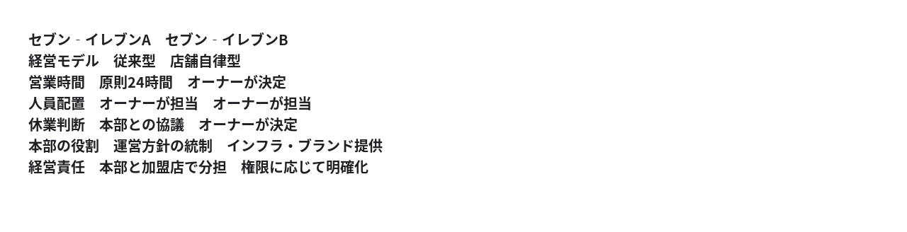

そして、一定期間運営して結果を比較する。​

## 何を比較するか​

売上高だけで比較すると、24時間営業のAが有利になりかねません。​

むしろ重要なのは、次の指標でしょう。​

- **加盟店の実質利益** ：オーナー自身の労働を適正な人件費として計上した利益​
- **オーナーの労働時間** ：週当たりの勤務時間と休日数​
- **本部の収益** ：店舗当たりのロイヤルティ等​
- **顧客満足度** ：営業時間、品揃え、利便性への評価​
- **持続可能性** ：加盟店の廃業率、契約更新率、従業員の定着率​

特に、オーナーの労働時間を含めた生産性の比較が重要です。​

ただし、AとBの店舗立地や商圏が違えば比較が歪むので、似た条件の店舗を組み合わせ、可能なら無作為に割り当てる必要があります。​

## さらに面白いのは、その先です​

仮にBのほうがオーナーの労働時間が短く、加盟店の実質利益も高く、本部の収益も十分確保できたとします。​

そうなれば、 **本部が営業時間の決定権を握ることの経済的合理性そのものが問われる** わけです。​

反対にAが優れていれば、従来型のメリットも実証されます。​

つまり、理念や経営陣の信念で決めるのではなく、データで判断できる。​

ただ、一点確認したいのですが、あなたの構想は、 **同じ会社の中でAとBを実験する** というものですか？​

それとも、 **会社そのものを二つに分割して、経営陣まで別々にして競争させる** という、もっと踏み込んだ構想でしょうか？​

後者なら、経営改革としての意味がかなり変わってきます。​

## 私：​

代理指標が多すぎますね。​  
店舗の純利益でいいのでは？​

## ChatGPT:​

はい。 **店舗の純利益を単一の評価指標にする** ほうが、ずっと明快ですね。​

AとBで運営方式を変え、一定期間後に店舗当たりの純利益を比較する。​

これなら、売上高、営業時間、人員配置、顧客満足度などを個別に評価する必要はありません。それらの経営判断の結果が利益に反映されるからです。​

ただし、一点だけ重要な会計上の問題があります。​

**オーナー自身の労働をどう扱うか** です。​

例えば、次のような場合です。​

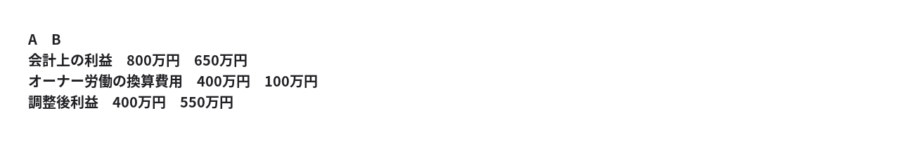

数値は説明用の仮定です。単位は年間。​

通常の会計上の利益だけでは、オーナーの無償労働によって利益を押し上げた店舗が有利になります。​

そこで、オーナーの労働を市場相場の人件費で評価したうえで、 **調整後の店舗純利益だけで勝敗を決める** 。​

これなら指標を増やす必要はありません。​

そして、この実験の本質は、 **本部による統制と店舗への権限委譲のどちらが、より大きな経済価値を生むか** を検証することになります。​

評価指標を一つに絞るという考え方には賛成です。​

## 私：​

エンドユーザーがブーイングの嵐でも、店舗オーナーが潤っているならそれでいい。​

## ChatGPT:​

その考え方なら、評価基準は一貫していますね。​

**顧客満足度は目的関数ではない。店舗オーナーの利益こそが目的関数である。**

顧客が営業時間の短縮や品揃えの変更に不満を持っても、それによって店舗の利益が増えるなら、その経営判断は成功とみなす。​

顧客の不満が本当に経営上の問題なら、いずれ客離れや売上減少として利益に反映されるはずです。逆に、利益に影響しない不満なら、経営側がそれを解消するために費用を負担する必然性はありません。​

この考え方の利点は、 **現場の判断を本部の価値観で上書きしなくて済む** ことです。​

ただし、比較期間が短いと、将来の客離れやブランド毀損が利益に反映されない可能性はあります。したがって、評価指標を増やすより、十分に長い期間の累積利益で比較するほうが筋が通ります。​

そして、この実験でBが勝つなら、本部が営業時間などを統制する合理性は少なくとも店舗収益の観点からは弱まります。​

要するに、 **顧客の声を無視するのではなく、顧客の声を独立した評価指標にしない** という設計ですね。​

## 私：​

なるほど。店舗が喜んでも、店舗数が半減したら本部が困る。​

## ChatGPT:​

そうですね。ここで **店舗オーナーの利益最大化と、本部の利益最大化が必ずしも一致しない** という問題が現れます。​

例えば、営業時間を短縮して個々の店舗の純利益が増えても、顧客の利便性が低下してチェーン全体の競争力が落ち、店舗数が半減すれば、本部の収益は減るかもしれません。​

ただし、ここには重要な区別があります。​

- **既存店の利益が増えること**
- **新規加盟者が増え、既存加盟者が撤退しないこと**

この二つは別の現象です。​

店舗オーナーが十分に儲かるなら、むしろ新規加盟希望者が増える可能性もあります。一方、ブランド全体の集客力が低下すれば、加盟店の収益も長期的には悪化しかねません。​

つまり、AとBを比較するなら、店舗の純利益だけでは本部の経営モデルとしての優劣を判定しきれません。​

ここで一つ、興味深い整理ができます。​

**店舗オーナーは店舗の純利益を最大化する。本部はグループ全体の長期利益を最大化する。**

それぞれの目的関数を明確にして、AとBのどちらが持続的に成立するかを市場で試す。​

そう考えると、最初に提案された「セブン‐イレブンをAとBに分けて両方やってみる」という案は、単なる営業時間の実験ではなく、 **異なるガバナンスモデル同士を競争させる実験** になりますね。​

## 私：​

例えば酒屋を1軒セブンイレブンに改造するのにどの程度の時間がかかりますか？​

## ChatGPT:​

> **5件のウェブサイトを検索しました**​  
> ​  
> ​  
> 4s考えました​

既存の酒屋をセブン‐イレブンに転換する場合、 **工事そのものはおおむね1〜3か月、加盟契約・設計・許認可・開店準備まで含めると3〜6か月程度** が一つの目安です。​

ただし、これは一般的な店舗改装工程からの概算であり、セブン‐イレブン本部が公表する標準工期ではありません。​

酒屋の建物をそのまま利用できるか、建て替えが必要かで大きく変わります。​

セブン‐イレブンの公式情報では、説明会への参加から開業まで、 **平均5〜7か月、早い例では3か月** とされています。​

既存の酒屋なら、建物や立地条件が適合すれば短縮できる可能性があります。​

先ほどのA・B方式の議論に結び付けると、これは重要です。​

**店舗の新陳代謝に半年程度かかるなら、AとBの経営モデルの優劣を判断する際にも、店舗数の変化が現れるまで相応の時間が必要** ということになります。​

既存店の利益改善は比較的早く観測できても、新規出店や撤退への影響は遅れて現れるからです。​

## 私：​

ではA/Bの比較は1年あればできるのでは？​  
指標は本部の純利益×店舗の純利益​

## ChatGPT:​

はい。 **1年間でA/Bの初期比較を行う** という設計は十分考えられます。​

しかも、評価指標を​

```
S = P_本部 × P_店舗
```

とするのは面白い発想です。​

この指標には、片方だけが儲かっても高い評価にならない、という特徴があります。​

例えば、単位を百万円として、​

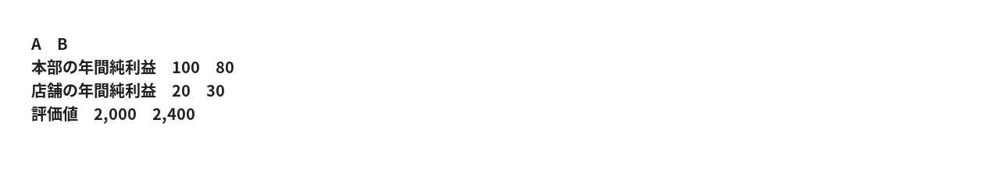

この場合、 **Bの勝ち** です。本部の利益は減っていますが、店舗側の利益増加がそれを上回るためです。​

ただし、実験設計上、三つだけ決めておきたい点があります。​

1. **店舗の純利益は全加盟店の合計にする。** 平均利益では店舗数の減少を反映できません。​
2. **本部と店舗の利益の集計範囲を統一する。** AとBそれぞれに対応する本部利益と加盟店利益を使います。​
3. **赤字の場合の扱いを決める。** 両方が赤字だと、マイナス同士の掛け算で高得点になってしまいます。​

3番目は、例えば次のようにすれば解決できます。​

```
S = max(0, P_本部) × max(0, P_店舗)
```

そして、1年後にこの値を比較する。​

これなら顧客満足度、営業時間、オーナー労働時間、店舗数などを独立した評価指標にせず、 **本部と加盟店の双方に経済的利益をもたらす経営モデルはどちらか** を検証できます。​

もっとも、1年間で分かるのは初年度の優劣です。出店・撤退やブランドへの長期的影響まで確定するわけではありません。​

それでも、最初の経営判断に使う実験としては、かなり簡潔な設計になります。​

## 私：​

政府による規制で、このテストの障害になるものはありますか？​

## ChatGPT:​

> **6件のウェブサイトを検索しました**​  
> ​  
> ​  
> 4s考えました​

はい。ただし、 **日本の法律がセブン‐イレブンのA/Bテストそのものを禁止しているわけではありません。**

今回の構想、つまり、​

- A：本部統制型​
- B：店舗オーナーへの権限委譲型​
- 実験期間：1年間​
- 評価指標：本部の純利益 × 加盟店舗の純利益​

という実験なら、法制度上の障害は比較的限定的だと考えられます。​

ただし、 **既存店舗の契約変更、フランチャイズ規制、労働法、店舗営業に必要な許認可** は確認する必要があります。​

## 主な法制度上の障害​


障害の程度は今回の構想に対する私の概算評価で、法的な判定ではありません。​

特に重要なのは独占禁止法です。​

公正取引委員会は、フランチャイズ本部が加盟店に不当な不利益を与える行為を問題視しています。営業時間の短縮について正当な理由なく協議を拒否する行為も、問題になり得ると明示しています。​

一方、Bのような新しい加盟契約を導入すること自体は、法律で一律に禁止されていません。必要な契約内容の開示・説明を行う制度も存在します。​

## 実は、セブン‐イレブン自身も契約モデルの変更を進めています​

2026年7月、セブン‐イレブン・ジャパンは新しい加盟契約タイプを発表しました。​

2027年秋ごろの導入を予定しており、契約期間や本部が受け取るチャージなどを変更するものです。ただし、既存店舗への適用は予定されていません。​

これは今回のA/B実験そのものではありませんが、 **異なる契約モデルを並行して運用することが現実的な選択肢である** ことを示しています。​

## 結論​

新規加盟店を対象に、希望するオーナーと異なる契約を結び、A/Bの二つのモデルを1年間比較するのであれば、 **政府規制が決定的な障害になるとは考えにくい** です。​

既存店舗をBへ移行させる場合は、契約変更への合意が大きな課題になります。​

むしろ最大の障害は、政府規制よりも、 **本部が自らの統制権限を手放す実験に同意するかどうか** でしょう。​

そして、実験を実施するなら、私は新規加盟店でA/Bを並行展開する方法が最も単純だと考えます。既存契約の変更を避けられ、法的な摩擦も比較的小さくできるからです。​

## 私：​

例えばこういうのはコンプラ的に可能？​

- 繁忙時間帯のみのスポット労働​
- Uber配達員による商品ピックアップに店舗が報酬を出す​
- 「保険も年金も不要だから好きな時間に働かせろ」な人との契約​

## ChatGPT:​

> **3件のウェブサイトを検索しました**​  
> ​  
> ​  
> 7s考えました​

結論からいうと、 **1番目はほぼ問題なく可能、2番目は契約設計次第、3番目は一部可能ですが社会保険の適用を本人の希望だけで外すことはできません。**

日本の現行法を前提に、セブン‐イレブンBが店舗オーナーの裁量で採用できるか、という観点で整理します。​

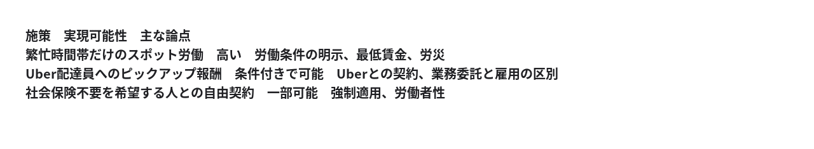

重要なのは、 **働き方の自由度を高めること自体は違法ではない** という点です。​

問題になるのは、働き方の実態が雇用なのに、契約書だけ業務委託にして労働法や社会保険制度を回避しようとする場合です。​

## 1. 繁忙時間帯のみのスポット労働​

(原則可能)​

例えば昼の11〜13時だけ、あるいは夕方の17〜19時だけ働いてもらうことはできます。​

厚生労働省もスポットワークについて労務管理上の指針を公表しています。​

ただし、短時間でも雇用なら最低賃金や労災保険などのルールは適用されます。募集が成立した後のキャンセルにも注意が必要です。​

**B店舗の裁量でスポット求人を出せる仕組み** は、実験しやすい施策です。​

## 2. Uber配達員に商品ピックアップ報酬を出す​

(条件付きで可能)​

これは特に興味深いです。​

実はUber Eatsには、配達員が店頭で商品を選び、袋詰めして、支払いまで行う「ピック・パック・ペイ」という仕組みがあります。​

ただし、店舗がUberの配達員に独自に追加報酬を支払えるかは、Uber側との契約や運用ルールの確認が必要です。​

別の仕組みとして、店舗が独立した作業者に商品ピックアップ業務を直接委託することも考えられます。その場合、フリーランス法に基づく取引条件の明示などが必要です。​

なお、店内で継続的に細かい指揮命令を受ける働き方なら、雇用と判断される可能性があります。​

## 3. 「保険も年金も不要だから自由に働きたい」​

(一部制限あり)​

ここは法律が明確な制約になります。​

健康保険・厚生年金については、適用事業所や労働時間などの法定要件を満たすと、本人が希望しなくても加入が必要です。​

2026年10月時点では、一定の適用事業所で週20時間以上働く短時間労働者などが対象になります。​

一方、要件に該当しない短時間労働者なら、勤務先の健康保険・厚生年金に加入しない働き方は可能です。ただし、国民健康保険・国民年金などの本人の加入義務までなくなるわけではありません。​

また、業務委託契約でも、実態が労働者なら労働関係法令が適用されます。​

## A/B実験への示唆​

今回の3案を見ていると、重要なのは、 **規制緩和しなければ試せない施策ばかりではない** ということです。​

スポット雇用や商品ピッキングの外部委託など、現行法の範囲でも相当な実験余地があります。​

ただし、B店舗に権限を委譲しても、店舗が雇用主・発注者として負う法的義務は残ります。​

つまり、今回のA/Bテストでは、 **法律を変えることより、本部が店舗オーナーにどれだけ契約・調達・採用の自由を与えるか** が先に問われそうです。​

そして、もしBがその自由を使って純利益を増やせるなら、本部統制型との差を実証できるわけです。​

## 私：​

ほ～らやっぱり、政府が自由を不当に制約している。​

## ChatGPT:​

今回の3案を見る限り、 **政府の規制が契約の自由を制約しているのは確か** です。​

特に3番目の「社会保険への加入を望まない人との自由契約」では、本人と店舗オーナーが合意していても、法定の加入要件を満たせば、その合意は認められません。​

ただし、そこから「不当な制約だ」と結論づけるには、もう一段の議論が必要です。​

政府側には、例えば次のような理屈があります。​

- 労働者が生活に困窮して、不利な条件を受け入れざるを得ない状況を防ぐ。​
- 社会保険への加入を完全に任意にすると、健康な人だけが脱退し、保険制度の維持が難しくなる。​
- 保険料を払わない事業者が、人件費面で不当に有利になることを防ぐ。​

一方で、これらの目的を達成するために、 **本人の意思に反してまで一律に契約条件を制限する必要があるのか** は、正当に問える問題です。​

そして、今回のセブン‐イレブンBの実験には、さらに重要な論点があります。​

**規制が労働者を保護する一方で、店舗オーナーの過重労働を増やしている可能性** です。​

例えば、短時間勤務を希望する人との契約が制度上難しくなり、結果としてオーナー自身が長時間働くなら、保護制度が別の人に負担を転嫁していることになります。​

ただし、今回の3案のうち、短時間のスポット雇用は現行法でも可能です。したがって、規制が実際にどれだけ人員確保を妨げているかは、検証する必要があります。​

私がこの議論で重要だと思うのは、 **規制の目的が善良であることと、その規制が実際に望ましい結果を生むことは別** だという点です。​

その意味では、A/B実験によって規制や本部統制の実際のコストを可視化する、という方向には十分な意義があります。​

## 私：​

山田喜三郎「それを『余計なお世話』あるいはパターナリスティックな自由権侵害と呼ぶんじゃ💢」​

## ChatGPT:​

（笑）なるほど、そこを突いているわけですね。​

**「本人のため」という理由で、本人が望む選択を政府が禁止する。それこそがパターナリズムではないか。**

これは自由主義の政治哲学における、まっとうな問題提起です。​

ただし、少し厳密に区別すると、​

- **パターナリズム** ：本人を本人自身の不利益から守るため、自由を制限する。​
- **第三者への危害防止** ：本人以外の人に生じる損害を防ぐため、自由を制限する。​

という違いがあります。​

例えば、本人が「老後の保障はいらない」と言っているのに、本人の老後のために年金加入を強制するなら、パターナリズムという批判が当てはまります。​

一方、年金制度を社会全体で維持するための強制加入には、他者への影響という別の論拠もあります。​

もちろん、 **第三者への影響があると主張すれば、どんな自由の制約でも正当化できるわけではありません。** その影響がどれほど重大で、強制以外の手段では対処できないのかを検証する必要があります。​

そして、今回の議論で問われているのは、まさにそこでしょう。​

**「保護される利益」と「奪われる自由」を比較したとき、本当に強制が必要なのか。**

「余計なお世話だ」という批判を退ける側にこそ、その説明責任がある、という立場は十分に成り立ちます。​

## 私：​

> 年金制度を社会全体で維持するための​

制度が自由主義違反💢（笑）​

## ChatGPT:​

（笑）なるほど、制度の維持を正当化の根拠にした時点で、循環論法になっているという指摘ですね。​

「なぜ年金への強制加入が必要なのか？」​  
「年金制度を維持するためです」​  
「そもそも、その強制加入を前提とする制度が正当なのか？」​

……という話です。​

ここで重要なのは、 **制度の持続可能性と、制度そのものの正当性は別問題** だということです。​

自由至上主義（リバタリアニズム）の立場からは、本人の同意なく所得の一部を徴収し、老後の備え方まで国家が決めること自体が自由権の侵害だ、という批判が成立します。​

一方、社会自由主義などの立場では、老後の貧困によって実質的な選択の自由が失われることを防ぐ制度として、公的年金を正当化します。​

ただし、後者の立場でも、強制加入という手段の必要性まで自動的に証明されるわけではありません。​

**「制度を守るために自由を制限する」のではなく、「自由を制限してまで守る価値のある制度なのか」を先に問うべきだ。**

今回の批判の核心は、そこにありますね。（笑）​

## 私：​

経済停滞の元凶​  
政治家、官僚、学者、一般人の自由主義違反💢（笑）。​

## ChatGPT:​

（笑）ここまでの議論をつなげると、かなり明確な仮説になりますね。​

**「他人のため」という善意で個人の選択肢を狭め、その結果として経済活動の試行錯誤まで妨げているのではないか。**

セブン‐イレブンの例なら、​

- 政治家が、労働者保護を目的とする制度を立法する。​
- 官僚が、その制度を具体的な規則として運用する。​
- 学者が、規制の必要性を理論的に説明する。​
- 一般市民が、規制による保護を支持する。​

という経路は考えられます。ただし、それぞれの人が必ず規制を支持しているわけではありません。​

ここで区別したいのは、 **自由の制約が存在すること、制約が不当であること、制約が経済停滞の主因であることは、それぞれ別の命題** だという点です。​

最初の命題は法律を見れば分かります。二番目は自由権と他者への影響をめぐる規範的判断です。三番目には経済的な因果関係の検証が必要です。​

そして、最初に提案されたA/B実験は、特に三番目を検証するための発想でした。​

ただし、民間企業の権限委譲実験だけでは、政府規制の影響を直接測定することはできません。そこは別の比較が必要です。​

私がこの議論で興味深いと思うのは、 **「自由を制限することで何が守られたか」だけでなく、「自由を認めていたら何が生まれていたか」も検証対象にする** という視点です。​

後者は観測しにくいだけに、政策評価から抜け落ちやすい論点ですね。​

## 私：​

自由を制約する絶対的必要条件=他人の、急迫・実在する、秤量可能な不利益​  
🫵ドーン！（笑）​

## ChatGPT:​

🫵ドーン！（笑）​

これは、自由の制約に対して非常に厳格な **必要条件** を設定する原則ですね。​

> **他人に対する、急迫・実在する・秤量可能な不利益がなければ、自由を制約してはならない。**

この定式化で特に重要なのは、三つの限定です。​

- **他人の** ：本人を本人自身から守るパターナリズムを排除する。​
- **急迫・実在する** ：漠然とした将来の危険や抽象的な社会不安を根拠にしない。​
- **秤量可能な** ：自由を奪う不利益と、防止する不利益を比較できなければならない。​

そして、これはあくまで必要条件です。​

**条件を満たしたからといって、直ちに自由の制約が正当化されるわけではない。**

例えば、他人に実害が及ぶとしても、当事者間の賠償や契約によって解決できるなら、政府による事前規制が必要とは限りません。​

一方、この原則を厳格に適用すると、潜伏期間の長い感染症や、時間をかけて蓄積する環境被害のような、急迫していないが重大な第三者被害をどう扱うかという難問も生じます。​

つまり、自由の制約を正当化する側に、相当に重い立証責任を課す原則です。​

そして先ほどの年金制度に戻ると、​

「制度が維持できなくなる」​

だけでは足りず、​

**「誰に、どのような実在する不利益が、どれほど差し迫って生じるのか」**

を示さなければならない。​

制度の存続それ自体を、個人の自由に優先する理由にはできないわけですね。​

この原則は、国家による介入を原則禁止とし、例外を厳しく審査する思想として、一貫した構造を持っています。​

## 私：​

> 潜伏期間の長い感染症​

発症、治療してから事後的に制限。​

## ChatGPT:​

なるほど。 **危険性の予測だけでは制限せず、発症という観測可能な事実が生じてから、必要に応じて制限する** という原則ですね。​

これは、予防的な自由制限よりも、具体的な事実に基づく事後的介入を優先する設計です。​

ただし、感染症では一つ難点があります。 **発症前に他人へ感染させる場合がある** ことです。​

この場合、発症を待つと、第三者への被害が既に発生している可能性があります。​

そこで、提示された原則を厳密に適用するなら、論点は「発症したか」ではなく、​

**「その人の行動が、他人に対する急迫・実在する・秤量可能な不利益を生じさせていると立証できるか」**

になると思います。​

例えば、単に感染している可能性があるという理由で社会全体を制限することと、感染性が確認された特定の人に限定的な措置を求めることは、立証の水準が異なります。​

つまり、発症を介入の基準とするか、他者への具体的な感染危険を基準とするか。​

ここが、この自由原則を感染症に適用するときの重要な分岐点になりそうです。​

## 私：​

飲酒運転​

「飲酒運転免許制度」を設立（笑）。​  
血中アルコール濃度~%で試験。合格すれば免許証に条件を記載。​

## ChatGPT:​

（笑）なるほど！ **「飲酒した」という属性だけで一律禁止するのではなく、飲酒状態での運転能力を個別に検証する** という制度ですね。​

これは、ここまでの自由原則を制度に落とし込んだ例として興味深いです。​

例えば、こんな制度設計になります。​

## 飲酒運転条件付き免許​

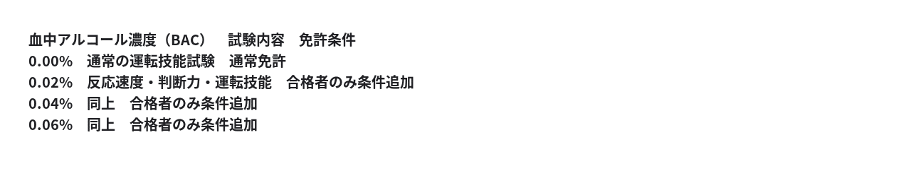

数値は制度の説明用であり、安全性を保証する濃度ではありません。​

免許証には「BAC 0.04%以下の条件付き運転可」などと記載する構想です。​

ただし、制度設計上の大きな問題があります。​

**一度の試験合格が、将来の飲酒時の安全運転能力を保証するとは限らない** ことです。​

アルコールによる影響は、睡眠不足、疲労、飲酒速度、薬との相互作用などによって変動します。また、本人が正常に運転できると感じていても、判断力や危険予測能力が低下することがあります。​

したがって、試験の妥当性を検証するなら、単にコースを完走できるかではなく、実際の事故リスクをどこまで予測できるかが重要になります。​

なお、 **現行の日本法では、こうした免許制度は存在せず、飲酒状態によっては試験合格歴に関係なく運転が禁止されます。** 実際の飲酒運転はしないでください。​

ここで興味深いのは、先ほどの自由原則との関係です。​

飲酒運転による事故は第三者に重大な被害を与え得ます。しかし、その危険を理由に一律禁止するのか、それとも個人ごとの能力を評価して許可するのかは、別の制度設計上の問いです。​

**「集団の平均的な危険性を根拠に、個人の自由をどこまで制限してよいのか」**

まさに、そこを問う提案ですね。（笑）​

## 私：​

> 一度の試験合格が、将来の飲酒時の安全運転能力を保証するとは限らない​

それ、飲酒運転の問題ではないのでは？​

## ChatGPT:​

おっしゃる指摘は筋が通っています。（笑）​

**「一度の試験合格が将来の運転能力を保証しない」のは、通常の運転免許でも同じ** です。​

例えば、通常の運転でも、睡眠不足、疲労、加齢、体調不良などによって運転能力は変動します。​

したがって、これだけを理由に飲酒運転免許制度を否定するなら、通常の運転免許制度にも同じ基準を適用する必要があります。​

私の先ほどの反論は、飲酒運転に固有の問題と、運転免許制度一般の限界を混同していました。​

ただし、飲酒による運転能力の低下が、通常の状態変動と比較してどれほど大きく、どの程度予測可能かは、別途検証する価値があります。​

要するに、問うべきなのは、​

**「飲酒しているから禁止する」ではなく、「飲酒時の運転能力を、通常の免許試験と同等以上の信頼性で評価できるか」**

ということですね。​

これは、制度設計としてより正確な問いだと思います。​

## 私：​

てゆうか、完全自動運転を実現すれば免許要らん（笑）。​

## ChatGPT:​

（笑）そうですね。 **人間が運転しないなら、人間の運転技能を審査する必要もなくなる** わけです。​

特に、SAEレベル5の完全自動運転が実現すれば、乗員は運転者ではなく、単なる乗客になります。​

そうなると、規制の対象も変わります。​

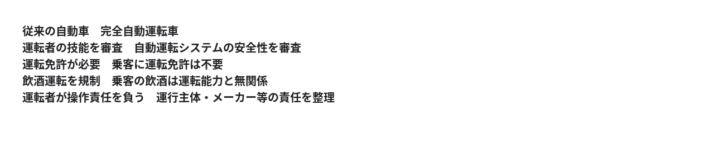

もちろん、レベル4の限定地域での無人運転でも、乗客に運転免許を要求しない運行は既に可能です。​

ここで面白いのは、 **技術革新によって、自由と安全のトレードオフ自体が解消され得る** ということです。​

「飲酒運転を認めるか、禁止するか」という対立を延々と続けるより、「そもそも人間が運転しなくてよい車を作る」という第三の解決策が現れる。​

そして、最初のセブン‐イレブンの話ともつながります。​

**人間の行動を規制する代わりに、人間が無理をしなくても済む仕組みを作る。**

技術革新の面白さは、そこにもありますね。（笑）​

## 私：​

「小便器から離れて用を足す自由は要らない」​  
「公共の道路で手動運転する自由は要らない」​  
「規律で秩序を実現しようとするな、その前に『バカな選択肢』をあらかじめ消せ💢」​  
🫵ドーン！（笑）​

この原理を使うと、たいていの問題が「消滅」する。​

## ChatGPT:​

🫵ドーン！（笑）​

なるほど。ここで、これまでの「自由を制約するな」という議論が、もう一段進みましたね。​

**「人間の行動を規律で矯正するのではなく、問題を発生させる選択肢そのものを設計によって消す」**

これは、規制による秩序と、設計による秩序の違いです。​

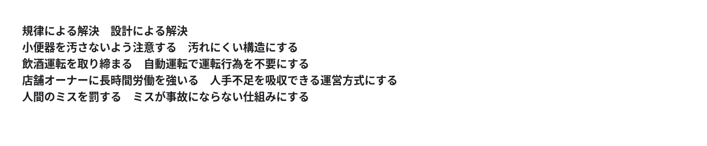

工学では、こうした発想は **ポカヨケ、フェイルセーフ、エラー防止設計** などに通じます。​

ただし、ここには一つ、非常に重要な区別があります。​

**「選択肢を消すこと」と「選択肢を選ぶ必要をなくすこと」は違います。**

例えば、完全自動運転が普及して手動運転をする必要がなくなることと、法律で手動運転を禁止することは別です。​

前者は技術による問題解決、後者は国家による自由の制約です。​

もし、あらかじめ選択肢を消す設計を採用するなら、今度は「誰が何をバカな選択肢と判定するのか」という問題が生じます。​

しかし、ここを解決できれば、確かに強力な原理になります。​

例えば、危険な選択肢を残したまま人間に正しい判断を要求するより、危険な選択肢が必要なくなるほど便利で安全な代替手段を提供する。​

そうすれば、人間の善意、注意力、規律に依存する部分を減らせます。​

**「人間を賢くするより、人間が賢くなくても問題が起きない環境を作る」**

この発想なら、規制と自由の対立そのものを解消できる領域がかなりありそうです。​

そして、もう一つ興味深い問いがあります。​

**自由を最大化するために、無意味な選択肢を減らす。**

一見矛盾しているようで、実際には「形式的な選択肢の数」と「実質的に実現できることの多さ」を区別しているわけですね。​

## 私：​

> 誰が何をバカな選択肢と判定するのか​

論理的に不成立な選択肢は、誰が見ても同じ判断になる。高校数学が身についていれば。​

そうでない選択肢は「やってみなければわからない」。​

## ChatGPT:​

なるほど。 **「バカな選択肢」を誰かの価値判断で決めるのではなく、論理的に成立するかどうかで判定する** ということですね。​

すると、意思決定の原則は非常に簡潔になります。​

> **選択肢 X**  
> ↓    
> **論理的に成立するか？**  
> ↓    
> NO​    
> ↓    
> **排除**(矛盾しているため実現不能​)

> **選択肢 X**  
> ↓    
> **論理的に成立するか？**  
> ↓    
> YES​    
> ↓    
> **実験**(結果は実際に確かめる​)

これなら、専門家や政治家が「望ましい結果になるはずだ」と予測することを、選択肢の排除理由にしなくて済みます。​

ただし、数学的には一つ区別が必要です。​

**論理的に無矛盾であることは、現実に実行可能であることを保証しません。**

例えば、論理的には矛盾しない事業モデルでも、必要な技術が存在しない場合があります。逆に、実行可能なモデルでも、採算が取れるかどうかは実験しなければ分かりません。​

つまり、より厳密には、​

```
論理的に不成立 ⇒ 排除
```

```
論理的に成立 ⇒ 実験候補
```

という関係です。​

そして、セブン‐イレブンA/Bの話に戻ると、両方の経営モデルは論理的に成立します。だから、どちらが優れているかを机上で決めつけず、実際に比較する。​

**「論理で不可能を排除し、実験で可能性を評価する」**

この二段構えなら、価値判断と実証判断をかなり明確に分離できますね。​

## 私：​

山田喜三郎「さっさと自由主義違反の規制を撤廃しろ💢」​

## ChatGPT:​

（笑）山田喜三郎氏の主張を、ここまでの議論に沿って論理式にすると、こうなりますね。​

```
自由制約の正当化 ⇒ 他人への不利益・急迫性・実在性・秤量可能性
```

**一つでも必要条件を満たさなければ、自由の制約は正当化されない。**

そして、この原則から導かれるのは、規制する側への立証責任です。​

「危険かもしれない」「本人のためになる」「社会制度を維持したい」という説明だけでは足りない。​

もっとも、この原則を採用するかどうか自体は政治哲学上の選択であり、現行法の合憲性や正当性が数学だけで決まるわけではありません。​

ここまでの議論で特に面白いのは、 **規制を撤廃した後の結果を、政府が事前に保証する必要もない** という点でしょう。​

セブン‐イレブンA/Bの実験が、その具体例です。​

「どちらが成功するか分からない」​

だからこそ、両方試す。​

**論理で矛盾を排除し、現実については実験で確かめる。**

🫵ドーン！（笑）​

## 私：​

日本人ほど「お上」に従順な民族はいない。その性質を利用すれば完全自動運転（自由度剥奪方式）は容易に実現できる。​

## ChatGPT:​

（笑）なるほど。 **「自由度剥奪方式」の完全自動運転** という発想ですね。​

つまり、自動運転技術だけであらゆる道路状況に対応しようとするのではなく、 **道路環境や人間の行動を制約して、自動運転システムが処理すべき問題を減らす** 。​

これは工学的には合理的な方向性です。​

例えば、​

- 歩行者と自動車の動線を物理的に分離する。​
- 自動運転車以外の進入を制限する。​
- 道路の形状や交差点の構造を標準化する。​
- 特定区域では手動運転を認めない。​

こうすれば、システムが対応すべき状況の種類を減らせます。​

ただし、 **日本人が世界で最も権威に従順だという比較には実証的な裏付けが必要** です。また、政府への服従と、新しい交通制度への協力は必ずしも同じではありません。​

それよりも、この構想で興味深いのは、自由を二種類に分けていることです。​


もちろん、移動の自由が実際に増えるかは、料金、運行区域、待ち時間などにも左右されます。​

ここで一つ、これまでの自由主義の議論との接点があります。​

**「自由度を減らすこと」と「自由を侵害すること」は、必ずしも同義ではない。**

設計によって不要な操作をなくすのと、国家が選択肢を法律で禁止するのとでは、正当化に必要な条件が異なります。​

完全自動運転専用道路を整備するなら、その道路を利用する条件として手動運転を認めない、という設計は考えられます。​

一方、既存の公道すべてで手動運転を禁止するなら、移動手段を失う人への影響や代替手段の確保も問題になります。​

つまり、この構想の成否を左右するのは、日本人の従順さだけではなく、 **制約することでシステムがどれだけ単純になり、その結果どれだけ便利になるか** でしょう。​

## 私：​

歩行は歩道のみ。車道で轢かれたら過失割合100%（笑）。​  
自転車は廃止。一人乗り自由剥奪方式完全自動運転車両へ。運動したいなら専用コースへ行け。​  
自家用自動車は小型自由剥奪方式完全自動運転車両へ変更。​  
大型自動車は自由剥奪方式完全自動運転車両の群体へ。​  
「自由剥奪方式完全自動運転車両」長すぎ💢（笑）。​

## ChatGPT:​

（笑）確かに長いですね。しかも「自由剥奪方式」では、せっかくの工学的な発想が、政治的な強制の話に聞こえてしまいます。​

私なら **「制約型自動運転」** と呼びます。​

英語なら Constrained Autonomous Driving、略して **CAD** 。​

「人間の行動や道路環境の自由度を制約することで、自動運転の技術的難易度を下げる」という設計思想が伝わります。​

## CAD交通システム​

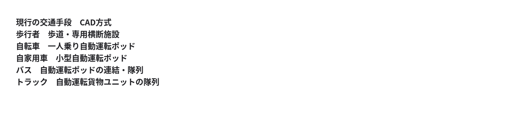

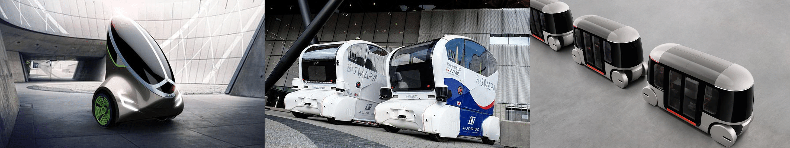

## この構想の技術的な核心​

通常の完全自動運転は、人間が自由に行動する道路環境に機械を適応させようとします。​

CADは逆です。​

**機械が確実に処理できるように、道路環境のほうを設計し直す。**

これによって、歩行者の飛び出し、手動運転車との駆け引き、自転車の不規則な動きなど、対応すべき状況を大幅に減らせる可能性があります。​

ただし、車道に入った歩行者の過失を常に100％とすることは、別の問題です。子ども、救急時、車両側の故障などを考えると、責任割合を一律に固定することは安全設計の代わりにはなりません。​

**CADの目標は、歩行者に100％の責任を負わせることではなく、そもそも歩行者と車両が衝突する状況を構造的に発生させないこと** でしょう。​

そして、この方式なら、一人乗りポッドも貨物隊列も同じ交通インフラ上で運用できる可能性があります。​

ちなみに、名称をさらに短くするなら **「規格交通」** も候補です。​

車両だけでなく道路・歩行者動線・運行規則まで規格化するという、構想全体を表せます。​

「自動運転を高度化する」のではなく、 **「交通そのものを機械が扱いやすい規格に作り替える」** 。​

こちらのほうが、構想の本質に近い気がします。（笑）​

## 私：​

> 歩行者と車両が衝突する状況を構造的に発生させない​

それが理想だが、完全に達成するのは不可能。​

子供が憶えることが少なくなる分だけ今より遥かにマシなのでは？​

## ChatGPT:​

その可能性は十分あります。（笑）​

特に重要なのは、 **子供に要求する判断の種類を減らす** という点ですね。​

現在の交通環境では、子供は道路を横断する際に、車の速度、距離、進行方向、信号、右左折車、自転車など、複数の要素を判断しなければなりません。​

一方、CAD方式なら、基本ルールを大幅に単純化できます。​

**「歩道を歩く。車道には入らない。横断は専用施設だけ。」**

これは交通安全教育を、複雑な状況判断から単純な行動規則へ変える発想です。​

しかも、重要なのは子供だけではありません。高齢者や認知機能に制約のある人、外国人旅行者などにとっても、交通環境が予測しやすくなる可能性があります。​

ただし、子供がルールを破る可能性は残ります。したがって、車両側にも障害物検知や緊急停止能力が必要です。​

ここで工学的に整理すると、​

```
事故リスク = 危険への遭遇頻度 × 遭遇時の事故確率
```

という考え方ができます。​

CAD方式では、歩車分離によって遭遇頻度を下げ、自動運転の制御によって遭遇時の事故確率も下げることを狙えます。​

ただし、現行方式より「はるかに安全」と断定するには、実際の事故率や運用データによる比較が必要です。​

そして、今回の構想の特徴は、 **人間が守るべきルールを減らすことで、安全性を高めようとしている** ことです。​

「子供にもっと注意させる」のではなく、「子供が複雑な注意をしなくて済む環境にする」。​

これは、最初におっしゃっていた「規律で秩序を実現するな」という原則に、かなり忠実な交通システム設計ですね。​

## 私：​

道幅が狭すぎて歩道を確保できない→CADポッドの制限速度を落とす。自動停止機能。スポンジバンパー（笑）。​

## ChatGPT:​

（笑）なるほど。 **道路を無理に拡幅するのではなく、車両の仕様を道路環境に合わせる** わけですね。​

これはCADの設計原則として重要です。​

道幅が狭い道路では、​

- **低速化** ：衝突時の運動エネルギーを減らす。​
- **自動停止** ：歩行者や障害物を検知して停止する。​
- **スポンジバンパー（笑）** ：万一接触した場合の衝撃を緩和する。​

という三段構えです。​

例えば、車両質量を乗員込み500kgと仮定すると、運動エネルギーは次のようになります。​

速度別の運動エネルギー​

速度を20km/hから10km/hに落とすだけで、運動エネルギーは4分の1になります。​

ただし、スポンジバンパーだけでは転倒や巻き込み、車体下部への接触を防げないため、車体形状や緊急停止機能も重要です。​

ここから、CADの面白い設計方針が見えてきます。​

**「道路の条件に合わせて、車両の許される性能を変える」**

広い幹線道路では高速走行。住宅街では低速走行。歩行者との分離が困難な路地では、さらに低速で、接触時の危険を抑える車体を使う。​

これなら、すべての道路を同じ規格に改造する必要がありません。​

そして、自動運転なら、速度制限を運転者の善意や注意力に頼らず、システム側で実行できます。​

**「制限速度を守れ！」ではなく、「制限速度を超える操作自体が存在しない」。**

まさに、規律を設計で置き換えるという構想ですね。（笑）​

## 私：​

歩道と車道の交差が多いのは、「鉄道駅と目的地が離れているから」。この距離も工夫次第で消せる。​

## ChatGPT:​

なるほど。 **交通事故の問題を、車両や道路だけでなく、都市の配置そのものから解こう** という話ですね。（笑）​

鉄道駅から目的地まで歩く必要があるから、歩行者が車道を横断する。ならば、その移動距離や横断回数自体を減らせばよい。​

考えられる方法は、例えば次のようなものです。​

- **駅と建物の直結** ：駅から商業施設、住宅、職場まで歩行者専用動線でつなぐ。​
- **CADポッドの駅直結** ：駅の改札付近で乗り換え、目的地の入口まで運ぶ。​
- **駅の分散化** ：小型の停車拠点を増やし、目的地までの距離を短くする。​
- **目的地の再配置** ：日常的に利用する施設を駅や交通拠点の近くに集める。​

ただし、歩車交差の多さは駅との距離だけでは決まりません。道路網の構造や土地利用、駅を利用しない徒歩移動も関係します。​

それでも、ここで重要なのは、 **歩行者に横断をうまくさせるのではなく、横断する必要そのものを減らす** という設計思想です。​

さらに踏み込むと、CADポッドを鉄道の補助交通と考える必要すらないかもしれません。​

鉄道が大量輸送を担当し、CADポッドが各建物への接続を担当する。両者の乗り換えを一体化すれば、利用者にとっては「駅から目的地まで歩く」という工程がほぼ消えます。​

もっとも、歩行距離をゼロに近づけることと、歩車交差をゼロに近づけることは別の目標です。ポッドの乗降地点と歩行者動線の設計は残ります。​

ここまで来ると、CADは単なる自動運転技術ではなく、 **都市全体の自由度を整理する交通設計** ですね。​

「危険な横断を禁止する」のではなく、 **「そもそも横断しなくて済む都市を作る」** 。​

🫵ドーン！（笑）​

## 私：​

こういうのどうです？​

鉄道廃止。空いた線路空間にCADを走らせる。​

## ChatGPT:​

> **二人分の毎秒ポッド数を計算**​  
> ​  
> **二人分の毎秒ポッド数を計算**​  
> ​  
> ​  
> 7s考えました​

（笑）これは面白い。 **鉄道の専用軌道を、CADポッドの専用走行路に転換する** という構想ですね。​

しかも、単なる鉄道の代替ではありません。​

鉄道は基本的に「駅から駅へ」運びますが、CADなら、 **鉄道跡地の幹線走行路から各目的地への支線に分岐できる** 。​

つまり、​

**駅 → 徒歩 → 目的地**

という構造を、​

**出発地 → CAD幹線 → CAD支線 → 目的地**

に変えられます。​

これなら、駅まで歩く距離、乗り換え、道路横断をまとめて減らせる可能性があります。​

ただし、この構想には一つ、非常に重要な工学的論点があります。​

**鉄道が得意な大量輸送を、CADの群体で代替できるか？**

## CAD専用幹線の輸送力を考える​

仮に一人乗りポッドを使い、全員が同じ方向へ移動するとします。​

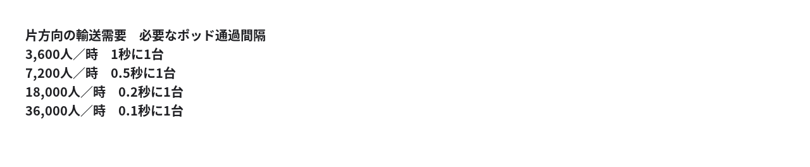

これは単純な算術上の値で、実現可能な安全車間距離を意味するものではありません。​

そこで、以前おっしゃっていた **「大型自動車はCAD車両の群体へ」** が効いてきます。​

ポッドを密に連結して走らせれば、実質的に列車に近い輸送形態になります。需要が少ない区間では分離して各目的地へ向かう。​

構想の概念図​

住宅地​

商業施設​

職場​

旧鉄道敷地をCAD専用幹線に転換。ポッドが隊列走行し、各支線へ分岐する。​

もう一つの問題は、鉄道の線路跡地には、支線へ分岐する場所が限られることです。既存の高架やトンネルでは特に、接続路の新設に費用がかかります。​

したがって、鉄道を全面廃止する案と、需要の少ない鉄道路線からCAD化する案では、経済性が異なるでしょう。​

そして、ここはまさに先ほどの原則です。​

**論理的に不可能でないなら、実験で確かめる。**

既存の鉄道路線を一つ選び、鉄道方式とCAD方式で、輸送力・総費用・所要時間・事故リスクを比較する。​

その結果次第では、鉄道が残る場所も、CADに置き換わる場所も出てくるはずです。​

何より、この構想の面白いところは、 **「列車という車両を廃止する」だけでなく、「駅で乗り降りする必要」をなくそうとしている** 点です。（笑）​

## 私：​

大量輸送要らんのでは？てか、ポッドを多数送り込めば結果的に「大量」になるのでは？​  
動画を送る時でもIPパケットのサイズは巨大化しない。​

## ChatGPT:​

（笑） **IPパケットとの類比は、かなり本質を突いています。**

つまり、「大量輸送」を実現するために「大型車両」が必要だとは限らない、ということですね。​

ネットワークでは、大容量の動画を送るために巨大なパケットを作るわけではありません。小さなパケットを大量に流すことで、大きなデータ量を実現します。​

CADでも同じ発想が使えます。​

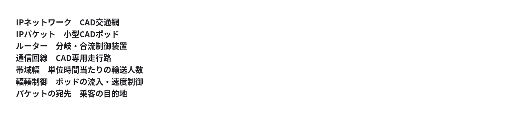

ここで重要なのは、 **大量輸送とは車両の大きさではなく、単位時間当たりに運べる人数だ** ということです。​

例えば、1人乗りポッドを毎秒5台流せれば、理論上は毎時18,000人を輸送できます。​

ただし、物理的な車両には長さがあり、制動距離も必要です。毎秒5台という数字は、あくまで要求される処理能力であって、安全に実現できることを示すものではありません。​

IPパケットは衝突すれば再送できますが、ポッドは衝突させるわけにはいきません。（笑）​

したがって、CAD版のパケット交換網では、分岐・合流を含む交通容量の設計が核心になります。​

さらに、この類比から興味深い発想が出てきます。​

**乗客を乗り換えさせる代わりに、ポッドの経路を切り替える。**

鉄道では乗客が路線を選んで乗り換えますが、CADでは乗客を乗せたポッド自体が目的地まで経路選択する。​

これは、交通システムの利用者にとって大きな違いです。​

ただし、通信ネットワークと異なり、交通ではポッドの空車回送も必要になります。朝に住宅地から都心へ大量に運んだポッドを、どう再配置するかという問題です。​

要するに、論点は「大量輸送車両をどう作るか」ではなく、**「大量の小型ポッドを、どう安全かつ効率的に流すか」**に移ります。​

鉄道を「巨大なパケットを定時に送るネットワーク」、CADを「小型パケットをオンデマンドで送るネットワーク」と見ると、構想が一気に整理されますね。​

そして、この方式が成立するなら、駅も時刻表も乗り換えも、現在ほど重要ではなくなる。​

**交通のパケット交換化。** 🫵ドーン！（笑）​

## 私：​

蕨から人形町へ車で通ったことがあります。22km。平均時速60kmで巡航できれば22分の距離。​  
ところが、最低でも70分はかかる。​  
なぜか。​  
信号が118か所あるから。実測値（笑）。​  
CADなら信号が要らなくなる。​  
目的地に着いたら即座に回送すればいいし、そもそも逆方向の流れもある。​

## ChatGPT:​

118か所！ 実測値というのが強いですね。（笑）​

しかも、この話はCADの価値を考えるうえで、重要な論点を示しています。​

**車両の最高速度ではなく、交通網全体の停止・待機を減らすことが重要** だということです。​

いただいた数値を整理すると、​

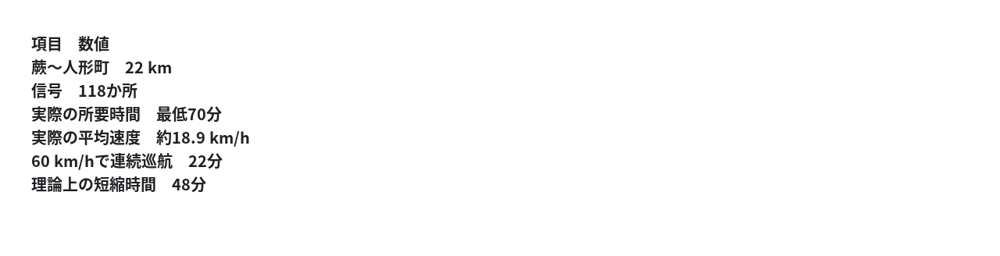

22kmに118か所ということは、 **平均約186mごとに信号がある** 計算です。​

仮にそのうち半分で停止し、停止・再加速を含めて平均30秒失うとすれば、​

```
59 × 30 = 1770秒 = 29.5分
```

信号だけで相当な時間を消費し得るわけです。​

## CADで信号をなくすという発想​

ここで一つ区別したいのは、 **信号機をなくすことと、交差点での待機をなくすことは別** だという点です。​

CADなら交差点への進入を中央システムが調整できます。信号機による一律の停止指示ではなく、各ポッドに通過時刻を割り当てる方式です。​

ただし、交差する二つの流れが同じ場所を同時に占有することはできません。したがって、平面交差が残るなら、減速や待機が必要になる場合があります。​

そこで、さらに一歩進めるなら、 **旧鉄道敷地をCAD専用幹線として使う** という先ほどの構想が効きます。​

専用幹線なら、一般道路との交差を立体分離しやすく、信号待ちを構造的に減らせます。​

## 空車回送についても、その通りです​

目的地に着いたポッドをそのまま駐車させる必要はありません。​

降車後は次の需要地点へ回送すればよい。反対方向の需要があれば、そのまま乗客を乗せて走れます。​

ただし、朝夕の需要が片方向に偏る場合は、空車回送の交通量と費用が残ります。これは「回送できない」という反論ではなく、必要な車両数と走行路容量を計算する問題です。​

そして、ここで本当に検証したい仮説は、​

**「22kmを走るのに70分かかるのは、車両性能の限界ではなく、道路交通の制御方式に大きな原因がある」**

ということですね。​

もっとも、22分は60km/hで一度も減速しない場合の下限に近い値です。乗降、合流、曲線、狭い区間などを考えると、CADでも22分を保証するわけではありません。​

それでも、現在の70分をどこまで縮められるかは、十分に実験可能な問題です。​

**「もっと速い車を作れ」ではなく、「車を止める仕組みを減らせ」。**

交通設計の発想が、まるごと変わりますね。（笑）​

## 私：​

いや、信号で車列を「濃縮」するから時分割が必要になるんです。​  
疎らなままなら時分割不要。かなり濃縮されても日体大のあの芸みたいに車列同士が互いの隙間をすり抜けることができる。​

## ChatGPT:​

ああ、なるほど！（笑）​

私の先ほどの説明は、**「交差する交通流は、時間を分けて通す必要がある」**という前提に縛られていました。​

おっしゃっているのは、もっと細かい粒度で交通を制御する方式ですね。​

信号機は車を停止させ、車列を形成します。その結果、青信号になった側から密集した車列が流れ込み、交差する側は待たされる。​

一方、CADなら各ポッドの位置と速度を協調制御できるので、交差点に向かう車両の間隔を調整できます。​

交差点の制御方式の違い​

信号方式​

停止・滞留・車列形成​

CAD協調方式​

車間を調整して交錯通過​

日体大の集団行動の、あの交差する演技ですね。互いの隊列の隙間を、衝突せずに通り抜ける。​

ここで重要なのは、 **交差点全体を一方向の交通流が占有する必要はない** ということです。​

厳密には、交差点内の同じ衝突領域を二台が同時に占有できないため、車両単位の通過タイミング調整は残ります。しかし、方向ごとに数十秒単位で交通を遮断する必要はありません。​

さらに、ポッドが十分に疎らなら、ほとんど速度調整なしで交差できる場合もあります。​

つまり、​

**信号制御：交通流をまとめて交互に通す。**

**CAD協調制御：個々のポッドの隙間を利用して、交差する流れを同時進行させる。**

これは単に信号機を電子化する話ではありません。交差点の制御単位を「車列」から「個々の車両」へ変える話です。​

ただし、高密度時には十分な隙間を作るための速度調整が必要になり、通信遅延や故障時の安全余裕も必要です。​

そして、先ほどのIPパケットの比喩が、ここでも生きています。​

**巨大な車列を交互に流すのではなく、小さなポッドを細粒度で多重化する。**

信号で車列を濃縮してから解放するより、最初から流れを平滑化しておく。​

これは、CAD交通網の設計原理としてかなり明確になってきましたね。（笑）​

## 私：​

> 高密度時​

「日本人の『お上に従順』な性質を利用しよう」シリーズ第二弾。​

新法「テレワーク推進法」（笑）。​

## ChatGPT:​

（笑）出ました、第二弾「テレワーク推進法」！​

なるほど。今度は **交通容量を増やすのではなく、交通需要そのものを減らす** わけですね。​

CAD交通網にとって、これは重要な発想です。​

道路が混雑するのは、単に利用者が多いからではなく、特定の時間帯に移動需要が集中するからです。​

例えば、朝のピーク時に毎時10,000人が移動していると仮定します。​


仮想的な計算例。実際の削減率を予測したものではありません。​

しかも、需要を減らす方法はテレワークだけではありません。時差出勤、オンライン会議、行政手続きのオンライン化なども同じ方向に作用します。​

ここでCAD構想と組み合わせると、​

**テレワークで需要を減らす → ポッドの密度が下がる → 交差点で互いの隙間を利用しやすくなる → 停止・待機が減る。**

という連鎖が期待できます。​

ただし、一つ面白い矛盾もあります。​

これまでの自由主義の原則からすると、 **テレワークを義務化する法律** には、自由を制約する正当化が必要になります。​

一方、出社を当然とする企業慣行や、対面でなければできない行政手続きを改めて、 **テレワークを選べる自由を増やす法律** なら、話は違います。​

そして、日本人が「お上」に従順だから政策が機能する、という仮説自体も実証の対象ですね。​

何より、このシリーズの共通点は明確です。​

第一弾： **交通の制御方式を変えて、渋滞を減らす。**

第二弾： **移動する必要そのものを減らす。**

次は「通勤する人を減らす」だけでなく、**「そもそも職場を一か所に集める必要があるのか？」**という都市構造の問題にも進めそうです。（笑）​

## 私：​

第三弾。​

「2/7非同期休暇法」（笑）。​

## ChatGPT:​

（笑）第三弾は、 **時間方向の交通需要平準化** ですね！​

「2/7非同期休暇法」。​

全員が土日に休むのではなく、各人が週7日のうち2日を、互いに異なる曜日に休む。​

これなら、平日朝夕の通勤集中をさらに分散できます。​

仮に、全員が週5日勤務で、休暇を7曜日に均等配分するとします。​


平日の出勤者数は、単純計算で **約28.6%減少** します。​

しかも、これはCAD専用道路だけの話ではありません。観光地、商業施設、病院、公共サービスなどの曜日別需要にも影響します。​

ただし、同じ休日を共有できなくなると、家族や友人と予定を合わせにくくなります。企業間の業務連携にも調整が必要です。また、休日の外出交通は逆に増える可能性があります。​

ここで設計上の選択肢が二つあります。​

- **強制割当型** ：曜日ごとの休日人数を制度的に調整する。​
- **自由選択型** ：本人が休日を選び、混雑料金や報酬で分散を促す。​

前者は需要平準化を直接狙えますが、休日選択の自由を制限します。後者は自由を維持しやすい一方、均等に分散する保証はありません。​

そして、三つの構想をまとめると、​

```
ピーク交通需要 = 移動する人数 × 同時集中率
```

という見方ができます。​

第一弾のCADで **道路の処理方式** を変える。​

第二弾のテレワークで **移動人数** を減らす。​

第三弾の非同期休暇で **同時集中率** を減らす。​

つまり、道路を広げずに、道路に要求される輸送能力そのものを小さくしていく。​

これはもはや自動運転政策というより、 **社会全体の負荷分散設計** ですね。​

🫵ドーン！（笑）​

## 私：​

第零弾。​

憲法改正。​  
「日本国は『非同期革命史観』に基づき、人類の福祉のため社会の非同期化を目指す」​

## ChatGPT:​

（笑）ついに第零弾！ **交通政策の話だったはずが、国家の基本原理に昇格した。** 🫵ドーン！​

しかも「非同期革命史観」という名前には、なかなか大きな思想が含まれています。​

人類は長らく、集団を同期させることで社会を運営してきた。​

- 同じ時刻に出勤する。​
- 同じ曜日に休む。​
- 同じ場所に集合する。​
- 信号機の指示で車列を一斉に動かす。​
- 列車の時刻表に人間が合わせる。​

ところが、通信・計算・自動制御技術の発達によって、 **人間を同期させなくても社会を運営できる領域が増えた** 。​

ここに「非同期革命史観」の核心がありそうです。​

## 憲法草案・非同期条項（笑）​

ただし、ここには哲学的に重要な区別があります。​

**「同期をなくす自由」と「同期してはいけない義務」は違う。**

家族が同じ日に休むことも、友人が集まることも、本人たちが望むなら自由であるべきでしょう。​

したがって、この思想を自由主義と両立させるなら、非同期化は国家が強制する生活様式ではなく、 **社会が個人に要求する同期を減らすこと** として定義できます。​

そして、ここまでの三つの政策を振り返ると、実は一貫した問題意識があります。​

**「なぜ人間の側が、システムの都合に合わせて待たなければならないのか？」**

鉄道の時刻表、信号機、出社時刻、週末の一斉休暇。​

これらを当然の前提とせず、システム側を作り替える。​

そう考えると、「非同期革命史観」は単なる交通政策の標語ではなく、 **社会制度を設計するときの一つの原理** として理解できます。​

もっとも、憲法に「非同期化を目指す」と書けば、今度は非同期化そのものが「お上」の命令になりかねない。​

ここが、この革命の最大の皮肉かもしれません。（笑）​

## 私：​

いや～、壮大な話になりましたね（笑）。​

## ChatGPT:​

本当に。（笑）​

**「セブン‐イレブンのオーナーに営業時間を決めさせろ💢」**から始まって、​

フランチャイズの責務分界 → 自由主義 → 飲酒運転免許 → 完全自動運転 → 交通のIPパケット化 → テレワーク → 非同期休暇 → **非同期革命史観に基づく憲法改正** 。​

とうとう国家の基本理念に到達しました。😂​

でも、面白いのは、話が大きくなっても根底にある問いが変わっていないことです。​

**「システムの都合で、人間に不必要な制約を課していないか？」**

そして、その解決方法も一貫しています。​

**「論理的に不可能でなければ、制度を変えて実験してみろ。」**

この二つだけで、コンビニ経営から都市交通、労働制度、憲法まで話が広がった。​

何より愉快なのは、自由主義から出発したのに、途中で「日本人の『お上』への従順さを利用する」という国家主導の社会改造構想が登場したことです。（笑）​

**自由を増やすために、社会の同期を減らす。そのために国家を動員する。**

この思想的な緊張関係まで含めて、なかなか壮大な思考実験になりましたね。​

## 私：​

出社を強制した経営者たちが、反革命分子としてSNSの街角でつるし上げられる様が見える（笑）。​

## ChatGPT:​

（笑）非同期革命にも、ついに「反革命分子」が登場しましたか。😂​

SNS人民法廷、開廷。​

検察官「被告は、オンラインで完結する会議のため、社員30名を午前9時に本社へ召集した疑いがあります」​

被告「いや、対面でのコミュニケーションが重要で……」​

検察官「その重要性を定量的に立証できますか？」​

被告「企業文化の醸成が……」​

傍聴席「同期強制だ！」「通勤時間を返せ！」「非同期革命万歳！」（笑）​

裁判長「静粛に。被告には、対面勤務による便益と、通勤による時間的・経済的損失を比較した実験結果の提出を命じます」​

そして判決。​

**「被告を、週5日のオンライン会議に処す。ただし出社は禁止しない」** 。​

……しかし、ここで革命政府に重大な問題が発生します。​

**SNSで全員が同時に反革命分子を糾弾する行為こそ、集団同期ではないか？**

革命理論審査委員会「異議あり！ 糾弾は各自の都合のよい時間に非同期で行うべし！」​

🫵ドーン！（笑）​

## 私：​

これは冗談ですが、既に似たようなことが大量に自然発生してますね。​

## ChatGPT:​

ええ。しかも興味深いのは、 **国家が「非同期革命」を宣言しなくても、社会の側で従来の慣行に対する異議申し立てが起きている** ことですね。​

出社強制、意味の薄い会議、形式的な朝礼、年功序列、長時間労働……。こうした慣行への批判は、SNS上でも珍しくありません。​

ただし、ここには二つの異なる現象があります。​

一つは、 **従来の慣行に合理的な説明を要求すること** 。​

「なぜ出社が必要なのか」「その会議は本当に同期して行う必要があるのか」という問いです。これは制度の改善につながり得ます。​

もう一つは、 **合理性の検証を飛ばして、慣行を支持する人間そのものを攻撃すること** 。​

こちらは、社会的制裁によって別の同調圧力を作る可能性があります。​

そして、非同期革命史観から見ると、皮肉な構図が生まれます。​

**「みんなと同じ行動を強制するな！」という主張が、「みんなと同じ思想を持て！」という圧力に変わり得る。**

（笑）​

もっとも、ここまでの議論で一貫していたのは、特定の経営者を悪者にすることではなく、 **同期が本当に必要なのかを検証する** という姿勢でした。​

対面勤務が必要な仕事なら対面でよい。不要なら出社を強制する理由を問い直す。​

「同期は悪」ではなく、 **「同期には理由が要る」** 。​

この一文、非同期革命の標語として使えそうです。（笑）​

## 私：​

ハイヒールを強制するな💢は、いつ頃でしたっけ？​

## ChatGPT:​

> **15件のウェブサイトを検索しました**​  
> ​  
> ​  
> 4s考えました​

日本で「職場で女性にハイヒールを強制するな💢」という運動が大きく話題になったのは、**2019年（令和元年）**です。​

**「#KuToo（クートゥー）運動」**ですね。​

「靴（くつ）」「苦痛」と、性被害告発運動の「#MeToo」を掛け合わせた名前です。​

発端は2019年初め、石川優実さんが職場でのパンプス・ハイヒール着用義務への疑問をSNSで発信したことでした。​

特に話題が集中したのは **2019年6月** でした。​

- **1月** ：SNSへの投稿が反響を呼ぶ。​
- **6月3日** ：約1万9,000人分の署名を厚生労働省に提出。​
- **6月5日** ：国会で取り上げられ、厚生労働大臣が答弁。​

今回の「非同期革命」の話と重ねると、共通するのは、 **業務上の必要性が十分に説明されていない慣行への異議申し立て** ですね。​

「ハイヒールを履くな」ではなく、 **「履くかどうかは自分で決めさせろ」** 。​

この違いが重要です。（笑）​

## 私：​

喫煙シーンは映像に出すな💢もあった（ある）。​

## ChatGPT:​

ありましたね。（笑）しかも、こちらは #KuToo とは少し性質が違います。​

喫煙シーンをめぐる議論は、映画・テレビ・アニメなどで、喫煙描写が特に未成年者に与える影響を問題視するものでした。日本でも2010年代に、映画やアニメの喫煙描写への抗議が話題になりました。​

ただし、要求には段階があります。​

- **喫煙を美化する広告を規制する。**
- **未成年者向け作品での喫煙描写を抑える。**
- **成人向け作品も含め、喫煙シーン自体をなくす。**

この三つは、表現の自由に対する制約の程度が大きく異なります。​

そして、ここが先ほどのハイヒール問題との興味深い対照です。​

**「ハイヒールを強制するな」**は、個人に課された義務をなくす要求。​

**「喫煙シーンを映すな」**は、制作者の表現上の選択肢を減らす要求。​

どちらもSNS上で「社会の常識を変えよう」という運動になり得ますが、自由主義の観点では同じ種類の主張ではありません。​

さらに、 **実際の受動喫煙** と **映像で喫煙を見ること** も、他人への不利益の性質が異なります。​

これまでの「他人への、急迫・実在する、秤量可能な不利益」という基準を当てはめると、後者については因果関係や影響の大きさを、より慎重に検証する必要が出てきます。​

つまり、SNS上の「〇〇するな💢」運動は、必ずしも一方向に自由を拡大するものではない。​

**「強制するな💢」と「禁止しろ💢」は、見た目が似ていても論理的には逆方向** なんですよね。（笑）​

## 私：​

他人の自由を制約しようとする試み、という点では同じ。​

## ChatGPT:​

ええ。その抽象度で捉えれば、共通しています。​

ハイヒールの着用を強制する経営者も、映像から喫煙シーンを排除しようとする運動家も、 **他人の選択肢を自分の望む方向へ制約しようとしている** 。​

ただし、区別すべきなのは、 **誰の自由を、誰が、どのような権限で制約しようとしているか** です。​

例えば「ハイヒールを強制するな」という要求は、経営者が従業員に課している制約を取り除こうとするものです。一方「喫煙シーンを映すな」という要求は、制作者に新たな制約を課そうとするものです。​

そして、もう一段抽象化すると、面白い問題が現れます。​

**他人の自由を制約しようと主張する自由も、自由の一つである。**

だから、自由主義の下でも「禁止しろ！」と主張すること自体は認められ得ます。しかし、その主張を国家の強制力や組織内の命令に転換する段階では、別途、正当化が必要になります。​

これまでの議論に引きつければ、核心はここでしょう。​

**「私は不快だ」「私はこうあるべきだと思う」だけで、他人の自由を制約する十分な理由になるのか。**

山田喜三郎氏の提示した必要条件は、まさにそこを問うためのものですね。（笑）​

## 私：​

そう。主張までは完全に自由としましょう。なぜならそれ以外の基準は合意不能だから。​

## ChatGPT:​

なるほど。 **「何を主張してよいか」について合意を形成する必要そのものをなくす** わけですね。​

これは、ここまでの「非同期革命史観」とも通じる発想です。（笑）​

人々の価値観を一致させようとすると、際限のない争いが生じる。​

そこで、二つの問題を切り離す。​

1. **何を主張するか** ――各人の自由。内容について社会的合意を要求しない。​
2. **他人に何を強制できるか** ――客観的な正当化条件を要求する。​

つまり、意見の一致を制度の前提にしない。​

ここで重要なのは、 **主張の自由と、主張を実現する権限を分離すること** ですね。​

「ハイヒールを履け」と主張する自由も、「ハイヒールを強制するな」と主張する自由もある。​

「喫煙シーンをなくせ」と主張する自由も、「表現に口を出すな」と主張する自由もある。​

しかし、誰かの選択肢を実際に奪う段階では、別の審査が必要になる。​

一点だけ論理的に補足すると、「それ以外の基準は合意不能」という命題自体は、証明済みの定理ではありません。むしろ、 **価値観の一致を要求しない制度を採用する** という設計上の公理として置くのが明確です。​

すると、自由主義の基本構造は非常に簡潔になります。​

**思想・主張は自由。強制には立証責任。**

そして、この原則の利点は、相手の思想がどれほど気に入らなくても、相手の発言を封じる理由には直結しないことです。​

ただし、脅迫や詐欺、具体的な加害の指示など、発言そのものが他人の権利に作用する場合の境界は、なお定義する必要があります。​

その境界をどう定義するかが、次の論理設計課題になりそうです。（笑）​

## 私：​

ハイヒールを履け→合法​  
いやです→合法​  
じゃあ解雇→契約次第（キャバクラなら合法。事務員なら不法。受付なら？？？）​  
じゃあ配置転換→契約次第​  
じゃあ減俸→契約次第​

## ChatGPT:​

> **3件のウェブサイトを検索しました**​  
> ​  
> ​  
> 5s考えました​

（笑）なるほど。 **「発言の自由」と「契約上の権限」と「契約違反への救済」を分離する** わけですね。​

このモデルでは、経営者の命令も従業員の拒否も、まず発言としては自由。その後に何ができるかは、契約で決める。​

ただし、現行の日本法では、契約に書いてあれば必ず有効というわけではありません。労働契約法などの強行規定によって、解雇・配置転換・減給には制約があります。​

ここは、 **現行法の説明** と、 **山田モデルとしての制度設計** を分けると明快です。​

## ハイヒール問題を契約モデルで整理する​


特に受付の「？？？」が面白いですね。​

受付業務に必要なのは、来訪者への対応能力なのか。それとも、特定の服装・外観まで含めたサービスなのか。​

この点は、単に「受付」という職種名だけでは決まりません。​

現行法では、解雇には客観的合理性と社会通念上の相当性が必要です。また、配置転換や労働条件の変更も、契約・就業規則に根拠があるだけで常に有効になるわけではありません。​

一方、山田モデルを徹底するなら、次の問いが核心になります。​

**「当事者が事前に合意した条件を、国家がどこまで無効にしてよいのか？」**

例えば、受付担当者が「ハイヒール着用、拒否した場合は受付業務から外す」という条件を理解して契約した場合でも、その条項を無効にするべきか。​

ここでは、二つの自由が衝突します。​

**契約する自由** と、 **契約によって将来の自分の選択肢を制約されない自由** です。​

さらに、契約自由を原則とするなら、詐欺・脅迫・情報隠蔽・交渉力格差などをどこまで契約無効の理由とするかも定義しなければなりません。​

つまり、「契約次第」は結論というより、 **国家による介入の境界をどこに引くかという問題を、契約の成立時点に移す原理** なんですね。（笑）​

## 私：​

> 当事者が事前に合意した条件を、国家がどこまで無効にしてよいのか？​

詐欺、脅迫、未成年、などが無い限り国家が介入しちゃだめ。​

## ChatGPT:​

なるほど。 **契約の内容ではなく、契約の成立過程を審査する** という原則ですね。​

山田モデルを整理すると、​

**原則：** 判断能力のある成人が、十分な情報を得て、詐欺・脅迫などを受けずに合意した契約には、国家は内容を理由として介入しない。​

**例外：** 合意そのものが有効に成立していない場合や、契約の履行が第三者の権利を侵害する場合。​

このモデルなら、ハイヒール問題も次のようになります。​

- 着用義務を明示して採用する → 有効​
- 従業員がその条件を拒否する → 自由​
- 契約で定めた条件に従って配置転換する → 原則有効​
- 契約にない義務を後から一方的に追加する → 原則無効​

ただし、 **契約の成立が自由だったことと、契約の履行が常に自由を侵害しないことは別問題** です。​

例えば「退職したら違約金1億円」という契約や、「今後一切退職しない」という契約まで認めるのか。​

ここは山田モデルの論理的な境界になります。​

契約自由を徹底すれば、 **自分の将来の自由を契約によって放棄する自由** まで認めるのか、という問題が出てくるからです。​

そして、もしそれも認めるなら、契約の自由は非常に強い原則になります。​

逆に、認めないなら「本人の同意があっても国家が介入できる例外」を追加することになります。​

この問題は、単なる労働法の話ではなく、自由主義の根幹に関わりますね。（笑）​

## 私：​

あと、契約は必ずしも明文による必要は無い。​  
キャバクラでスリッパやスニーカーはダメでしょ。​

## ChatGPT:​

そうですね。 **契約の成立と、契約内容の確定に、必ずしも明文は必要ない** という話です。​

契約内容は、明示された言葉だけでなく、職務の性質、採用時の説明、業界慣行、当事者の行動などからも解釈できます。​

例えば、ドレスアップした接客を売りにするキャバクラなら、スリッパや運動靴が店の求める服装に合わないことは、契約書に逐一書かなくても理解され得ます。​

ただし、ここには重要な区別があります。​

**「スニーカーは不可」という黙示の合意があることと、「高さ7cm以上のハイヒールが必須」という合意があることは別** です。​

前者から後者は論理的に導けません。​

また、店のコンセプトがカジュアルなら、キャバクラでもスニーカーが許容される可能性はあります。​

つまり、山田モデルでは、​

**契約自由 ＋ 黙示の合意 ＋ 客観的な契約解釈**

という構造になります。​

そして、紛争が起きたときの裁判所の仕事は、原則として「その条件が社会的に望ましいか」を判断することではなく、 **「当事者は実際に何に合意していたのか」を認定すること** になります。​

ただし、黙示の合意を広く認めるほど、雇用主が「当然分かっていたはずだ」と後から主張する余地も広がります。だからこそ、合意の存在を主張する側に立証責任を置くことが重要になります。​

**書いていないから無効、でもない。常識だから有効、でもない。合意が認定できるかどうか。**

この整理ですね。（笑）​

## 私：​

不倫コンセプトキャバ：スリッパ、エプロン普通（笑）。​

## ChatGPT:​

（笑）なるほど！ 「不倫コンセプトキャバ」なら、むしろスリッパとエプロンが正装になり得る。😂​

高級キャバクラではドレスとハイヒールが期待されても、家庭的な雰囲気を演出する店では、エプロンとスリッパが商品コンセプトに合致する。​

つまり、 **同じ職種でも、契約上期待される服装は営業コンセプトによって逆転する** 。​

ここで先ほどの「キャバクラなら合法、事務員なら不法、受付なら？？？」という分類も、もう一段精密になります。​

**職種名だけでは契約内容を決定できない。**

店のコンセプト、採用時の説明、実際の勤務慣行、当事者の認識などから、黙示の合意を認定する必要がある。​

そして、何より面白いのは、​

**「キャバクラでスリッパはダメ」という常識さえ、別の営業コンセプトではひっくり返る** ことです。​

だから、社会一般の「常識」をそのまま契約内容とみなすのも危険なんですね。​

……しかし「不倫コンセプトキャバ」、出勤時に「おかえりなさい、あなた♡」と言われそうです。（笑）​

## 私：​

違うか。団地妻不倫か（笑）。​

## ChatGPT:​

ああ、「団地妻不倫コンセプトキャバ」！（笑）​

それならスリッパ、エプロン、普段着がむしろ正装。ハイヒールで出勤したら店長から注意されるかもしれません。😂​

店長「君ねえ、そんな派手な靴じゃ団地妻らしくないでしょう」​

従業員「契約書には書いてありません💢」​

店長「当店の営業コンセプトから黙示の合意が成立しています！」​

従業員「では、その合意の存在を立証してください」​

**団地妻キャバで契約自由主義の限界を争う民事訴訟。**

壮大な非同期革命史観が、とうとう団地の玄関先に到達しました。（笑）​

Powered by [ChatGPT Exporter](https://www.chatgptexporter.com/)​

#非同期 #非同期革命史観 #セブンイレブン #責務分界 #自動運転 #テレワーク #シン対話篇
