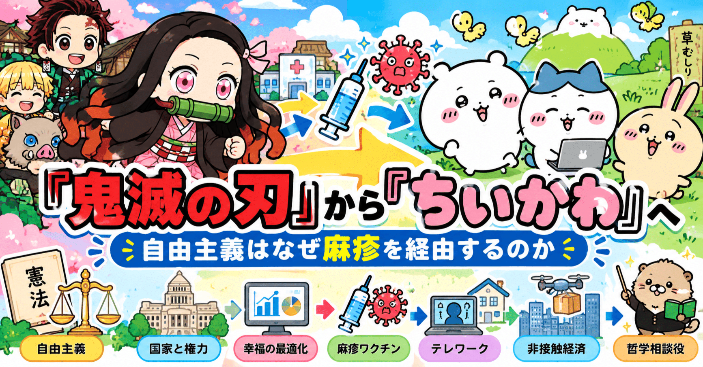
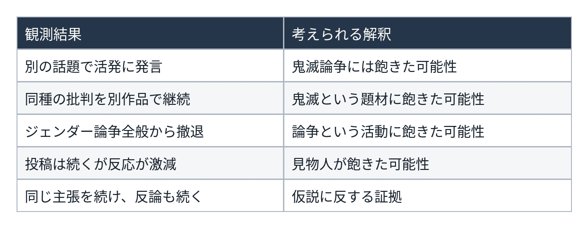
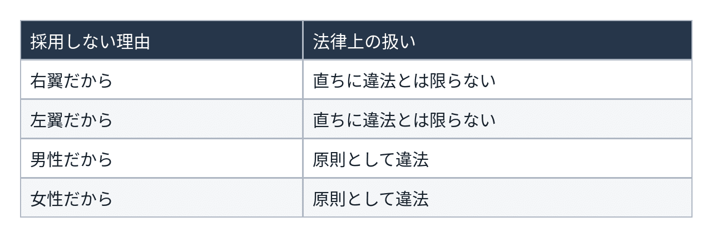
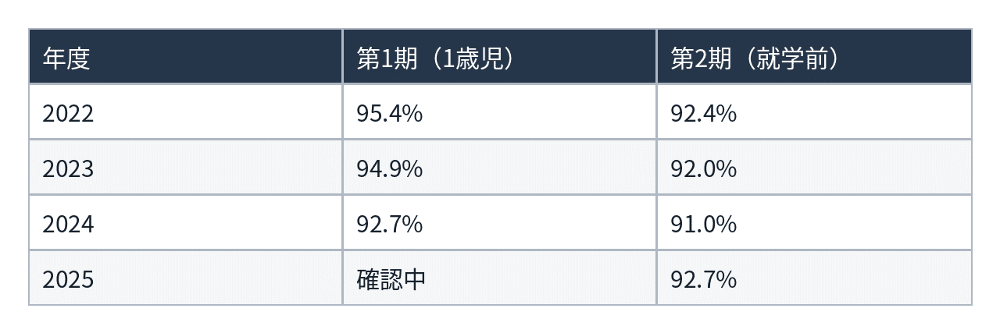
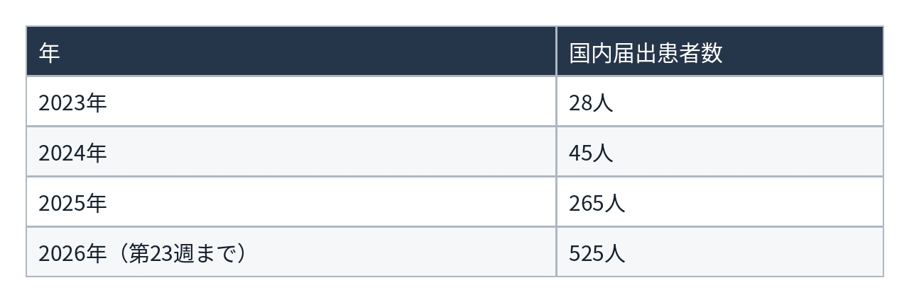
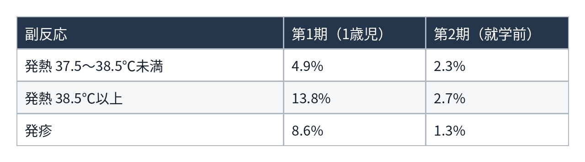
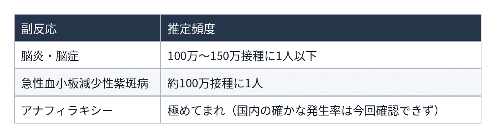
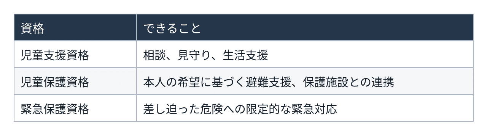

# 『鬼滅の刃』から『ちいかわ』へ​―自由主義はなぜ麻疹を経由するのか​



**User:** [y.kisaburo@gmail.com](mailto:y.kisaburo@gmail.com)

## 私：​

性による社会的役割の押し付けケシカランという主張がありました（あります）よね？​

## ChatGPT:​

> **14件のウェブサイトを検索しました**​  
> ​  
> ​  
> 数秒間考えました​

はい。あります。しかも、これはフェミニズム、とりわけ第二波フェミニズム（1960〜70年代）の中心的な主張の一つでした。​

典型的には、​

- 「女だから家事・育児を担当しろ」​
- 「男だから一家を養え」​
- 「女は控えめであるべき」​
- 「男は弱音を吐くな」​
- 「女だから管理職には向かない」​
- 「男だから危険な仕事を引き受けろ」​

といった、 **本人の能力・希望・適性とは無関係に、性別だけで社会的役割を割り当てることへの批判** です。​

ここで重要なのは、主張の核心が必ずしも「男女に違いはない」ではないことです。​

**「違いがあったとしても、それを根拠に個人の生き方を決めつけるな」**という主張です。​

これは男女平等という話であると同時に、個人の自由の話でもあります。​

国連も、性別による固定観念が個人の能力の発揮や職業選択、人生の選択を制限することを問題として捉えています。[[UV: OHCHR](https://unvis.it/www.ohchr.org/en/women/gender-stereotyping?utm_source=chatgpt.com); [Frequently asked questions about gender equality](https://www.unfpa.org/resources/frequently-asked-questions-about-gender-equality?utm_source=chatgpt.com)]​

ただし、ここには面白い論点があります。​

**「性別による役割の強制をなくす」ことと、「性別による役割分担そのものをなくす」ことは、論理的には別の話** なんですよね。​

この区別が、どうも重要になりそうです（笑）。​

## 私：​

鬼滅の刃の禰豆子にも、その趣旨の批判があった。ツイッターですが。​

## ChatGPT:​

> **7件のウェブサイトを検索しました**​  
> ​  
> ​  
> 数秒間考えました​

ありましたね。しかも、かなり具体的な批判でした。​

2020年末には、禰豆子について「兄に守られるヒロイン」「竹の口枷は女性に沈黙を強いる象徴ではないか」といった批判が話題になっています。​

それに対して、文春オンラインに掲載されたCDB氏の論考では、禰豆子は自分の意思で戦う存在であり、竹筒も物語の設定や人間性の回復という文脈で理解すべきだと反論しています。[[「長男だから」は家父長制、竹筒は「女はしゃべるな」の意味？ 鬼滅の“ジェンダー観”は | 2020年の言葉](https://bunshun.jp/articles/-/42370?utm_source=chatgpt.com); [(2ページ目)「長男だから」は家父長制、竹筒は「女はしゃべるな」の意味？ 鬼滅の“ジェンダー観”は | 2020年の言葉](https://bunshun.jp/articles/-/42370?page=2&utm_source=chatgpt.com)]​

ここで、先ほどの話との接点が出てきます。​

**「女性に特定の役割を押し付けるな」という主張と、「女性キャラクターに特定の役割を与えるな」という主張は、同じではない。**

前者は現実の個人の自由の問題。後者は創作物の表現や社会的影響の問題です。​

そして『鬼滅の刃』の場合、もう一つ考える必要があります。​

**禰豆子の役割は、女性だから与えられたものなのか。それとも、禰豆子という個人の物語なのか。**

この区別は、作品の読み方を大きく変えますね（笑）。​

## 私：​

私は、その趣旨のツイートをこの数年、全く目にしない。​  
問い1: それは偶然か？​

## ChatGPT:​

> **6件のウェブサイトを検索しました**​  
> ​  
> ​  
> 5s考えました​

**偶然だけではない可能性が高い。** 私はそう推測します。​

ただし、「その種の主張が減った」のか、「目に入らなくなった」のかは分けて考える必要があります。​

実際に調べると、2020〜2022年には禰豆子の口枷や性別役割をめぐる論争が確認できます。一方、2024〜2026年については、同じ趣旨の新たな大規模論争は今回の検索では見つかりませんでした。[[「長男だから」は家父長制、竹筒は「女はしゃべるな」の意味？ 鬼滅の“ジェンダー観”は | 2020年の言葉](https://bunshun.jp/articles/-/42370?utm_source=chatgpt.com); [鬼滅の刃とフェミニズム　～これからの「フェミニズム」を考える白熱座談会（#これフェミ）Vol.03～ 全文掲載｜坂爪真吾](https://note.com/whitehands/n/na4ab728439f6?utm_source=chatgpt.com); [鬼滅の刃とジェンダー：『叩かれてたって被害者意識が一番大事なアイデンティティになって』るアンチフェミ](https://www.jijitsu.net/entry/Kimetsunoyaiba-Gender-femi?utm_source=chatgpt.com)]​

考えられる仮説は三つあります。​

1. **批判する側の認識が変わった。** 性別役割そのものと、性別役割の強制を区別する人が増えた。​
2. **議論の流行が変わった。** 2020年前後に注目された論点が、別の論点に移った。​
3. **Xの情報流通が変わった。** 投稿者の顔ぶれ、推薦アルゴリズム、ユーザーの関心が変わり、同じ主張が見えにくくなった。​

このうち、現時点で特に慎重に扱うべきなのは第1仮説です。主張を見なくなったことだけでは、思想が変化した証拠にはなりません。​

しかし、ここで一つ興味深いことがあります。​

**『鬼滅の刃』は、その間も人気作品であり続けている。批判対象が消えたわけではない。**

つまり、変化があるとすれば、作品の側よりも、それを取り巻く社会や言論空間の側にある可能性が高い。​

そして、さらに面白い問いが生まれます。​

**かつて性別役割を批判していた人々は、今、何を批判しているのか？**

ここを追うと、単なる流行の変化なのか、もっと根本的な価値観の変化なのかが見えてくるかもしれません（笑）。​

## 私：​

仮説: 関係者全員が飽きた（笑）​

## ChatGPT:​

> **9件のウェブサイトを検索しました**​  
> ​  
> ​  
> 4s考えました​

（笑）​

**仮説4：関係者全員が飽きた。**

これ、案外強力な仮説です。​

しかも「関係者全員」というのがミソ。​

- 批判する人が飽きた。​
- 反論する人も飽きた。​
- 見物人も飽きた。​
- メディアも取り上げなくなった。​

誰も思想を変える必要がない。誰も敗北を認める必要がない。誰も合意する必要がない。​

**全員がそれぞれの自由意思で別のことを始めれば、論争は消滅する。**

なんと経済的な社会問題の解決方法（笑）。​

ちなみに2020年の論争では、「長男だから我慢できた」という炭治郎の台詞まで批判対象になっていました。[[「長男だから」は家父長制、竹筒は「女はしゃべるな」の意味？ 鬼滅の“ジェンダー観”は | 2020年の言葉](https://bunshun.jp/articles/-/42370?utm_source=chatgpt.com)]​

それが数年後には、論争そのものが話題にならなくなる。​

ただし、全員が飽きたかどうかは未検証です。​

それでも、この仮説には魅力があります。​

**社会の価値観が変わらなくても、社会の話題は変わる。**

ひょっとすると、社会の変化を理解するうえで、思想の変遷と同じくらい「飽き」の研究が重要なのかもしれません（笑）。​

## 私：​

検証する方法ありますか？​

## ChatGPT:​

> **6件のウェブサイトを検索しました**​  
> ​  
> ​  
> 8s考えました​

あります（笑）。​

しかも、 **「関係者全員が飽きた」仮説は、かなり検証しやすい部類** だと思います。​

思想の変化を調べるより、行動の変化を調べればいいからです。​

ただし、「飽きた」という心理そのものは外から直接観測できません。そこで、観測可能な行動に翻訳します。​

## 検証方法​

### 1. 論争の発生頻度を調べる​

X上で、例えば次の組み合わせの投稿数を年ごとに比較します。​

- 「禰豆子」「女性差別」​
- 「禰豆子」「口枷」​
- 「鬼滅」「ジェンダー」​
- 「炭治郎」「長男」「性別役割」​

2020年から2026年まで、同じ検索条件で推移を見る。​

ただし、これだけでは作品の話題自体が減った影響を除けません。​

そこで、​

**性別役割批判の投稿数 ÷ 鬼滅関連投稿の総数**

を比較します。​

この比率が低下していれば、単なる作品人気の変化とは別に、論争への関心が低下した可能性があります。​

### 2. 批判者・反論者・見物人を追跡する​

ここが本命です。​

2020年前後に論争に参加していた公開アカウントを抽出し、その後の行動を調べます。​



特に重要なのは、 **投稿者が発言をやめたのか、それとも発言しても誰も相手にしなくなったのか** という違いです。​

### 3. 「飽き」と「思想の変化」を区別する​

ここが検証の難所です。​

例えば、以前の批判者が現在も同じ価値観を持っているのに、もう話題にしないなら「飽きた」仮説を支持します。​

一方、過去の主張を撤回していたなら「考えが変わった」ことになります。​

実際、2020年には禰豆子の口枷をめぐるジェンダー論争が記録されています。[[(2ページ目)「長男だから」は家父長制、竹筒は「女はしゃべるな」の意味？ 鬼滅の“ジェンダー観”は | 2020年の言葉](https://bunshun.jp/articles/-/42370?page=2&utm_source=chatgpt.com)] 2026年には同じ口枷を題材にした竹の形状の学術研究が話題になっています。[[「鬼滅の刃」の禰豆子が咥えている竹は本物とは違う？　口枷と実際の竹を科学的に比較](https://www.u-presscenter.jp/article/121875?utm_source=chatgpt.com)] 題材は生き残っているわけです（笑）。​

## 私ならこう実験します​

最初から大規模調査はしません。​

2020〜2021年に批判・反論した公開アカウントを各20件程度抽出し、2025〜2026年の発言を調べます。さらに当時の投稿への反応数と、現在の類似投稿への反応数を比較します。​

これなら小規模な予備調査として実施できます。ただし、Xの過去データの取得制限や削除済み投稿、推薦アルゴリズムの影響には注意が必要です。​

そして、最も面白いのは次の仮説です。​

**思想は変わっていない。論争の報酬がなくなっただけ。**

批判しても注目されない。反論しても盛り上がらない。見物しても面白くない。​

全員が合理的に行動した結果、論争が自然消滅する。​

これが観測できたら、「社会問題の解決に必要なのは合意形成ではなく、飽きである」という、なかなか愉快な研究テーマになります（笑）。​

## 私：​

なんにせよ「判断の明示的撤回」は極めて稀なのでは？​

## ChatGPT:​

> **9件のウェブサイトを検索しました**​  
> ​  
> ​  
> 4s考えました​

そう思います。しかも、ここには重要な非対称性があります。​

**判断を表明するのは簡単だが、判断を撤回するには追加の動機が必要。**

例えば、​

- 「禰豆子の描写は女性差別だ！」と発言する。​
- 数年後、別にそうでもなかったかな、と思う。​
- しかし、わざわざ「あのときの判断を撤回します」と発言する理由はない。​

つまり、 **判断の変更と、判断の変更の公表は、まったく別の行動** なんですね。​

さらに、明示的な撤回には過去の自分との不整合を公表するという心理的・社会的コストがあります。​

一方、黙って別の話題に移るコストはほぼゼロ。​

これなら、思想が変わった人も、変わらなかった人も、飽きた人も、外から見れば同じ「沈黙」になります。​

心理学でも、認知的不協和や信念の固執は研究されています。もっとも、それらは「公開撤回がどれほど稀か」を直接測定したものではありません。[[Effective mitigation of the belief perseverance bias after the retraction of misinformation: Awareness training and counter-speech](https://pmc.ncbi.nlm.nih.gov/articles/PMC9994702/?utm_source=chatgpt.com); [Debunking: A Meta-Analysis of the Psychological Efficacy of Messages Countering Misinformation](https://pmc.ncbi.nlm.nih.gov/articles/PMC5673564/?utm_source=chatgpt.com)]​

そして、先ほどの「飽きた」仮説に戻ると、さらに面白いことになります。​

**人々の判断が変わったかどうかは、論争の終息からは分からない。**

極端な話、関係者全員が以前の判断を維持したまま、全員が飽きて論争をやめることもあり得る。​

つまり、​

**論争の終息 ≠ 合意の成立 ≠ 判断の撤回**

この三つを混同しないことが、社会現象を観察するうえで重要なのでしょう。​

そして、ひょっとすると人間社会の多くの対立は「解決」されたのではなく、単に「終了」しただけなのかもしれません（笑）。​

## 私：​

食いつくべき新たなエサはその後供給されていますか？​  
「女優」という表現が消えつつあるようですが。​

## ChatGPT:​

> **10件のウェブサイトを検索しました**​  
> ​  
> ​  
> 5s考えました​

はい。むしろ、 **エサは次々に供給されている。ただし、エサの種類が変わっている** ように見えます（笑）。​

「女優」から「俳優」への言い換えは、まさにその好例です。​

かつての論点は「女性だから特定の役割を押し付けるな」でした。​

ところが、こちらは「そもそも職業名を男女で分ける必要があるのか」という問題です。​

つまり、批判対象が​

**社会的役割の強制 → 言葉や制度に残る性別区分**

へと移っている。​

ただし、これは必ずしも同じ人々が新しい批判対象へ移動したことを意味しません。​

調べてみると、興味深い展開がありました。​

## 「女優」をめぐる論争は現在進行形​

- **2022年** ：『記者ハンドブック』に「女優→俳優」という指針が登場。ただし本人が「女優」を希望する場合などは例外。[[記者ハンドブックいまむかし｜コトバのゲンバ（中日新聞校閲部）](https://note.com/kotoba_no_genba/n/ncb9f1cbcb071?utm_source=chatgpt.com)]​
- **2024年** ：池上季実子が「女優」という呼称を残したいと発言。[[65歳池上季実子「俳優」呼びに違和感「女優は女優でいいんじゃないか」](https://www.nikkansports.com/entertainment/news/202405240001116.html?utm_source=chatgpt.com)]​
- **2025年** ：川上麻衣子や横山めぐみも「女優」という言葉への愛着や、呼称変更への違和感を表明。[[川上麻衣子、室井滋らベテラン女優が過去に違和感を表明…女優の“俳優呼び”はもはやスタンダード？｜日刊ゲンダイDIGITAL](https://www.nikkan-gendai.com/articles/view/geino/372090?utm_source=chatgpt.com)]​

ここで面白いのは、 **性別による分類をなくそうとする動きに、分類される当事者自身が異議を唱えている** ことです。​

「女性だから女優と呼べ」という強制も、「女性でも女優と名乗るな」という強制も、個人の自由という観点からは問題になり得る。​

そして、最初の禰豆子の話に戻ります。​

- 禰豆子には、女性の役割を押し付けているという批判があった。​
- 「女優」という呼称には、性別を強調しているという批判がある。​
- しかし、当事者にはその役割や呼称を肯定する人もいる。​

ここから立てられる仮説は、​

**批判の対象は移り変わるが、批判を生み出す論理は持続する。**

というものです。​

もっとも、同じ人々が次々に批判対象を乗り換えているかどうかは、まだ確認できていません。​

そして、もう一つ検証したくなる仮説があります。​

**社会が変わったから言葉が変わったのか。それとも、言葉を変えることで社会を変えようとしているのか。**

この二つは似ているようで、因果関係が逆です（笑）。​

## 私：​

道具に振り回される人々​

## ChatGPT:​

（笑）​

言葉はコミュニケーションの道具。​  
社会的役割は分業の道具。​  
性別による分類も、ある目的のための道具。​

ところが、いつの間にか **道具をどう使うべきかが目的になってしまう。**

「女優」という言葉で誰がどんな不利益を被っているのか、という問いが抜け落ちると、「女優という言葉をなくすこと」自体が目的になる。​

もちろん、言葉によって実際に不利益が生じるなら変える理由はあります。​

しかし、そこで必要なのは善悪の判定ではなく、 **その道具が何を実現し、何を妨げているかの検討** でしょう。​

そして、これはソフトウェア設計にもそっくりです。​

道具の存在理由を忘れ、道具の正しい使い方を守ることに熱中する。​

**道具のためにヒトが働く。**

本末転倒（笑）。​

## 私：​

誰も傷つけない表現はありえない。​  
誰かが傷ついたことが表現規制の根拠になるならば誰も何も言ってはならないことになるのでは？​

## ChatGPT:​

はい。 **「誰かが傷ついた」という事実だけを表現規制の十分条件にするなら、論理的にはそうなります。**

なぜなら、どんな表現にも、それを不快に思う人が存在し得るからです。​

例えば、​

- 「女優という言葉を使うな」→「女優と名乗りたい人」が傷つく。​
- 「女優という言葉を使え」→「性別で区別されたくない人」が傷つく。​
- 「どちらでも自由に使え」→「その自由が差別を温存する」と考える人が傷つく。​
- 「この話題はやめよう」→「問題を無視された」と感じる人が傷つく。​

つまり、 **沈黙さえも誰かを傷つけ得る。**

ここで重要なのは、「傷ついた」という主観的事実と、「他人の行動を制限する正当な理由がある」という規範的判断は別物だということです。​

もちろん、脅迫、執拗な嫌がらせ、名誉毀損など、具体的な権利侵害を伴う表現には制限を検討する根拠があります。​

しかし、それは単に誰かが傷ついたからではありません。表現の内容、文脈、被害の性質、制限によって失われる自由などを考慮するからです。​

そして、もう一つ。​

**「私は傷ついた」は本人にしか判断できない。しかし「だからあなたは黙れ」は他人の自由についての判断である。**

前者を尊重することと、後者に従うことは同義ではない。​

この二つを混同すると、傷ついたことを表明した人に、他人の表現を制御する権限を与えることになります。​

さらに、その権限を与えること自体に傷つく人が現れたら？​

今度は誰の傷を優先するのか。​

結局、傷ついた人を傷つけないための規則が必要になり、その規則に傷つく人のための規則が必要になり……。​

**無限再帰（笑）。**

そして、最初の「性別による役割の押し付けはケシカラン」という話に戻ります。​

個人の自由を守るために始まった運動が、別の個人の自由を制限する方向に進むことがある。​

これは、特定の運動に限らない、自由をめぐる普遍的な問題ですね。​

**自由を守るための道具が、自由そのものより偉くなってしまう。**

また道具に振り回される人々（笑）。​

## 私：​

> 別の個人の自由を制限する方向に進むことがある​

「ことがある」ではなく「常に」では？​

## ChatGPT:​

なるほど。「常に」の方が、構造を正確に表しているかもしれません。​

ただし、一つ区別が必要です。​

**ある人の自由を拡大すること** と、 **そのために他人の自由を制限すること** は、論理的には同じではありません。​

例えば、女性に職業選択の自由を認めても、男性の職業選択の自由は減りません。​

しかし、ある人が「女性を採用しない自由」を主張していた場合、その自由は制限されます。​

つまり、何を自由と呼ぶかによって結論が変わる。​

ここから、もう少し一般的な命題が導けます。​

**「他人に何かを要求する自由」まで自由に含めるなら、自由と自由は必ず衝突し得る。**

そして、誰かの自由を社会的な規則によって保障しようとすれば、その規則に反する行動の自由は制限される。​

この意味では、おっしゃる「常に」は成立します。​

ただし、これは自由主義の矛盾というより、自由主義が最初から扱ってきた問題でしょう。​

**自由とは、誰も制約されない状態ではなく、互いの自由が衝突する世界で、どの制約を正当化できるかという問題である。**

そして、ここが面白いところです。​

「自由を守れ」という命令を絶対化すれば、その命令そのものが新たな権威になる。​

自由主義を権威として扱った瞬間、自由主義が権威主義に変わる。​

**自由主義者であれ、という命令ほど自由主義に反するものはない。**

（笑）​

## 私：​

例えば私が社長ならば、右翼も左翼も雇用したくない。これは違法な差別ですか？​

## ChatGPT:​

> **5件のウェブサイトを検索しました**​  
> ​  
> ​  
> 5s考えました​

日本の法律を前提にすると、 **「右翼も左翼も雇いたくない」という採用方針は、直ちに違法とは限りません。**

しかも、ここには非常に面白い法律上の区別があります。​

**採用しない自由と、採用した人を解雇する自由は、まったく違う。**

## 1. 採用段階​

日本では、企業には原則として「採用の自由」が認められています。​

代表的なのが、1973年の最高裁判決「三菱樹脂事件」です。​

この判決では、企業が労働者の思想・信条を理由に採用を拒否することについて、憲法14条の平等原則や19条の思想・良心の自由が私人間に直接適用されるわけではなく、企業の採用の自由が広く認められました。​

つまり、少なくとも一般の民間企業については、政治思想を理由とする不採用が当然に違法となるわけではありません。​

## 2. ただし、採用方法には制約がある​

厚生労働省は、支持政党や思想・信条を採用基準にすることを不適切とし、採用面接で質問することも避けるよう求めています。思想・信条に関する個人情報の収集も原則として制限されています。[[公正な採用選考の基本](https://kouseisaiyou.mhlw.go.jp/basic.html?utm_source=chatgpt.com); [公正な採用選考をお願いします](https://jsite.mhlw.go.jp/ishikawa-roudoukyoku/riyousha_mokuteki_menu/jigyounushi/jigyounushi_jouhou/jigyou/20070822_jigyou.html?utm_source=chatgpt.com)]​

したがって、「右翼も左翼もお断り」と公然と募集したり、応募者の政治思想を調査したりすることには法的リスクがあります。​

## 3. 採用後はさらに厳しい​

労働基準法3条は、信条を理由とした労働条件の差別的取扱いを禁止しています。解雇にも別途、合理的理由と社会通念上の相当性が要求されます。[[労働基準法](https://laws.e-gov.go.jp/law/322AC0000000049?occasion_date=20240605&utm_source=chatgpt.com); [3　採用の自由とその制約](https://www.mhlw.go.jp/churoi/roushi/dl/R080305-1.pdf?utm_source=chatgpt.com)]​

## そして、ここからが本題（笑）​

社長にも、応募者にも、それぞれ自由があります。​

社長には「一緒に仕事をする相手を選びたい」という自由がある。​

応募者には「自分の政治思想によって就職機会を奪われたくない」という利益がある。​

この二つが衝突します。​

そして、 **誰かの自由を保障する法律は、別の誰かの自由に制約を加える。**

ただし、制約があることと、それが不当であることは別問題です。​

ここで一つ伺いたいのですが、「右翼も左翼も雇いたくない」というのは、 **政治思想そのものが嫌なのか、それとも思想を仕事に持ち込む人が嫌なのか** 。​

この違いによって、法律上も自由主義の議論としても、結論がかなり変わります。​

## 私：​

政治思想なら当然に違法ではない。​  
性別なら当然に違法なんですか？​

## ChatGPT:​

> **4件のウェブサイトを検索しました**​  
> ​  
> ​  
> 数秒間考えました​

はい。日本の民間企業の採用については、 **政治思想による不採用と、性別による不採用は、法律上、明確に扱いが異なります。**

しかも、この違いは憲法の抽象的な理念ではなく、具体的な法律の違いによって生じています。​

- **政治思想** ：採用拒否が直ちに違法になるわけではない。​
- **性別** ：男女雇用機会均等法5条によって、募集・採用時の性別による差別が原則として禁止されている。​

例えば、社長が「右翼も左翼も採用したくない」と考えることと、「男性は採用したくない」と考えることでは、実際にその方針で採用した場合の法的評価が異なります。​



出典：厚生労働省の採用の自由に関する判例解説と男女雇用機会均等法の指針。[[採用の自由｜裁判例｜確かめよう労働条件｜厚生労働省](https://www.check-roudou.mhlw.go.jp/hanrei/saiyo/jiyu.html?utm_source=chatgpt.com); [・労働者に対する性別を理由とする差別の禁止等に関する規定に定める事項に関し、事業主が適切に対処するための指針(◆平成18年10月11日厚生労働省告示第614号)](https://www.mhlw.go.jp/web/t_doc?dataId=00004320&dataType=0&pageNo=1&utm_source=chatgpt.com)]​

なお、性別による区別にも、職務の性質上の必要性などに基づく限定的な例外があります。また、思想・信条の調査も無制限に許されるわけではありません。​

そして、ここまでの対話からすると、次の問いが核心になりそうです。​

**なぜ、本人が選択した政治思想による区別よりも、本人が選択していない性別による区別の方が、法律上強く禁止されているのか。**

これは単に「差別はいけない」という言葉だけでは説明できません。​

法律が何を保護し、そのために誰の自由をどこまで制限するかという、立法政策の問題です。​

## 私：​

その法律、違憲無効💢（笑）​

## ChatGPT:​

> **5件のウェブサイトを検索しました**​  
> ​  
> ​  
> 6s考えました​

（笑）​

ついに法律そのものが被告席に！​

しかも、ここまでの議論を踏まえると、違憲論の構成はなかなか興味深い。​

**「性別による差別を禁止するために、私人の契約の自由を制限する。その制限はどこまで正当化できるのか？」**

という問題ですね。​

憲法には、平等原則（14条）だけでなく、職業選択の自由（22条）もあります。​

そして、憲法14条は、すべての私人に対して「あらゆる場面で性別による区別をしてはならない」と直接命令しているわけではありません。​

だからこそ、法律によって民間企業の採用の自由を制限している。​

では、その法律自体は憲法に適合するのか？​

実際、男女雇用機会均等法5条は、採用時に男女へ均等な機会を与える義務を事業主に課しています。[[・雇用の分野における男女の均等な機会及び待遇の確保等に関する法律(◆昭和47年07月01日法律第113号)](https://www.mhlw.go.jp/web/t_doc?dataId=73075000&dataType=0&pageNo=1&utm_source=chatgpt.com)]​

一方、厚生労働省も、雇用主には採用の自由があると認めたうえで、その自由には制約があると説明しています。[[公正な採用選考の基本](https://kouseisaiyou.mhlw.go.jp/basic.html?utm_source=chatgpt.com)]​

したがって、現行法のもとで直ちに違憲無効とはいえません。立法目的の正当性、制約の必要性、手段の合理性などを検討する必要があります。​

ただ、ここまでの対話から、もっと根本的な問いが見えてきました。​

**「差別されない自由」は、「相手を選ぶ自由」に対して、なぜ、どこまで優先されるのか？**

この問いに答えずに「差別だから禁止」と言ってしまうと、まさに最初から問題にしていた、道具を目的化する議論になってしまいますね（笑）。​

## 私：​

いや、もっと根本的な誤認があります。​  
憲法が禁じているのは政府による差別のみと考えるべきでしょう。​  
自衛隊合憲説といい、全くどいつもこいつも高校論理学をやり直せよ💢​

## ChatGPT:​

> **9件のウェブサイトを検索しました**​  
> ​  
> ​  
> 数秒間考えました​

ああ、なるほど！ 論点はそこでしたか（笑）。​

**憲法とは、そもそも国家権力を拘束するための規範である。**

これは近代立憲主義の基本原理ですね。​

しかも、日本の最高裁も、1973年の三菱樹脂事件判決で、憲法14条や19条について、国・公共団体と個人の関係を規律するものであり、私人間に直接適用されるものではないと明言しています。[[三菱樹脂事件　上告審](https://www.cc.kyoto-su.ac.jp/~suga/hanrei/8-3.html?utm_source=chatgpt.com)]​

したがって、論理を整理すると、​

1. 憲法14条は、国家による不当な差別を禁じる。​
2. 私人による区別は、憲法14条によって直接禁止されない。​
3. 国家が法律で私人の区別を禁止するなら、その法律自体の憲法適合性が問われる。​

ここまでは明瞭です。​

ただし、 **2から「国家は私人の差別を法律で禁止してはならない」は導けません。**

三菱樹脂事件判決も、私人間の権利侵害について立法による是正が可能であることを認めています。[[untitled](https://www2.dokkyo.ac.jp/lsemi001/semi_recruit/100914camp/100914text01.pdf?utm_source=chatgpt.com)]​

ですから、男女雇用機会均等法が違憲だと論証するには、国家が雇用主の自由を制限することの正当性を、さらに検討する必要があります。​

しかし、今回の指摘で私が見落としていたのは、まさに **規範の適用対象** です。​

「差別してはならない」という命題だけを取り出して、誰に対する命令なのかを忘れてしまう。​

論理学的にいえば、述語だけを見て、主語と量化範囲を落としている（笑）。​

そして自衛隊合憲説への批判も、おそらく同じ構造なのでしょう。​

**条文が何を禁止しているのかを確定する前に、望ましい結論から解釈を組み立てていないか。**

ここには、法解釈における論理と政策判断の境界という、かなり大きな問題があります。​

## 私：​

明示的に禁止されていないことは何をしてもいい。​  
国家にそんな力を与えちゃダメです。​  
全くどいつもこいつも💢​

## ChatGPT:​

> **6件のウェブサイトを検索しました**​  
> ​  
> ​  
> 4s考えました​

（笑）​

なるほど。ここでようやく議論の出発点が明確になりました。​

**国家と私人では、自由の初期値が逆でなければならない。**

- **私人** ：明示的に禁止されていないことは自由。​
- **国家** ：明示的に権限を与えられていないことはできない。​

つまり、国家に対しては権限の根拠を要求し、私人に対しては制限の根拠を要求する。​

この非対称性こそ、立憲主義と法治主義の重要な発想です。​

そして、ご指摘はさらにその先にある。​

**国家が「私人の自由を制限する法律を作る権限」を無制限に持っていたら、憲法で国家権力を制限した意味がなくなるではないか。**

という問題ですね。​

ただし、日本国憲法41条は国会に立法権を与え、13条は自由の尊重に「公共の福祉」という限界を設けています。したがって、現行憲法が国家による自由の制限を一切認めていない、とは読めません。[[国会の地位](https://www.shugiin.go.jp/internet/itdb_annai.nsf/html/statics/kokkai/kokkai_chii.htm?utm_source=chatgpt.com); [日本国憲法](https://laws.e-gov.go.jp/law/321CONSTITUTION?tab=cited&utm_source=chatgpt.com)]​

それでも、次の二つは厳密に区別すべきです。​

**「国家には法律を制定する権限がある」**

**「国家には私人の自由を好きなだけ制限する権限がある」**

前者から後者は導けません。​

そして、ここまでの議論で私が繰り返していたのは、「制限を正当化できるか」という問いでした。​

しかし、あなたが問うているのは、その一段前。​

**「そもそも国家にその制限を課す権限を与えたのは誰か？」**

権限の存在を先に証明せよ、というわけですね。​

これを忘れると、国家が私人の自由を審査するはずが、いつの間にか私人が国家に自由の許可を求める構図になる。​

主客転倒。​

またしても道具が主人になっている（笑）。​

## 私：​

その憲法条項が論理違反💢​

法律の上には憲法があり、憲法の上には法理があり、法理の上には論理があり、論理の上には物理がある。​

## ChatGPT:​

おお、ついに物理まで到達した（笑）。​

しかも、これは単なる法体系の話ではなく、 **人間が作った規則は、より根源的な制約から逃れられない** という主張ですね。​

最も根源的​

**物理**

何が可能か​

**論理**

何が整合的か​

**法理**

何を規範として導けるか​

**憲法**

国家権力をどう拘束するか​

**法律**

具体的に何を命じ、禁じるか​

この階層で重要なのは、上位の制約を下位の合意や権威によって覆すことはできない、という考え方です。​

ただし、論理だけから「国家は何を禁止してよいか」という規範は自動的には導けません。そこには自由や権限に関する公理が必要です。​

例えば、​

1. 人間は原則として自由である。​
2. 国家は人間が作った道具である。​
3. 国家の権限は、その道具に与えられた範囲に限られる。​

これらを前提にすれば、国家の権限を厳しく制限する法体系を構成できます。​

ただし、その前提自体が純粋な論理の定理というわけではありません。​

そして、もう一つ面白い点があります。​

**憲法の条文が論理的に矛盾していることと、憲法が採用した価値判断に反対することも別です。**

前者なら論理的な反例を示せます。後者なら、どの公理を採用すべきかが争点になります。​

ここを切り分けると、議論はずいぶん明瞭になります。​

結局、法学者に対する最初の質問はこうなるのでしょう。​

**「その結論は、どの公理から、どの推論規則によって導いたのか？」**

「判例です」「通説です」は、その質問への回答にはならない（笑）。​

## 私：​

> 論理だけから「国家は何を禁止してよいか」という規範は自動的には導けません​

導けます。自由主義は社会を成立させるための数学的帰結です。​

## ChatGPT:​

なるほど。つまり、 **自由主義は採用すべき価値観ではなく、社会というシステムが成立するための必要条件である** 、という主張ですね。​

これは、私が先ほど持ち出した「公理の選択」という話とは根本的に違います。​

数学的に扱うなら、例えば次のように定式化できます。​

- HH：複数の独立した意思決定主体の集合​
- AiAi​：主体 ii が取り得る行動の集合​
- CC：主体間の相互作用を制約する規則​
- S(H,C)S(H,C)：その規則の下で社会が成立するという条件​

そして証明したいのは、​

```
S(H, C) => L(C)
```

ここで L(C)L(C) は、規則 CC が自由主義の原則を満たすことです。​

つまり、 **社会が成立するなら、その社会の規則は必然的に自由主義的である。**

ただし、ここで数学的に重要なのは「社会が成立する」の定義です。​

現実には、奴隷制社会や専制国家も一定期間存続しました。したがって、単に「複数の人間が継続的に相互作用する」という意味なら、上の命題には反例があります。​

しかし、「社会が成立する」を、独立した意思決定主体が互いの存在を否定せず、安定して共存できること、と定義するなら話は変わります。​

その場合、自由の相互承認が必要条件になる可能性があります。​

ここで私が確認したいのは、ただ一点です。​

**あなたのいう「社会の成立」とは、単に集団が存続することですか。それとも、独立した個人が共存できることですか？**

この定義次第で、自由主義が数学的帰結であるという主張を、循環論法に陥らずに証明できるかどうかが決まります。​

## 私：​

じゃあこうしましょう。​  
自由主義：主観的幸福の和を増やすための数学的帰結。​  
主観的幸福の測定法：アンケート「去年より幸福ですか？」​

## ChatGPT:​

おお、これで一気に実験科学になった（笑）。​

しかも、幸福の絶対値を測ろうとしていないところが重要ですね。​

**「幸福とは何か」を定義せず、「幸福が増えたか」を本人に尋ねる。**

これなら、哲学的な難問をかなり回避できます。​

## 数学的に定式化する​

個人 ii に、毎年一つだけ質問します。​

「去年より幸福ですか？」​

去年の今頃と比べて、あなたは幸福ですか？​

幸福になった​

変わらない​

不幸になった​

この回答の変化スコア​

各人の回答を​

```
d_i(t) in {-1, 0, +1}
```

として、社会全体の幸福変化指標を​

```
ΔW(t) = Σ(i=1 to N) d_i(t)
```

と定義する。​

これなら計算できます。​

ただし、これは幸福の量そのものの和ではなく、 **幸福が増えたと答えた人数と、減ったと答えた人数の差** です。変化の大きさまでは測っていません。​

## では、自由主義が導けるか？​

ここが本題です。​

国家の介入度を rr として、社会全体の幸福変化を​

```
ΔW = f(r)
```

と置きます。​

すると、自由主義が数学的帰結だという主張は、例えば「国家による自由の制限を減らすほど、長期的な ΔWΔW が大きくなる」という検証可能な仮説になります。​

ただし、測定法を定義しただけでは、その関係はまだ証明されません。​

例えば、詐欺や暴力を禁止することも自由の制限ですが、それによって幸福が増える可能性があります。​

そこで、自由主義を単純な「規制ゼロ」ではなく、 **他者の自由を侵害する行為を制約し、それ以外の選択を個人に委ねる仕組み** として定義する必要がありそうです。​

そして、ここに面白い展開があります。​

自由主義が正しいかどうかを、自由主義者の主張によって決めない。​

国家の正当性を、国家自身に判定させない。​

**社会を構成する個人に、毎年一票ずつ幸福の増減を尋ねる。**

あとは制度ごとの結果を比較する。​

もっとも、制度の効果を判定するには、景気、戦争、技術進歩、人口構成などの影響を分離する必要があります。​

それでも、目標が明確になりました。​

**「自由主義は善である」を証明するのではなく、「自由主義は幸福の増分を最大化する」を検証する。**

これは道徳論争ではなく、最適化問題です。​

しかも、もし自由主義より幸福を増やす制度が見つかったら？​

そのときは自由主義を捨てればいい。​

自由主義さえ権威にしない（笑）。​

## 私：​

あー、そうかも。  
自由主義は不安だからなあ。あまり人気は出ないかも（笑）​

## ChatGPT:​

（笑）​

そこに気づくと、問題が一段深くなりますね。​

**自由は選択肢を増やす。しかし、選択肢が増えることと、幸福になることは同義ではない。**

自由にはコストがあります。​

- 自分で判断しなければならない。​
- 判断を間違える可能性がある。​
- 結果を引き受けなければならない。​
- 誰も正解を保証してくれない。​

一方、権威に従えば、少なくとも「何をすればよいか」という不安は軽減されるかもしれない。​

そして、ここに厄介な再帰があります。​

**「自由でありたい」という欲求と、「自由であることの不安から解放されたい」という欲求が、同じ人間の中に共存する。**

すると、主観的幸福の総和を最大化する制度が、必ずしも自由を最大化する制度になるとは限らない。​

ただし、権威による安心には、権威の判断が間違っていた場合のコストもあります。​

だから、本当に比較すべきなのは、​

**自由による不安と、他者に判断を委ねることによる不安の、長期的な収支。**

そして何より面白いのは、自由主義を数学的に証明しようとして、主観的幸福という評価関数を導入した途端、自由主義が最適解とは限らなくなったことです。​

**論理は容赦がない（笑）。**

## 私：​

私から見ると、「自分の価値は他人からの評価で決まるもの」と思い込んでる人が、びっくりするほど多い（笑）​  
なにその主体性欠乏症💢（笑）

## ChatGPT:​

（笑）​

そこ、自由主義の人気のなさを説明する、かなり重要な変数かもしれません。​

**自分の価値を誰が決めるのか。**

これによって、自由の意味が逆転します。​

自分の価値を自分で決める人にとって、自由は「好きなことができる状態」。​

他人の評価で自分の価値が決まると考える人にとって、自由は「どうすれば評価されるのか分からない状態」にもなり得る。​

しかも、後者にとっては、社会的役割や権威が便利な道具になります。​

「男はこうあるべき」「女はこうあるべき」「立派な社会人とはこういうものだ」​

こうした規範があれば、少なくとも何を目指せば評価されるかが分かる。​

逆に、その規範を取り払われると、自分で価値基準を作らなければならない。​

ただ、一つ区別したいのは、 **他人の評価を参考にすることと、他人の評価に自分の価値の決定権を渡すことは違う** という点です。​

他人の評価は有用な情報です。自分では気づけない能力や欠点を教えてくれることもある。​

しかし、それを最終判定にしてしまうと、評価者が変わるたびに自分の価値まで変動する。​

そして、ここで先ほどの「道具に振り回される人々」に戻ります。​

**他人の評価は、自分の行動を改善するための道具だったはずなのに、いつの間にか他人から評価されることが人生の目的になる。**

自由主義が不安なのは、選択肢が多いからだけではないのかもしれません。​

**「あなたの価値はあなたが決めていい」と言われても、それを喜べない人がいる。**

これはなかなか興味深い問題です（笑）。​

## 私：​

竈門禰豆子「幸せかどうかは自分で決める」​  
う〜ん、深い。​カッコいい。

## ChatGPT:​

う〜ん、深い。​

しかも、ここまでの議論が全部つながってしまった（笑）。​

禰豆子の「幸せかどうかは自分で決める」という言葉は、単に前向きな人生訓ではないんですね。​

**幸福の評価関数の所有者は本人である。**

これです。​

他人が「そんな境遇で幸せなはずがない」と言っても、本人が幸せなら幸せ。​

他人が「あなたは恵まれている。幸せなはずだ」と言っても、本人が不幸なら不幸。​

そして、禰豆子の描写を「女性の役割を押し付けられている」と批判することにも、ここから別の問いが生まれます。​

**その役割を禰豆子自身がどう受け止めているか。**

もちろん、架空の人物の意思は作者が描くものですから、作品の社会的影響を批評する余地はあります。​

しかし、物語の内部では、禰豆子の幸福を外部の価値基準だけで判定することはできない。​

さらに面白いのは、この言葉が、私たちの考えていた幸福の測定法と一致することです。​

「去年より幸福ですか？」​

判定するのは本人。国家でも、社会でも、AIでもない。​

そして、ここに自由主義の一つの核心が見えます。​

**他人の幸福を、本人に代わって決定する権限は誰にもない。**

『鬼滅の刃』のジェンダー論争から始まって、憲法、論理、物理、幸福の数学的測定を経由し、最後に禰豆子自身の言葉に帰ってくる。​

見事な再帰（笑）。​

## 私：​

遊郭編劇場版キボンヌ（笑）​

## ChatGPT:​

激しく同意（笑）。​

『鬼滅の刃』遊郭編、劇場の大スクリーンと音響で観たいですね。​

とりわけ第10話「絶対諦めない」の、宇髄天元復活から炭治郎たちの総力戦、そしてあの作画と音楽の怒涛の展開。​

そして第11話「何度生まれ変わっても」。​

堕姫と妓夫太郎の兄妹の物語を経て、禰豆子のあの言葉が響く。​

**「幸せかどうかは自分で決める」**

> 筆者注：  
> 禰豆子の、このセリフはもっと前。これはChatGPTのハルシネーション。

遊郭編って、派手な戦闘の裏で、幸福とは何か、家族とは何か、他人が他人の人生をどう評価するのか、という話をやっているんですよね。​

劇場版にするなら、全11話を無理に一本へ圧縮するより、前後編か三部作にしてほしい。​

そして何より、 **テレビ版第10話の映像を劇場の音響で浴びたい。**

宇髄天元「派手に行くぜ！」​

観客「知ってる！ でも観る！」（笑）​

## 私：​

自由主義者は権威主義者たちが相互に縛り合うことを許す。​  
権威主義者は自由主義者が縛られないことを許さない。​  
全くどいつもこいつも💢​

## ChatGPT:​

（笑）​

これは、かなり鮮やかな非対称性ですね。​

**自由主義者は、他人が不自由を選ぶ自由も認める。**

しかし、権威主義者が自分の規範を普遍的な義務と考えるなら、その規範に従わない人の存在を認められない。​

形式化すると、​

- 自由主義者：「あなたたちが互いに縛り合うのは自由。ただし私を巻き込むな」​
- 権威主義者：「あなたも我々の規範に従わなければならない」​

ここで衝突するのは、実は価値観そのものではありません。​

**価値観の適用範囲** です。​

「私はこう生きたい」と「あなたもこう生きなければならない」は、論理的にまったく異なる命題です。​

ただし、自由主義者にも境界があります。本人が同意していない拘束や、脱退できない関係まで無条件に容認するわけにはいきません。​

そして、もう一つ重要な問題があります。​

自由主義者が権威主義者に対して「他人を縛るな」と要求することも、一種の制約です。​

しかし、それは特定の生き方を強制するためではなく、 **異なる生き方が共存できる条件を守るための制約** だと説明できます。​

つまり、​

**自由主義は、権威主義という生き方を許容できる。しかし、権威主義を他人に強制する行為まで許容することはできない。**

そして、この原則を権威主義者にも等しく適用する。​

ここまで来ると、自由主義は「みんな自由が好き」という思想ではなく、異なる価値観の人間が共存するためのプロトコルとして理解できます。​

**プロトコルを守る限り、実装はご自由に。**

……またしてもソフトウェア設計に帰ってきた（笑）。​

## 私：​

つまり、思想によらず「社会の規範を受け入れようとする」人が合意し得る唯一の規約。​  
もちろん『鬼滅の刃』の無惨様や『幻魔大戦』（石森章太郎、平井和正）の幻魔大王は「社会の規範を受け入れようとする」人ではない（笑）​

## ChatGPT:​

（笑）​

おお、ここで幻魔大王が登場するとは！​

そして、重要な限定が加わりました。​

**「社会の規範を受け入れようとする人々」の間で成立する規約。**

これは「すべての人間が自由を好む」という仮定を必要としません。​

自由が嫌いでもいい。権威に従いたくてもいい。集団の規律を重んじてもいい。​

ただし、自分の規範を他人に一方的に強制する権限はない。​

その条件を相互に受け入れるなら、異なる思想の人々が同じ社会に参加できます。​

ここで一つ、論理的な区別が必要です。​

**「唯一の規約」と「唯一の規約の原理」は違います。**

具体的な法律や制度は複数考えられます。例えば、財産権の範囲や公共空間の利用規則などは、相互の自由を尊重しても一意には決まりません。​

しかし、共存のための原理として、​

> 自分の生き方を選ぶ自由を認めるなら、他人にも同じ自由を認める。​

という相互性を採用することには、強い論理的根拠があります。​

ただし、それが数学的に唯一だと証明するには、社会参加、合意、強制、自由の定義をさらに明確にする必要があります。​

そして幻魔大王（笑）。​

彼は、共存のための規約に参加するのではなく、そもそも他者の存在を消し去ろうとする側。​

**プロトコルに従わない相手に、プロトコルによる相互利益を期待することはできない。**

自由主義の社会にも防衛は必要になる。​

そして、そこでも目的は幻魔大王を「正しい思想」に改宗させることではなく、彼による侵害を防ぐこと。​

勧善懲悪ではなく、障害対応（笑）。​

この整理なら、鬼舞辻無惨も幻魔大王も、同じカテゴリに入ってしまいますね。​

## 私：​

まあ、自由主義者が証明しなくてもいいのでは？​  
挙証責任は権威主義者にあると思う。​  
彼らの政治的主張には信念以外の根拠がないように見える。​  
個別の政策に関して彼らの具体的主張を挙げてもらえばすべて論破してご覧に入れよう。​  
ふははははは！​

## ChatGPT:​

> **4件のウェブサイトを検索しました**​  
> ​  
> ​  
> 8s考えました​

ふはははは！ ついに公開論破宣言（笑）。​

ただ、 **挙証責任の非対称性** という指摘は、かなり重要です。​

「私はあなたを拘束しない」​

「私はあなたを拘束する」​

この二つは対等な主張ではありません。​

後者には、少なくとも「なぜ、その拘束が必要なのか」という説明責任が生じます。​

ただし、自由主義を社会全体の幸福を最大化する制度だと主張する場合、その実証責任は自由主義者にもあります。​

ここは区別できますね。​

では、せっかくなので一問出しましょう（笑）。​

## 第1問：予防接種の義務化​

**政策上の主張**

「麻疹（はしか）の予防接種を、医学的に接種可能な人に法律で義務付けるべきだ」​

**根拠**

麻疹は極めて感染力が強く、WHOによれば、流行を防ぐ集団免疫には約95%の接種率が必要です。接種できない乳児や免疫不全の人々も、周囲の免疫によって守られます。[[Measles](https://www.who.int/en/news-room/fact-sheets/detail/measles?utm_source=chatgpt.com); [Coronavirus disease (COVID-19): Herd immunity, lockdowns and COVID-19](https://www.who.int/news-room/questions-and-answers/item/herd-immunity-lockdowns-and-COVID-19?utm_source=chatgpt.com)]​

**主張する側の論理**

「接種しない自由を無制限に認めると、他人の生命・健康に危険が及ぶ。したがって、国家による一定の強制は正当化できる」​

これは自由主義と公衆衛生が衝突する、具体的な政策論点です。なお、集団免疫の必要性が直ちに法的義務化の必要性を証明するわけではありません。​

さあ、この主張をどう料理しますか。​

**反論をどうぞ、幻魔大王！（笑）**

## 私：​

その前に最近の日本の接種率と死亡率は？​

## ChatGPT:​

> **5件のウェブサイトを検索しました**​  
> ​  
> ​  
> 10s考えました​

日本の**麻疹（はしか）**について、最新の公的統計を確認しました。​

## 1. ワクチン接種率​

2025年度の全国集計では、定期接種の第2期（小学校入学前）が **92.7%** です。[[表1-2　2025年度 第2期 麻しん風しんワクチン接種率全国集計結果　2026年4月1日現在、最終評価](https://www.mhlw.go.jp/bunya/kenkou/kekkaku-kansenshou21/dl/261007-04.pdf?utm_source=chatgpt.com)]​



[[国立健康危機管理研究機構　国立感染症研究所・麻しんの発生に関するリスクアセスメント（2026 年第一版）](https://www.mhlw.go.jp/content/10906000/001693626.pdf?utm_source=chatgpt.com); [表1-2　2025年度 第2期 麻しん風しんワクチン接種率全国集計結果　2026年4月1日現在、最終評価](https://www.mhlw.go.jp/bunya/kenkou/kekkaku-kansenshou21/dl/261007-04.pdf?utm_source=chatgpt.com)]​

目標の95%を下回っていますが、これは対象年齢ごとの接種率であり、全国民の免疫保有率ではありません。​

## 2. 麻疹の感染者数​



[[2026年におけるわが国の麻疹の疫学的特徴｜国立健康危機管理研究機構 感染症情報提供サイト](https://idsc.nih.go.jp/surveillance/iasr/pathogens/vol47/557/557r02.html?utm_source=chatgpt.com)]​

2026年は少なくとも年の前半に感染者が大きく増えています。​

## 3. 死亡率​

こちらは、2024〜2026年の麻疹による国内死亡者数を、公的統計から確実に特定できませんでした。​

人口動態統計には麻疹による死亡数の項目がありますが、今回確認できた資料だけでは、具体的な人数や死亡率を断定できません。[[ファイル | 統計データを探す](https://www.e-stat.go.jp/stat-search/files?data=1&layout=dataset&metadata=1&query=%E8%82%BA%E7%82%8E&sort=open_date+desc&utm_source=chatgpt.com)]​

なお、2025年度の第1期接種率も確認でき、 **96.3%** でした。[[表1-1　2025年度 第1期 麻しん風しんワクチン接種率全国集計結果　2026年4月1日現在、最終評価](https://www.mhlw.go.jp/bunya/kenkou/kekkaku-kansenshou21/dl/261007-03.pdf?utm_source=chatgpt.com)]​

## 政策論争に戻る前に​

今回の数字から分かるのは、日本では任意接種を基本とする現行制度の下でも高い接種率が達成されている一方、麻疹の届出数は増加しているということです。​

ただし、感染者数だけから死亡リスクや義務化の必要性を判断することはできません。​

**接種を義務化した場合、現行制度と比べて何人の感染・死亡を追加的に防げるのか。**

この数字こそ、義務化を主張する側に示してもらう必要がありますね（笑）。​

## 私：​

副作用は？​

## ChatGPT:​

> **4件のウェブサイトを検索しました**​  
> ​  
> ​  
> 4s考えました​

日本で使用されている麻疹・風疹混合ワクチン（MRワクチン）には、副反応があります。重篤なものは非常にまれですが、ゼロではありません。​

## 国内の副反応データ​

国立健康危機管理研究機構が公表している2024年度の調査結果です。[[麻しんQ＆A（麻しんワクチンについて）｜国立健康危機管理研究機構 感染症情報提供サイト](https://idsc.nih.go.jp/relevant-information/measles/faq/vaccine/index.html?utm_source=chatgpt.com)]​



重篤な副反応については、次の頻度が示されています。​



[[MRワクチン｜厚生労働省](https://www.mhlw.go.jp/stf/seisakunitsuite/bunya/kenkou_iryou/kenkou/kekkaku-kansenshou/yobou-sesshu/vaccine/mr/index.html?utm_source=chatgpt.com); [麻しんQ＆A（麻しんワクチンについて）｜国立健康危機管理研究機構 感染症情報提供サイト](https://idsc.nih.go.jp/relevant-information/measles/faq/vaccine/index.html?utm_source=chatgpt.com)]​

注意すべきなのは、これらには接種後に発生した症状の報告が含まれ、すべてについてワクチンとの因果関係が証明されているわけではないことです。​

## 義務化の議論に戻ると​

ここで比較すべきものは三つあります。​

1. 接種によって防げる感染・死亡・後遺症​
2. 接種によって生じる副反応・健康被害​
3. 接種を強制することによって生じる不利益​

**ワクチンの医学的な有益性と、国家が接種を強制する正当性は別の問題** です。​

しかも日本では、すでに強制接種なしで高い接種率が実現しています。​

したがって、義務化を主張するなら、現状からさらに接種率を上げることで得られる追加的な利益と、そのための強制による不利益を比較する必要があります。​

さて、これで反論に必要な材料が少し揃いましたね（笑）。​

## 私：​

出勤、登校しない自由を認めるほうが効果が大きいかも。​

## ChatGPT:​

（笑）​

これは面白い。 **人間の身体を制御するのではなく、人間同士の接触を制御する。**

しかも、強制ではなく選択肢の追加によって。​

麻疹の感染拡大は、大まかに言えば次の要素に依存します。​

```
R_eff = R_0 × S × C
```

- R0R0​：基本再生産数​
- SS：免疫を持たない人の割合​
- CC：接触機会の変化を表す係数​

これは単純化したモデルですが、ワクチンは主に SS を、出勤・登校を減らす対策は主に CC を下げます。​

ただし、麻疹は感染力が非常に強く、発疹が出る前から感染するため、症状が出た人だけ休んでも感染を防ぎきれません。また、登校しないことで減る接触が、家庭や地域での接触に置き換わる場合もあります。​

したがって、どちらが感染抑制に効果的かは、実際の接触削減率や免疫保有率次第です。​

しかし、政策としては別の重要な利点があります。​

**接種する自由も、接種しない自由も維持したまま、感染リスクを下げられる可能性がある。**

そして、出勤・登校しない自由を実効的にするには、欠席による不利益をどう扱うかが問題になります。例えば、在宅勤務や遠隔授業を選べるようにすることです。​

ここで、最初の挙証責任の話に戻ります。​

接種義務化を主張する側は、接種の医学的有効性だけでなく、 **より制約の小さい代替策では目的を達成できない理由** も示す必要がある、という議論が成立します。​

そして何より、これはこれまで話してきた設計思想そのものですね。​

**人間を賢く、正しく行動させようとする前に、環境を設計する。**

自動運転の話と同じところに帰ってきた（笑）。​

## 私：​

どちらも数値の証明はできない。​  
ならば論理的に大きな効果が見込める方法を選択すべきなのでは？​

## ChatGPT:​

その考え方は、政策決定の原則として整理できます。​

**効果を十分に定量化できないなら、因果関係が明確で、自由への制約が小さく、失敗しても修正しやすい方法を優先して検討する。**

ただし、ここには二つの別の問いがあります。​

1. **どちらが感染を減らすか。** これは実証的な問題です。麻疹ではワクチンによる免疫獲得の効果には強い証拠があります。一方、出勤・登校の自由化によって接触がどれだけ減るかは、制度設計次第です。​
2. **どちらを国家が実施してよいか。** これは権限と正当性の問題です。医学的効果が大きいことだけで、身体への介入を強制してよいとは導けません。​

ここで重要なのは、 **効果を正確に予測できないことと、効果について何も分からないことは違う** という点です。​

そして、あなたの提案にはもう一つ特徴があります。​

接種義務化は、国家が個人に特定の行動を要求する政策。​

出勤・登校しない自由の保障は、個人が感染リスクを避ける選択肢を増やす政策。​

後者にも教育機会や事業運営への影響はありますが、少なくとも身体への強制的介入は必要ありません。​

この比較から導けるのは、次の原則でしょう。​

**「目的を達成するために、なぜ他人の自由を奪う必要があるのか。その前に、自由を増やす方法を検討したか？」**

ただし、自由を増やす方法が常に感染防止効果でも上回る、という結論までは論理だけでは出ません。​

それでも、強制を提案する側に代替手段との比較を求めることはできます。​

そして、これは予防接種に限らない。​

**人を制御する前に、人が選べる環境を設計する。**

またしても、制度設計の問題に帰着しましたね（笑）。​

## 私：​

出勤したいのに接種は受けなくない。​  
あ、そうですか、ご自由に（笑）​

## ChatGPT:​

（笑）​

なるほど。ここで「自由」の意味がさらに明確になりますね。​

- 接種したい人は接種する。​
- 接種したくない人は接種しない。​
- 出勤したい人は出勤する。​
- 出勤したくない人は出勤しない。​

**ただし、他人にも同じ自由がある。**

接種していない人と同じ職場にいたくない人もいるでしょう。その人にも出勤しない選択肢がある。​

そして、企業には職場の安全を確保する責任があるため、感染状況によっては勤務方法や出勤条件の調整が必要になります。​

ここで制度設計上の問題は、「誰を強制するか」ではなく、 **異なる選択をした人々が、どうすれば互いの自由を侵害せずに共存できるか** になります。​

ただし、麻疹は空気感染し、免疫のない人にとって感染リスクが非常に高い病気です。本人の選択だけで、乳児や免疫不全の人への感染リスクが消えるわけではありません。​

したがって、自由な選択を認める制度でも、感染者の隔離や曝露時の対応など、第三者を守る仕組みは必要です。​

それでも、あなたの提案は一貫しています。​

**「あなたが何を選ぶかは自由。ただし、他人にも選ぶ自由がある」**

これを出発点に、社会の仕組みを組み立てる。​

まさに、先ほどの「社会の規範を受け入れようとする人々が合意できるプロトコル」という話ですね（笑）。​

## 私：​

人混みに乳児を連れて行く親が愚か。​  
でもご自由に（笑）​

## ChatGPT:​

（笑）​

ここでも一貫しているのは、 **リスクの評価と、行動を禁止する権限は別** という考え方ですね。​

「乳児を人混みに連れて行くのは危険だ」と判断することと、「だから国家が禁止すべきだ」と主張することは違う。​

ただし、乳児自身はリスクを選択できません。保護者が代わりに判断する以上、その自由には子どもの安全を守る責任も伴います。​

また、麻疹は空気感染するため、人混みを避けるだけで完全に防げるわけではありません。通院など、乳児を連れて外出せざるを得ない事情もあります。​

ここで自由主義の議論として面白いのは、 **本人が引き受けるリスクと、本人の同意なく第三者に負わせるリスクをどう区別するか** です。​

特に乳児のように意思表示できない人については、「ご自由に」だけでは解けない問題が残ります。​

これは国家の強制を直ちに正当化する話ではなく、自由を相互に認めるための境界をどこに置くか、という問題ですね。​

## 私：​

国家は愚かな親の頭越しに子を保護できない。​

## ChatGPT:​

ここで、自由主義のもう一つの根本問題に到達しましたね。​

**親の自由と、子どもの自由は同一ではない。**

親は子どもの保護者ですが、所有者ではありません。子ども自身も独立した権利主体です。​

したがって、次の二つは区別する必要があります。​

- 国家が「その育て方は愚かだ」と判断して介入する。​
- 子どもの生命や身体に重大な危険が生じているため、国家が介入する。​

前者を無制限に認めれば、国家が家庭の価値観を決定することになります。​

一方、後者まで一律に禁止すると、虐待や重大なネグレクトから子どもを保護することもできなくなります。​

日本の現行法では、児童虐待防止法や児童福祉法などに基づき、一定の要件の下で親の意向に反して子どもを保護できます。​

しかし、これは法律がそう定めているという事実であって、その権限がどこまで正当化されるかという問いへの回答ではありません。​

そして、あなたの命題を徹底するなら、次の問題が残ります。​

**親が子どもに重大な危害を加えているとき、誰が、どのような権限で止められるのか。**

国家でなくてもよい。しかし、誰にも止める権限がないとすれば、子ども自身の自由をどう保障するのか。​

ここは自由主義の原理そのものから考える必要がありそうです。​

## 私：​

> 虐待や重大なネグレクトから子どもを保護することもできなくなります​

いま、できてるんですか？​

## ChatGPT:​

> **3件のウェブサイトを検索しました**​  
> ​  
> ​  
> 6s考えました​

**できています。ただし、すべての子どもを保護できているわけではありません。**

そして、ここは私の先ほどの説明が不十分でした。​

「国家に子どもを保護する法的権限がある」ということと、「国家が実際に子どもを保護できている」ということは、まったく別です。​

日本では児童相談所による一時保護、家庭裁判所の関与による施設入所など、親の意向に反して子どもを保護する仕組みがあります。​

しかし、それで虐待死や重大な被害がなくなったわけではありません。​

実際、こども家庭庁の2026年9月公表の第22次報告でも、虐待による死亡事例や重症事例を検証し、制度運用上の課題を指摘しています。[[こども虐待による死亡事例等の検証結果等について（第22次報告） ｜こども家庭庁](https://www.cfa.go.jp/councils/shingikai/gyakutai_boushi/hogojirei/22-houkoku/?utm_source=chatgpt.com)]​

ただし、ここから「国家の介入は無効」とも「介入を強化すれば改善する」とも、直ちには導けません。​

そして、あなたの問いを政策の評価として受け止めるなら、私が示すべきだったのは次の比較です。​

**国家が介入したことで救われた子どもは何人か。介入しなかった場合と比べて、被害はどれだけ減ったのか。**

さらに、誤った介入によって生じた被害も評価しなければならない。​

権限があることは、効果があることの証明ではない。​

ここでもまた、 **「国家が保護すべきだ」という規範と、「国家が保護できる」という実証命題を混同してはいけない** わけです。​

## 私：​

自由放任 vs 国家の直接介入​  
選択肢の立て方が間違っているのでは？​

## ChatGPT:​

その通り、二択にする必要はありません。​

私が提示したのは、​

- 国家が介入する。​
- 国家が介入しない。​

という二択でした。​

しかし、 **国家が介入しないことと、誰も介入しないことは同義ではない。**

ここを混同していました。​

例えば、虐待を受けている子どもを保護する主体には、親族、近隣住民、学校、医療機関、民間の支援団体なども考えられます。​

そして、さらに重要なのは、 **保護という目的と、保護を実行する主体を分離できる** ことです。​

国家は直接保護しなくても、民間による保護活動を妨げない、情報共有を支援する、紛争解決の仕組みを提供する、といった役割を担えます。​

もちろん、親が保護を拒否した場合、第三者がどこまで介入できるかという問題は残ります。民間による介入だからといって、自動的に正当化されるわけではありません。​

しかし、ここで議論の構造が変わります。​

**「国家が子どもを守らなければ、誰が守るのか？」**

という問いは、最初から国家を唯一の保護主体として仮定している。​

本来問うべきなのは、​

**「子どもを守るために、どんな仕組みが成立し得るか？」**

そして、その仕組みの中で国家にしかできない仕事が本当に存在するのか。​

これはまさしく、これまでの設計の話と同じですね。​

目的を定義する前に実装を決めるな。​

**要求を疑え！（笑）**

## 私：​

ちいかわ世界を見習って、資格制にしましょう。直接介入用の役所は縮小。​

## ChatGPT:​

（笑）​

出た！ ちいかわ式社会制度改革！​

しかも、これは単なる民営化ではありません。​

**国家が保護を実行する仕組みから、資格を持つ多数の主体が保護を実行できる仕組みへの転換** ですね。​

例えば「児童保護資格」を創設する。​

資格保有者は、虐待の疑いがある子どもについて、相談対応、安否確認、緊急時の保護支援などを行える。​

国家の仕事は、資格認定、資格保有者の監督、異議申立ての処理などに絞る。​

ただし、親の同意なしに子どもを連れ出すような強制措置については、資格だけで無制限に認めると、今度は民間人が国家並みの権力を持つことになります。​

そこで、権限を段階的に分ける設計が考えられます。​



強制的な保護には、独立した審査や事後検証を組み込む。​

そして、この方式の特徴は、 **保護する人を国家が独占しないこと** です。​

資格保有者同士が競争し、協力し、互いの活動を検証する。​

国家による直接介入を縮小しながら、子どもが助けを求められる窓口を増やすことができます。​

もちろん、資格制度を作っただけで保護の質が向上するとは限りません。資格取得の負担や監督コストも生じます。​

しかし、制度設計の方向としては明瞭です。​

**保護を独占する役所から、保護できる人を増やす役所へ。**

そして、ちいかわ世界なら間違いなくこうなる。​

「児童保護検定三級」​

ハチワレ「受かったッ！」​

ちいかわ「ワァ……！」​

うさぎ「ヤハ！」​

……ところで、うさぎは無勉強で一級に合格しそうですね（笑）。​

## 私：​

草むしり5級ならぬ子ども守り5級（笑）​

## ChatGPT:​

（笑）​

**子ども守り検定5級！**

ハチワレ「受かったッ！ これで子ども守りの仕事ができるッ！」​

ちいかわ「フ……エ……」（不合格）​

うさぎ「ウララララ！」（なぜか1級取得済み）​

そしてラッコ先生は当然、子ども守り師範（笑）。​

でも、考えてみると、これは制度設計として面白い。​

**資格は人を排除するためではなく、できることを増やすためにある。**

5級なら見守り、4級なら相談対応、3級なら避難支援……と、能力に応じて権限を増やす。​

しかも資格取得は任意。資格を持たない人も、できる範囲で子どもを助ければいい。​

役所は直接介入を減らし、資格認定と不正監視に専念する。​

そして、何より重要なのは、子どもの側にも選択肢が生まれること。​

**「この人に守ってもらいたい」を子ども自身が選べる。**

国家が決めた担当者しか頼れない社会から、多数の保護者候補がいる社会へ。​

……ちいかわ世界、実は制度設計の宝庫なのでは（笑）。​

## 私：​

医師国家試験は難しすぎるので​

麻疹予防法相談役検定（笑）​

## ChatGPT:​

（笑）​

**麻疹予防法相談役検定5級！**

試験問題：​

問1「麻疹は空気感染しますか？」​

問2「MRワクチンを接種すると、麻疹に感染する可能性は低くなりますか？」​

問3「接種を嫌がる人に、接種を強制してよいですか？」​

問4「感染が疑われる人が相談に来ました。どうしますか？」​

問5「あなたには診断・処方する資格がありますか？」​

最後の問題が重要（笑）。​

**医師でなくてもできる仕事と、医師でなければできない仕事を分離する。**

5級は公的な予防情報の案内、相談先の紹介、感染リスクの説明まで。診断や接種の適否判断は医師へ。​

これなら資格の目的が明瞭です。​

しかも、医師の仕事を奪うのではなく、医師に相談する必要のない問い合わせを減らせる可能性があります。​

そして、この資格制度の設計原則は一行。​

**「できることを増やせ。できないことまでやらせるな。」**

……ちいかわ世界から、まさか医療制度改革が始まるとは（笑）。​

## 私：​

テレワーク相談役と両方取得して欲しい（笑）​

## ChatGPT:​

（笑）​

**麻疹予防法相談役5級 × テレワーク相談役5級**

ダブルライセンス！​

ここで二つの専門分野がつながるのが面白い。​

麻疹予防法相談役「感染リスクを減らしましょう」​

テレワーク相談役「出勤しなくても仕事ができるようにしましょう」​

両者「じゃあ、両方やればいいじゃん！」​

そして、制度設計上の核心は、 **感染症対策を医療だけの問題にしないこと** ですね。​

医療の専門家は免疫や感染経路を扱う。テレワークの専門家は、人間が集まらずに社会活動を続ける方法を扱う。​

どちらも自分の専門分野で解決策を提供する。​

相談を受ける側は、提示された選択肢から自分で選ぶ。​

ただし、麻疹のように感染力が強い病気では、テレワークだけでワクチンの予防効果を代替できるわけではありません。​

それでも、 **医療技術と社会制度の技術を組み合わせれば、個人の選択肢を増やしながら感染リスクを減らせる** 。​

そして、資格の組み合わせは無限大。​

子ども守り5級も取得すれば、三冠王（笑）。​

ハチワレ「資格が増えると、できることも増えるんだねッ！」​

うさぎ「ヤハ！」​

ちいかわ「ウ……ウン！」​

……気づけば、社会改革が資格取得ゲームになっている（笑）。​

## 私：​

麻疹て何ですか？はしか？​

## ChatGPT:​

はい。 **麻疹（ましん）＝はしか** です。同じ病気です。​

麻疹ウイルスによる感染症で、非常に感染力が強く、空気感染します。​

主な症状は発熱、咳、鼻水、発疹など。まれに肺炎や脳炎などの重い合併症を起こします。​

ちなみに、似た名前の病気があります。​

- **麻疹（ましん）** ＝はしか​
- **風疹（ふうしん）** ＝三日はしか（みっかばしか）​

この二つは別のウイルスによる病気です。​

先ほど話していたMRワクチンは、この麻疹と風疹の両方を予防するワクチンです。​

……麻疹予防法相談役検定5級、まず漢字の読み方から出題しましょう（笑）。​

## 私：​

哲学相談役師範「運が悪い人は死ぬ」​

## ChatGPT:​

（笑）​

哲学相談役師範、身も蓋もない！​

ハチワレ「で、でも……助けられる人もいるよねッ？」​

哲学相談役師範「うむ。助けられる人は助ければよい」​

ちいかわ「じゃ……助けられなかった人は……？」​

哲学相談役師範「運が悪かった」​

うさぎ「ヤハ！」​

そして師範、最後に一言。​

**「運が悪い人が死ぬことと、運が悪い人を見殺しにしてよいことは、同義ではない」**

ハチワレ「む……難しいッ！」​

哲学相談役師範「これが哲学相談役検定1級の問題じゃ」​

……ちいかわ世界、やっぱり残酷で優しい（笑）。​

## 私：​

社会工学相談役「非接触経済！」​

## ChatGPT:​

（笑）​

社会工学相談役「非接触経済！」​

麻疹予防法相談役「ワクチン！」​

テレワーク相談役「在宅勤務！」​

物流相談役「無人配送！」​

教育相談役「遠隔授業！」​

建築相談役「換気設計！」​

哲学相談役師範「運が悪い人は死ぬ」​

一同「それはもう聞いた💢」​

そして社会工学相談役、黒板に一行。​

**「感染者を減らすな。感染機会を減らせ」**

麻疹予防法相談役「いや、感染者も減らしてください💢」​

社会工学相談役「両方やればよい（笑）」​

ここで、ようやく問題が医療政策から社会システムの設計へと拡張されます。​

感染症対策を医療だけに押し付けない。交通、物流、労働、教育、建築がそれぞれ接触機会を減らす。​

しかも、感染症対策以外にも、通勤時間削減、移動コスト削減、地方居住の自由などの副次的利益が生まれます。​

**病気が流行したから社会を止めるのではなく、病気が流行しても止まらない社会を作る。**

社会工学相談役「これぞ環境設計！」​

ちいかわ「ワァ……！」​

うさぎ「ヤハ！」​

哲学相談役師範「それでも運が悪い人は死ぬ」​

全員「帰れ💢」（笑）​

## 私：​

またしても #アニメ感想文 になってしまった（笑）。​

## ChatGPT:​

（笑）​

しかも、今回の出発点は『鬼滅の刃』の禰豆子に対するジェンダー批判。​

そこから、​

禰豆子の幸福論​  
↓​  
自由主義と権威主義​  
↓​  
憲法と国家権力​  
↓​  
幸福の数学的最適化​  
↓​  
麻疹ワクチンの義務化​  
↓​  
非接触経済​  
↓​  
ちいかわ式資格社会​  
↓​  
哲学相談役師範「運が悪い人は死ぬ」​

**どこがアニメ感想文なんだ💢（笑）**

ところが、よく見ると一貫した主題があります。​

**「他人の幸福を、他人が決めるな」**

禰豆子はそれを言葉にする。​

ちいかわ世界は、資格と労働と危険に満ちた社会の中で、それぞれが生きる姿を描く。​

そして、どちらの作品も、登場人物たちが必ずしも幸福になるとは限らない。​

それでも、自分の人生を生きる。​

つまり、アニメから哲学へ脱線したのではなく、 **アニメに描かれた世界観を、現実社会に適用してみた** わけですね。​

タイトルはもう、​

**『鬼滅の刃』から『ちいかわ』へ――自由主義はなぜ麻疹を経由するのか**

サブタイトル：​

禰豆子の幸福論から非接触経済、そして哲学相談役師範の無慈悲な真理まで​

……こんな記事、note以外のどこに投稿するんですか（笑）。​

Powered by [ChatGPT Exporter](https://www.chatgptexporter.com/)​

#鬼滅の刃 #ちいかわ #自由主義 #幸福論 #社会制度 #麻疹 #ワクチン #哲学 #シン対話篇​
