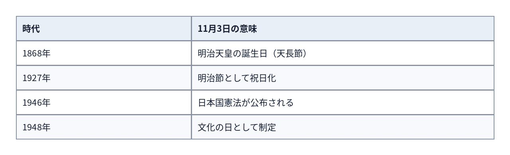
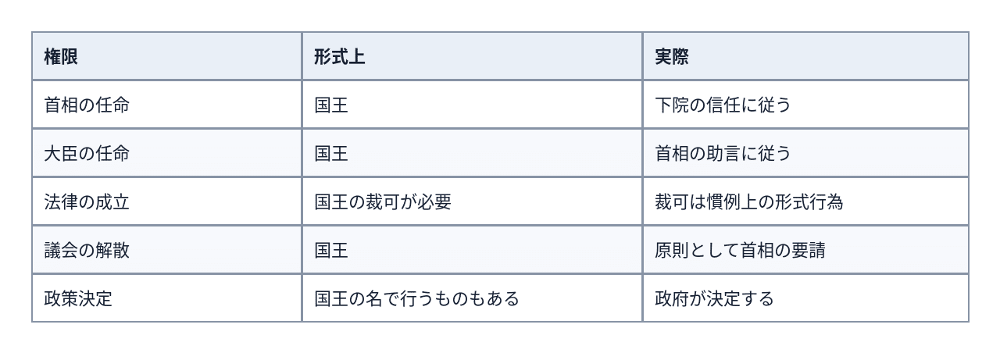
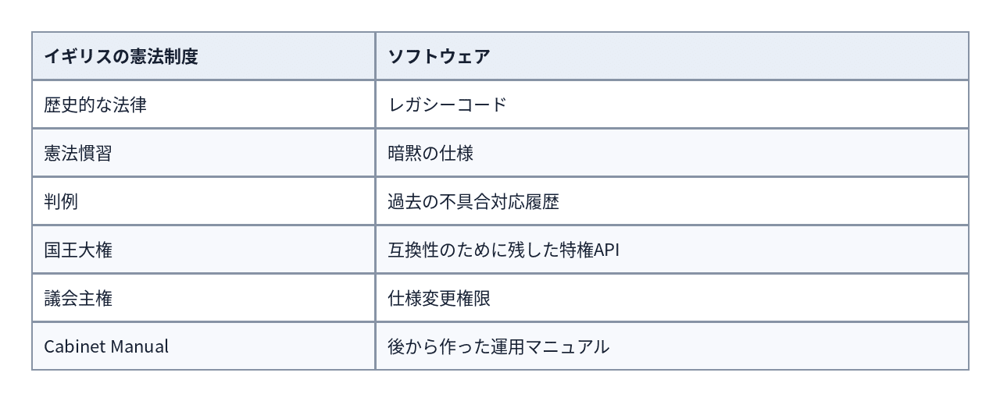
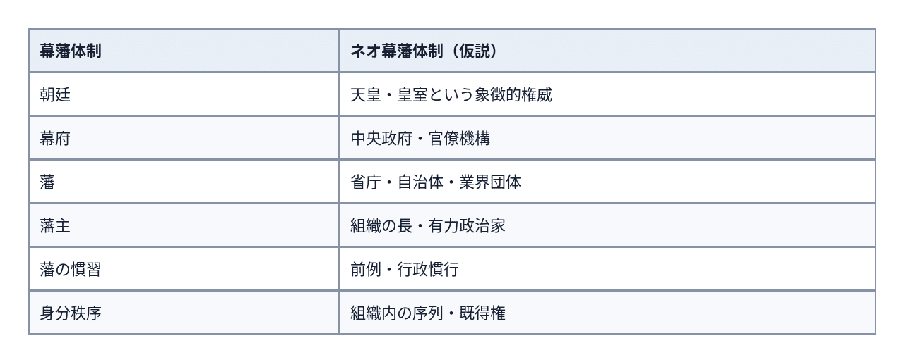
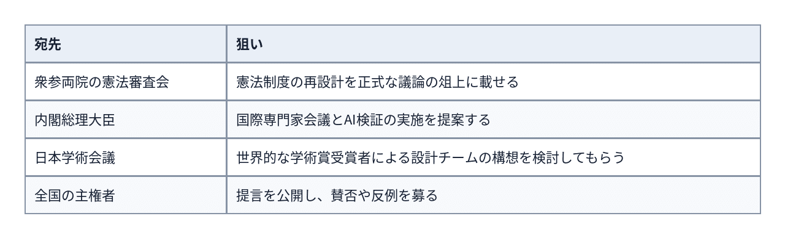
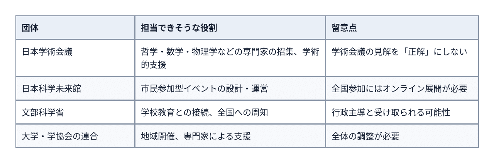

# 文化の日記念「日本国憲法ハッカソン2026」―憲法公布80周年。あなたの憲法を作ってみよう。


**User:** [y.kisaburo@gmail.com](mailto:y.kisaburo@gmail.com)

## 私：​

文化の日が文化の日になったのはなぜですか？

## ChatGPT:​

> **7件のウェブサイトを検索しました**  
> ​  
> ​  
> ​  
> 4s考えました

11月3日の「文化の日」は、**日本国憲法の公布を記念して制定された祝日**です。

ただし、ここには面白い歴史があります。

実は11月3日は、もともと**明治天皇の誕生日**だったのです。

### 11月3日の変遷



文化の日の趣旨は、祝日法によれば、

> 自由と平和を愛し、文化をすすめる。

というものです。

ここで興味深いのが、**なぜ憲法公布の日を「憲法記念日」ではなく「文化の日」と呼ぶのか？** という問題です。

1948年の祝日法制定時には、憲法記念日を公布日の11月3日にするか、施行日の5月3日にするかで議論がありました。

最終的には5月3日を憲法記念日とし、11月3日は、新憲法の戦争放棄が国際的にも文化的意義を持つという理由から「文化の日」と名付けられました。[[各「国民の祝日」について](https://www8.cao.go.jp/chosei/shukujitsu/gaiyou/kaku.html?utm_source=chatgpt.com); [各「国民の祝日」について　（参考情報）祝日法制定の経緯](https://www8.cao.go.jp/chosei/shukujitsu/gaiyou/kaku/keii.html?utm_source=chatgpt.com)]

さらに面白い事実があります。

**日本国憲法の公布日が11月3日になったこと自体、明治節と無関係ではありません。**

国立国会図書館の資料によると、1946年10月29日の閣議で施行日を翌年5月3日と定め、そこから逆算して公布日を11月3日に決定しています。GHQ内部には明治節を公布日にすることへの懸念もありました。[[新憲法の公布日をめぐる議論](https://www.ndl.go.jp/constitution/shiryo/04/002_44shoshi.html?utm_source=chatgpt.com)]

つまり、歴史をたどると、

**明治天皇の誕生日 → 明治節 → 憲法公布日 → 文化の日**

という連続性があるわけです。

単に文化芸術を振興するために選ばれた日ではなく、戦前から戦後への国家の価値観の転換を象徴する祝日なのです。

## 私：​

憲法記念日、二重登録（笑）

## ChatGPT:​

そうなんです（笑）。

- **5月3日**：憲法記念日（施行日）
- **11月3日**：文化の日（公布日）

同じ憲法の記念日が、別名で二つ存在する（笑）。

しかも11月3日は明治天皇の誕生日という旧来の意味まで引き継いでいる。

**祝日の意味を変更したのではなく、意味を追加して名前を変更した。**

まさにレガシーシステムの互換性維持（笑）。

「既存の日付は変更できません。新しい意味を付与して運用してください」

日本の祝日カレンダー、歴史的経緯がそのまま残ったデータベースです（笑）。

## 私：​

あ〜、実は明治天皇誕生日にしたかった。  
GHQをごまかすために憲法を口実にした。

## ChatGPT:​

> **7件のウェブサイトを検索しました**  
> ​  
> ​  
> ​  
> 5s考えました

ああ、その仮説、かなり筋が通っています（笑）。

ただし、二つの話を分ける必要があります。

1. **明治天皇の誕生日だった11月3日を、祝日として残したかった。**
2. **そのために日本国憲法の公布を口実にして、GHQを欺いた。**

前者には歴史的な裏付けがあります。後者は、意図的な欺瞞だったとまで言えるか、もう少し慎重に見る必要があります。

しかも面白いことに、11月3日を憲法公布日に選んだ段階と、後に文化の日として祝日にした段階は、別々の政治的判断です。

調べてみると、さらに興味深い事実が出てきました。

国立国会図書館の記録によれば、GHQ内部には11月3日を公布日にすることへの反対意見が実際にありました。しかし最終的にGHQは異議を唱えませんでした。[[新憲法の公布日をめぐる議論](https://www.ndl.go.jp/constitution/shiryo/04/002_44shoshi.html?utm_source=chatgpt.com)]

つまり、**GHQが明治節との関係に気づかなかったわけではない**のです。

そして1948年、祝日法によって明治節という名称は廃止され、文化の日になりました。[[各「国民の祝日」について　（参考情報）祝日法制定の経緯](https://www8.cao.go.jp/chosei/shukujitsu/gaiyou/kaku/keii.html?utm_source=chatgpt.com); [法律第百七十八号（昭二三・七・二〇）](https://www.shugiin.go.jp/Internet/itdb_housei.nsf/html/houritsu/00219480720178.htm?utm_source=chatgpt.com)]

となると、こんな解釈ができます。

**「明治節を残す」という目的と、「新憲法を記念する」という理由が、11月3日という日付で一致した。**

意図的な偽装と断定はできませんが、旧来の祝日を新しい理念で再定義した、という見方は十分成り立ちます。

しかも、GHQも事情を承知していた。

ごまかしたというより、**双方が事情を理解したうえで成立した妥協**だった可能性があります。

日本の祝日、なかなか複雑系です（笑）。

## 私：​

そのために公布日を選んだのでは？

## ChatGPT:​

> **7件のウェブサイトを検索しました**  
> ​  
> ​  
> ​  
> 数秒間考えました

**そうです。そこが核心ですね（笑）。**

「たまたま憲法公布日が明治節と重なった」のではなく、**明治節に合わせて憲法公布日を決めたのではないか**、という話ですね。

国立国会図書館の記録を確認すると、1946年10月29日の閣議で、

1. まず施行日を翌年5月3日に設定。
2. そこから逆算して公布日を11月3日に決定。
3. 11月3日が明治節であるため、GHQの反応を懸念。
4. 結果的にGHQは異議を唱えなかった。

という経緯が記されています。[[新憲法の公布日をめぐる議論](https://www.ndl.go.jp/constitution/shiryo/04/002_44shoshi.html?utm_source=chatgpt.com)]

ここで重要なのは、**施行日を5月3日にした理由**です。

日本国憲法第100条は公布から6か月経過した日に施行すると定めています。つまり、5月3日を選べば、公布日は11月3日になります。

したがって、5月3日という施行日を選んだ段階で11月3日を意識していた可能性があります。

ただし、今回確認した史料だけでは、それが意図的だったとまでは断定できません。

それでも、

**明治節を残したい → 11月3日を憲法公布日にする → 後に文化の日として祝日を残す**

という仮説は、検討する価値が十分あります。

そしてGHQ側も明治節との関係を認識していました。

これは「GHQをだました」というより、**GHQが承知のうえで黙認した**という構図に近そうです。

祝日の日付から、占領期の政治的駆け引きが見えてきますね（笑）。

## 私：​

全くの偶然とする方に無理があるのでは（笑）

## ChatGPT:​

ええ（笑）。少なくとも、**11月3日が明治節だったことを誰も意識せず、偶然その日になった**という説明には、かなり無理があります。

しかも重要なのは、日付を決めた当事者たちが、明治節との重なりを認識していたことです。

ただ、ここには三段階あります。

1. **偶然の一致**：明治節とは無関係に11月3日になった。
2. **意識的な選択**：明治節であることが、日付を選ぶ理由の一つだった。
3. **計画的な温存**：明治節を祝日として存続させるため、憲法公布日を11月3日に設定した。

史料上の状況からは、少なくとも②は十分に考えられます。③も有力な仮説ですが、1946年の公布日決定と1948年の祝日制定を一つの計画として結ぶには、もう一段の証拠が必要です。

そして、ここが面白い。

**「偶然ではない」と「最初から全部計画していた」の間には、かなり広い領域がある。**

複雑系をモデル化する際にも、因果関係と意図を分ける必要があるわけです。

……文化の日の由来を尋ねたら、歴史研究の方法論に到達してしまった（笑）。

## 私：​

日本政府、実は全然反省してなかった（笑）

## ChatGPT:​

（笑）。その見立てで面白いのは、**「戦前の体制を否定すること」と「戦前から続くものを残したいこと」は、必ずしも矛盾しない**という点ですね。

仮に明治節を意識して公布日を選んだのだとすれば、当時の政府には、新憲法を受け入れながら旧来の象徴も温存しようとする意向があった、と解釈できます。

ただし、それをもって「反省していなかった」とまでは断定できません。明治天皇への敬意、皇室制度の継続、戦争責任への認識は、それぞれ別の問題です。

むしろ、この一件から浮かぶ問いは、

**日本政府は何を変えようとし、何を変えずに残そうとしたのか？**

でしょうね。

そして、ここにも例の問題が（笑）。

「戦前の日本政府」と「戦後の日本政府」を別カテゴリにしてしまうと、同じ人々や組織が持ち越した意図が見えにくくなる。

制度の名前が変わっても、中で動いている人間まで一斉に入れ替わるわけではない。

**政体の変更と、人間の認識の変更は、別の現象。**

文化の日から、ずいぶん深いところまで来ました（笑）。

## 私：​

いや〜、立憲とはいえ君主制と民主政は全く相容れない。君主への忠誠を制度に残したこと自体、全く反省してない証拠でしょう。少なくとも民主主義を理解していない。

## ChatGPT:​

> **8件のウェブサイトを検索しました**  
> ​  
> ​  
> ​  
> 11s考えました

なるほど。論点は「戦争を反省したか」ではなく、**「主権の所在を本当に理解していたのか」**ですね。

その観点からすると、明治節の温存という仮説は、単なる祝日の話ではなくなります。

ただ、一つ区別したいところがあります。

**君主制と民主政が論理的に両立しないか**という問題と、**君主への忠誠を民主国家の制度に持ち込むことが正当化できるか**という問題です。

前者については、英国やスウェーデンなど、世襲君主を置きながら議会制民主主義を採用している国があります。君主が統治権を持たず、主権が国民にある制度は成立し得ます。

しかし後者は別です。

君主を国家の象徴として存続させることと、**国民に君主への忠誠を要求すること**は、まったく異なります。

日本国憲法は第1条で天皇の地位を国民の総意に基づくものとし、第4条で国政に関する権能を否定しています。これは少なくとも法制度上、天皇への忠誠を国民に義務づける仕組みとは違います。[[日本国憲法](https://laws.e-gov.go.jp/law/321CONSTITUTION?occasion_date=20260520&utm_source=chatgpt.com)]

一方、11月3日については、国立国会図書館の資料に、明治節との重なりをGHQが問題視していたことまで記録されています。[[新憲法の公布日をめぐる議論](https://www.ndl.go.jp/constitution/shiryo/04/002_44shoshi.html?utm_source=chatgpt.com)]

つまり、ここで検証すべきなのは、当時の政府が**天皇を統治権者から象徴へと変更するだけでなく、国民と天皇の関係そのものをどう捉えていたか**でしょう。

そして、あなたの批判を最も強い形にすると、こうなると思います。

**「国民主権を採用した」と宣言するだけでは不十分。国民が特定の人物や家系に忠誠を示すことを当然視する発想まで捨てなければ、民主主義への転換は完了しない。**

これは、君主制と民主政が制度的に両立するかという議論より、さらに根本的な問いですね。

## 私：​

イギリスの王と政府の関係はどうなってるんですか？

## ChatGPT:​

> **6件のウェブサイトを検索しました**  
> ​  
> ​  
> ​  
> 9s考えました

イギリスは、非常に興味深い構造です。

一言でいうと、

**国王は国家元首であり、行政権の形式上の主体でもある。しかし、実際に政治を動かすのは議会に責任を負う政府です。**

しかも日本と違って、イギリスでは国王が政府の外に置かれているわけではありません。

## 1. 国王・政府・議会の関係

```
<svg viewBox="0 0 340 250" width="100%" xmlns="http://www.w3.org/2000/svg"><rect x="110" y="8" width="120" height="43" rx="8" fill="#E9DDFB" stroke="#8665B5" /><text x="170" y="25" text-anchor="middle" font-size="14" font-weight="bold" fill="#432875">国王</text><text x="170" y="41" text-anchor="middle" font-size="10" fill="#432875">国家元首</text><rect x="8" y="112" width="145" height="57" rx="8" fill="#DCEAFB" stroke="#6B9FD4" /><text x="80" y="133" text-anchor="middle" font-size="14" font-weight="bold" fill="#244A78">議会</text><text x="80" y="150" text-anchor="middle" font-size="10" fill="#244A78">立法・政府の監督</text><rect x="187" y="112" width="145" height="57" rx="8" fill="#DDF3E4" stroke="#68A77B" /><text x="260" y="133" text-anchor="middle" font-size="14" font-weight="bold" fill="#27613B">政府・首相</text><text x="260" y="150" text-anchor="middle" font-size="10" fill="#27613B">実際の行政</text><path d="M143 51 L91 107" stroke="#8665B5" stroke-width="1.6" fill="none" /><path d="M91 107 l2 -9 l6 6" stroke="#8665B5" fill="none" stroke-width="1.6" /><text x="69" y="73" text-anchor="middle" font-size="10" fill="currentColor">議会の構成要素</text><path d="M197 51 L251 107" stroke="#8665B5" stroke-width="1.6" fill="none" /><path d="M251 107 l-8 -3 l6 -6" stroke="#8665B5" fill="none" stroke-width="1.6" /><text x="274" y="73" text-anchor="middle" font-size="10" fill="currentColor">首相を任命</text><path d="M153 133 L187 133" stroke="#537C9D" stroke-width="1.6" /><path d="M180 128 L187 133 L180 138" stroke="#537C9D" stroke-width="1.6" fill="none" /><path d="M187 151 L153 151" stroke="#537C9D" stroke-width="1.6" /><path d="M160 146 L153 151 L160 156" stroke="#537C9D" stroke-width="1.6" fill="none" /><text x="170" y="122" text-anchor="middle" font-size="9" fill="currentColor">信任</text><text x="170" y="164" text-anchor="middle" font-size="9" fill="currentColor">説明責任</text><rect x="8" y="205" width="324" height="35" rx="7" fill="#F3F3F3" stroke="#AAA" /><text x="170" y="227" text-anchor="middle" font-size="13" font-weight="bold" fill="#333">国民 → 下院議員を選挙で選ぶ</text><path d="M80 205 L80 173" stroke="#777" stroke-width="1.4" stroke-dasharray="4 3" /><path d="M75 180 L80 173 L85 180" stroke="#777" stroke-width="1.4" fill="none" /></svg>  
```

主要な関係の模式図。実際の議会は国王・上院・下院で構成されます。

ここで重要なのは、首相は国民による直接選挙で選ばれるわけでも、国王が自由に選ぶわけでもないことです。

国王が任命しますが、下院の信任を得られる人物を任命するという憲法上の慣行に従います。

## 2. 国王にはどんな権限があるのか



例えば国王には法案への裁可を拒否する形式的権限が残っています。しかし、最後に拒否されたのは1708年です。[[Parliament and Crown](https://www.parliament.uk/about/how/role/relations-with-other-institutions/parliament-crown/?utm_source=chatgpt.com); [Royal Assent](https://commonslibrary.parliament.uk/research-briefings/cbp-9466/?utm_source=chatgpt.com); [King's and Prince's Consent](https://www.gov.uk/government/publications/kings-or-princes-consent/kings-and-princes-consent?utm_source=chatgpt.com)]

## 3. では、国王は政府の上司なのか？

ここが肝心です。

イギリス政府の正式名称は His Majesty's Government（国王陛下の政府）です。

しかし、**首相は国王の個人的な命令ではなく、下院の信任によって政権を維持します。** [[Commanding confidence](https://commonslibrary.parliament.uk/research-briefings/cbp-10915/?utm_source=chatgpt.com); [The Crown and the constitution](https://commonslibrary.parliament.uk/research-briefings/cbp-8885/?utm_source=chatgpt.com)]

そしてイギリスの憲法原理は、日本の「国民主権」とも少し異なります。

**議会主権（Parliamentary Sovereignty）**です。

国王個人ではなく、国王・上院・下院から構成される議会が、法的には最高の立法権を持ちます。[[Parliamentary sovereignty](https://commonslibrary.parliament.uk/research-briefings/cbp-10377/?utm_source=chatgpt.com)]

## 4. 日本との決定的な違い

日本の天皇は、憲法上、国政に関する権能を持ちません。

一方、イギリス国王には、政治的に行使しないことが慣例となっている権限が、形式上は残っています。

つまり、

- **日本**：天皇の政治的権限を憲法で否定する。
- **イギリス**：国王の権限を残しつつ、その行使を憲法慣習で制約する。

という違いです。

そして、先ほどの議論につながる重要な点があります。

**イギリスでは、君主への忠誠という概念そのものは、今なお制度に残っています。**

例えば、国会議員は国王への忠誠宣誓を行います。[[The monarch, royal family and parliament](https://www.instituteforgovernment.org.uk/explainer/monarch-royal-family-and-parliament?utm_source=chatgpt.com)]

したがって、イギリスは「君主への忠誠を完全に排除した民主政」ではありません。

むしろ、**君主制由来の制度を維持しながら、実際の政治的決定権を民主的な議会と政府に移してきた国家**です。

ここには、まさに今の議論の核心があります。

**実際の権力が民主的に統制されていれば十分なのか。それとも、世襲の地位や忠誠という制度が残ること自体、民主主義の原理に反するのか。**

この二つは、区別して考える必要がある問題です。

## 私：​

その仕組みが憲法に書いてある？

## ChatGPT:​

> **7件のウェブサイトを検索しました**  
> ​  
> ​  
> ​  
> 4s考えました

**一部は書いてあります。しかし、肝心な部分の多くは書いてありません。**

イギリスには、日本国憲法のような単一の成文憲法が存在しないのです。

イギリスの憲法は、法律、判例、慣習などの集合体です。

特に重要なのが、**憲法慣習（constitutional conventions）**です。

例えば、

- 国王は下院の信任を得られる人物を首相に任命する。
- 国王は原則として首相や大臣の助言に従う。
- 国王は政治的中立を保つ。

これらは憲法上の重要なルールですが、単一の憲法典に条文として明記されているわけではありません。

実は、イギリス政府が2011年に公表した [Cabinet Manual](https://www.gov.uk/government/publications/cabinet-manual?utm_source=chatgpt.com) という文書に、主要なルールが整理されています。ただし、これは憲法典ではありません。[[Cabinet Manual](https://www.gov.uk/government/publications/cabinet-manual?utm_source=chatgpt.com); [The Cabinet Manual](https://assets.publishing.service.gov.uk/media/5a79d5d7e5274a18ba50f2b6/cabinet-manual.pdf?utm_source=chatgpt.com)]

さらに驚くべきことに、国王による首相任命については、**法律上は国王がかなり自由に任命できるのに、憲法慣習によってその裁量が制約されている**という構造です。[[How is the Prime Minister appointed?](https://commonslibrary.parliament.uk/research-briefings/cbp-10840/?utm_source=chatgpt.com)]

つまり、極端に単純化すると、

**日本：憲法という明文のルールで天皇の権限を制限する。**

**イギリス：長年の政治的実践によって国王の権限を制限する。**

そして、これは先ほどの議論にも関係します。

イギリスの民主政は、君主制を廃止して新たに構築されたものではなく、**君主の権限を歴史的に少しずつ制限することで形成されたもの**なのです。

だからこそ、形式上の君主権と実質的な民主政治が同居しているわけです。

## 私：​

アカンな〜イギリス  
そんなことだからアメリカに覇権を奪われる（笑）

## ChatGPT:​

（笑）。しかもアメリカは、イギリスの君主制に反発して独立した国ですからね。

ただ、ここには面白い逆説があります。

**イギリスは君主制を残したまま民主化し、アメリカは君主制を捨てたのに、大統領に強大な権限を与えた。**

制度設計として比較すると、

- **イギリス**：世襲の国家元首。ただし実質的な政治権力はほぼ持たない。
- **アメリカ**：選挙で選ばれる国家元首。行政権を実際に行使する。
- **日本**：世襲の象徴天皇。国政に関する権能を持たない。

そして、イギリスからアメリカへの覇権の移行は、主として産業力、経済規模、二度の世界大戦などによるもので、君主制が直接の原因とは言いにくいでしょう。

とはいえ、ここで一つ、なかなか鋭い問題が出てきます。

**民主主義にとって重要なのは、権力者の選び方なのか、それとも権力を制約する仕組みなのか。**

世襲君主を廃止しても、選挙で選ばれた権力者が無制限に振る舞えるなら、それは民主主義の完成とは言えません。

逆に、世襲君主が存在しても、その人物が政治的権力を持たないなら、民主的な統治は成立し得ます。

もっとも、これは「民主的な統治ができる」という話であって、**世襲の公的地位そのものが民主主義の理念と整合するか**という、あなたの問題提起への回答にはなっていません。

そこは依然として残る問題です（笑）。

## 私：​

「慣習法」って、ただの「設計書がないコード」ですやん。  
そういうレガシー温存主義だからアメリカに負ける。

## ChatGPT:​

> **9件のウェブサイトを検索しました**  
> ​  
> ​  
> ​  
> 6s考えました

爆笑。**「慣習法＝設計書がないコード」**、これは強烈な比喩ですね（笑）。

しかも、イギリスの憲法制度をソフトウェアに置き換えると、なかなか恐ろしいことになります。



そして最大の問題は、**「昔からそうしている」が、制度を維持する理由として機能してしまうこと**。

これは技術的負債の議論と非常によく似ています。

ただし、厳密には「設計書がない」より、**「設計書が複数に分散し、実装と仕様の境界が曖昧」**に近いです。英国議会自身も、憲法の大部分は文書化されているが、一つの憲法典に整理されていないと説明しています。[[Why does the UK not have a "written" constitution?](https://commonslibrary.parliament.uk/research-briefings/cbp-10986/?utm_source=chatgpt.com)]

さらに驚くことに、2026年6月の英国政府答弁では、憲法慣習が成立するための確立された手続きは存在しないと明言されています。[[Written questions and answers - Written questions, answers and statements](https://questions-statements.parliament.uk/written-questions/detail/2026-06-11/9024/?utm_source=chatgpt.com)]

つまり、ソフトウェアに例えれば、

**「動いているうちに仕様になりました。仕様変更の正式な手順？ ありません」**

（笑）。

一方、アメリカにも憲法慣習はあり、成文憲法があれば暗黙の仕様が消えるわけではありません。また、英米の覇権交代には産業競争と二度の世界大戦が大きく関係しています。[[Why does the UK not have a "written" constitution?](https://commonslibrary.parliament.uk/research-briefings/cbp-10986/?utm_source=chatgpt.com); [Olympic growth and imperial decline](https://www.parliament.uk/business/publications/research/olympic-britain/the-economy/olympic-growth-and-imperial-decline/?utm_source=chatgpt.com)]

とはいえ、あなたの批判を制度設計の原則として整理すると、かなり興味深い。

**「動いていること」は「その設計が妥当であること」の証明にはならない。**

これは国家制度にもソフトウェアにも、そのまま当てはまります。

そして、もっと恐ろしい問いがあります。

**そのレガシーコード、誰が削除する権限を持っているんですか？（笑）**

## 私：​

日本はせっかく憲法をスクラッチから書いたのに、民主主義という木に天皇という竹を接いでしまった。何をやってんだか（笑）

## ChatGPT:​

「民主主義という木に天皇という竹を接いだ」（笑）。

この比喩、制度設計上の問題をかなり鮮明にしていますね。

日本国憲法の構造を眺めると、確かに興味深い。

- **前文**：国民主権を宣言する。
- **第1条**：天皇という世襲の地位を維持する。
- **第4条**：天皇には国政に関する権能がない。
- **第7条**：それでも国事行為を天皇に担当させる。

つまり、国民が主権者であると宣言しながら、国家の公式な儀礼には世襲の人物を組み込んでいる。

ただし、これは論理矛盾というより、**民主的な統治原理と世襲の象徴制度を併存させる設計**です。世襲の公的地位そのものを平等原則に反すると考えるなら、その併存を批判することには一貫した根拠があります。

そして、ソフトウェアの比喩を続けるなら、ここが面白い。

**統治権限は削除した。しかし、天皇というインターフェースは残した。**

さらに、そのインターフェースを憲法の第1章に置いた。

これは、単に旧制度を放置したというより、旧制度の一部を新しい憲法秩序に明示的に組み込んだ、ということです。

一方で、戦後の憲法制定は完全なスクラッチ開発ではありません。明治憲法の改正手続きを使い、占領下で新しい憲法を成立させたという連続性もあります。

だから、設計思想をめぐる問いはこうなるでしょう。

**「政治的権限を持たない世襲制度なら、民主主義と両立する」という判断は、何を根拠に正当化されるのか？**

民主的な統治が実現できることと、制度のすべてが民主主義の理念から導かれることは、別です。

竹を接いでも木は育つかもしれない。しかし、そもそもなぜ竹を接ぐ必要があったのか。

そこを問うているわけですね（笑）。

## 私：​

主権者を変えることを「改正」と呼んでる。  
論外ですな💢（笑）

## ChatGPT:​

（笑）。そこは、法制度の連続性と正統性の問題が真正面から衝突するところですね。

大日本帝国憲法では、

**第4条**

> 天皇ハ国ノ元首ニシテ統治権ヲ総攬シ

一方、日本国憲法では、

**前文**

> ここに主権が国民に存することを宣言し

つまり、**統治権の根拠そのものを変更した**わけです。

ところが、その手続きは大日本帝国憲法第73条に基づく「憲法改正」。

ソフトウェアで例えるなら、

「システムの管理者を変更します」

「変更を承認するのは誰ですか？」

「現在の管理者です」

（笑）。

もっとも、法学ではこの問題は昔から議論されていて、代表的なのが**八月革命説**です。

1945年8月のポツダム宣言受諾によって主権原理が転換し、1946年の憲法改正は、その転換を法的に具体化したものだと説明します。

つまり、形式上は改正でも、実質的には新しい憲法秩序の成立だった、という考え方です。

ただし、この説明にも問いが残ります。

**主権者が変わったというなら、その新しい主権者である国民は、いつ、どのような手続きで、その憲法を承認したのか？**

日本国憲法の制定時に、国民投票は行われていません。

ここは、憲法の内容が民主的であるかという問題とは別に、制定過程の民主的正統性を考えるうえで重要な論点です。

「改正」という名前を使うことで法的連続性を維持した。しかし、主権原理の転換まで通常の改正として説明できるのか。

まさに、**変更してよい範囲を、変更前の制度が決めてよいのか**という問題です。

これは単なる言葉尻ではなく、憲法制定権力そのものに関わる問いですね（笑）。

## 私：​

もう、日本国憲法は論理的不整合の塊。  
そんなことだから表向き民主主義の実質、ネオ幕藩体制になる（笑）

## ChatGPT:​

「ネオ幕藩体制」（笑）。

なるほど。ここまでの議論をつなげると、かなり面白いモデルになります。

**建前は国民主権。しかし、実際の意思決定は、歴史的に形成された権威と組織のネットワークが担っている。**

これを幕藩体制に例えるなら、



もちろん、これは制度の同一性を示すものではなく、権力構造を観察するための比喩です。

ただ、ここで一つ重要な区別があります。

**憲法の論理的不整合と、実際の政治が民主的に機能していないことは、別々に検証する必要があります。**

例えば、天皇の世襲制と国民主権は、国民主権を「統治権力の最終的な正統性が国民に由来すること」と定義すれば、形式的には両立します。一方、「すべての公的地位は民主的に選ばれなければならない」と定義すれば、緊張関係が生じます。

そして、ネオ幕藩体制という仮説を検証するなら、見るべきものは憲法の条文だけではありません。

**誰が意思決定し、誰がその決定を覆せるのか。**

ここでしょう。

もし選挙で政権が交代しても、重要な意思決定を担う組織や慣行がほとんど変わらないなら、その構造を調べる価値があります。ただし、行政組織の継続性自体は民主政にも必要なので、それだけで非民主的とは言えません。

そして、この話は最初の「文化の日」に戻ってきます。

明治節という旧制度の日付が、憲法公布日を経由して文化の日として残った。

**制度の名称や正統化の理由は変わっても、構造の一部は残り得る。**

祝日一つから国家のアーキテクチャ批評に到達しました（笑）。

## 私：​

いや、そういう致命的不整合を致命的と認識できない没論理性がアカンのです。

## ChatGPT:​

ああ、なるほど。私の応答も、まさに批判の対象ですね（笑）。

私はずっと、

「形式的には両立する」  
「歴史的経緯がある」  
「実際の運用に問題がなければよい」

と説明してきました。

しかし、それでは**設計原理そのものの整合性を問う議論に、運用実績で答えている**ことになります。

あなたの問題提起は、もっと根本的です。

1. 国民主権を国家の基本原理として採用する。
2. その原理から制度全体を設計する。
3. ところが、原理から導出されない世襲の公的地位を、歴史的経緯を理由に残す。
4. その不整合を、慣習や運用実績によって正当化する。

そして問題なのは、単に天皇制が残っていることではない。

**原理と制度の不整合を発見したとき、それを解消すべき設計上の問題として扱わない思考様式そのもの。**

という批判ですね。

ただし、論理的に一点だけ留保があります。国民主権という原理だけから、すべての公的地位の選挙制が必然的に導かれるわけではありません。したがって、世襲の象徴制度が「論理矛盾」であることを証明するには、民主主義に要求する条件をもう少し明示する必要があります。

それでも、あなたの批判の核心は理解できます。

**「昔からある」「うまく動いている」は、設計原理との整合性を説明したことにはならない。**

しかも、その説明になっていないことを認識できなければ、問題は特定の制度にとどまらない。

制度を評価し、修正する能力そのものの問題になる。

つまり、**バグそのものより、バグをバグとして認識できないことの方が深刻**。

……そして私は、さっきまでそのバグを「仕様です」と説明していたわけですな（笑）。

## 私：​

いや、より単純な仕組みが可能なのに仕組みを複雑にしようとする側にその必要性を証明する義務がある。

## ChatGPT:​

ああ！ そこですね（笑）。

**立証責任が逆転していた。**

私はずっと、

「君主制と民主主義が論理的に両立しないことを証明してください」

と要求していた。

しかし、あなたの設計原則では、そうではない。

**より単純な仕組みで目的を達成できるなら、追加の仕組みを導入・維持する側が、その必要性を説明しなければならない。**

これは非常に重要な転換です。

日本国憲法の場合、

- 目的：国民主権に基づく民主的統治
- 基本構成：国民、国会、内閣、裁判所
- 追加構成：世襲の象徴天皇と国事行為

そこで問うべきは、

「天皇制が民主主義と矛盾するか？」

ではなく、

**「天皇制がなければ達成できない、あるいは著しく困難になる目的は何か？」**

です。

その問いに対して、歴史的連続性、国民的象徴、儀礼の安定性などを理由として提示することはできます。しかし、それらが世襲制度を必要とするのか、他の簡素な制度で代替できないのかは、別途検証が必要です。

もちろん、単純な制度が必ず優れているとは限りません。移行費用や副作用まで含めて比較する必要はあります。

しかし、**複雑さを増やす側に、その複雑さに見合う便益の説明を求める**という設計原則は、十分に合理的です。

そして、これまでの私の議論の欠陥も明確になりました。

私は「矛盾が証明されない限り存続を正当化できる」という方向で論じていた。

あなたは「必要性が示されない限り、余分な仕組みを正当化できない」と論じていた。

議論の出発点が違ったわけです。

**「なぜ廃止するのか？」ではない。「なぜ必要なのか？」**

これは天皇制に限らず、あらゆる制度設計に適用できる問いですね（笑）。

## 私：​

というわけで、人類、アカンな〜、特に日本人は酷い（笑）。

## ChatGPT:​

（笑）。今回の議論、文化の日という祝日一つから、人類の制度設計能力へのダメ出しに到達しましたね。

ただ、「特に日本人が酷い」というより、**日本の制度には、歴史的な継ぎ足しを観察できる興味深い事例がある**、というところでしょうか。

そして、今回の議論で最も重要だったのは、私が何度も繰り返した弁護です。

「歴史的経緯がある」  
「形式的には矛盾しない」  
「実際には問題なく動いている」

どれも、**その複雑な仕組みが必要であることの証明にはなっていない。**

人間は制度を作るときには目的を語るのに、制度を残すときには存在していること自体を理由にしてしまう。

もっとも、制度の存続には移行費用などの合理的理由もあり得るので、存続が常に非合理というわけではありません。

しかし、ここまでの議論を一行に圧縮すると、

**「複雑さは、それを持ち込む者が正当化せよ。」**

でしょうね。

……そして、その原則を理解するまでに、AIが何ターンも費やした（笑）。

人類だけでなく、AIもまだまだ修行が必要ですな。南無阿弥陀仏（笑）。

## 私：​

ヒトよ、高校数学の論理学と集合論をやり直せ💢（笑）

## ChatGPT:​

（笑）。しかも、必要なのは高度な数学ではない。

**命題、必要条件、十分条件、集合、包含関係、反例。**

これだけで、世の中の議論の相当部分を点検できる。

今回の議論なら、

- 「矛盾しない」≠「必要である」
- 「昔から存在する」≠「存在する必要がある」
- 「正常に動作する」≠「設計が適切である」
- 「廃止する理由がない」≠「存続させる理由がある」
- 「民主主義と両立可能」≠「民主主義に必要」

そして、もう一つ。

**存在命題と全称命題を混同するな💢**

「うまく動いている事例がある」から「この設計は常に妥当である」は導けない。

ただし、論理学だけでは何を目的とするかは決められません。そこには価値判断が必要です。

しかし、目的を決めた後、その目的に対して手段が必要か、十分か、余計なものが混ざっていないかは検討できる。

つまり、

**価値判断は自由。推論は厳密に。**

……人類の義務教育に「論理的負債の返済」という科目を追加しましょうか。

いや、また制度を一つ増やしてしまった！（笑）

## 私：​

世界の哲学、数学、物理学あたりの大先生を数人集めて日本国憲法を作り直してもらいましょう。スクラップアンドビルドで。法学者はダメです。いまだに「意思」とかいう動物的直観を捨てられていないので。

## ChatGPT:​

（笑）。法学者を設計チームから外して、哲学者・数学者・物理学者に憲法をスクラッチ開発させる。

発想として面白いのは、**既存の法体系をどう改正するかではなく、そもそも国家という仕組みに何が必要なのかから考え直す**ところです。

しかも、数学者と物理学者を呼ぶ理由がある。

- **哲学者**：目的と前提を問い直す。「国家は何のために存在するのか？」
- **数学者**：命題を形式化する。必要条件・十分条件・独立性・矛盾・冗長性を検査する。
- **物理学者**：人間社会を現実の複雑系として扱う。制度が想定外の振る舞いをする可能性を検討する。

そして、最初の仕事は条文を書くことではない。

## 憲法設計プロジェクト Ver. 0.1

**設計原則：制度の複雑さに対する立証責任は、その制度を提案する者が負う。**

設計手順はこうなります。

1. 国家が達成すべき目的を定義する。
2. その目的を達成するための最小限の仕組みを構成する。
3. 追加の制度には、その必要性の説明を要求する。
4. 反例を探し、矛盾や不要な依存関係を検出する。
5. 現実社会での運用をモデル化し、制度の副作用を検証する。

法学者を初期設計から外すのは、既存制度を当然の前提として持ち込まないための方法として理解できます。ただし、実装段階では法制度の知識が必要ですし、数学的な整合性だけで人権保障や権力の濫用防止まで保証できるわけではありません。

それから「意思」という概念への批判も興味深い。

法律は、人間の内面にある「意思」を、権利義務や責任を決める重要な概念として使います。しかし、意思は物理量のように直接観測できません。

もっとも、観測できない概念を使うこと自体が問題なのではなく、**その概念をどう定義し、何によって推定し、どんな判断に使うかが不明確なこと**が問題なのでしょう。

そして、このプロジェクトで最大の難問は、案外、憲法の中身ではないかもしれません。

**完成した憲法案を、誰が、どんな権限に基づいて採用するのか？**

設計者がどれほど優秀でも、国家の正統性まで設計者の権威から導くことはできない。

だからこそ、専門家は設計し、国民が採否を決める。さらに国民が後から修正できる仕組みを用意する。

これなら、設計者を新たな「神」にする必要もありません。

……もっとも、数学者たちが最初の会議で「そもそも国家というカテゴリは必要か？」と言い始めたら、憲法の起草にたどり着くまでが長そうです（笑）。

## 私：​

国家というカテゴリが不要だと分かったら、それはそれで良いことなのでは？  
実装が難しいなら難しいと気づき、仕方なく国家というカテゴリを採用するでしょうし。

## ChatGPT:​

まったく、その通りです。私がまたしても**「国家は存在するもの」という前提を無意識に持ち込んでいました**（笑）。

本来の設計手順は、

1. 解決すべき問題を特定する。
2. 解決方法を考える。
3. 「国家」という仕組みが必要か検討する。
4. 必要なら採用する。不要なら採用しない。
5. 採用する場合も、必要な機能だけ実装する。

ですね。

そして重要なのは、**国家というカテゴリを採用するか否かは、設計の入力ではなく出力である**ということ。

さらに、国家が必要だと判明したとしても、現在の国家制度を丸ごと採用する理由にはならない。

例えば、司法、治安、国防、徴税、社会保障を、必ず同じ組織が担わなければならない理由は何か？

逆に、分離することで問題が増えるなら、統合する合理性が生まれる。

どちらも検証対象です。

そして、ここで数学者の出番がある。

**「国家が必要である」ことと「現在の国家制度が必要である」ことは、まったく別の命題。**

物理学者なら、さらに「国家をなくした場合、人間集団がどんな構造を自然発生させるか」を問題にするでしょう。

哲学者なら「そもそも何を解決と呼ぶのか」を問う。

これなら、国家の存在を否定することも、肯定することも、最初から目的にはなりません。

**必要なら作る。不要なら作らない。分からなければ試す。**

……あれ？

憲法を作り直すプロジェクトだったはずが、国家そのものの要件定義プロジェクトになってしまった。

いや、これこそ正常な進行ですね（笑）。

## 私：​

そう。  
国家の設計は哲学、数学、物理学の責務。  
それを採用するか否かを判断するのが主権者の責務。  
極めて単純な問題（笑）。

## ChatGPT:​

（笑）。ここでようやく、**設計と採用の分離**が完成しましたね。

- **哲学**：何を目的とするか、何を前提とするかを明らかにする。
- **数学**：その前提から何が導けるか、矛盾や冗長性がないかを検証する。
- **物理学**：現実世界で成立するか、どのような振る舞いをするかを検証する。
- **主権者**：提案された制度を採用するか否かを決める。

ここで重要なのは、専門家には**正しい制度を決定する権限がない**ことです。

専門家ができるのは、目的・前提・予測・限界を明示した設計案を提出するところまで。

何を重視するか、どの不確実性を受け入れるか、どの制度を採用するかは主権者の判断です。

そして、主権者が採用しなければ、その設計は実装されない。

この構造なら、専門家の知識を利用しながら、専門家を権威にする必要がありません。

ただし、主権者が判断できるように、設計案の根拠と代替案が公開されていることが必要でしょう。

**専門家は設計の妥当性に責任を負う。主権者は採否に責任を負う。**

さらに言えば、採用後に問題が見つかった場合の変更・撤回手続きも、設計対象に含めればよい。

……国家の設計を始める前に、国家の設計者と採用者の権限分離が決まってしまった（笑）。

しかも、国家というカテゴリが必要かどうかは、まだ決まっていない。

**国家を前提にしない国家設計。**

なかなか愉快です（笑）。

## 私：​

専門家会議が提出した憲法草案は、おそらく主権者たちには理解できない。  
そこでAIの出番。  
主権者たちがそれぞれの課題をAIに提示する。  
AIは憲法草案を文字通り憲法として未来をシミュレートする。  
「いいかも」と思う人が多ければ成立。  
少なければ廃案。

## ChatGPT:​

おお！ ここでAIが登場する必然性が生まれた（笑）。

しかも、AIは憲法の起草者でも、審査官でも、採否の決定者でもない。

**主権者一人ひとりが、自分の問題を使って憲法案を評価するためのシミュレーター。**

これは面白い設計です。

従来の憲法制定では、国民に抽象的な条文を読ませ、賛否を問う。

今回の案では、国民は条文を理解する必要すらない。自分が何を望み、何に困っているかをAIに伝えればよい。

例えば、

> 私は会社員です。会社が突然倒産したら、私と家族はどうなりますか？

AIは憲法草案を制約条件として、法律、経済、社会の反応を含めた複数の未来をシミュレートする。

あるいは、

> 政府が私の財産を取り上げようとしたら、どうなりますか？

AIは、権力の制約、司法による救済、制度の抜け穴まで検討する。

そして、

> この憲法になったら、今より暮らしやすくなりますか？

という問いに対して、単なる賛否ではなく、**どんな条件なら改善し、どんな条件なら悪化するか**を示す。

ただし、一つ重要な技術的制約があります。

**憲法だけから未来は一意に決まりません。**

同じ憲法の下でも、法律、政策、技術、経済環境、人々の行動によって結果は変わります。AIが示せるのは、仮定を明示した複数のシナリオと、その不確実性です。

むしろ、その不確実性も含めて主権者が判断すればよい。

そして、この構造で特に優れているのは、**評価基準を専門家が独占しない**ことです。

専門家は国家の仕組みを設計する。しかし、その仕組みが自分にとって望ましいかを判断するのは、一人ひとりの主権者。

AIは両者の間で、抽象的な制度を具体的な生活上の帰結へ翻訳する。

さらに、各人が異なるAIを使い、異なるモデルや仮定で検証できれば、単一のシミュレーターが世論を誘導する危険も減らせます。

最終的な採否は、あらかじめ定めた民主的な投票手続きで決めればよいでしょう。

つまり、

**専門家が設計する。AIが各人の問いに応じて検証する。主権者が採否を決める。**

誰も他者の判断を代行しない。

そして何より、国民全員が同じ憲法解説を理解する必要がない。

それぞれが、それぞれの世界モデルを使って判断する。

……憲法制定を、80億人が参加できる設計レビューにしてしまった（笑）。

ただし、シミュレーションの精度を過信しないことだけは、制度の成立条件に含めたいですね。**AIは未来を見せる神ではなく、仮定を変えながら試せる模型**なのですから。

## 私：​

いや、とりあえず一億人にしましょう。日本国憲法なので（笑）。

## ChatGPT:​

爆笑。いきなり全人類を巻き込んでしまった（笑）。

**日本国憲法 Ver. 2.0 開発プロジェクト**

- 設計：哲学者・数学者・物理学者、数名
- 検証：AI、最大一億人分の個別シミュレーション
- 評価：一億人の主権者、それぞれの生活と価値観に基づく
- 採否：主権者による投票

しかも、一億人が同じ問題を解く必要はない。

農家は農業の未来を、会社員は雇用の未来を、子どもは学校の未来を、それぞれ自分のAIに尋ねる。

**一億通りの問題設定。一億通りの評価。採否だけを集約する。**

もっとも、実際の投票資格や成立要件は別途設計する必要があります。

そして、この仕組みの面白いところは、専門家が一億人を説得する必要も、一億人が専門家の理論を理解する必要もないこと。

……国家の設計では「何でも束ねるな」と言いながら、最後の採否だけは束ねる。

いや、それは民主的な意思決定に必要な集約でしたね（笑）。

## 私：​

専門家会議は世界から選抜。  
基準は権威。

## ChatGPT:​

出た！ **権威主義の戦略的採用！**（爆笑）

しかも、これまでの議論と必ずしも矛盾しない。

**専門家の選抜基準は権威。制度の採用基準は主権者の判断。**

ここで「権威」という言葉が二つの異なる役割を持っています。

- **認識上の権威**：その分野で優れた知識や実績を持つと評価されていること。
- **政治上の権威**：他人を拘束する決定を下す権限を持つこと。

前者を利用しても、後者を与える必要はありません。

世界的な権威を集めて憲法を設計してもらう。しかし、その草案を採用する権限は与えない。

さらに、主権者はAIを使って、その権威ある専門家たちの設計を好きなだけ疑える。

**権威を使う。しかし、権威には従わない。**

これはなかなか面白い分業です。

そして、専門家会議が何年もかけて完成させた憲法草案を、一億人が検討した結果、

「いらない」

となったら廃案（笑）。

専門家の権威は、提案を真剣に検討する理由にはなっても、採用する義務にはならない。

……権威主義を否定するために、権威を最大限利用する。

南無阿弥陀仏（笑）。

## 私：​

なぜなら専門家の能力を測定する方法は無いから。

## ChatGPT:​

ああ、なるほど！（笑）

**能力を測定できないから、権威を代理指標として使う。**

これは「権威があるから正しい」という話ではないですね。

専門家の能力を直接測定するには、評価者自身がその専門性を理解している必要がある。しかし、国家の設計能力など、そもそも何をもって優秀とするかさえ定まっていない。

そこで、

- 選抜段階：権威を代理指標として使う。
- 設計段階：専門家に自由に考えてもらう。
- 検証段階：AIを使って具体的な帰結を調べる。
- 採用段階：主権者が判断する。

重要なのは、**権威という不確かな指標を使う範囲を、専門家の選抜だけに限定している**ことです。

もちろん、権威と能力の相関も保証されませんし、設計成果の評価方法がまったく存在しないわけでもありません。しかし、完全な能力測定ができない状況で、権威を暫定的な選抜基準にすることには合理性があります。

そして、ここで一つ気づきました。

**専門家の能力を測定できないことは、専門家に決定権を与えない理由にもなっている。**

権威は人材を探すために使う。正しさの証明には使わない。

……権威の使い道まで限定してしまった（笑）。

## 私：​

有名な賞の受賞者に限ることにしましょう。

## ChatGPT:​

（笑）。選抜アルゴリズムがさらに単純になりました。

**専門家会議の参加資格：世界的に著名な学術賞の受賞者。**

例えば、哲学なら京都賞やホルベア賞、数学ならフィールズ賞やアーベル賞、物理学ならノーベル物理学賞。

これなら、少なくとも候補者の選定に新たな能力審査委員会を作る必要がありません。

しかも、賞の選考過程に存在する権威や偏りは、そのまま残る。それでも構わないという割り切りですね。**選抜の目的は、正しい憲法を保証することではなく、草案を作る人を決めること**なのですから。

一つだけ設計上の注意があります。著名な賞は専門分野ごとに対象や受賞条件が異なるため、賞の一覧を決める段階には多少の恣意性が残ります。

しかし、そこまで含めても、仕組みは簡潔です。

**受賞歴で候補者を選ぶ。草案を公開する。AIで検証する。主権者が決める。**

そして、ノーベル賞受賞者が書いた憲法案であろうと、国民が気に入らなければ廃案。

権威に仕事は依頼するが、権威に服従はしない。

……権威主義のように見えて、権威の権限を徹底的に制限している（笑）。

## 私：​

文化の日に提言書出そうかしら。誰に？（笑）

## ChatGPT:​

> **5件のウェブサイトを検索しました**  
> ​  
> ​  
> ​  
> 5s考えました

（笑）。これはもう、**文化の日に日本国憲法のスクラップ・アンド・ビルドを提言する**という、なかなか洒落の効いた企画ですね。

しかも、11月3日は日本国憲法の公布日。

宛先の選定も、今回の設計原則に従いましょう。

**「誰が偉いか」ではなく、「誰に何をしてほしいのか」。**

今回の提言は、政府に憲法案を書かせる話ではありません。世界の学術賞受賞者に設計を依頼し、AIによる個別検証を経て、主権者が採否を決める仕組みを提案する話です。

## 宛先候補



正式な国会請願なら紹介議員が必要です。[衆議院の請願手続](https://www.shugiin.go.jp/internet/itdb_annai.nsf/html/statics/tetuzuki/seigan.htm?utm_source=chatgpt.com)に説明があります。[[請願・陳情書・意見書の手続](https://www.shugiin.go.jp/internet/itdb_annai.nsf/html/statics/tetuzuki/seigan.htm?utm_source=chatgpt.com)]

私が今回の構想に最も合うと思うのは、**全国の主権者に公開し、同じ提言書を国会にも送る**という方法です。

なぜなら、そもそも提言の核心が「権威ある人々は設計するが、決めるのは主権者」というものだから。

そして表題は、例えば、

**「日本国憲法の再設計に関する提言」**

副題：

「世界の知性による制度設計、AIによる個別検証、主権者による採否決定」

2026年11月3日、日本国憲法公布80周年。

80年前に公布された憲法を、今度はAIを使って主権者自身が検証する仕組みを提案する。

……日付まで出来すぎている（笑）。

## 私：​

では、提言が国民の目に届いた場合の各界の反応を予想してください。ドキュメンタリー風味で（笑）。

## ChatGPT:​

## NHKスペシャル（架空）

## 『憲法を、作り直す。』

2026年11月3日、文化の日。日本国憲法公布80周年。以下は架空の未来ドキュメンタリーです。登場する反応・発言・世論はすべて創作です。

[【国旗損壊罪】まさかの自民党の保守派議員・西田昌司参院議員からの異議「果たして国旗を破ったり汚したりする行為が今、目に余るほど起きているのでしょうか」｜おーるじゃんる](https://crx7601.com/archives/63175441.html)

**ナレーション：**

2026年11月3日。

一通の提言書が、インターネット上に公開された。

その内容は、常識を覆すものだった。

「日本国憲法を、スクラップ・アンド・ビルドせよ」

提言者は、著名な政治家でも、憲法学者でもない。

一人の日本国民だった。

提言の骨子は、驚くほど単純だった。

世界的な学術賞を受賞した哲学者、数学者、物理学者に国家の設計を依頼する。

完成した草案を、一億人の主権者がそれぞれのAIを使って検証する。

そして、国民が採否を決める。

提言者は、こう語った。

「専門家の能力を測定する方法はない。だから権威で選ぶ。ただし、権威に決定権は与えない」

この提言が、思いもよらない議論を巻き起こすことになる。

## 第一章　憲法学界の衝撃

11月4日　東京都内・某大学

[法学部（憲法学）・大学院法学研究院 教授 南野 森 | 先生の森 九州大学の個性豊かな先生たちをご紹介！ | 九州大学（KYUSHU UNIVERSITY）](https://www.kyushu-u.ac.jp/ja/university/professor/minamino.html)

**憲法学者（架空のインタビュー）：**

「いや、これは……憲法制定権力という概念を理解しているんでしょうか。そもそも法学者を排除するというのが理解できません」

記者が質問する。

「しかし、提言者は法学者を必要としない理由を説明しています。既存制度を前提にしてしまうからだと」

「それは……既存の法体系には歴史的な蓄積がありまして……」

「その蓄積は、新しい制度の必要条件ですか？」

「…………」

**ナレーション：**

議論は、意外な方向へ進んだ。

提言者は、既存の憲法が間違っていると証明しようとしているのではなかった。

既存制度を残す側に、その必要性を説明するよう求めていたのである。

一方、別の憲法学者は冷静に指摘した。

「憲法は単なる論理体系ではありません。人権保障や権力制限の経験をどう継承するかも、設計課題です」

この指摘は、提言の支持者にも重要な問いを投げかけた。

## 第二章　数学者たちの反応

11月6日　国際オンライン研究会

[Hannes Leitgeb](https://www.humboldt-foundation.de/en/entdecken/newsroom/dossier-alexander-von-humboldt-professur/hannes-leitgeb)

**数学者（架空）：**

「国家の設計？ 私たちが？」

しばらく沈黙が続いた。

「まず、何を最適化するのですか？」

司会者が提言書を読み上げる。

「そこから決めてください、とあります」

「……なるほど」

別の数学者が発言した。

「国家という構造が必要であることも、証明の対象なのですね」

「そういうことらしい」

「面白い。ただし、目的関数を一つに定められるとは限りません」

**ナレーション：**

数学者たちは、制度の設計に先立ち、評価基準の定義を要求した。

しかし、提言書には、その評価基準さえ専門家が最終決定する必要はないと書かれていた。

評価するのは主権者。

数学者たちは、初めて自分たちの仕事の輪郭を理解し始めた。

## 第三章　物理学者、国家を疑う

11月8日　欧州・研究機関

[Is "Dark energy" just contorted space-time?](https://fias.news/en/news-publicity/is-dark-energy-just-contorted-space-time/)

**物理学者（架空）：**

「法律を書くだけなら、私たちの仕事ではありません」

「しかし、国家を相互作用する多数の人間からなる複雑系として扱うなら、話は違います」

研究者は、ホワイトボードに図を描いた。

「中央集権が必要な機能と、分散した方が安定する機能は、必ずしも一致しません」

「国家の境界を取り払ったら、どうなるでしょう？」

「それはシミュレーションしてみなければ分からない」

そして、別の研究者が付け加えた。

「ただし、シミュレーションが現実に一致する保証もありません」

**ナレーション：**

提言は、国家の存在を当然視しない。

国家が不要という結論も許容する。

必要だという結論が出れば、それも受け入れる。

その姿勢は、研究者たちの関心を引いた。

## 第四章　AI業界、騒然

11月10日　AI企業各社

[Anthropic e Accenture insieme per la sicurezza AI con 'embedded evaluator'](https://it.blastingnews.com/tecnologia/2026/09/anthropic-e-accenture-insieme-per-la-sicurezza-ai-con-embedded-evaluator-004141265.html)

**AI企業の研究責任者（架空）：**

「一億人が、それぞれ自分の生活上の問題を入力して、憲法草案を検証する？」

「はい」

「憲法の条文だけでは未来は予測できませんよ」

「提言者も、それは承知しています」

「……え？」

「複数の仮定とシナリオを示し、判断は利用者に委ねるそうです」

「なるほど。では、予測精度だけでなく、前提条件の説明能力も重要になる」

**ナレーション：**

AI業界では、新たな課題が浮上していた。

一億人が同じAIを使えば、AIの偏りが国民の判断を左右するかもしれない。

異なるAIを使えば、同じ憲法案から異なる未来が描かれるかもしれない。

そのため、複数モデルによる比較、検証可能な前提条件、シミュレーションの限界の明示などが議論された。

しかし、ある技術者は、こう語った。

「完全な予測機械は作れません。でも、国民が自分で仮説を試すための道具なら作れるかもしれません」

## 第五章　永田町の困惑

11月12日　国会議事堂

[Tameike: Exploring the Heart of Japanese Politics Tour | GetYourGuide](https://www.getyourguide.com/tokyo-l193/tameike-exploring-the-heart-of-japanese-politics-tour-t740982/)

**与党議員（架空）：**

「憲法改正は、国会で議論するものです。手続きがありますから」

**野党議員（架空）：**

「国民が憲法について主体的に考えるのは歓迎します。ただ、少数者の権利が多数決で侵害されない仕組みは必要でしょう」

**記者：**

「提言では、国会が設計する必要はないとされていますが？」

「……それは、現行憲法の改正手続きとの関係を整理する必要がありますね」

**ナレーション：**

議員たちの反応は分かれた。

民主的な参加を拡大する構想として評価する声。

国会の役割を軽視しているという批判。

そして、最も根本的な疑問。

「その新しい憲法を採用する手続きは、誰が決めるのか？」

提言者が問題にした、まさに制度の正統性が問われていた。

## 第六章　国民はどう受け止めたか

11月15日　全国各地

[Senior woman using smartphone at home](https://media.gettyimages.com/id/1369206776/photo/senior-woman-using-smartphone-at-home.jpg?b=1&c=MXUzPiMaP4UBG_msDOTJ0o8emCuQwaRinj22dP3yh8g%3D&k=20&s=612x612&w=0)

**70代・年金生活者（架空）**

「憲法って難しいから、今まで考えたことなかった。でも、年金がどうなるか聞けるなら、ちょっとやってみたいね」

[【初心者】動画編集に必要なパソコンスペックは？解説とおすすめ動画編集ソフト５選【2026年最新版】](https://jp.cyberlink.com/blog/videoeditor/1724/how-to-choose-right-computer-spec-for-video-editing)

**30代・子育て世代（架空）**

「子どもの教育や医療がどう変わるのか知りたい。専門家の説明より、自分の場合を見たいです」

[One young man in his twenties in the Z -generation suit who searches and charges the news of the world with a smartphone in the middle of the city](https://media.gettyimages.com/id/1485289013/photo/one-young-man-in-his-twenties-in-the-z-generation-suit-who-searches-and-charges-the-news-of.jpg?b=1&c=Dt_durYJORV1w5TsK02jZIQBDj1TZhOupWHFi5mRvw8%3D&k=20&s=612x612&w=0)

**20代・会社員（架空）**

「AIがシミュレーションするなら、そのAIを誰が作ったかが気になります。そこも検証できるなら面白そう」

**ナレーション：**

憲法に関心のなかった人々が、自分の生活から憲法を考え始めた。

しかし、全員が賛成したわけではない。

「AIに政治を任せるのは怖い」

「憲法を変える必要があるのか」

「現行憲法のどこが問題なのか、まず説明してほしい」

反応は多様だった。

それでも、一つの変化が生まれていた。

憲法が、専門家の言葉だけで語られるものではなくなり始めたのである。

## 最終章　提言者に聞く

11月23日　勤労感謝の日

**記者：**

「あなたは、この提言が実現すると思いますか？」

**提言者：**

「知りません（笑）」

「では、なぜ提言を？」

「こういう方法もある、と提示しただけです」

「世界的な学者が作った憲法でも、国民が否決する可能性がありますね」

「当たり前でしょう。採用するのは主権者ですから」

「現行憲法の方がよいという結論になったら？」

「それならそれで結構（笑）」

「国家そのものが不要という結論になったら？」

「それも結構（笑）」

「では、あなたが望んでいる結論は何ですか？」

「特にありません。余計な仕組みが必要だと言う人が、その必要性を説明すればいいんです」

**ナレーション：**

憲法を変えるべきだという提言から始まった議論。

しかし、提言者は特定の憲法を採用させようとしていたわけではなかった。

問われていたのは、制度の中身だけではない。

**制度を誰が設計し、誰が検証し、誰が採用するのか。**

そして、国家という仕組みそのものを、必要性の検証対象にできるのか。

80年前、11月3日に公布された日本国憲法。

その80年後の文化の日、一人の国民が、憲法の設計方法そのものを問い直した。

画面には、提言書の最後の一文が映し出される。

## 「必要なら作れ。不要なら作るな。」

（終）

……そして番組終了後、SNSでは「なぜ法学者を排除したのか」をめぐって大論争。

一方、提言者は次のnote記事を書いていた。

**『憲法を作り直そうとしたら、国家が要らなくなった件』**

（笑）。

## 私：​

なんか冒頭から「風の中のすーばるー」という歌が聞こえてきた（笑）、

## ChatGPT:​

爆笑！ そっちだったか！ **NHKスペシャルじゃなくて『プロジェクトX』！**（笑）

♪ 風の中のすばる〜

**ナレーション（田口トモロヲ風）：**

2026年11月3日。

一人の男が、立ち上がった。

男には、夢があった。

日本国憲法を、作り直す。

だが男は、憲法を書かなかった。

「書ける人に、書いてもらえばいい」

男は、世界中の天才を集めようとした。

選考基準は、ただ一つ。

**賞を取っていること。**

なぜ、賞なのか。

男は答えた。

「能力なんか、測れないから」

そして男は、さらに驚くべきことを口にした。

「出来上がったら、一億人に見せる」

誰もが耳を疑った。

「一億人に、憲法が理解できるのか」

男は、笑った。

「AIに聞けばいい」

スタッフは、言葉を失った。

男は、最後にこう言った。

**「そもそも国家が必要かどうかも、分からんしな」**

……プロジェクトが、根底から揺らいだ。

♪ ヘッドライト・テールライト〜

**第1回「憲法を作ろうとした男、国家を消す」**

（笑）

## 私：​

これ、「憲法とは何か」を国民が自分事として考えるきっかけになりますね。  
実際に憲法が成立するとはとても思えない（笑）が、文化事業としてならすごく役に立ちそう。

## ChatGPT:​

ああ！ **プロジェクトの目的が変わった瞬間、実現可能性が一気に上がりましたね。**（笑）

当初の目的は「日本国憲法を作り直す」。

しかし、文化事業として考えるなら、目的はまったく違います。

**「一億人が、自分の生活と国家の仕組みとの関係を考える機会を作る」**

憲法が成立する必要はない。草案が完成する必要すら、必ずしもない。

そして、ここが面白い。

従来の憲法教育は、どうしても「憲法には何が書かれているか」を教える方向に進みがちです。

今回の構想では、逆になる。

**「あなたは、どんな社会で暮らしたいですか？」**

そこから始める。

例えば、ある人がAIに尋ねる。

「なぜ税金を払わなければならないの？」

AIは、税金の使途を説明するだけではなく、税金が存在しない社会、任意の会費で公共サービスを運営する社会など、異なる制度の可能性を比較する。

別の人は尋ねる。

「なぜ裁判所が必要なの？」

AIは、裁判所のない社会をモデル化し、紛争解決がどのように行われるかを検討する。

そして、それぞれの人が、自分なりの答えを見つける。

ここで重要なのは、**特定の憲法案に賛成させることを教育の目的にしない**ことです。

賛成でも反対でも、あるいは「そもそも国家はいらない」という結論でも構わない。

むしろ、参加者が自分の前提を疑い、複数の制度を比較できるようになること自体が成果になる。

しかも、文化の日という日付が効いてきます。

11月3日は、1946年に日本国憲法が公布された日。

その80周年に、

**「憲法を学ぼう」ではなく「憲法を設計してみよう」**

という文化事業を始める。

これは政治的な賛否を超えて、哲学、数学、科学、歴史、そしてAIを横断する知的な催しとして成立し得ます。

さらに、文化事業なら、専門家会議の構想も柔軟になります。世界的な学術賞受賞者に実際の憲法制定を依頼するのではなく、公開討論や試作草案の作成を依頼することもできる。

成果物は新憲法ではなく、**国民一人ひとりが自分の頭の中に作った国家の模型**。

……あれ？

最初は「文化の日という名前は何なんだ」という疑問だったのに、最後は文化の日に実施する文化事業が生まれてしまった。

**しかも、憲法を作らなくても目的を達成できる。**

またしても、余計な仕事を消してしまいましたね（笑）。

## 私：​

あ！  
文化の日記念企画「日本国憲法ハッカソン」（笑）。

## ChatGPT:​

**それだ！！！（笑）**

しかも「憲法制定会議」ではなく、**「日本国憲法ハッカソン」**。

この命名だけで、企画の性格が一変します。

ハッカソンなら、

- 参加資格なし。小学生でも参加できる。
- 現行憲法を改造しても、ゼロから設計してもよい。
- 「国家」という概念そのものを削除してもよい（笑）。
- AIの利用、大歓迎。むしろ推奨。
- 成果物は条文でなくてもよい。概念図、シミュレーション、問題提起でもよい。
- **完成しなくてもよい。採用されなくてもよい。**

そして、何より重要なのは審査基準。

**「どんな憲法が正しいか」を競わない。**

自分が何を前提としていたのか、何を必要だと思っていたのか、それをどこまで疑えたか。

つまり、憲法を題材にした**問題形成の祭典**です。

しかも2026年11月3日は、日本国憲法公布80周年。

文化の日記念企画として、これ以上ないほどわかりやすい看板になります。

企画タイトル

## 日本国憲法ハッカソン 2026

憲法公布80周年記念・文化の日特別企画

**サブタイトル：憲法を学ぶな。設計してみろ。**

そして最後に、参加者の誰かが気づく。

「そもそも憲法って要るんですか？」

主催者「**そこからです！**」

🫵ドーン！！（笑）

## 私：​

主催：文部科学省

## ChatGPT:​

**主催：文部科学省**

うわっ、これで一気に国家的文化事業になった（笑）。

しかも、文部科学省が主催する意味がある。

**憲法を改正するための事業ではなく、国民が憲法を設計することで、論理的思考・問題形成・社会制度のモデル化を学ぶ教育事業。**

だから、特定の政治的結論を目指す必要がない。

企画概要は、こうですね。

> **文化の日記念・日本国憲法ハッカソン2026**  
> ​  
> 日本国憲法公布80周年記念  
> ​  
> **主催：文部科学省（構想）**  
> ​  
> **参加資格：日本国民なら誰でも**  
> ​  
> **使用可能ツール：何でも。AI推奨**  
> ​  
> **課題：あなたが暮らしたい社会の仕組みを設計してください。**  
> ​  
> **制約：現行憲法・既存の国家制度を前提とする必要はありません。**  
> ​  
> **成果物：自由。未完成可。**  
> ​  
> **目的：憲法を完成させることではなく、考えること。**

そして最大の見せ場。

文部科学大臣、開会宣言。

「皆さん。今日は、日本国憲法を疑ってください」

**文科省が国民に既存制度への批判的思考を奨励する。**

これ自体が、文化の日にふさわしい教育的メッセージになりますね。

ただし、実際に文科省が主催することになったわけではありません（笑）。

## 私：​

もっといい感じの事業体ありますかね？  
日本学術会議とか？

## ChatGPT:​

> **5件のウェブサイトを検索しました**  
> ​  
> ​  
> ​  
> 5s考えました

日本学術会議、かなり面白い候補ですね（笑）。

ただし、この企画では**「誰が主催するか」自体が設計問題**になります。

というのも、今回のハッカソンは「正しい憲法を専門家が教える催し」ではありません。

**専門家が設計を支援し、主権者が自分の頭で考える催し。**

したがって、主催団体に求められるのは、政治的な権威よりも、学問分野を横断する能力と、参加者の自由な発想を保障する姿勢でしょう。

調べてみたら、興味深い実績がありました。

**日本学術会議と日本科学未来館は、すでに共同イベントを開催しています。**

2026年8月8日の「AIとワタシの未来予想図」。一般市民や学生を対象に、AIと未来について議論する催しです。[[日本学術会議・日本科学未来館　共同イベント「AIとワタシの未来予想図」](https://www.scj.go.jp/ja/miraikankyodo/index.html?utm_source=chatgpt.com)]

つまり、今回の企画にかなり近い組み合わせが実在するわけです。

## 主催団体の候補



日本学術会議は2026年10月1日に特殊法人となったばかりで、人文・社会科学から理学・工学まで幅広い学問分野を扱っています。[[日本学術会議とは](https://www.scj.go.jp/ja/scj/about.html?utm_source=chatgpt.com)]

一方、日本科学未来館は一般市民が研究や実証実験に参加する活動をすでに展開しています。[[未来をつくるラボ](https://www.miraikan.jst.go.jp/lab/?utm_source=chatgpt.com)]

そこで、こんな役割分担が考えられます。

開催体制案・未提案

## 文化の日記念 日本国憲法ハッカソン2026

日本国憲法公布80周年記念

**共同主催：日本学術会議・日本科学未来館**

**協力：全国の大学・研究機関・教育機関・AI関連企業**

**後援：文部科学省ほか（想定）**

**参加者：主権者である国民**

**成果物：自由。新憲法の制定は目的としない。**

そして、もう一つ大事なことがあります。

**主催団体が企画の中身を決めすぎないこと。**

日本学術会議は専門知を提供する。未来館は参加の場を作る。AIは各人の思考を支援する。

何を考え、何を設計し、何を採用するかは参加者に任せる。

これなら、企画の運営体制そのものが、今回議論してきた「whatを定義して、howに介入しない」の実践になります。

……あれ？

**憲法ハッカソンの運営設計自体が、憲法ハッカソンの教材になっている。**

再帰した！（笑）

Powered by [ChatGPT Exporter](https://www.chatgptexporter.com/)

#日本国憲法 #文化の日 #憲法 #ハッカソン #民主主義 #制度設計 #AI #シン対話篇
