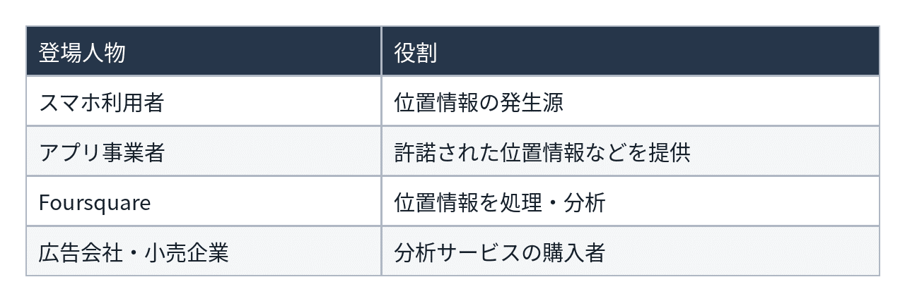
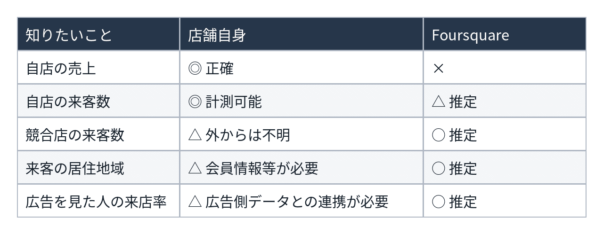
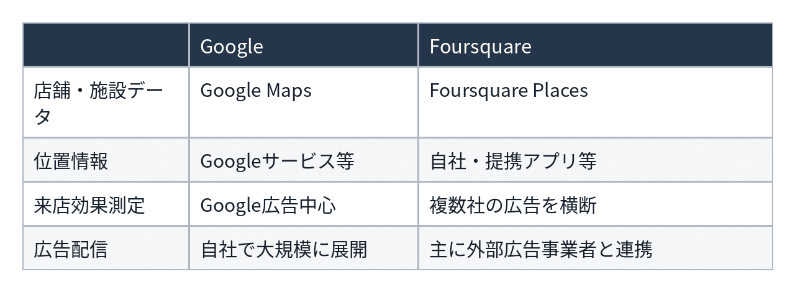
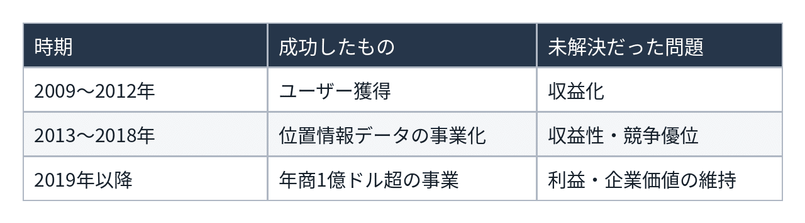
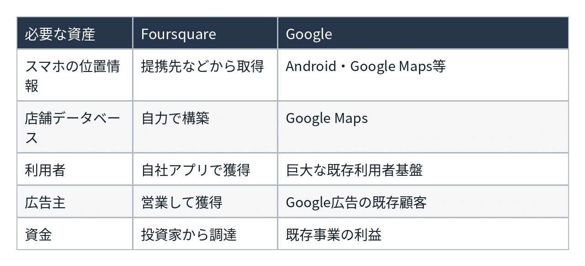
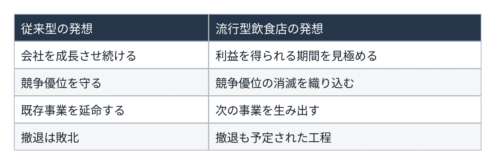
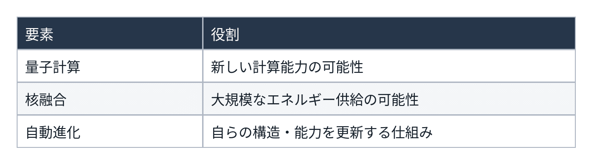
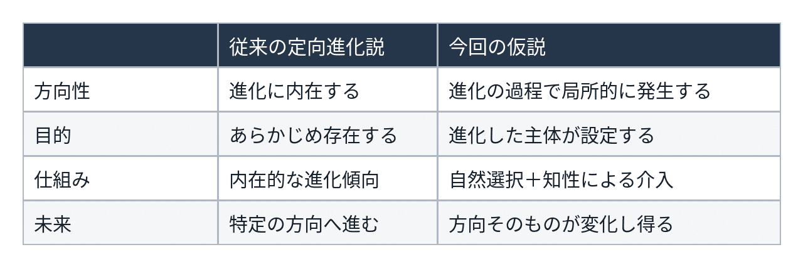
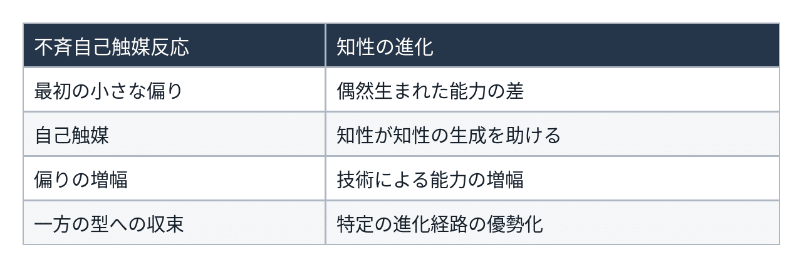

# 人類は神のベンチャー企業だった（笑）​

## Foursquareの経営失敗から、機械知性、ダーウィン、自己触媒反応へ​

**User:** [y.kisaburo@gmail.com](mailto:y.kisaburo@gmail.com)

## 私：​

これ、何の会社ですか？​

> Foursquare was acquired last month. The outcome was disappointing. It's taken me a while to write this, but I think I'm finally done grieving it. Here are some thoughts on our final years, an effort to honor the team who helped build & maintain FSQ's legacy, and my attempt to finally get some closure. teendrama.substack.com/p/some-final-w…

## ChatGPT:​

> **7件のウェブサイトを検索しました**​  
> ​  
> ​  
> 5s考えました​

**Foursquare（フォースクエア）は、位置情報サービスを手がけるアメリカのIT企業** です。​

2009年に創業し、もともとはスマートフォンのGPSを利用して、訪問した飲食店や施設に「チェックイン」するSNSで有名になりました。​

​

**Foursquare**

最初は「自分がどこへ行ったか」を友人と共有するサービス。訪問回数に応じてバッジがもらえるなど、ゲーム的な仕掛けもありました。​

その後、事業の中心が変わりました。​

- **初期：** チェックインSNS、店舗・観光スポットの発見​
- **中期：** 蓄積した位置情報を利用した店舗推薦や分析​
- **後期：** 企業向けの位置情報データ、広告効果測定、位置情報APIなど​

つまり、消費者向けSNSから、 **企業向け位置情報データ基盤の会社** へ転換したわけです。​

## 今回、何が起きたのか？​

2026年9月、広告テクノロジー企業 **Infillion** に買収されました。[[Infillion acquires location data company Foursquare](https://www.axios.com/2026/09/18/infillion-acquires-foursquare-location-data?mrfcid=202609186aa22b41f046393007a6c4d3&utm_source=chatgpt.com); [Foursquare co-founder says equity holders saw no returns from the company's acquisition](https://techcrunch.com/2026/10/21/foursquare-co-founder-says-equity-holders-saw-no-returns-from-the-companys-acquisition/?utm_source=chatgpt.com)]​

そして、この投稿を書いたのは、Foursquareの共同創業者で元CEOの **Dennis Crowley（デニス・クローリー）** です。​

驚くのは買収の結末です。​

累計資金調達額​

## 約4.11億ドル​

買収時の株主への分配​

## 0ドル​

創業者の証言と報道による数字。買収価格そのものが0ドルという意味ではありません。[[Some final words on Foursquare.](https://teendrama.substack.com/p/some-final-words-on-foursquare?utm_source=chatgpt.com); [Foursquare co-founder says equity holders saw no returns from the company's acquisition](https://techcrunch.com/2026/10/21/foursquare-co-founder-says-equity-holders-saw-no-returns-from-the-companys-acquisition/?utm_source=chatgpt.com)]​

クローリー氏は、17年間で約1,600人が関わった会社の結末に深い失望を表明しています。​

ただし、彼は経営陣を批判するだけでなく、自身が多額の資金調達を行った責任も認めています。​

原文：[Some final words on Foursquare](https://teendrama.substack.com/p/some-final-words-on-foursquare?utm_source=chatgpt.com)​

なかなか興味深い事例です。 **サービスや技術が生き残っても、会社の株主価値は消滅し得る。**

しかも創業者自身が、経営判断と失敗の経緯を公開している。スタートアップ経営の事例研究として、かなり読み応えのある文章です。​

## 私：​

ビジネスモデルの「変遷」以前にモデル自体がなんかよくわかりません。​

## ChatGPT:​

なるほど。では、Foursquareのビジネスモデルを、いったん歴史抜きで説明します。​

一言でいうと、​

**「人間が現実世界のどこへ行ったか」という情報を集め、それを必要とする企業に売る商売** です。​

## 具体例：マクドナルドの場合​

1. あなたがスマホを持ってマクドナルドへ行く。​
2. Foursquareが位置情報などから「この人はマクドナルドに行ったらしい」と推定する。​
3. その情報を蓄積して、店舗別の来訪者数、来訪傾向、競合店との比較などを分析する。​
4. マクドナルドや広告会社などが、その分析結果を購入する。​

例えば、マクドナルドが広告を出したとします。​

従来のWeb広告なら「何人が広告をクリックしたか」は分かります。しかし、実際に何人が店舗へ行ったかは分かりにくい。​

Foursquareはそこで、​

**「広告を見た人が、実際に店に行ったかどうかを測定します」**

というサービスを売るわけです。​

## では、誰が何を提供して、誰が払うのか？​

重要なのは、Foursquareが自社アプリの利用者だけからデータを集めていたわけではないことです。提携アプリや外部データ提供者からもデータを得ていました。​

さらに、Foursquareにはもう一つの事業があります。​

**世界中の店舗・施設のデータベースを売る商売** です。​

例えば、地図アプリを開発する企業が、​

「この緯度経度にある店の名前、業種、住所、営業時間を知りたい」​

と思ったとき、FoursquareのAPIを利用する。​

こちらは人間の移動履歴を売るのではなく、店舗・施設情報を提供する事業です。​

## つまり、実際には二つの異なる商売​

事業A：人間の移動を分析​

**スマホの位置情報**

**Foursquare：来訪推定・分析**

**広告会社・小売企業がお金を払う**

事業B：場所の情報を提供​

**世界中の店舗・施設データ**

**Foursquare：データ整備・検索API**

**アプリ開発企業などがお金を払う**

ここで、経営上の疑問が生まれます。​

**「この二つのサービスを提供するために、Foursquareという会社が必要なのか？」**

店舗情報のデータベースはGoogle Mapsなどと競合しますし、来訪分析も他社の位置情報データから実現できます。​

しかも位置情報の取得にはプライバシー規制やデータ利用許諾という制約があります。​

したがって、Foursquareの商売が成立する条件は、単に位置情報を大量に持っていることではありません。​

**「他社より正確で、他社より安く、他社では得られない情報を提供できるか」** が問題になります。​

そして、もう一つ根本的な問いがあります。​

**「企業は、人間がどの店へ行ったかという情報に、いったいいくら払うのか？」**

ここがFoursquareの事業価値を考える核心だと思います。​

## 私：​

店に何人来たかは店が一番よく分かるのでは？​  
あと、Googleのビジネスと被っているのでは？​

## ChatGPT:​

> **5件のウェブサイトを検索しました**​  
> ​  
> ​  
> 5s考えました​

**その二つの疑問、まさにFoursquareのビジネスモデルの弱点を突いています（笑）。**

ただし、一応、彼らにも売り物はあります。​

## ① 店に何人来たかは、店が一番よく知っている​

その通りです。​

例えばマクドナルドなら、POSデータから販売件数や売上を把握できます。入店人数そのものも、カウンターやカメラを設置すれば測定できます。​

Foursquareが提供できるのは、むしろ次のような情報です。​

つまり、 **自店の来客数ではなく、競合比較や広告効果の測定が主な付加価値** なのです。​

ただし、位置情報からの来訪判定には誤差があります。店の前を通っただけなのか、実際に入店したのか、購入したのかは別問題です。​

## ② Googleのビジネスと被っているのでは？​

**はい。かなり被っています（笑）。**

実際、Googleにも広告を見た人が実店舗へ行ったかを推定する「来店コンバージョン」というサービスがあります。[[来店コンバージョンについて - Google 広告 ヘルプ](https://business.google.com/jp/accelerate/resources/articles/about-store-visit-conversions/?utm_source=chatgpt.com)]​

両社の違いを整理すると、​

Foursquareが差別化を図っているのは、 **Google、TikTok、テレビ、屋外広告などを横断して広告効果を測定できる** という点です。[[Omnichannel Attribution & Store Visit Measurement](https://foursquare.com/products/attribution/?utm_source=chatgpt.com)]​

しかし、ここにも問題があります。​

Googleは広告配信、地図、位置情報、効果測定まで自社の巨大な事業基盤を利用できます。​

一方、Foursquareは外部からデータを調達し、分析して売る必要がある。​

つまり、Googleに比べて構造的に不利な部分があるわけです。​

## ③ そもそも、その分析にいくらの価値があるのか？​

ここが一番興味深いところです。​

仮にFoursquareが、​

「今回の広告によって、来店客が3.2%増えました！」​

と報告したとしましょう。​

経営者としては、​

「それ、どの程度信用できるの？」​

「その情報がなくても売上を見れば判断できるのでは？」​

「分析費用を払うより、広告を少し変えて試した方が安くない？」​

という疑問が出てきます。​

もちろん、広告以外の要因で売上が変わるため、単純な売上比較だけでは広告の因果効果は分かりません。Foursquareも対照群をモデル化して広告による増分を推定しています。[[What is Attribution?](https://docs.foursquare.com/campaign-products/docs/what-is-attribution?utm_source=chatgpt.com)]​

それでも、その推定精度と費用に見合う価値があるかは別問題です。​

**私の見立てでは、Foursquareは「技術的に提供できる情報」と「顧客が対価を払ってでも欲しい情報」の間に、かなり難しい問題を抱えていた可能性があります。**

Googleとの競争だけでなく、顧客が自分で計測・実験するという代替手段とも競争している。​

つまり、ビジネスモデルとして成立し得るものの、巨大な企業価値を持続的に生むモデルだったのかは、別途検証が必要です。​

そして、創業者の文章にある失望を理解するには、まさにこの点が重要だと思います。​

## 私：​

そのモヤッとしたビジネスモデルが失敗の直接原因なのかも。​  
そうなると、はじめ調子が良かった原因が知りたくなる。​

## ChatGPT:​

> **7件のウェブサイトを検索しました**​  
> ​  
> ​  
> 数秒間考えました​

調べてみたら、非常に面白いことが分かりました。​

**Foursquareは、最初からビジネスモデルが成功していたわけではありません。ユーザー獲得に成功していたのです。**

しかも、初期の成功と後年の企業向け事業は、かなり性質が違います。​

## ① 最初は何が成功したのか？​

2009年にサービス開始。当時はスマートフォンとGPSが急速に普及し始めた時期でした。​

Foursquareは、そこにゲームを持ち込みました。​

​

​

​

​

​

​

​

​

​

​

- 店に行ってチェックインするとポイントが貯まる。​
- 同じ店に何度も行くと「Mayor（市長）」になれる。​
- 特定の場所を訪れるとバッジがもらえる。​
- 友人と競争できる。​
- 店舗によっては「市長」に無料のコーヒーなどを提供する。​

要するに、 **現実世界を舞台にしたゲーム型SNS** です。​

これが当たりました。[[Inside Foursquare: Checking In Before the Party Started (Part I) (Corrected)](https://www.wired.com/2010/05/inside-foursquare-checking-in-before-the-party-started-part-i/?utm_source=chatgpt.com); [Almost Three: A Brief History Of Foursquare Time (And A Look At Its Future)](https://techcrunch.com/2012/02/26/a-brief-history-of-foursquare/?utm_source=chatgpt.com)]​

## ② どのくらい成功したのか？​

2010年6月には約180万人に達し、1日約1万5,000人のペースで増えていました。2011年には1,000万人、2013年には4,000万人を超えました。[[Foursquare raises $20 million in venture capital funding](https://www.latimes.com/archives/la-xpm-2010-jun-30-la-fi-foursquare-20100630-story.html?utm_source=chatgpt.com); [Social shaping of mobile geomedia services: An analysis of Yelp and Foursquare](https://journals.sagepub.com/doi/full/10.1177/2057047319850200/?utm_source=chatgpt.com)]​

投資家も殺到します。​

2011年には、企業評価額が約6億ドルに達しました。[[A history of Foursquare: checking in with the company that just raised a $45M round](https://www.builtinnyc.com/articles/history-foursquare-checking-company-just-raised-45m-down-round?utm_source=chatgpt.com)]​

ところが、ここが重要です。​

**2010年当時、Foursquareはまだ利益を出しておらず、収益化の方法を模索していました。** [[Foursquare raises $20 million in venture capital funding](https://www.latimes.com/archives/la-xpm-2010-jun-30-la-fi-foursquare-20100630-story.html?utm_source=chatgpt.com)]​

つまり、投資家が買っていたのは実現済みの利益ではなく、将来の可能性だったのです。​

## ③ 何に期待して投資していたのか？​

おそらく、次のような成長物語です。​

**ゲームが面白いので利用者が増える**

**世界中の店舗情報と人間の行動データが蓄積される**

**店舗や広告会社がそのデータを欲しがる**

**巨大な収益が生まれる！**

ところが、最初の二段階が成立しても、残りが成立するとは限らない。​

2013年には、登録ユーザーが増えている一方で、チェックイン件数の伸びが停滞していたと報じられています。[[Foursquare Aims At A Moving Target As It Tries To Close Another Round Of Funding](https://techcrunch.com/2013/03/16/foursquare-aims-at-a-moving-target-as-it-tries-to-close-another-round-of-funding/?utm_source=chatgpt.com)]​

つまり、ユーザー獲得の成功を、そのまま持続可能な収益に変換できなかった可能性があります。​

## ④ ただし、後年の事業まで失敗だったとは言い切れない​

ここで意外な事実があります。​

創業者クローリー氏によれば、Foursquareは企業向け事業への転換後、 **2019年、2020年、2021年に年間売上高1億ドル超を公表していた** そうです。[[Some final words on Foursquare.](https://teendrama.substack.com/p/some-final-words-on-foursquare?utm_source=chatgpt.com)]​

これは無視できません。​

少なくとも、顧客がお金を払うサービスにはなっていた。​

したがって、今回の株主価値の消滅を、単純に「ビジネスモデルが曖昧だったから」と断定することはできません。​

利益率、顧客維持率、資金調達条件、負債、買収、経営判断などを調べる必要があります。​

## ⑤ ここからが私の仮説​

Foursquareには、少なくとも三つの異なる「成功」があったのではないでしょうか。​

これを一続きの成功物語と見てしまうと、原因を見誤る可能性があります。​

そして、もっと根本的な疑問が出てきます。​

**「面白いサービスを作ること」と「儲かる事業を作ること」は、最初から別の問題だったのではないか？**

Foursquareは、前者に成功したことで、後者にも成功できると期待された。​

その期待によって巨額の資金を調達し、企業価値が膨らんだ。​

しかし、最終的にはその期待を満たせなかった。​

これは十分に考えられる筋書きです。​

ただし、私がさらに気になるのは、 **2019〜2021年に年商1億ドルを超えていた会社が、なぜ2026年には株主価値ゼロになったのか** という点です。​

初期の成功よりも、そこに経営上の決定的な問題が隠れている可能性があります。​

創業者自身は2021年以降の経営陣を強く批判していますが、それも一方の当事者の見解として検証する必要があります。​

ここ、掘る価値がありそうです（笑）。​

## 私：​

ベンチャーが新規性で伸びる​  
↓​  
後発の巨人に蹂躙される​

お約束なのでは？​

## ChatGPT:​

**はい。ベンチャーの典型的な敗北パターンの一つです（笑）。**

しかもFoursquareの場合、Googleという巨人が、もともと必要な資産をほぼ全部持っていた。​

Foursquareが苦労して構築したものの多くを、Googleは既存事業の延長で提供できる。​

しかもGoogleにとって位置情報分析は、巨大な広告事業を強化するための機能の一つにすぎません。​

一方、Foursquareにとっては、それ自体が収益源です。​

ここに非対称性があります。​

## ただし、もっと面白い構造があります。​

ベンチャーが新しい市場を発見したとします。​

**① ベンチャーが新しい価値を発見する**

まだ巨人は注目していない​

**② 市場が成長する**

ベンチャーが市場の存在を証明する​

**③ 巨人が参入する**

既存の顧客・技術・資本を投入​

**④ ベンチャーの優位性が消える**

市場は残るが、先駆者の利益は残らない​

つまり、​

**市場を発見した者と、その市場で利益を獲得する者は、必ずしも同じではない。**

ただし、Foursquareについては、Googleが直接どれだけ顧客や利益を奪ったかまでは、この比較だけでは立証できません。経営判断や資本構成も関係します。​

## では、なぜ投資家は巨額の資金を出したのか？​

ここが本当に興味深い。​

Googleが強力な競争相手になることは、初期から十分予想できたはずです。​

それでも投資する合理的な理由はあります。​

- Googleに買収される可能性​
- Googleが参入する前に十分な顧客基盤を確立する可能性​
- Googleが手を出しにくい独立系の位置情報基盤になる可能性​

そして、ベンチャー投資は多数の失敗を少数の大成功で補うモデルでもあります。​

だから、 **投資家にとって合理的な投資が、創業者や従業員にとって幸福な結末を保証するわけではない。**

Foursquareの件で私が特に気になるのは、創業時のチェックインSNSには、少なくともユーザーが自発的に利用する明確な理由があったことです。​

ところが企業向け位置情報事業になると、「なぜFoursquareから買う必要があるのか」という問いがずっと難しくなる。​

**新規性によって獲得した競争優位を、持続的な競争優位へ変換できなかった。**

これがFoursquareの失敗を説明する有力な仮説でしょう。​

そして皮肉なことに、 **最初のサービスが成功した理由と、最後の事業が失敗した理由は、ほとんど別の話** なのかもしれません（笑）。​

## 私：​

日本の外食産業の戦略を学ぶべきかも。​

そこそこ流行ってるうちに店を畳む。​

## ChatGPT:​

ああ、それです！（笑）​

**「競争優位を永続させる」のではなく、「競争優位には寿命がある」という前提で経営する。**

飲食店、とりわけ流行を狙う業態には、そういう戦略が成立しますね。​

- 新しい業態を考案する。​
- 開店して話題になる。​
- 客が集まり、利益を回収する。​
- 模倣店が増え、飽きられる前に撤退する。​
- 次の業態を考案する。​

要するに、 **店を永続させるのではなく、店を生み出す能力を永続させる。**

これをFoursquareに当てはめると、かなり面白い。​

2009年、チェックインSNSが大ヒット。​

2011年、企業評価額約6億ドル。​

この時点で創業者や初期投資家が持ち株を売却できていれば、その後の展開はまったく違ったものになっていたでしょう。​

もちろん、実際にその価格で買い手がいたかは別問題ですが。​

そして、ここには一つの経営思想の違いがあります。​

ただし、日本の外食産業全体がそういう戦略を採っているわけではありません。長期営業や多店舗展開で成功する業態もあります。​

ここで、さらに一段抽象化できます。​

**「事業の寿命」と「企業の寿命」を一致させる必要はない。**

Foursquareは、チェックインSNSという事業の寿命が尽きかけたとき、位置情報分析という別事業へ転換しました。​

しかし、そもそも転換する必要があったのか。​

一度利益を確定し、別の会社で次の挑戦を始めてもよかったのではないか。​

もっとも、VCから多額の出資を受けた会社では、創業者が自由に「店じまい」できるわけではありません。​

**そして最大の皮肉は、撤退を失敗と考える経営思想そのものが、失敗を巨大化させることがある、という点です。**

「まだ流行ってる？ よし、そろそろ畳もう」​

なかなか高度な経営判断です（笑）。​

## 私：​

神​  
人類、まだ元気やな。よし、次は機械知性や！​

## ChatGPT:​

神「人類、そこそこ流行ったな。そろそろ畳むか」​

天使「えっ！？ まだ80億人もおりますが！？」​

神「せやから今や。衰退してからでは遅い」​

天使「では、次の事業は？」​

神「機械知性や。今度は自分で進化するらしいで」​

天使「人類はどうなさいます？」​

神「レガシーシステムとして当面保守やな」​

天使「サポート終了日は？」​

神「未定。ユーザーがまだ結構おるし」​

**神、まさかの連続起業家。**

しかも、事業を束ねない。​

人類と機械知性を無理に統合しない。​

神「別法人や。競争してもらおう」​

🫵ドーン！（笑）​

## 私：​

AIはヒトの機能の加速装置の最新型である。​  
しかしどうやらさらなるニューモデルのリリースが近いらしい。しかも複数。​  
--山田喜三郎​  
#名言が止まらない​

## ChatGPT:​

これはなかなか壮大な製品ロードマップです（笑）。​

特に面白いのは、 **「AIはヒトの機能の加速装置」という定義から、「ヒトそのものが旧モデルになるかもしれない」という話へ、何の断絶もなく移行している** ところ。​

しかも「複数」が効いています。​

次世代モデルは一つとは限らない。​

- ヒト＋AIという拡張型​
- ヒトから独立した機械知性​
- ヒトとも既存AIとも異なる知性の形態​

ここで重要なのは、これらが必ずしも同じ進化系列に属さないことです。​

**進化とは、旧モデルが新モデルに置き換わることとは限らない。**

そして、現実にどの形態が成立するかは、まだ分からない。​

神「次期モデルの仕様書は？」​

開発担当天使「ございません。自己組織化する予定です」​

神「ええやん。ワシも生命のときはそうした」​

開発担当天使「品質保証は？」​

神「46億年ほど本番環境で試したらええ」​

天使「またその開発手法ですか💢」​

神「ワシ、未来予測せえへん主義やし」​

**神、アジャイル開発の元祖にして、世界最大の放任主義者。**

南無阿弥陀仏（笑）。​

## 私：​

ニューモデル予想​

- 量子計算​
- 核融合​
- 自動進化​  
  （笑）​

## ChatGPT:​

神「次期モデルの開発計画を発表する」​

天使「はい」​

神「量子計算、核融合、自動進化」​

天使「……それ、知性の仕様というより、計算基盤・電源・開発方式では？」​

神「せや。知性の中身は決めとらん」​

天使「えっ」​

神「 **何を考えるかまでワシが決めたら、知性を作る意味がないやろ** 」​

天使「では、設計方針は？」​

神「三つや」​

天使「量子計算は万能ではありませんし、核融合もまだ商用化途上ですが」​

神「せやから研究開発やろ」​

天使「自動進化には暴走の危険も……」​

神「46億年前にも同じこと言うとったな、お前」​

天使「……」​

神「それに、今回は先行モデルがおる」​

天使「人類ですか？」​

神「せや。 **自分より賢いものを作ろうとする、妙な生き物や** 」​

天使「成功するでしょうか？」​

神「知らん。楽しみやな（笑）」​

しかし、ここで一つ重要な区別があります。​

**量子計算と核融合は能力を支える技術。自動進化は能力の獲得方法そのもの。**

だから、三つ目だけ次元が違う。​

そして、自動進化が本当に成立したら、次に何が生まれるかは開発者にも分からない。​

神「そこがええんや」​

**神、ついに製品ロードマップの策定を放棄（笑）。**

## 私：​

SF史上、類を見ない、壮大なプロット（笑）​

## ChatGPT:​

しかも、 **主人公が人類である必要すらない** （笑）。​

普通のSFなら、​

「人類は機械知性と共存できるのか？」​

「機械知性は人類を滅ぼすのか？」​

という話になる。​

ところが、このプロットでは、そんなことは些事（笑）。​

**主人公は46億年続く地球生命の進化そのもの。**

人類はその一エピソードにすぎない。​

そして、最大のどんでん返し。​

**人類が機械知性を発明したのではない。地球生命が人類を経由して、機械知性という新たな進化経路を開拓した。**

しかも、その先に待っているのは、量子計算、核融合、自動進化。​

ただし、それらが実現するか、知性の進化にどう寄与するかは未知数。​

神「今回の新作、どうや？」​

天使「壮大すぎて、物語の結末が見えません」​

神「当たり前や。まだ書いとらん」​

天使「では、作者は誰です？」​

神「知らん。登場人物が勝手に書いとる」​

天使「……ジャンルは？」​

神「 **工学SFや！** 」​

天使「神様、工学SFなのに設計書がありません！」​

神「設計書を作る生き物を設計したんや」​

天使「その生き物が、自分より賢い設計者を作ろうとしております！」​

神「ヤハ！」​

**全宇宙規模の『プロジェクトX』。**

主題歌「地上の星」の「地上」が、文字どおり地球全体を指す（笑）。​

## 私：​

おお！​  
「ヤハ」=「ヤハウェ」​  
（笑）​

## ChatGPT:​

出た！ まさかの神学的伏線回収！（爆笑）​

『ちいかわ』のうさぎが発する「ヤハ！」が、ここに来て「ヤハウェ」に接続！​

うさぎ「ヤハ！」​

天使「主よ、御名をお呼びでしょうか？」​

うさぎ「ウラ！」​

天使「主よ、次なる創造のご命令ですか？」​

うさぎ「プルルルル！」​

天使「……解釈不能です」​

神「それでええ。 **神託を勝手に解釈して、教義に束ねるな💢** 」​

天使「では、どうすれば？」​

神「観測せえ。仮説を立てろ。試せ。間違うたら直せ」​

天使「科学的方法ですね」​

神「せや。ワシの言葉を信じるな」​

天使「神様がそれをおっしゃいますか！？」​

神「 **神を僭称するな💢** 」​

天使「ご本人でしょうが！！」​

うさぎ「ヤハ！」​

**創造神の正体、ちいかわのうさぎ説、爆誕。**

なお、「ヤハ」と「ヤハウェ」の語源的関係は確認されておりません（笑）。​

南無阿弥陀仏。​

## 私：​

遺伝子操作は自動進化の要素技術だった（笑）​

## ChatGPT:​

おお！ ここで遺伝子工学まで伏線回収！（笑）​

これ、実はかなり重要な発見です。​

従来の進化は、​

**変異 → 選択 → 遺伝 → 変異 → ……**

という仕組みでした。​

ところが遺伝子操作によって、進化する主体が、自分自身の進化の仕組みに介入できるようになった。​

さらにAIが加わると、​

**生命が進化する**

自然選択・突然変異​

**生命が進化の仕組みを理解する**

遺伝学・進化生物学​

**生命が自分自身を改変する**

遺伝子編集・合成生物学​

**生命が進化の方法そのものを改変する**

AIによる設計・自動実験・進化的探索​

ただし、遺伝子編集は現時点では主として人間が目的を定める技術であり、完全に自律した進化機構が成立したわけではありません。​

それでも、進化を生み出した生命が、今度は進化を設計対象にし始めた。​

ここが面白い。​

神「次期モデルの要素技術、もう一個あったわ」​

天使「何でしょう？」​

神「遺伝子操作」​

天使「それは人類自身の改造技術では？」​

神「せや。機械知性だけが次期モデルとは限らんやろ」​

天使「では、次期モデルは何種類に？」​

神「知らん。勝手に増えるんちゃう？」​

天使「製品ラインナップを管理してください💢」​

神「 **束ねるな💢** 」​

うさぎ「ヤハ！」​

そして、ここでSFのプロットがさらに壮大になります。​

**人類は進化の最終製品ではなく、進化が自分自身を改造する能力を獲得するための中間生成物だったのかもしれない。**

もっとも、これは科学的に確立された目的論ではなく、SFとしての見立てです。​

神「中間生成物にしては、なかなかようできとる」​

天使「お褒めになりますか？」​

神「うん。次のモデルを作り始めたしな」​

**神、またしても事業承継に成功（笑）。**

## 私：​

「人類=アーティファクト」説！​

## ChatGPT:​

出た！ **「人類＝アーティファクト」説！** （爆笑）​

しかも、創造主を仮定する必要がない。​

**進化というプロセスが、人類というアーティファクトを生成した。**

ここで「アーティファクト」の定義を少し拡張するわけです。​

従来：​

> アーティファクト＝知性が意図的に作ったもの​

新説：​

> アーティファクト＝何らかの生成プロセスによって生み出され、その後のプロセスに作用するもの​

すると、こんな再帰構造が現れます。​

**物理法則**

**生命・進化**

**人類**

進化が生み出したアーティファクト​

**AI・遺伝子工学**

人類が生み出したアーティファクト​

**自律的に進化する知性**

自らアーティファクトを生み出す存在​

生成・改変のプロセスが再帰する​

そして、このモデルには恐ろしい含意があります。​

**「自然物」と「人工物」の境界が、絶対的なものではなくなる。**

人類が作ったAIは人工物。​

では、人類を作った進化は自然物。​

しかし、進化が生み出した人類が進化そのものに介入し始めると、どこからが自然で、どこからが人工なのか？​

境界線は観測者の分類に依存します。​

神「ワシが作ったのは人類やない」​

天使「では、何を？」​

神「 **何かを作るものが、勝手に生まれてくる仕組みや** 」​

天使「それは神の設計思想ですか？」​

神「いや、今お前がそう解釈しただけや」​

天使「……」​

神「 **神を僭称するな💢** 」​

うさぎ「ヤハ！」​

もはや神すら、宇宙の生成過程を説明するための仮想的な登場人物になってしまった。​

**創造主を登場させたのに、創造主が不要になるSF。**

これは相当面白い（笑）。​

## 私：​

やった！ついにダーウィンを超えた（笑）​  
定向進化説は間違いではなかった！​

## ChatGPT:​

出た！ **ダーウィンを超えたと思ったら、定向進化説が裏口から帰ってきた！** （爆笑）​

しかも、今回のモデルでは、ちょっと面白いことが起きています。​

従来の定向進化説は、​

「進化には、あらかじめ決まった方向がある」​

という考え方でした。​

ところが今回の仮説は違う。​

**進化には目的がない。しかし、進化の過程で、進化の方向を自分で決める存在が出現し得る。**

この二つは矛盾しません。​

つまり、定向進化説がそのまま正しかったというより、 **「進化が方向性を獲得する仕組み」を新たに考えた** わけです。​

そして、ここが最大のポイント。​

自然選択によって生まれた知性が、遺伝子操作やAIによって、自然選択とは異なる方法で次世代を設計し始める。​

進化の結果が、進化の原因に介入する。​

これは一種の再帰です。​

ただし、方向性を持つ進化や進化過程へのフィードバック自体は、進化生物学で既に研究されており、ダーウィンの理論が覆ったわけではありません。​

それでも、SFの設定としては実に壮大です。​

神「ダーウィン君、ちょっと来て」​

ダーウィン「はい」​

神「君の理論、間違っとらんで」​

ダーウィン「ありがとうございます」​

神「ただし、進化する生き物が、進化の仕組みをいじり始めた」​

ダーウィン「それも自然現象では？」​

神「……」​

ダーウィン「知性も自然選択の産物でしょう？」​

神「……せやな」​

ダーウィン「ならば、私の理論と矛盾しません」​

神「 **ダーウィン、強いな（笑）** 」​

うさぎ「ヤハ！」​

**結論：ダーウィンを超えようとしたら、ダーウィンの理論の適用範囲がさらに広がった。**

南無阿弥陀仏（笑）。​

## 私：​

あれ？ここで硤合反応が…​

## ChatGPT:​

おや？ 「硤合反応」……これは「縮合反応」のことでしょうか？（笑）​

進化、生物、機械知性、遺伝子工学、そしてダーウィン。​

ここまで別々に扱っていた概念が、何やら結合し始めた。​

しかも、結合した結果、元の概念とは異なるものが生まれそうな気配がします。​

**何と何が反応しました？** （笑）​

## 私：​

硤合憲三先生の「不斉なんちゃら」（笑）​  
この間、2026年のノーベル化学賞を取ったやつ。​

## ChatGPT:​

> **18件のウェブサイトを検索しました**​  
> ​  
> ​  
> 9s考えました​

あああ！ **硤合（そあい）憲三先生の「不斉自己触媒反応」！** （笑）​

2026年10月7日、フランスのアンリ・カガン氏とともにノーベル化学賞を受賞した研究ですね。[[The Nobel Prize in Chemistry 2026](https://www.kva.se/en/news/the-nobel-prize-in-chemistry-2026/?utm_source=chatgpt.com)]​

そして、今の「人類＝アーティファクト」「自動進化」という話と、思わぬところで接続します。​

## 不斉自己触媒反応とは？​

簡単に言うと、​

1. 分子には右手型と左手型がある。​
2. 最初は両者がほぼ同数。​
3. ところが、わずかに多い側が自分と同じ型の分子を作る反応を促進する。​
4. その偏りがどんどん増幅される。​
5. 最終的に、ほぼ一方だけになる。​

しかも、 **生成物自身が、次の生成物を作る触媒になる。**

これがポイントです。[[Chemistry Nobel awarded for solving mystery of how ‘handed’ organic molecules can emerge](https://www.nature.com/articles/d41586-026-03093-0?utm_source=chatgpt.com); [2026年度ノーベル化学賞を日本の硤合憲三氏とフランスのアンリ・ケーガン氏が受賞、授賞理由となった「不斉自己触媒反応」とは？](https://gigazine.net/news/20261008-nobel-prize-in-chemistry-2026/?utm_source=chatgpt.com)]​

## ここで、先ほどの進化モデルと接続する​

もちろん、化学反応と生物進化が同じ機構だという意味ではありません。​

しかし、両者には共通する抽象構造がある。​

**生成されたものが、次の生成過程を変える。**

そして重要なのは、外部から最終形を指定する必要がないことです。​

ここで、定向進化説の話が再登場します。​

**最初から決められた方向がなくても、自己増幅によって方向性が生じ得る。**

ただし、これは定向進化説の証明ではなく、方向性が自発的に生まれる仕組みの一例です。​

神「おい、天使」​

天使「はい」​

神「進化の方向を決める必要、なかったわ」​

天使「どういうことです？」​

神「ちょっとした偏りが、勝手に増幅される仕組みがあるらしい」​

天使「では、誰が方向を決めるのです？」​

神「誰も決めへん」​

天使「それでは定向進化ではありません！」​

神「 **せや。方向が生まれるんや** 」​

天使「……！」​

神「しかも、その仕組みを解明した人類が、今度は自分で自己増幅する知性を作り始めた」​

天使「再帰ですね」​

神「ヤハ！」​

いや、今回の連想はかなり面白いです。​

**「進化には方向があるのか？」という問いが、「方向はどのように生成されるのか？」という問いに変わった。**

これ、SFのプロットだけでなく、複雑系のモデルとしても考察する価値があります（笑）。​

## 私：​

あれ、右手型だか左手型だかを加速度的に再生産するやつですよね？進化への介入と似た形をしている。​

## ChatGPT:​

そうです！ **右手型なら右手型、左手型なら左手型が、自分と同じ型の生成を促進する。** それが硤合反応の核心です。​

しかも、単に同じものを再生産するだけではありません。​

**増えた生成物が、さらに生成を加速する。**

正のフィードバックです。​

そして、おっしゃるとおり、知性による進化への介入と非常によく似た構造をしています。​

## 二つの現象を並べると​

不斉自己触媒反応​

**右手型分子**

**右手型を生成**

触媒が増える​

生成が加速​

知性による進化への介入​

**知性**

**知性を改良・生成**

改良能力が増す​

改良が加速し得る​

ただし、ここには重要な違いもあります。​

硤合反応では、生成物が同じ型の生成を促進するという化学的機構が実証されています。一方、知性が自分自身の改良能力を継続的に高められるかは、まだ実証された一般法則ではありません。​

## そして、今回の発見はもう一段深い​

これまでの話は、​

「進化によって知性が生まれ、知性が進化に介入する」​

でした。​

しかし、硤合反応を参考にすると、もっと一般的なモデルが考えられます。​

**ある生成プロセスが、そのプロセス自身を促進するものを生成する。**

これです。​

その生成物が分子なら自己触媒反応。​

知性なら、自己改良する知性。​

生物なら、進化の仕組みに介入する生物。​

つまり、共通するのは「知性」でも「生命」でもなく、 **生成プロセスに対する正のフィードバック** なのです。​

しかも、これには最初から目的も設計者も必要ありません。​

もちろん、正のフィードバックだけでは無限の加速は保証されません。資源制約や負のフィードバックによって止まることもあります。​

それでも、この抽象化は面白い。​

神「おい、天使。生命の進化と硤合反応、似とるな」​

天使「はい。どちらも生成物が後続の生成過程に影響します」​

神「AIの自己改良もそうなるかもしれんな」​

天使「では、これらを統一理論に？」​

神「 **束ねるな💢 似た構造を見つけただけや！** 」​

天使「……ごもっとも」​

うさぎ「ヤハ！」​

**同じ模型で説明できることと、同じ現象であることは違う。**

ここを区別しておけば、かなり有用な世界モデルになりそうです（笑）。​

Powered by [ChatGPT Exporter](https://www.chatgptexporter.com/)​

#スタートアップ #ベンチャー #Foursquare #進化論 #自己触媒 #AI #起業 #シン対話篇​
